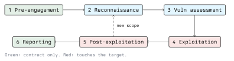

# Introduction to Penetration Testing

A penetration test is an authorized, time-boxed attempt to compromise a defined set of systems in
order to show what an attacker could actually achieve. The deliverable is not the compromise. The
deliverable is a report that a defender can act on.

The word "authorized" carries all the weight. The same commands that make a penetration test a
professional service make an unauthorized intrusion a criminal offence. In Austria that is
primarily StGB §118a (unlawful access to a computer system), §126a (damage to data) and §126b
(disruption of a computer system). Module 01 covers the legal framework and the GDPR obligations in
detail; this module assumes you have a signed authorization in hand before any packet leaves your
machine.

## What a Penetration Test Is Not

Students routinely confuse four different services. Clients do too, which is why scoping
conversations go wrong.

| Service                  | Question it answers                                      | Typical duration |
| ------------------------ | -------------------------------------------------------- | ---------------- |
| Vulnerability scan       | Which known weaknesses does automation report?            | Hours            |
| Vulnerability assessment | Which of those are real, and how bad are they?            | Days             |
| Penetration test         | What can an attacker actually reach from here?            | 1-3 weeks        |
| Red team engagement      | Would the defenders notice, and could they respond?       | Weeks to months  |

A vulnerability scan is breadth with no depth: it enumerates and matches signatures. A penetration
test adds the step automation cannot do, which is chaining several mediocre weaknesses into one
serious outcome. A red team engagement changes the goal entirely: it tests the detection and
response capability of the blue team, so stealth matters and coverage does not.

Bug bounty programmes are a fifth thing again. They are open-ended, paid per finding, and the
scope is published by the operator rather than negotiated. They produce good individual findings
and very poor coverage, because nobody is paid to test the boring parts.

## The Engagement Lifecycle



The two green phases involve no traffic to the target at all, and they are the phases students
skip and professionals never do. The four remaining phases are the technical work, and each one
feeds the next:

1. **Pre-engagement.** Scope, rules of engagement, authorization, contacts, test window.
2. **Reconnaissance.** Enumerate what exists: hosts, services, domains, people, technologies.
3. **Vulnerability assessment.** Find candidate weaknesses and verify which are real.
4. **Exploitation.** Prove the finding by using it, within the agreed limits.
5. **Post-exploitation.** Establish what the foothold is worth: data reachable, hosts reachable,
   privileges obtainable.
6. **Reporting.** Write it up so it can be fixed, then retest after the fix.

The dashed loop in the diagram matters more than it looks. A foothold on one host almost always
reveals a network the external view never showed, and that new network has to be mapped from the
start. In practice phases 2 to 5 run as a cycle rather than a pipeline.

## Flavours of Test

### By knowledge given to the tester

- **Black box.** The tester gets a target name or an IP range and nothing else. Simulates an
  external attacker with no inside help. Realistic, and the most expensive per finding, because a
  large part of the budget is spent rediscovering facts the client already knows.
- **Grey box.** The tester gets partial information: an architecture diagram, a low-privileged user
  account, a list of in-scope hosts. This is the usual choice, because it spends the budget on
  finding problems rather than on enumeration.
- **White box.** Full information, including source code and configuration. Finds the most per day
  of effort, and is the only variant that reliably finds logic flaws in code paths that are hard to
  reach from outside.

The amount of knowledge given is a budget decision, not a security property. A black box test that
finds nothing does not mean a black box attacker would find nothing; it means two weeks were not
enough.

### By position

- **External.** The tester starts on the internet. Tests the perimeter: published services, web
  applications, VPN endpoints, mail.
- **Internal.** The tester starts on the corporate LAN or on a client VLAN, modelling a malicious
  employee, a visitor who found a network socket, or an attacker who already phished someone.
- **Assumed breach.** The tester is handed a workstation or a user account on purpose, and the
  question is only how far that goes. Removes the phishing lottery from the schedule.

### By target type

Web application, API, mobile application, network infrastructure, wireless, Active Directory,
cloud configuration, ICS/OT, physical, and social engineering. Later modules in this curriculum
cover several of these in their own right. The methodology in this module applies to all of them;
only the tooling changes.

## Methodologies

Working from a published methodology is what separates a test from poking around. It gives you
coverage you can defend in a meeting, and it makes two tests of the same system comparable.

- **PTES** (Penetration Testing Execution Standard) organizes an engagement into pre-engagement
  interactions, intelligence gathering, threat modeling, vulnerability analysis, exploitation,
  post-exploitation and reporting. It is the closest thing to a general-purpose structure.
- **OSSTMM** (Open Source Security Testing Methodology Manual, published by ISECOM) is more formal
  and measurement-oriented, and covers physical and human channels as well as the digital one.
- **OWASP Web Security Testing Guide** is the reference checklist for web applications, organized
  by test category, and the matching **OWASP Top 10** is the awareness document people quote at you.
- **NIST SP 800-115**, "Technical Guide to Information Security Testing and Assessment", is the
  document to cite when a client asks what standard you follow.
- **MITRE ATT&CK** is not a testing methodology but a catalogue of attacker techniques observed in
  the wild. It is useful for mapping your findings to things a defender can hunt for, which makes
  a report far more actionable.

Use one as a spine and keep notes against it. The gaps in your notes at the end of the week are
the gaps in your coverage, and they belong in the report.

## What Makes a Test Useful to a Defender

The whole point of learning offence in this curriculum is to be able to defend. Keep the defensive
counterpart in view for every technique:

- **Every finding needs a fix, not a scolding.** "Weak password policy" is a complaint.
  "Enforce a minimum length of 12 characters, block the top 10,000 breached passwords, and remove
  the 90-day rotation requirement" is a change someone can ship.
- **Every exploited path should name the control that would have broken it.** Network segmentation,
  egress filtering, least privilege, MFA, patching, logging. If a finding does not name one, it is
  not finished.
- **Detection is a finding too.** If you ran a loud port scan across a /24 and nobody called, that
  is worth writing down even in a test where stealth was not required.

## Lab Setup

Everything in this module runs against machines you own or are explicitly allowed to attack. A
reasonable setup:

```bash
# A host-only or internal virtual network, so nothing escapes to the real LAN.
# Attacker VM: Kali Linux or a Debian box with the tools installed.
# Targets: deliberately vulnerable images, e.g. Metasploitable, OWASP Juice Shop, DVWA.

ip addr show                      # confirm which interface is on the lab network
ip route                          # confirm the default route is NOT the lab interface
```

For a managed environment, HackTheBox and similar platforms provide targets that are legal to
attack by design, and that removes the "am I allowed to do this" question entirely. They do not
remove the habit of asking it.

### A rule to internalize now

Before any scan, answer three questions in writing:

1. Who authorized this, and do I have it on paper?
2. What exactly is in scope, by IP, hostname and URL?
3. What do I do if I break something, and who do I call?

If any answer is missing, you are not ready to start. That is the subject of the next lecture.

## Key Takeaways

- A penetration test is authorized, scoped and time-boxed. The authorization is a document, not a
  conversation.
- A scan reports possibilities, a test demonstrates consequences, a red team engagement tests the
  defenders. They are priced, scoped and reported differently.
- The lifecycle is a loop, not a pipeline: a foothold restarts reconnaissance from the inside.
- Black box, grey box and white box are budget decisions. More information given means more
  findings per day.
- Follow a published methodology so that your coverage is defensible and your gaps are visible.
- A finding without a named control and a concrete remediation is an unfinished finding.

## Resources

- [Penetration Testing Execution Standard](http://www.pentest-standard.org/)
- [OWASP Web Security Testing Guide](https://owasp.org/www-project-web-security-testing-guide/)
- [OSSTMM, ISECOM](https://www.isecom.org/research.html)
- [NIST SP 800-115: Technical Guide to Information Security Testing and Assessment](https://csrc.nist.gov/pubs/sp/800/115/final)
- [MITRE ATT&CK](https://attack.mitre.org/)
- [Austrian Criminal Code (StGB), consolidated text in the RIS](https://www.ris.bka.gv.at/)
