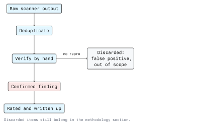

# Vulnerability Assessment

Vulnerability assessment is the phase between knowing what a target runs and proving what can be
done to it. The input is an inventory of hosts, services and versions. The output is a list of
candidate weaknesses, each one marked as verified, discarded, or not yet tested.

The temptation is to run a scanner, export the PDF and call it a report. That is the single most
common failure in junior work, and the reason clients sometimes think penetration testing is
worthless. The scanner produces the raw material; the assessment is what you do to it.

## From Scanner Output to Finding



Each stage removes noise:

1. **Raw output.** One row per plugin hit per host. A medium-sized network produces thousands.
2. **Deduplicate by root cause.** Forty "outdated OpenSSL" rows across forty hosts are one finding
   about patch management, not forty findings. Grouping by cause is what makes a report readable
   and what makes the remediation a single project rather than forty tickets.
3. **Verify by hand.** Reproduce the condition yourself. A version banner is a hypothesis, not a
   vulnerability.
4. **Confirmed finding.** The condition exists, you have evidence, and you can state the impact.
5. **Rate and write up.** Severity, affected assets, reproduction steps, remediation.

Anything discarded in step 3 still belongs in the methodology section of the report, so the client
can see that it was examined rather than missed.

## Classes of Weakness

Scanners are good at the first class and almost blind to the last two.

- **Missing patches.** A known vulnerability in a known version. Detectable by banner, by
  authenticated package inventory, or by a safe check.
- **Misconfiguration.** Default credentials, anonymous FTP, directory listing, permissive CORS,
  an unauthenticated management interface, an S3-style bucket open to the world.
- **Weak cryptography and transport.** Deprecated TLS versions, weak ciphers, certificates for the
  wrong name, cleartext protocols on the LAN.
- **Injection and input handling.** SQL injection, command injection, template injection, path
  traversal, deserialization. Module 04 covers the web variants.
- **Broken access control.** The user can reach another user's object by changing an identifier, or
  reach an admin function by requesting its URL. Scanners cannot find this without knowing who is
  supposed to be allowed to do what.
- **Business logic flaws.** The discount can be applied twice; the refund path does not check who
  owns the order. Found only by reading and thinking.

The rough rule: automation finds the first three classes well, the fourth partially, and the last
two not at all. A test whose findings are all in the first three classes is a scan with a nicer
cover page.

## Tooling

### Network and host scanners

Nmap's scripting engine covers a lot of ground before you reach for anything heavier.

```bash
# Default safe scripts plus version detection
sudo nmap -sV -sC -oA scans/sc 10.10.1.20

# The vulnerability-oriented script category
sudo nmap -sV --script vuln -oA scans/vuln 10.10.1.20

# A specific check, for example SMB dialects and signing
sudo nmap -p445 --script smb-protocols,smb-security-mode 10.10.1.20
```

Be aware that `--script vuln` includes scripts that are intrusive and some that are
unreliable. Read what a script does before running it inside a client network, and keep the
category out of a first pass against anything fragile.

Dedicated vulnerability scanners add a maintained plugin database and authenticated checks.
Greenbone/OpenVAS is the common open-source option; Nessus and Qualys are the common commercial
ones. The important configuration decision is credentials:

- **Unauthenticated scan.** Sees what the network sees. Prone to false positives, because it
  guesses from banners.
- **Authenticated scan.** Logs in and reads the installed package list and configuration.
  Dramatically more accurate, and the only sensible way to assess patch level at scale.

An unauthenticated scan reporting "no critical vulnerabilities" says very little. Say which mode
you used, in the report.

### Web application scanners

```bash
# Quick server-level checks
nikto -h http://10.10.1.20

# Template-based checks; keep templates updated
nuclei -u http://10.10.1.20
nuclei -l targets.txt

# Content discovery
gobuster dir -u http://10.10.1.20/ -w /usr/share/wordlists/dirb/common.txt
```

An intercepting proxy such as Burp Suite or OWASP ZAP is the actual working environment for web
testing. The scanner inside it is useful; the manual repeater and the request history are what
find broken access control.

### Matching versions to known vulnerabilities

```bash
# Local copy of the Exploit-DB index
searchsploit apache 2.4
searchsploit -m 12345          # copy an entry into the working directory to read it
```

Read the exploit code before running it. Public exploit code is frequently broken, occasionally
destructive, and sometimes deliberately malicious.

## Identifiers and Scores

You need four vocabularies, and they are often mixed up.

- **CVE.** An identifier for one specific vulnerability in one specific product, in the form
  `CVE-YYYY-NNNN...`. It is a name, not a score.
- **CWE.** A classification of the underlying weakness type, for example "improper neutralization
  of special elements used in an SQL command". Many CVEs share one CWE. Useful in a report because
  the CWE suggests the systemic fix.
- **CVSS.** The Common Vulnerability Scoring System, a formula producing a 0.0-10.0 score from
  metrics such as attack vector, required privileges and the impact on confidentiality, integrity
  and availability. Version 3.1 is widely deployed and version 4.0 is the current revision.
- **EPSS.** The Exploit Prediction Scoring System, an estimate of the likelihood that a
  vulnerability will be exploited in the wild in the near future. A useful complement to CVSS for
  prioritization, because CVSS does not model attacker interest.

The qualitative bands for a CVSS v3.1 base score:

| Score      | Rating   |
| ---------- | -------- |
| 0.0        | None     |
| 0.1 - 3.9  | Low      |
| 4.0 - 6.9  | Medium   |
| 7.0 - 8.9  | High     |
| 9.0 - 10.0 | Critical |

### CVSS is an input, not an answer

A base score describes the vulnerability in the abstract. It knows nothing about your client. A
critical remote code execution bug in a service that is reachable only from a management VLAN with
no data on it is a lower risk to that organization than a medium-rated authentication bypass on
the customer portal.

This is what the environmental and temporal metrics exist for, and what a tester is paid to do:
adjust the rating for context and say why. CISA's Known Exploited Vulnerabilities catalogue is a
good tiebreaker, because "actively exploited in the wild" outranks most theoretical scoring.

## False Positives and False Negatives

A false positive wastes the client's engineering time and damages your credibility. A false
negative leaves a real hole open. Both come from trusting a signature.

Common causes of false positives:

- **Backported fixes.** A Linux distribution patches a vulnerability without changing the upstream
  version string, so banner-based detection reports a fixed package as vulnerable.
- **Load balancers and WAFs.** The banner belongs to the proxy, not to the host behind it.
- **Honeypots and deliberately false banners.**
- **Compensating controls.** The vulnerable endpoint exists but is unreachable from any network a
  user is on.

Verification discipline:

1. Reproduce manually and record the exact request and response.
2. Prefer a non-destructive proof. For SQL injection, a provable difference in response to a
   boolean condition is enough; you do not need to drop a table.
3. State the privilege and the network position the proof required.
4. If the finding cannot be reproduced, record it as unverified rather than deleting it quietly.

## The Defensive View

Vulnerability assessment is one of the few offensive phases that defenders run themselves,
continuously, and the report should push them towards that.

- **Asset inventory is the prerequisite.** You cannot patch a host nobody knows about. A frequent
  and valuable finding is simply the list of live hosts the client did not expect.
- **Authenticated scanning on a schedule** beats a once-a-year external test for patch coverage.
- **Prioritize by exploitability and exposure, not by raw count.** A dashboard showing 4,000 open
  medium findings causes paralysis; a list of the twelve internet-facing criticals causes action.
- **Fix the class, not the instance.** If one host has an unauthenticated management interface,
  ask why the build process allows it. The systemic finding is worth more than the host-level one.

## Exercises

Against your own lab only.

1. Scan a deliberately vulnerable lab image with `nmap -sV -sC` and with a full vulnerability
   scanner. Compare the number of reported issues before and after deduplication by root cause.
2. Pick three reported issues and verify each by hand. Record which were real, which were false
   positives, and what caused the false positives.
3. Score one confirmed finding with the CVSS v3.1 calculator, then write two sentences explaining
   why the risk to a specific fictional organization is higher or lower than the base score.
4. Run the same scan unauthenticated and authenticated against a lab Linux host and compare the
   patch-level findings.

## Key Takeaways

- A scanner report is raw material. The assessment is deduplication, manual verification and
  contextual rating.
- Group findings by root cause so remediation is one project instead of forty tickets.
- Authenticated scanning is far more accurate than banner guessing; always state which mode you
  used.
- CVE names a bug, CWE classifies it, CVSS scores it in the abstract, EPSS estimates attacker
  interest. None of them knows your client's architecture.
- Automation finds patches and misconfiguration; it does not find broken access control or logic
  flaws. Those need a human reading requests.
- Verify non-destructively, record the exact request and response, and mark anything you could not
  reproduce as unverified rather than hiding it.

## Resources

- [Nmap Scripting Engine documentation](https://nmap.org/book/nse.html)
- [CVE Program](https://www.cve.org/)
- [CWE: Common Weakness Enumeration](https://cwe.mitre.org/)
- [CVSS specification and calculator, FIRST](https://www.first.org/cvss/)
- [EPSS, FIRST](https://www.first.org/epss/)
- [CISA Known Exploited Vulnerabilities Catalog](https://www.cisa.gov/known-exploited-vulnerabilities-catalog)
- [Greenbone Community Edition documentation](https://greenbone.github.io/docs/)
- [OWASP ZAP](https://www.zaproxy.org/)
