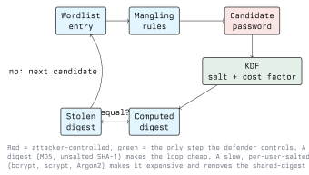

# Password Cracking with Python

## 2.1 Introduction

Password cracking is guessing. Nothing in it is clever: a candidate password is run through the same
function the defender used, and the result is compared with the stored value. Everything that makes
cracking fast or slow is a property of that function and of the candidate list.

This lecture builds the cracking loop in Python so the cost of each step is visible, then uses that
understanding to explain why bcrypt, scrypt and Argon2 exist and what makes a password store
survivable after a breach. Python is the teaching tool here, not the production tool: a GPU cracker
is orders of magnitude faster, and section 2.8 says why.

## 2.2 How Passwords Are Stored

A system that needs to verify a password should never store it. It stores the output of a one-way
function, and verifies by recomputing.

```python
import hashlib

print(hashlib.sha256(b"Sommer2024!").hexdigest())
```

Three generations of this idea matter:

- **Bare digest.** `md5(password)` or `sha256(password)`. Fast, unsalted. Identical passwords
  produce identical digests, so one lookup table cracks every user at once.
- **Salted digest.** A random per-user salt is concatenated with the password before hashing and
  stored alongside the digest. Precomputation is dead; each user must be attacked separately. The
  function is still fast.
- **Password-based key derivation function (KDF).** PBKDF2, bcrypt, scrypt, Argon2. Salted *and*
  deliberately slow, with a tunable cost factor. This is the only acceptable choice for new systems.

### 2.2.1 Salts and peppers

A salt is not a secret. Its job is to make every user's hash unique, so that work spent on one
account buys nothing against another. It must be unique per password and generated with a CSPRNG:

```python
import secrets

salt = secrets.token_bytes(16)
```

A pepper is a site-wide secret added to the input and stored outside the database: in an HSM, a
key vault, or at least a separate configuration store. It helps only while the database leaks and
the secret does not.

## 2.3 The Cracking Loop



The attacker repeats the right-hand side of that diagram per candidate. The defender picks the KDF
and the cost factor once. That asymmetry is the whole subject.

### 2.3.1 Offline versus online

| | Offline | Online |
| - | - | - |
| Attacker has | the hash file | a login endpoint |
| Rate limited by | hardware | the network and the application |
| Candidates per second | very many | very few |
| Defence | strong KDF, high cost factor | rate limiting, lockout, MFA, monitoring |

They are different problems with different defences. Confusing them is a common exam mistake: a
high bcrypt cost factor does nothing against credential stuffing, and rate limiting does nothing
once the database is stolen.

## 2.4 A Dictionary Attack, in Python

Generate the target yourself so there is no question of authorization. This is the exercise:
crack a hash you created five lines earlier.

```python
import hashlib

# Lab target, created by you, for this exercise only.
TARGET = hashlib.sha256(b"dolphin").hexdigest()

def crack_sha256(target_hex: str, wordlist_path: str) -> str | None:
    with open(wordlist_path, "rb") as handle:
        for line in handle:
            candidate = line.rstrip(b"\r\n")
            if hashlib.sha256(candidate).hexdigest() == target_hex:
                return candidate.decode("utf-8", errors="replace")
    return None

print(crack_sha256(TARGET, "wordlist.txt"))
```

Note the details that matter:

- The wordlist is opened in **binary** mode. Passwords are byte strings, and a wordlist is full of
  bytes that are not valid UTF-8.
- `rstrip(b"\r\n")` and not `strip()`: a password may legitimately begin or end with a space.
- One candidate at a time. The file is not read into memory; `rockyou.txt` and its successors are
  large.

### 2.4.1 Salted targets

With a per-user salt, the loop moves inside the user loop and nothing is shared between accounts:

```python
def crack_salted(digest: bytes, salt: bytes, wordlist_path: str) -> bytes | None:
    with open(wordlist_path, "rb") as handle:
        for line in handle:
            candidate = line.rstrip(b"\r\n")
            if hashlib.sha256(salt + candidate).digest() == digest:
                return candidate
    return None
```

Cracking ten thousand salted hashes costs ten thousand times as much as cracking one. Cracking ten
thousand unsalted hashes costs the same as cracking one.

### 2.4.2 Rule-based mangling

Real wordlists are not lists of real passwords; they are lists of *roots*. Users append years,
capitalise the first letter, and substitute digits for letters. A small rule set multiplies a
wordlist's reach far more cheaply than adding more words.

```python
def mangle(word: str):
    yield word
    yield word.capitalize()
    yield word + "1"
    yield word + "!"
    for year in range(2018, 2027):
        yield f"{word}{year}"
```

This is why "P@ssw0rt2024!" is not a strong password. Every transformation a human finds memorable
is already a rule in `best64.rule`. Length and unpredictability are what help; a passphrase of four
unrelated words beats a short string of punctuation.

### 2.4.3 Brute force and the shape of the search space

```python
import itertools, string

for tup in itertools.product(string.ascii_lowercase, repeat=4):
    candidate = "".join(tup)
```

The candidate count is `charset ** length`. Adding one character multiplies the space by the size of
the charset; adding one character class multiplies the base. Exhaustive search is therefore a
last resort reserved for short passwords, and a mask attack ("eight characters, first upper, last
two digits") is what is actually used, because it encodes a guess about human behaviour.

## 2.5 Why a Python Cracker Is Slow

Three reasons, all structural:

1. **The hash loop runs in Python.** Each candidate pays interpreter overhead that a compiled
   cracker does not.
2. **The GIL.** Hashing is CPU-bound, so threads do not help. `multiprocessing` helps, bounded by
   core count.
3. **No GPU.** A password hash is a small, independent, highly parallel computation, which is
   exactly what a GPU is for. Dedicated crackers exploit that; `hashlib` does not.

Use Python to understand the loop, to prepare and filter candidate lists, to parse a dump into the
format a real cracker wants, and to automate the reporting around a run. Use hashcat or John the
Ripper to do the cracking.

```bash
# identify a hash format first, then pick the mode
hashid '$2b$12$...'

hashcat -m 0    -a 0 md5.txt     wordlist.txt            # MD5
hashcat -m 1400 -a 0 sha256.txt  wordlist.txt            # SHA2-256
hashcat -m 3200 -a 0 bcrypt.txt  wordlist.txt            # bcrypt
hashcat -m 0    -a 0 md5.txt     wordlist.txt -r best64.rule

john --wordlist=wordlist.txt --format=raw-sha256 sha256.txt
john --show sha256.txt
```

Mode numbers change as the tools grow; check `hashcat --help` rather than trusting a number from a
slide.

## 2.6 Verifying Correctly

The defender's side of the loop is short, and two details in it are easy to get wrong.

```python
import hashlib, hmac, secrets

# A policy value, not a law of nature. Look up the current OWASP recommendation
# for PBKDF2-HMAC-SHA256 and raise it as hardware gets faster.
ITERATIONS = 600_000

def store(password: str) -> tuple[bytes, bytes]:
    salt = secrets.token_bytes(16)
    digest = hashlib.pbkdf2_hmac("sha256", password.encode(), salt, ITERATIONS)
    return salt, digest

def verify(password: str, salt: bytes, digest: bytes) -> bool:
    candidate = hashlib.pbkdf2_hmac("sha256", password.encode(), salt, ITERATIONS)
    return hmac.compare_digest(candidate, digest)
```

- **`hmac.compare_digest`, not `==`.** A normal comparison returns as soon as two bytes differ, and
  the time it took leaks how much of the value was correct. `compare_digest` takes the same time
  regardless.
- **`ITERATIONS` is a policy, not a constant to copy.** OWASP's Password Storage Cheat Sheet
  publishes current recommended cost factors for PBKDF2, bcrypt, scrypt and Argon2; look up the
  present value, record it with the stored hash, and raise it as hardware improves.

`hashlib` ships PBKDF2 and scrypt. bcrypt and Argon2 need a library, `bcrypt` or
`argon2-cffi`. Prefer a maintained library over a hand-rolled construction; "salted SHA-256 with
a loop I wrote myself" is how homegrown schemes end up weaker than they look.

### 2.6.1 Hash formats you will meet

Reading a dump starts with recognising the format. Modern Unix password entries are self-describing
strings carrying the algorithm identifier, the cost and the salt:

```text
$2b$...   bcrypt
$y$...    yescrypt
$argon2id$...  Argon2id
$6$...    SHA-512-crypt
```

A bare 32-character hex string is probably MD5; 40 is probably SHA-1; 64 is probably SHA-256. The
length narrows the field but does not prove the algorithm; `hashid` guesses, it does not know.

## 2.7 Defences That Actually Work

In roughly descending order of effect:

- **Multi-factor authentication.** A cracked password alone stops being sufficient. This is the
  single biggest change available.
- **A modern KDF with a current cost factor.** Argon2id, scrypt or bcrypt. Re-hash on next login
  when you raise the cost, and plan the migration path off whatever you have now.
- **Block known-breached passwords at registration**, for example against the Have I Been Pwned
  password list, which can be queried with a k-anonymity prefix so the password never leaves your
  system.
- **Length over composition rules.** Long passphrases, a password manager, no forced 90-day
  rotation, because rotation drives users to predictable increments.
- **Rate limiting and lockout** on the login endpoint, plus monitoring for spray patterns: many
  accounts, one password, is the signature of credential stuffing and looks nothing like a
  forgetful user.
- **Detect the dump as well as the login.** Mass reads of the user table, and canary accounts whose
  hash should never be cracked or used, catch what the login page cannot.

## 2.8 Lab Exercise

Entirely self-contained; no external target.

1. Write a script that hashes ten passwords of your choice with unsalted SHA-256, then crack them
   with a wordlist. Time the run.
2. Add a per-user salt and crack again. Explain the change in cost in one paragraph.
3. Replace the hash with `hashlib.pbkdf2_hmac` at a realistic iteration count and measure how many
   candidates per second you now manage.
4. From those three numbers, estimate how long each scheme would hold against a cracker a thousand
   times faster than your laptop. State your assumptions.
5. Implement `verify` with `==` and with `hmac.compare_digest`, and write down which threat the
   second one removes.

## Key Takeaways

- Cracking is a loop: candidate, same function the defender used, compare. Speed is everything.
- Salts kill precomputation and shared work; they do not slow anything down.
- Cost factors are the only defence against offline cracking. Use Argon2id, scrypt or bcrypt.
- Rules beat longer wordlists, because human password patterns are predictable.
- Python teaches the loop; hashcat and John do the work. Use Python for the plumbing around them.
- Compare digests in constant time with `hmac.compare_digest`.
- MFA, breached-password blocking and rate limiting defend the online path; the KDF defends the
  offline one. You need both.

## Resources

### Official Documentation

- **hashlib**: <https://docs.python.org/3/library/hashlib.html>
- **hmac**: <https://docs.python.org/3/library/hmac.html>
- **secrets**: <https://docs.python.org/3/library/secrets.html>
- **hashcat wiki**: <https://hashcat.net/wiki/>
- **John the Ripper**: <https://www.openwall.com/john/doc/>

### Standards and Guidance

- **OWASP Password Storage Cheat Sheet**:
  <https://cheatsheetseries.owasp.org/cheatsheets/Password_Storage_Cheat_Sheet.html>
- **OWASP Authentication Cheat Sheet**:
  <https://cheatsheetseries.owasp.org/cheatsheets/Authentication_Cheat_Sheet.html>
- **NIST SP 800-63B, Digital Identity Guidelines**: <https://pages.nist.gov/800-63-3/sp800-63b.html>
- **RFC 9106, Argon2**: <https://www.rfc-editor.org/rfc/rfc9106.html>

### Practice

- **Have I Been Pwned Passwords API**: <https://haveibeenpwned.com/API/v3>
- **CrackStation wordlists**: <https://crackstation.net/>
