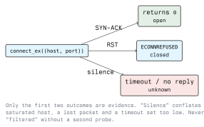

# Vulnerability Scanning with Python

## 3.1 Introduction

A vulnerability scanner does three things: find hosts, find services, and decide whether a service
looks vulnerable. Nmap, Nessus and OpenVAS do all three well and you should use them. You write
Python when the decision in step three is specific to the environment: a custom TCP protocol, an
internal version-numbering scheme, a check that needs to run hourly against four thousand hosts and
write to your own ticket system.

This lecture builds the parts of a scanner in Python, is explicit about what each result does and
does not prove, and ends with what the scanned side sees. Everything here runs against your own lab
only: scanning is the point at which a Python exercise becomes an access attempt under StGB §118a.

## 3.2 Scope First

Before a packet leaves the machine, the script must know what it may touch.

```python
import ipaddress

ALLOWED = [ipaddress.ip_network("192.168.56.0/24")]

def in_scope(addr: str) -> bool:
    ip = ipaddress.ip_address(addr)
    return any(ip in net for net in ALLOWED)
```

Hardcode the scope as a list of networks and check every target against it, including targets that
arrive from a file or from DNS. A hostname that resolved to a lab address last week can resolve
somewhere else today; resolve first, then check scope, then connect. This single function is the
difference between a lab exercise and an incident.

## 3.3 Host Discovery

### 3.3.1 What you can do without root

An unprivileged script cannot send a raw ICMP echo, but it can ask the operating system to complete
a TCP handshake. "Does something answer on a commonly open port" is a serviceable LAN liveness test.

```python
import socket

def alive(host: str, ports=(445, 139, 80, 443, 22), timeout: float = 0.5) -> bool:
    for port in ports:
        with socket.socket() as sock:
            sock.settimeout(timeout)
            if sock.connect_ex((host, port)) == 0:
                return True
    return False
```

A host that answers nothing is not necessarily down. On a modern Windows network the host firewall
drops unsolicited traffic by default, so silence is the expected response from a live machine.

### 3.3.2 ARP, on your own segment

On the local layer-2 segment, ARP is the honest answer: a host that uses IP must answer ARP, and a
host firewall does not filter it. This needs root and `scapy`.

```python
from scapy.all import ARP, Ether, srp

def arp_sweep(cidr: str, timeout: float = 2):
    request = Ether(dst="ff:ff:ff:ff:ff:ff") / ARP(pdst=cidr)
    answered, _ = srp(request, timeout=timeout, verbose=False)
    return [(r.psrc, r.hwsrc) for _, r in answered]
```

ARP does not cross a router, so this works for the segment you are on and nothing beyond it.

## 3.4 Port Scanning

### 3.4.1 The TCP connect scan



```python
import errno
import socket
from concurrent.futures import ThreadPoolExecutor

def probe(host: str, port: int, timeout: float = 1.0) -> tuple[int, str]:
    with socket.socket(socket.AF_INET, socket.SOCK_STREAM) as sock:
        sock.settimeout(timeout)
        code = sock.connect_ex((host, port))
    if code == 0:
        return port, "open"
    if code == errno.ECONNREFUSED:
        return port, "closed"
    return port, "unknown"

def scan(host: str, ports, workers: int = 50):
    with ThreadPoolExecutor(max_workers=workers) as pool:
        return [r for r in pool.map(lambda p: probe(host, p), ports) if r[1] == "open"]
```

`connect_ex` returns an error number instead of raising, which is what you want when most results
are failures. A full handshake is completed on an open port, so the connection is logged by the
service. A connect scan is loud by construction.

### 3.4.2 SYN scanning and why nmap exists

A SYN scan sends a SYN, reads the reply and never completes the handshake. It is faster and leaves
no application log entry. In scapy:

```python
from scapy.all import IP, TCP, sr1

answer = sr1(IP(dst="192.168.56.10") / TCP(dport=80, flags="S"), timeout=1, verbose=False)
```

A SYN-ACK means open, a RST means closed, no answer means unknown. Writing this is instructive;
relying on it is not. Nmap handles retransmission, timing, rate adaptation, fragmentation, IPv6 and
a decade of edge cases in middleboxes. Use `nmap -sS` for real work and call it from Python if you
need the automation:

```bash
nmap -sS -p- -oX scan.xml 192.168.56.10
```

```python
import xml.etree.ElementTree as ET

for host in ET.parse("scan.xml").getroot().iter("host"):
    addr = host.find("address").get("addr")
    for port in host.iter("port"):
        if port.find("state").get("state") == "open":
            print(addr, port.get("portid"))
```

Parsing nmap's XML output is usually the right division of labour: nmap scans, Python decides what
the result means for this environment. Reverse lookups and zone transfers belong here too; Module 02
covers the DNS side of discovery in detail.

### 3.4.3 UDP

UDP scanning is unreliable by design. A closed port *should* produce an ICMP port-unreachable, but
that message is rate-limited by the host and commonly dropped by firewalls, so "no answer" covers
both open and filtered. Meaningful UDP scanning requires a protocol-specific probe, a real DNS
query to 53 or a real SNMP get to 161, which is exactly what nmap's version detection does.

## 3.5 Service and Version Detection

A port number is a convention, not a fact. Something is listening on 8080; whether it is HTTP is a
separate question.

```python
import socket

def banner(host: str, port: int, timeout: float = 2.0) -> str:
    with socket.create_connection((host, port), timeout=timeout) as sock:
        sock.settimeout(timeout)
        try:
            data = sock.recv(1024)
        except socket.timeout:
            sock.sendall(b"\r\n")   # some services speak only when spoken to
            data = sock.recv(1024)
    return data.decode("utf-8", errors="replace").strip()
```

SSH, SMTP and FTP announce themselves. HTTP does not, so send a request:

```python
import requests

resp = requests.get("http://192.168.56.10:8080/", timeout=5)
print(resp.status_code, resp.headers.get("Server"), resp.headers.get("X-Powered-By"))
```

### 3.5.1 TLS certificates

The certificate is a rich, free source of information and a finding in its own right.

```python
import socket, ssl

def cert_info(host: str, port: int = 443):
    ctx = ssl.create_default_context()
    with socket.create_connection((host, port), timeout=5) as raw:
        with ctx.wrap_socket(raw, server_hostname=host) as tls:
            return tls.getpeercert(), tls.version(), tls.cipher()
```

From this you get the expiry date, the subject alternative names (often revealing internal
hostnames), the issuer, and the negotiated protocol version. An expired certificate, a self-signed
certificate on a production service, or a successful handshake at TLS 1.0 are all reportable.
Disable verification only to inspect a certificate that fails validation, never for a request that
carries credentials.

## 3.6 From "Version X" to "Vulnerable"

Naive scanners generate most of the findings that destroy a report's credibility at this step.

A banner says `OpenSSH_8.9p1 Ubuntu-3ubuntu0.1`. Three reasons that is not a verdict:

1. **Backports.** Distributions patch vulnerabilities without changing the upstream version
   string. The package revision matters and the banner usually hides it.
2. **Banners lie.** Administrators change them, and reverse proxies rewrite them.
3. **Configuration decides.** A vulnerability in a module that is not loaded, or behind an
   authentication requirement, is not exploitable here.

So version matching produces *candidates*, which a human or a safe check confirms. Mark them as
such in output:

```python
finding = {
    "host": "192.168.56.10",
    "port": 22,
    "evidence": "SSH-2.0-OpenSSH_8.9p1 Ubuntu-3ubuntu0.1",
    "confidence": "candidate",   # banner match only, not verified
    "verified_by": None,
    "scanned_at": "2026-01-15T09:12:03Z",
}
```

Keep the scope and the timestamp with the results. A finding without a time and a target is not
reproducible, and a result nobody can reproduce does not survive a client's pushback.

If you reference a CVE, reference one you have looked up in the NVD or the vendor advisory for this
exact product and version. Never generate a CVE identifier from a pattern, and never carry one
forward from a previous report without re-checking it.

### 3.6.1 Safe checks

Prefer a check that reads rather than writes, and that cannot damage the target:

- Does an administrative interface answer without authentication?
- Does a documented default credential pair work in your lab?
- Is a known-sensitive path readable, such as `/.git/HEAD`, `/.env` or a directory listing?
- Does the TLS configuration negotiate something it should not?

Anything that writes, deletes, restarts or floods belongs in an explicitly agreed test window, with
the client's name on the authorization.

## 3.7 How the Scan Looks From the Other Side

Every technique above is detectable, and knowing the signature is how you defend against it.

| Technique       | What the defender sees                                            |
| --------------- | ----------------------------------------------------------------- |
| Connect scan    | Many short-lived connections from one source; application logs     |
| SYN scan        | Half-open connections, SYN without ACK; firewall and IDS counters  |
| ARP sweep       | A burst of ARP requests for the whole subnet from one MAC          |
| Banner grabbing | Connections that disconnect immediately after the greeting         |
| Version probing | Odd, malformed or protocol-mismatched requests                     |

Defences, in the order they are worth deploying:

- **Reduce the surface.** A port that is not listening cannot be scanned. Host firewalls with a
  default-deny inbound policy; services bound to `127.0.0.1` where possible.
- **Segment.** A scanner on a user VLAN should not be able to reach a server VLAN at all.
- **Detect.** Port-scan detection in the IDS/IPS: one source touching many ports or many hosts in a
  short window. Module 13 covers this side.
- **Authenticated scanning for yourself.** Credentialed scanning reads the actual package list and
  avoids the backport guessing problem entirely. Run it against your own estate.
- **Patch management and an asset inventory.** You cannot defend hosts you do not know you own, and
  most scanner findings are "this host was missed".

## 3.8 Lab Exercise

Against lab VMs you own, on a host-only network.

1. Write `scan.py` with an `in_scope()` guard, a thread-pooled TCP connect scan and `--json`
   output. Verify it refuses an out-of-scope target.
2. Add banner grabbing for every open port and a TLS certificate check for every port that
   completes a handshake. Report certificates expiring within 30 days.
3. Run `nmap -sV -oX nmap.xml` against the same host and diff the service list against yours. Explain each
   difference: whose result is right, and why?
4. Watch your own scan in Wireshark, then in the target's logs. Which techniques left a log entry?
5. Enable the host firewall on the target and scan again. Document how your output changed and what
   you can no longer conclude.

## Key Takeaways

- Encode the scope in the script; check every target against it after resolution, before connecting.
- `connect_ex` returning 0 is open and `ECONNREFUSED` is closed; everything else is unknown, not
  "filtered".
- A connect scan completes the handshake and is logged by the service; a SYN scan is not.
- UDP results are ambiguous without a protocol-specific probe.
- A version banner yields a candidate finding, never a confirmed vulnerability. Never invent a CVE,
  and write timestamped, scoped output with a confidence field on every finding.
- Defence is surface reduction and segmentation first, detection second, and credentialed scanning
  of your own estate instead of guessing from banners.

## Resources

### Official Documentation

- **socket, ssl, concurrent.futures**: <https://docs.python.org/3/library/>
- **Scapy**: <https://scapy.readthedocs.io/>
- **Nmap reference guide**: <https://nmap.org/book/man.html>

### Vulnerability Data

- **NIST National Vulnerability Database**: <https://nvd.nist.gov/>
- **CISA Known Exploited Vulnerabilities Catalog**:
  <https://www.cisa.gov/known-exploited-vulnerabilities-catalog>
- **Nmap NSE documentation**: <https://nmap.org/nsedoc/>
- Lab targets you may scan: **Metasploitable**, **VulnHub** images, **OWASP Juice Shop**
