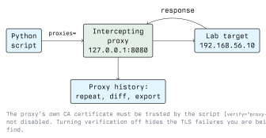

# Web Application Security Testing with Python

## 4.1 Introduction

A web application speaks HTTP, and HTTP is a text protocol you can generate from a script. That is
why Python dominates web testing: a browser hides headers, rewrites your request and enforces rules
the server should be enforcing itself. A script sends exactly the bytes you choose.

Burp Suite and OWASP ZAP remain the tools for interactive testing. Python is for what they are bad
at: a multi-step authentication flow, a thousand-object authorization matrix, a check you want to
run in CI on every deployment. This lecture covers the HTTP client, the patterns of authenticated
testing, and what each class of bug looks like from the defender's side.

Every example targets a lab application you installed yourself: OWASP Juice Shop, DVWA, or a
container on `192.168.56.0/24`. Sending a crafted request to a third party's application without written
authorization is unlawful access; Module 01 has the detail.

## 4.2 The HTTP Client

```python
import requests

resp = requests.get("http://192.168.56.10/", timeout=10, allow_redirects=False)
print(resp.status_code, len(resp.content), dict(resp.headers))
```

Three habits from the start:

- **Always set `timeout`.** Without it, `requests` waits indefinitely and one dead endpoint stalls
  the run.
- **`allow_redirects=False` while testing.** A check that answers `302 /login` instead of `403` is
  worth seeing as a 302; following it automatically hides the finding.
- **Read `resp.content` as well as `resp.text`.** Length differences are often the only signal a
  blind test gives.

### 4.2.1 Sessions

A `Session` keeps cookies, headers and the TLS connection across requests. Use one for anything
multi-step.

```python
s = requests.Session()
s.headers.update({"User-Agent": "athena-lab-test/0.1 (authorized testing)"})
s.get("http://192.168.56.10/login")                    # collect cookies
s.post("http://192.168.56.10/login",
       data={"username": "student", "password": "student"})
print(s.cookies.get_dict())
resp = s.get("http://192.168.56.10/profile")           # now authenticated
```

Identify your traffic in the `User-Agent`: the client's SOC will see it, and a recognisable string
saves everyone an incident call.

### 4.2.2 Tokens in the page

Many forms carry a per-request anti-CSRF token, so a POST assembled from scratch is rejected. Fetch
the form, parse the token, submit it:

```python
import requests
from bs4 import BeautifulSoup

s = requests.Session()
page = s.get("http://192.168.56.10/login", timeout=10)
soup = BeautifulSoup(page.text, "html.parser")
token = soup.select_one('input[name="csrf_token"]')["value"]

s.post("http://192.168.56.10/login", timeout=10,
       data={"csrf_token": token, "username": "student", "password": "student"})
```

A required token is a sign the application defends itself correctly. If the POST succeeds *without*
it, you have found the missing CSRF protection.

### 4.2.3 Working through a proxy



```python
proxies = {"http": "http://127.0.0.1:8080", "https": "http://127.0.0.1:8080"}
resp = requests.get("https://192.168.56.10/", proxies=proxies, verify="burp-ca.pem", timeout=10)
```

Every request now appears in the proxy's history, where you can repeat it, diff two responses and
export it into the report: the script's automation plus the proxy's visibility. Trust the proxy's CA
certificate rather than passing `verify=False`, which makes every TLS problem on the target
invisible, including the ones you were hired to find.

## 4.3 Mapping the Application

### 4.3.1 Reading what the app tells you

```python
resp = requests.get("http://192.168.56.10/", timeout=10)
for name in ("Server", "X-Powered-By", "Content-Security-Policy",
             "Strict-Transport-Security", "X-Frame-Options"):
    print(name, "=", resp.headers.get(name))
```

Missing security headers are a legitimate low-severity finding; present ones tell you which attacks
the application already resists. `robots.txt`, `sitemap.xml`, `/.well-known/`, source maps and the
JavaScript bundle map the attack surface without a single unusual request.

### 4.3.2 Content discovery

Path brute-forcing is the one job where `ffuf`, `feroxbuster` and `gobuster` beat a script: they
handle concurrency, rate limiting and response calibration already. Calibration is the part people
skip: request a path that certainly does not exist, because an application that answers 200 with a
"not found" page turns a status-code scan into hundreds of identical findings. Write the Python
version only when the request needs a session, a signature or a header those tools cannot produce.

## 4.4 Testing for Injection Classes

The aim is detection in a lab, not exploitation. For each class: what the test looks like, what it
proves, and what fixes it.

### 4.4.1 Reflected input and XSS

```python
MARKER = "athena7311"
resp = session.get(f"http://192.168.56.10/search?q={MARKER}", timeout=10)
if MARKER in resp.text:
    print("input reflected — check the encoding of the surrounding context")
```

Reflection alone is not a vulnerability. What matters is whether it is contextually encoded: HTML
text, an attribute, a `<script>` block and a URL each need different escaping. Look at which
characters survive, not at whether a payload "fires".

**Fix:** context-aware output encoding by the template engine, a Content-Security-Policy that
forbids inline script, and `HttpOnly` on session cookies so a successful XSS cannot read them.

### 4.4.2 SQL injection

Two signals are worth testing automatically:

```python
import time

def timing(session, url, payload):
    start = time.perf_counter()
    session.get(url, params={"id": payload}, timeout=20)
    return time.perf_counter() - start

if timing(session, url, "1' AND SLEEP(3)-- ") - timing(session, url, "1") > 2.5:
    print("timing differential — possible SQL injection, verify manually")
```

A single timing measurement is not evidence; networks jitter. Repeat it, vary the delay, and confirm
the response time tracks the delay you asked for. The other signal is error-based: an input that
produces a database error message, where the error text is itself an information-disclosure finding.
For confirmation and exploitation on an authorized engagement, `sqlmap` is the tool. Writing your
own exploitation chain is not a good use of time.

**Fix:** parameterised queries (prepared statements). Not input filtering, not escaping functions,
not a WAF. An ORM used correctly gives you this by default; string-concatenated SQL inside an ORM
does not.

### 4.4.3 Three more classes, same shape

Each of these is detected by sending a crafted value and watching for a distinguishable response,
in your lab only. The fix matters more than the payload.

- **Command injection.** Do not pass user input to a shell. This is the `subprocess.run([...])`
  with `shell=False` rule from lecture 1, seen from the other side of the keyboard.
- **Path traversal and file inclusion.** The interesting input is double-encoded or uses mixed
  separators, because the naive `../` is what the filter catches. Fix by resolving the path and
  checking it stays inside the intended directory
  (`Path(base, user).resolve().is_relative_to(base.resolve())`), or by mapping an identifier to a
  known file and never touching user paths at all.
- **Server-side request forgery.** A parameter holding a URL the server fetches is the candidate;
  in a lab, point it at a listener you control. Fix by allow-listing destinations and rejecting
  private, loopback and link-local addresses *after* resolution, which is where
  `ipaddress.ip_address(...).is_private` from lecture 1 earns its place. Apply the same check to
  redirect targets.

## 4.5 Authorization Testing

This is where Python beats every point-and-click tool, and where the most serious findings live.
Broken access control is a systematic bug, and a systematic bug wants a loop.

```python
import itertools

SESSIONS = {"alice": alice_session, "bob": bob_session, "anon": requests.Session()}
OBJECTS = [f"/api/orders/{n}" for n in range(1, 50)]

for user, path in itertools.product(SESSIONS, OBJECTS):
    resp = SESSIONS[user].get(f"http://192.168.56.10{path}", timeout=10)
    print(f"{user:6} {path:20} {resp.status_code} {len(resp.content)}")
```

Build the matrix of identities against objects and read the grid. Every cell where a user reaches
another user's object is an IDOR. The variations worth automating:

- The same request with the session cookie removed entirely.
- A low-privileged session against an administrative endpoint.
- A `POST`/`PUT`/`DELETE` where only the `GET` was checked.
- An identifier moved between URL, query parameter and body, since frameworks sometimes check one
  location and read another.

**Fix:** authorize server-side on every request, at the data layer, comparing the object's owner
with the authenticated subject. Never rely on an unguessable identifier, nor on the front end
hiding the button.

## 4.6 API Testing

APIs are easier to test than web pages: they are already machine-readable.

```python
spec = requests.get("http://192.168.56.10/openapi.json", timeout=10).json()
for path, methods in spec["paths"].items():
    print(path, [m.upper() for m in methods])
```

An OpenAPI or Swagger document gives the complete endpoint list, including endpoints no link points
at. Without a spec, the front-end JavaScript bundle usually contains the paths.

Specific things to check:

- **Authorization on every method of every endpoint**, using the matrix from 4.5.
- **Mass assignment.** Add an undocumented field such as `"role": "admin"` and see whether it binds
  to the model. Fix with an allow-list of writable fields.
- **Excessive data exposure.** An endpoint returning the whole user object while the front end shows
  three fields leaks the rest. Fix with a response schema, not front-end filtering.
- **Rate limiting.** Does a hundred rapid requests still succeed? Measure it in your lab.
- **JWTs.** Decode the middle segment with `base64.urlsafe_b64decode` to inspect it. Check whether
  the server accepts `alg: none`, a signature from a different key, or an expired token. Fix by
  pinning the expected algorithm and verifying `exp`, `aud` and `iss` server-side. Never make
  an authorization decision from an unverified decode.

## 4.7 Reporting and the Defensive Summary

```python
finding = {
    "title": "IDOR on /api/orders/{id}",
    "severity": "high",
    "request": "GET /api/orders/42 (session: bob)",
    "evidence": "200, body contains alice's address",
    "reproduced": 3,
    "remediation": "authorize by object owner at the data layer",
}
```

A finding needs the exact request, the exact evidence, and how many times you reproduced it, and a
remediation line that names the control rather than the symptom.

The defensive side of this entire lecture, in order of effect:

- Parameterised queries, context-aware output encoding, and no shell invocation of user input.
- Server-side authorization on every request, checked against the object's owner.
- Security headers, plus `Secure`, `HttpOnly` and `SameSite` on cookies.
- Rate limiting and anti-automation on anything touching credentials or money.
- Logging of authorization failures, and alerting on one session touching many object identifiers:
  the signature of the loop in section 4.5. A WAF is a delay and a detection surface, not the fix.

## 4.8 Lab Exercise

Install OWASP Juice Shop or DVWA locally. Nothing in this exercise leaves your machine.

1. Write a script that logs in with a `Session`, handling whatever token the login form requires,
   and confirms the authenticated state by requesting a protected page.
2. Route it through Burp or ZAP with the proxy's CA trusted; confirm every request appears in the
   proxy history.
3. Build the authorization matrix from 4.5 for two accounts you created, over at least twenty object
   identifiers. Present it as a grid and mark every cell that should have been denied.
4. Dump the security headers; write a one-line finding for each one missing.
5. Fix one finding in the application's source, re-run your script and show the output change.

## Key Takeaways

- Set `timeout`, disable automatic redirects while testing, and compare response lengths as well as
  status codes. Use a `Session` for anything multi-step.
- Route scripts through an intercepting proxy with its CA trusted; never use `verify=False`.
- Reflection is not XSS, and a single timing spike is not SQLi. Confirm before reporting.
- Parameterised queries, not filtering, fix SQL injection; argument lists, not escaping, fix
  command injection.
- Authorization testing is a matrix of identities against objects, which Python handles better than
  any GUI tool.
- An API's spec lists endpoints, not enforcement: test every method of every endpoint as every
  role, against lab targets only and with written authorization always.

## Resources

### Official Documentation

- **requests**: <https://requests.readthedocs.io/>
- **Beautiful Soup**: <https://www.crummy.com/software/BeautifulSoup/bs4/doc/>

### Standards and Guidance

- **OWASP Web Security Testing Guide**: <https://owasp.org/www-project-web-security-testing-guide/>
- **OWASP API Security Project**: <https://owasp.org/www-project-api-security/>

### Practice

- **OWASP Juice Shop**: <https://owasp.org/www-project-juice-shop/>
- **DVWA**: <https://github.com/digininja/DVWA>
- **PortSwigger Web Security Academy**: <https://portswigger.net/web-security>
- **mitmproxy, scriptable in Python**: <https://docs.mitmproxy.org/>
