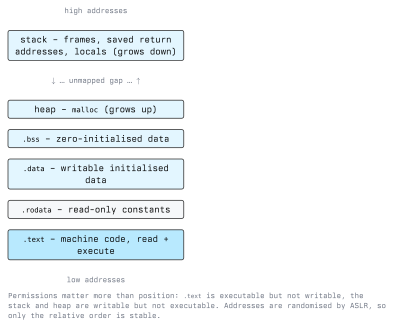
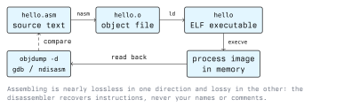

# Introduction to Assembly

Assembly language is the lowest level at which a program is still readable by a human. Every
instruction in an assembly source file corresponds to one machine instruction that the processor
actually executes. There is no runtime, no garbage collector and no type system between the text
and the hardware.

For security work this matters because the machine code is the only version of a program that is
guaranteed to exist. Source code may be unavailable, the comments may lie, and the compiler may
have transformed the logic beyond recognition. The binary cannot lie about what it does.

## 1.1 Why Assembly Belongs in a Security Curriculum

- **Reverse engineering.** Malware, firmware and commercial software arrive as binaries. Reading
  disassembly is the only way to establish what they do.
- **Vulnerability analysis.** A buffer overflow, an integer truncation or a use-after-free is
  invisible in a high-level description of a program. It becomes obvious once you see which
  register holds the length and which instruction copies the bytes.
- **Exploit development and mitigation.** Stack canaries, non-executable memory and address space
  randomisation are all defences at the instruction and memory level. Understanding what they
  stop requires understanding what they are stopping.
- **Detection engineering.** Signatures, YARA rules and emulation-based sandboxes all operate on
  instruction patterns.

You are not expected to write large programs in assembly. You are expected to read it fluently and
write short, deliberate pieces of it.

## 1.2 The Machine Model

An x86-64 processor executing a user-space program sees a very simple world:

- A set of **registers**, a few dozen named slots of 64 bits each, inside the CPU.
- A flat **address space** of bytes, reachable by address.
- An **instruction pointer** (`rip`) holding the address of the next instruction.
- A **flags register** (`rflags`) holding the results of the last comparison.

An instruction reads some registers or memory, computes something, and writes a register, memory,
the flags, or `rip`. That is the whole machine. Everything else (objects, strings, exceptions,
threads) is a convention built on top of it by compilers and operating systems.

### 1.2.1 Instruction Set Architectures

The *instruction set architecture* (ISA) defines which instructions exist and how they are encoded.
Assembly language is specific to an ISA; there is no portable assembly.

| ISA     | Typical use                          | Style                             |
| ------- | ------------------------------------ | --------------------------------- |
| x86-64  | Desktops, servers, most laptops      | CISC, variable-length instructions |
| ARM64   | Phones, tablets, Apple Silicon, many servers | RISC, fixed 32-bit instructions |
| RISC-V  | Embedded, research, growing industry use | RISC, open specification       |
| AVR     | 8-bit microcontrollers (Arduino)     | RISC, Harvard architecture        |

This module uses **x86-64 on Linux** because that is what most of the binaries a security analyst
meets in practice are compiled for, and because the tooling is free and well documented. The
concepts (registers, stack frames, calling conventions, flags) carry over to every other ISA.

### 1.2.2 The General-Purpose Registers

x86-64 has sixteen general-purpose registers. The first eight inherited names from the 16-bit era,
which is why they are not simply numbered:

| 64-bit | Lower 32 | Lower 16 | Lowest 8 | Conventional role                    |
| ------ | -------- | -------- | -------- | ------------------------------------ |
| `rax`  | `eax`    | `ax`     | `al`     | Return value, syscall number         |
| `rbx`  | `ebx`    | `bx`     | `bl`     | General, callee-saved                |
| `rcx`  | `ecx`    | `cx`     | `cl`     | 4th argument, shift counts           |
| `rdx`  | `edx`    | `dx`     | `dl`     | 3rd argument                         |
| `rsi`  | `esi`    | `si`     | `sil`    | 2nd argument, source of string ops   |
| `rdi`  | `edi`    | `di`     | `dil`    | 1st argument, destination of string ops |
| `rbp`  | `ebp`    | `bp`     | `bpl`    | Frame pointer                        |
| `rsp`  | `esp`    | `sp`     | `spl`    | Stack pointer -- never use as scratch |
| `r8`--`r15` | `r8d`--`r15d` | `r8w`--`r15w` | `r8b`--`r15b` | General purpose |

The "conventional role" column is convention, not hardware. The CPU does not care which register
holds an argument; the *calling convention*, covered in lecture 5, is an agreement between
compilers. Only `rsp` and `rip` have behaviour wired into instructions.

One hardware rule worth memorising now: **writing to a 32-bit register name zeroes the upper 32
bits** of the 64-bit register. `mov eax, 1` leaves `rax` equal to `1`, not to its old high half
plus one. Writing to a 16-bit or 8-bit name leaves the upper bits untouched. This asymmetry is a
frequent source of confusion when reading disassembly.

## 1.3 The Process Address Space

A running program is more than its code. The kernel maps several distinct regions with different
permissions.



The security-relevant part of this picture is the permission on each region, not the order:

- `.text` is readable and executable but **not writable**, so a program cannot normally rewrite its
  own instructions.
- The stack and heap are readable and writable but **not executable** on any current system. This
  is the NX (no-execute) bit, and it is why injecting machine code into a buffer and jumping to it
  no longer works by itself.
- Addresses are randomised at each run by ASLR, so a hardcoded address from one run is wrong on the
  next.

Lectures 3 and 5 return to this layout in detail.

## 1.4 The Toolchain



Four tools do almost everything in this module:

| Tool      | Purpose                                              |
| --------- | ---------------------------------------------------- |
| `nasm`    | Assembler: assembly source to an object file         |
| `ld`, `gcc` | Linker: object files to an executable              |
| `objdump` | Disassembler: executable back to assembly text       |
| `gdb`     | Debugger: run the program one instruction at a time  |

On Debian or Ubuntu, the lab machine needs:

```bash
sudo apt install nasm binutils gdb gcc
```

### 1.4.1 Two Syntaxes for One ISA

The same instruction is written two ways, and you will meet both:

```text
Intel syntax (NASM, objdump -M intel, Windows tooling):
    mov rax, 60          ; destination first

AT&T syntax (GNU as default, gcc -S default, gdb default):
    movq $60, %rax       # source first, % on registers, $ on literals
```

This module uses Intel syntax throughout. Configure your tools to match:

```bash
objdump -d -M intel ./prog
echo 'set disassembly-flavor intel' >> ~/.gdbinit
```

## 1.5 A First Program

The smallest useful assembly program asks the kernel to write a string and then exit. On Linux a
system call is made by putting the call number in `rax`, the arguments in `rdi`, `rsi`, `rdx`,
`r10`, `r8`, `r9`, and executing the `syscall` instruction.

```asm
; hello.asm -- write a string to stdout and exit
; build: nasm -f elf64 hello.asm -o hello.o && ld hello.o -o hello

section .rodata
msg:    db  "hello, assembly", 10      ; 10 is the newline byte
msglen: equ $ - msg                    ; assembler computes the length

section .text
global _start

_start:
        mov     rax, 1                 ; syscall 1 = write
        mov     rdi, 1                 ; fd 1 = stdout
        mov     rsi, msg               ; buffer address
        mov     rdx, msglen            ; byte count
        syscall

        mov     rax, 60                ; syscall 60 = exit
        mov     rdi, 0                 ; exit status
        syscall
```

Build and run it:

```bash
nasm -f elf64 hello.asm -o hello.o
ld hello.o -o hello
./hello
echo "exit status: $?"
```

Note what is absent. There is no `main`, because `main` is a C convention; the kernel enters the
program at the ELF entry point, which `ld` takes from `_start`. There is no automatic return either:
if the `exit` call is removed, execution runs off the end of the code into whatever bytes follow and
the process crashes. A high-level language hides both of these for you.

Syscall numbers are per-architecture. On x86-64 Linux the authoritative list is the kernel table
`arch/x86/entry/syscalls/syscall_64.tbl`; locally, `man 2 syscall` documents the register
convention and `ausyscall --dump` prints the numbers if `auditd` is installed.

## 1.6 Reading a Binary Back

Writing assembly is the smaller half of the skill. Reading it is the half you will use.

```bash
# disassemble only the executable sections, Intel syntax
objdump -d -M intel ./hello

# what sections exist, and with what permissions
readelf -S -l ./hello

# printable strings in the file -- crude but the fastest first look
strings -n 6 ./hello
```

Then step through it:

```bash
gdb ./hello
(gdb) starti                 # stop at the very first instruction
(gdb) info registers rax rdi rsi rdx
(gdb) x/s $rsi               # inspect memory as a string
(gdb) stepi                  # one instruction
(gdb) disassemble
(gdb) quit
```

`starti`, `stepi`, `info registers` and `x` are the four commands that will carry you through this
entire module. Spend the time to get comfortable with them now.

### 1.6.1 What the Disassembler Cannot Recover

Assembling discards information permanently. Label names, comments, variable names, types and macro
structure are not stored in the machine code. A disassembler recovers the instructions exactly and
everything else not at all. When a binary is stripped of its symbol table
(`strip ./prog`, or `gcc -s`), even function names are gone and the analyst is left naming things
`sub_401136` by hand.

This cuts both ways: it makes reverse engineering laborious, and it makes "we compiled it, so
nobody can read it" a false sense of security. Compilation is not encryption.

## 1.7 Legal Framing

Reverse engineering is a normal part of security research, but it is not unconditional. Two
separate bodies of law apply:

- **Access and integrity.** Running your analysis against a system you do not own touches
  Austrian StGB §118a (unlawful access to a computer system), §126a (data damage) and §126b
  (disruption of a computer system). Analyse only binaries you are entitled to analyse, in a lab
  you control.
- **Copyright and licence terms.** Software licences frequently prohibit decompilation, while EU
  copyright law provides narrow statutory exceptions. Which one wins in a given case is a legal
  question, not a technical one.

Module 01 covers both in detail. The operational rule for this module: work on code you wrote, on
deliberately provided training binaries, or on targets covered by a written authorisation.

## Key Takeaways

- One assembly instruction equals one machine instruction. Assembly is ISA-specific; there is no
  portable assembly.
- The machine model is small: registers, a flat byte-addressed memory, `rip`, and flags.
- A process address space is divided into regions whose *permissions* matter more than their
  positions: `.text` is executable and not writable, stack and heap are writable and not
  executable.
- Writing a 32-bit register name zeroes the upper 32 bits of the 64-bit register.
- Intel and AT&T syntax describe the same instructions with reversed operand order. Pick one and
  configure every tool to it.
- Linux system calls take their number in `rax` and their arguments in `rdi`, `rsi`, `rdx`, `r10`,
  `r8`, `r9`.
- Compilation destroys names, comments and types but preserves behaviour exactly. It is not a
  protection mechanism.

## Resources

- Intel 64 and IA-32 Architectures Software Developer Manuals, Volume 2 (instruction reference),
  <https://www.intel.com/sdm>
- AMD64 Architecture Programmer's Manual, Volume 3, <https://www.amd.com/en/support/tech-docs>
- NASM Manual, <https://www.nasm.us/doc/>
- *System V Application Binary Interface, AMD64 Architecture Processor Supplement*,
  <https://gitlab.com/x86-psABIs/x86-64-ABI>
- `man 2 syscall`, `man 1 objdump`, `man 1 gdb`
- Felix Cloutier's x86 instruction reference (a readable mirror of the Intel manual) --
  <https://www.felixcloutier.com/x86/>
