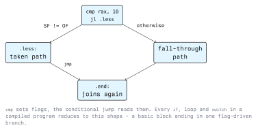

# Control Structures

A processor has no `if`, no `while` and no `switch`. It has exactly one control mechanism: change
the instruction pointer. Everything else is built from a comparison that sets flags and a jump that
reads them.

Reading control flow is the core skill of reverse engineering. Once you can recover the branch
structure of a function, you can recover its logic, and, more importantly, you can find the check
that an attacker needs to bypass.

## 4.1 Unconditional and Conditional Jumps

```asm
        jmp     .somewhere      ; always transfer control
        je      .equal          ; transfer only if ZF = 1
```

A conditional jump (`jcc`, "jump if condition") tests flags set by an earlier instruction, almost
always a `cmp` or a `test`. If the condition holds, `rip` becomes the branch target; if not,
execution continues with the next instruction. There is no third option.



## 4.2 The Conditional Jump Table

The mnemonics look arbitrary until you notice they come in signed and unsigned pairs. After
`cmp a, b`:

| Signed | Unsigned | Meaning (`a` vs `b`) | Flags tested          |
| ------ | -------- | -------------------- | --------------------- |
| `je`   | `je`     | equal                | `ZF = 1`              |
| `jne`  | `jne`    | not equal            | `ZF = 0`              |
| `jl`   | `jb`     | less than / below    | `SF != OF` / `CF = 1` |
| `jle`  | `jbe`    | less or equal        | includes `ZF = 1`     |
| `jg`   | `ja`     | greater / above      | `ZF = 0, SF = OF` / `CF = 0, ZF = 0` |
| `jge`  | `jae`    | greater or equal     | `SF = OF` / `CF = 0`  |

Signed comparisons use `l`/`g` ("less"/"greater") and inspect `SF` and `OF`. Unsigned comparisons
use `b`/`a` ("below"/"above") and inspect `CF`. `je` and `jne` are the same instruction for both,
because equality does not depend on signedness.

Flag-specific jumps also exist and mean exactly what they say: `jz`/`jnz` (zero, an alias of
`je`/`jne`), `js`/`jns` (sign), `jc`/`jnc` (carry), `jo`/`jno` (overflow).

### 4.2.1 Signedness Confusion Is a Vulnerability Class

A length check compiled with the wrong comparison is a real and recurring bug:

```asm
        ; C: if (len > MAX) reject;   with len declared as a signed int
        cmp     edi, 4096
        jg      .reject                 ; signed comparison
        ; ... proceed to copy edi bytes
```

If `edi` is `0xFFFFFFFF`, the signed interpretation is `-1`, which is not greater than 4096, so the
check passes. The copy that follows converts the same bits to a size, where they mean roughly four
billion. The identical check written with `ja` instead of `jg` rejects the value correctly.

So when you read a bounds check in disassembly, the `jg`-versus-`ja` distinction is not a detail,
it is the whole question. The defensive counterparts: declare sizes as `size_t` or another unsigned
type, reject negative inputs explicitly at the parsing boundary before they are used as lengths,
and enable `-Wsign-compare -Wconversion` so the compiler points at the mismatch.

## 4.3 Building `if` / `else`

A high-level conditional becomes a jump over the body. Note that the condition is **inverted**: the
source says "if x equals 10, do A", and the assembly says "if x does not equal 10, skip A".

```c
if (x == 10) {
    y = 1;
} else {
    y = 2;
}
```

```asm
        cmp     dword [x], 10
        jne     .else                   ; inverted condition jumps away
        mov     dword [y], 1
        jmp     .endif
.else:
        mov     dword [y], 2
.endif:
```

That inversion is universal and worth internalising, because misreading it inverts your
understanding of the whole function. When reading unfamiliar disassembly, read the branch as "skip
the following block when ..." rather than "do the following block when ...".

### 4.3.1 Branchless Conditionals

Compilers often avoid a jump altogether, because a mispredicted branch is expensive:

```asm
        ; y = (x > 0) ? a : b
        cmp     dword [x], 0
        mov     rax, rbx                ; assume b
        cmovg   rax, rcx                ; overwrite with a if the condition held
```

`cmovcc` conditionally moves and never changes `rip`. `setcc` is the related instruction that
writes 1 or 0 into a byte register:

```asm
        cmp     rdi, rsi
        sete    al                      ; al = 1 if equal, else 0
        movzx   eax, al                 ; widen to a full int
```

This pattern is the compiled form of `return a == b;`. It also has a security dimension:
constant-time comparison routines in cryptographic libraries use `cmov`/`setcc` deliberately,
because a data-dependent *branch* leaks information through timing while a data-dependent *move*
does not. Finding a plain `jne` inside a password or MAC comparison loop is a genuine finding.

## 4.4 Loops

### 4.4.1 A Counting Loop

```c
for (int i = 0; i < 10; i++) { sum += i; }
```

```asm
        xor     ecx, ecx                ; i = 0
        xor     eax, eax                ; sum = 0
.loop:
        cmp     ecx, 10
        jge     .done                   ; test at the top: handles the zero-iteration case
        add     eax, ecx
        inc     ecx
        jmp     .loop
.done:
```

Optimising compilers usually restructure this into a test at the *bottom*, which costs one jump less
per iteration:

```asm
        xor     ecx, ecx
        xor     eax, eax
.loop:
        add     eax, ecx
        inc     ecx
        cmp     ecx, 10
        jl      .loop                   ; fall out when done
```

The bottom-tested form is only correct when the loop is known to run at least once, so a compiler
that emits it has proven the trip count is non-zero. An optimised loop preceded by a separate guard
check is that proof made visible.

### 4.4.2 A Sentinel Loop

Counting is not the only shape. Walking a NUL-terminated string tests the data, not a counter:

```asm
; strlen: length of the string at rdi, result in rax
my_strlen:
        xor     rax, rax
.loop:
        cmp     byte [rdi + rax], 0
        je      .done
        inc     rax
        jmp     .loop
.done:
        ret
```

A sentinel loop has no upper bound. If the terminator is missing, because a `read()` filled a
buffer completely without leaving room for it, the loop walks off the end of the allocation. This
is the mechanism behind a large family of out-of-bounds read bugs, and the reason APIs that take an
explicit maximum (`strnlen`, `memchr` with a length) are preferred.

### 4.4.3 The `loop` Instruction

x86 has a dedicated instruction that decrements `rcx` and jumps while it is non-zero:

```asm
        mov     rcx, 10
.loop:
        ; body
        loop    .loop                   ; rcx--, jump if rcx != 0
```

It is compact and almost never emitted by modern compilers, because the equivalent `dec`/`jnz` pair
runs faster on current hardware. You will meet it in handwritten assembly, in shellcode and in old
code. Its hardwired use of `rcx` is a trap: anything in the loop body that clobbers `rcx` breaks
the loop count.

## 4.5 `switch` and Jump Tables

A `switch` over a dense range of integers does not compile to a chain of comparisons. The compiler
builds a table of addresses and indexes it:

```asm
        ; switch (x) with cases 0..3
        cmp     edi, 3
        ja      .default                ; unsigned check catches negatives too
        lea     rax, [rel .table]
        mov     rax, [rax + rdi*8]      ; load the target address
        jmp     rax                     ; indirect jump

section .rodata
.table: dq  .case0, .case1, .case2, .case3
```

Three things make this worth recognising:

- The bounds check before the table lookup is the only thing keeping the indirect jump inside the
  table. It is deliberately an **unsigned** `ja`, so a negative index fails it as well. A jump
  table with a signed bounds check, or none, is a serious bug.
- A disassembler that cannot resolve `jmp rax` will show the function as ending there. Recovering
  the real targets means finding the table in `.rodata` and reading it by hand, which is why
  switch-heavy code is harder to analyse statically.
- Indirect jumps and calls are the raw material for control-flow hijacking. Mitigations such as
  Control-Flow Integrity in compilers and Intel CET's indirect branch tracking in hardware exist
  specifically to constrain where an indirect branch may land.

A sparse `switch` (cases 1, 100, 10000) compiles instead to a binary search or a plain comparison
chain, because a table would be mostly empty.

## 4.6 Basic Blocks and Control-Flow Graphs

A **basic block** is a straight-line run of instructions with one entry at the top and one exit at
the bottom. A block ends at a jump, a call, a return, or at any instruction that is itself a jump
target. Connect the blocks with their possible transitions and you have the function's
**control-flow graph**.

This is the representation every serious analysis tool shows you, and the one to build in your head
when reading a long function:

```bash
# in gdb, see the current function's instructions
(gdb) disassemble /s

# in objdump, the branch targets are annotated with <label+offset>
objdump -d -M intel --no-show-raw-insn ./prog | less
```

Graphical tools (Ghidra, Cutter/radare2, Binary Ninja, IDA) draw the CFG directly, and the shape
alone is informative: a long chain of diamond-shaped branches is usually input validation, a
back-edge is a loop, and a single block with many predecessors is often an error handler.

Practical reading order for an unfamiliar function:

1. Find the exits (`ret`) and the loops (backward jumps).
2. Find the comparisons against constants; those are the checks.
3. For each check, decide which path is the accept path and which is the reject path.
4. Only then read the arithmetic in between.

## 4.7 Exercises

In your own lab VM only.

1. Write the `my_strlen` routine above, call it on a string in `.rodata`, and return the length as
   the exit status. Verify with `echo $?`.
2. Write a loop that sums the first `n` integers, with `n` taken from a register. Test `n = 0` and
   explain why the top-tested form is correct and the bottom-tested form is not.
3. Compile this and explain the comparison the compiler chose:

   ```c
   int check(int len) { if (len > 64) return -1; return len; }
   ```

   Then change `int len` to `unsigned len` and diff the disassembly.
4. Compile a `switch` with cases 0--7 at `-O2` and find the jump table in `.rodata` with
   `objdump -s -j .rodata`. Confirm the entries are the case labels.
5. Draw the control-flow graph of a 30-line function from a binary of your choosing, by hand, from
   `objdump` output alone. Then compare with what Ghidra draws.

## Key Takeaways

- The processor's only control mechanism is changing `rip`. Every control structure is a
  flag-setting comparison plus a conditional jump.
- Signed jumps are `jl`/`jg`, unsigned are `jb`/`ja`. Picking the wrong family in a length check is
  a vulnerability, not a style issue.
- Compiled conditionals invert the source condition and jump *over* the body. Read a branch as
  "skip the next block when ...".
- `cmovcc` and `setcc` implement conditionals without branching; their use in cryptographic
  comparisons is a deliberate defence against timing side channels.
- Sentinel-terminated loops have no upper bound and read out of bounds when the terminator is
  missing. Length-taking APIs remove that.
- A dense `switch` becomes a jump table guarded by one unsigned bounds check. That check is the
  whole safety of the construct, and indirect branches are what CFI and Intel CET constrain.
- Reading disassembly means recovering basic blocks and the control-flow graph, then finding the
  checks before reading the arithmetic.

## Resources

- Felix Cloutier's x86 reference, `Jcc`, `CMOVcc`, `SETcc`, `LOOP` entries:
  <https://www.felixcloutier.com/x86/>
- Intel 64 and IA-32 Architectures Software Developer Manual, Volume 1, appendix on flags and
  condition codes: <https://www.intel.com/sdm>
- Ghidra: <https://ghidra-sre.org/>
- radare2 / Cutter: <https://rada.re/n/> and <https://cutter.re/>
- Clang Control Flow Integrity: <https://clang.llvm.org/docs/ControlFlowIntegrity.html>
- CWE-195: Signed to Unsigned Conversion Error: <https://cwe.mitre.org/data/definitions/195.html>
- CWE-125: Out-of-bounds Read: <https://cwe.mitre.org/data/definitions/125.html>
