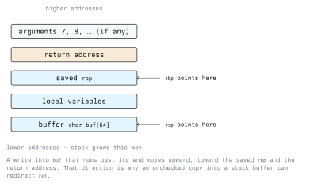

# Procedures and Functions

A function is not a hardware concept. The CPU offers two instructions, `call` and `ret`, that save
and restore a return address on the stack. Everything else (parameters, return values, local
variables, which registers survive a call) is a written agreement between compilers called the
**calling convention**.

That agreement is also where a large part of binary exploitation happens, because the return
address is ordinary writable memory sitting a short distance above local buffers. This lecture
covers how a call works, what the convention promises, and what defends the mechanism.

## 5.1 `call` and `ret`

```asm
        call    my_func         ; push the address of the next instruction, then jmp my_func
        ...
my_func:
        ret                     ; pop an address into rip
```

`call` does exactly two things: it pushes the address of the instruction following the `call`, then
sets `rip` to the target. `ret` pops eight bytes off the top of the stack into `rip`.

`ret` does not verify anything. It transfers control to whatever 64-bit value happens to be at
`[rsp]`. If that value was overwritten, control goes there instead. This is not a flaw in `ret`; it
is the entire mechanism, and it is the reason the return address is the most valuable target on the
stack.

## 5.2 The System V AMD64 Calling Convention

Linux, macOS and the BSDs on x86-64 use the System V AMD64 ABI. Windows uses a different one, which
is why cross-platform shellcode and FFI bindings must distinguish them.

| Purpose              | Registers                                                |
| -------------------- | -------------------------------------------------------- |
| Integer arguments    | `rdi`, `rsi`, `rdx`, `rcx`, `r8`, `r9`, in that order    |
| Further arguments    | Pushed on the stack, last argument pushed first          |
| Return value         | `rax` (and `rdx` for a 128-bit return)                   |
| Floating point args  | `xmm0`--`xmm7`                                           |
| Callee-saved         | `rbx`, `rbp`, `r12`, `r13`, `r14`, `r15`                 |
| Caller-saved         | `rax`, `rcx`, `rdx`, `rsi`, `rdi`, `r8`--`r11`           |

Two rules matter in practice:

- **Callee-saved** means a function must leave those registers as it found them. If it wants to use
  `rbx`, it pushes `rbx` on entry and pops it before returning.
- **Caller-saved** means the opposite: a caller must assume those registers are destroyed by any
  call. Keeping a value in `rsi` across a `call` is a bug.

Note the deliberate difference from the *syscall* convention in lecture 1: a syscall's fourth
argument is in `r10`, not `rcx`, because the `syscall` instruction itself clobbers `rcx` and `r11`.
Confusing the two conventions produces a function that works until its fourth argument matters.

The ABI also requires `rsp` to be 16-byte aligned immediately before every `call`, and reserves a
**red zone** of 128 bytes below `rsp` that a leaf function, one that calls nothing, may use
without adjusting `rsp` at all. Signal handlers and the kernel respect the red zone; this is why a
small leaf function sometimes has no visible stack allocation.

## 5.3 The Stack Frame

A function's local storage lives in a **stack frame**. The classic layout, with `rbp` as the frame
pointer, looks like this at the point where the body runs:



The code that establishes and tears it down is formulaic:

```asm
my_func:
        push    rbp                     ; prologue: save the caller's frame pointer
        mov     rbp, rsp                ; rbp now marks this frame
        sub     rsp, 32                 ; reserve 32 bytes of locals

        mov     dword [rbp - 4], 7      ; a local, addressed relative to rbp
        mov     eax, edi                ; first argument
        add     eax, dword [rbp - 4]    ; return value accumulates in eax

        mov     rsp, rbp                ; epilogue: discard locals
        pop     rbp                     ; restore the caller's frame pointer
        ret
```

`leave` is a single instruction equivalent to `mov rsp, rbp; pop rbp`, and compilers emit it
frequently.

With `rbp` as the frame pointer, locals sit at negative offsets from `rbp` and stack arguments at
positive ones, which makes frames easy to read. Optimising compilers usually *omit* the frame
pointer (`-fomit-frame-pointer`, on by default at `-O1` and above), keep `rbp` as a general-purpose
register, and address locals from `rsp` instead. Both forms are common; recognise both.

### 5.3.1 Why the Frame Layout Is a Security Property

Look at the ordering in the diagram. Local buffers are at *lower* addresses than the saved `rbp` and
the return address, and a buffer write that runs past its end moves toward *higher* addresses. So an
overflow in a local buffer reaches, in order: the other locals, the saved frame pointer, and then
the return address.

Overwrite the return address with an address of the attacker's choosing and `ret` transfers control
there. With a non-executable stack, that target is an existing instruction sequence in the program or its
libraries rather than injected code, which is the basis of return-oriented programming. A full
treatment belongs in an exploitation module; what belongs here is the structural reason it works:
**control data and user data share one writable region, and `ret` does not authenticate its
target.**

## 5.4 Defences on the Return Address

Each defence attacks a different step of that chain. Be able to name which:

- **Stack canaries** (`-fstack-protector-strong`, standard in distribution builds). The prologue
  stores a secret value between the locals and the saved registers; the epilogue compares it before
  `ret` and aborts on a mismatch. In disassembly this is a load from `fs:0x28` on entry and a
  `__stack_chk_fail` call on the failure path. Canaries detect *contiguous* overwrites; they do not
  stop an arbitrary write that skips over the canary.
- **NX / DEP.** The stack is mapped without execute permission, so injected machine code in a
  buffer cannot run. This does not protect the return address itself.
- **ASLR and PIE.** Library and executable base addresses are randomised each run, so an attacker
  cannot hardcode a target. Partial overwrites and information leaks are the counters.
- **Shadow stacks** (Intel CET, ARM's pointer authentication by a different mechanism). A second,
  hardware-protected copy of each return address is pushed by `call` and checked by `ret`. This
  attacks the problem at its root: `ret` finally authenticates its target. Support requires both
  hardware and a toolchain and kernel that enable it.
- **RELRO** (`-Wl,-z,relro,-z,now`). Makes the GOT read-only after startup, closing a different
  indirect-control-flow target.

Inspect a binary with:

```bash
checksec --file=/bin/ls          # from pwntools, or the standalone checksec script
readelf -l ./prog | grep -i gnu_relro
readelf -d ./prog | grep -i bind_now
```

Running this across the binaries in your own lab and explaining each result is the exercise that
makes the list stick.

## 5.5 Calling Into libc

Calling a C library function from assembly means obeying the ABI exactly: arguments in the right
registers, stack aligned, and `rax` set to the number of vector registers used for variadic
functions (zero, when you pass no floating-point arguments).

```asm
; greet.asm -- build: nasm -f elf64 greet.asm -o greet.o && gcc -no-pie greet.o -o greet
        global  main
        extern  printf

section .rodata
fmt:    db  "value = %ld", 10, 0

section .text
main:
        push    rbp                     ; prologue also realigns rsp to 16 bytes
        mov     rbp, rsp

        lea     rdi, [rel fmt]          ; 1st arg: format string
        mov     rsi, 42                 ; 2nd arg: the value
        xor     eax, eax                ; 0 vector registers used
        call    printf

        xor     eax, eax                ; return 0 from main
        pop     rbp
        ret
```

Linking with `gcc` rather than `ld` brings in the C runtime, which is why the entry point here is
`main` and not `_start`, and why returning from `main` exits cleanly without an explicit syscall.
`-no-pie` keeps the addresses absolute, which makes the disassembly easier to read while learning.

The `push rbp` in the prologue is doing double duty. At the entry to `main`, `rsp` is 8 bytes off
16-byte alignment because `call` pushed a return address; the `push` restores alignment. Remove it
and `printf` may crash inside an SSE instruction.

## 5.6 Recursion and Stack Depth

Each recursive call consumes a frame, and the stack is finite, typically 8 MB for the main thread
on Linux, as `ulimit -s` reports.

```asm
; factorial(n) in rdi, result in rax
factorial:
        cmp     rdi, 1
        jbe     .base                   ; unsigned: 0 and 1 both return 1
        push    rdi                     ; preserve n across the recursive call
        dec     rdi
        call    factorial
        pop     rdi                     ; restore n
        imul    rax, rdi
        ret
.base:
        mov     rax, 1
        ret
```

The `push`/`pop` pair exists because `rdi` is caller-saved: the recursive call is free to destroy
it. Removing those two instructions produces a function that returns a wrong answer rather than
crashing, which is the harder kind of bug to find.

Unbounded recursion driven by attacker-controlled input exhausts the stack and crashes the process.
That is a denial-of-service condition, and a recursive parser applied to untrusted input (nested
JSON, nested archives, deeply nested XML) is the usual way it is reached. The defences are an
explicit depth limit enforced in the parser, an iterative rewrite with an explicit worklist, and
treating the resulting crash as a reportable bug rather than a curiosity. Under Austrian law,
causing that crash on a system you are not authorised to test falls under StGB §126b; Module 01
covers the detail.

## 5.7 Tracing Calls in the Debugger

```bash
gdb ./prog
(gdb) break main
(gdb) run
(gdb) info args                 # with debug info
(gdb) info registers rdi rsi rdx rcx r8 r9
(gdb) x/8xg $rsp                # the top of the stack, including the return address
(gdb) bt                        # call stack
(gdb) finish                    # run to the end of this frame, print the return value
(gdb) info frame                # frame base, saved registers, return address location
```

To watch a return address being overwritten, note its address from `info frame`, then:

```bash
(gdb) watch -l *(long *)0x7fffffffe1a8
```

Execution stops at the exact instruction that writes it. For a crash in a program with a corrupted
frame, that is the difference between a guess and an answer.

Outside the debugger, `ltrace` traces library calls, `strace` traces system calls, and
`objdump -d -M intel` shows the prologue and epilogue of every function in the binary. Reading
prologues is how you find function boundaries in a stripped binary.

## 5.8 Exercises

In your own lab VM only.

1. Write a function `max3(a, b, c)` taking its arguments in `rdi`, `rsi`, `rdx` and returning the
   largest in `rax`. Call it from `_start` and return the result as the exit status.
2. Write a function that uses `rbx` and `r12`, and verify with `gdb` that both are unchanged in the
   caller after the call. Then delete the saves and observe the breakage.
3. Compile a C function at `-O0` and `-O2`, and find where the frame pointer disappeared.
4. Compile a function with a `char buf[64]` local, once with `-fstack-protector-strong` and once
   with `-fno-stack-protector`, and diff the prologues. Identify the `fs:0x28` load and the
   `__stack_chk_fail` path.
5. Write the `factorial` routine above, confirm `factorial(20)` is correct, then call it with a
   very large argument and observe the crash. Report the signal and explain which limit was hit.
6. Run `checksec` on five binaries from `/usr/bin` and tabulate which protections each has.

## Key Takeaways

- `call` pushes a return address and jumps; `ret` pops it into `rip` without any verification.
- Functions, arguments and locals are conventions. On Linux x86-64 the convention is the System V
  AMD64 ABI: arguments in `rdi`, `rsi`, `rdx`, `rcx`, `r8`, `r9`, return value in `rax`.
- Callee-saved (`rbx`, `rbp`, `r12`--`r15`) must be preserved by the function; caller-saved
  registers must be assumed destroyed across every call.
- The syscall convention differs from the function convention: the fourth argument is `r10`, and
  `rcx` and `r11` are clobbered by `syscall`.
- `rsp` must be 16-byte aligned before a `call`. The red zone is 128 bytes below `rsp`, usable only
  by leaf functions.
- Local buffers sit below the saved `rbp` and the return address, and overflows grow upward. Control
  data and user data sharing one writable region is the structural cause of stack-based
  control-flow hijacking.
- Canaries detect contiguous overwrites, NX stops injected code, ASLR removes fixed targets, and
  shadow stacks make `ret` authenticate. Know which defence addresses which step.
- Unbounded recursion on untrusted input is a denial-of-service bug, fixed with an explicit depth
  limit.

## Resources

- *System V Application Binary Interface, AMD64 Architecture Processor Supplement*, the normative
  calling convention: <https://gitlab.com/x86-psABIs/x86-64-ABI>
- Agner Fog, *Calling conventions for different C++ compilers and operating systems*:
  <https://www.agner.org/optimize/>
- GCC manual, `-fstack-protector-strong`, `-fomit-frame-pointer`, `-fcf-protection`:
  <https://gcc.gnu.org/onlinedocs/gcc/Instrumentation-Options.html>
- Intel Control-flow Enforcement Technology specification:
  <https://www.intel.com/content/www/us/en/developer/articles/technical/technical-look-control-flow-enforcement-technology.html>
- CWE-121: Stack-based Buffer Overflow: <https://cwe.mitre.org/data/definitions/121.html>
- CWE-674: Uncontrolled Recursion: <https://cwe.mitre.org/data/definitions/674.html>
- `man 3 getcontext`, `man 1 ltrace`, `man 1 strace`, `ulimit -s`
