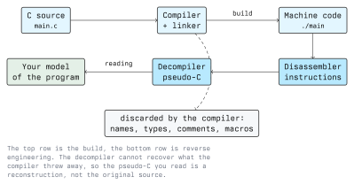

# Introduction to Reverse Engineering

Reverse engineering is the process of taking a finished artefact apart to work out how it was
built and what it does. In software security the artefact is usually a compiled program: an
executable, a library, a firmware image, a mobile app. You do not have the source code, you have
the machine code, and your job is to rebuild enough understanding of the program to answer a
concrete question about it.

That question is always the point. "Understand this binary" is not a goal, it is an endless task.
"Does this installer contact a server, and what does it send?" or "which input makes this function
write past the end of its buffer?" are goals, and they tell you when to stop.

## Why It Matters in Security

- **Malware analysis.** A sample arrives from an incident. Nobody ships source code with ransomware,
  so the only way to extract indicators of compromise, the C2 protocol, or the encryption scheme is
  to read the binary.
- **Vulnerability research.** Closed-source software still has memory-safety bugs. Finding them
  means reading the disassembly of the parser that handles untrusted input.
- **Patch analysis.** Comparing a patched binary with the previous version shows which check the
  vendor added, and therefore what the bug was. This is how a quiet fix becomes a public exploit.
- **Firmware and embedded devices.** Routers, PLCs and IoT devices rarely publish source. The
  firmware image is the documentation.
- **Interoperability and forensics.** Understanding an undocumented file format or protocol, or
  reconstructing what a program wrote to disk during an incident.
- **Verification.** Checking that a binary you were given really does what its vendor claims, and
  nothing else.

The defensive value runs through all of these. If you know how an analyst takes your product apart,
you know what not to put inside it: hard-coded credentials, a licence check that is one conditional
jump, a "secret" algorithm that is secret only until somebody opens Ghidra.

## What the Compiler Destroys

The central fact of binary reverse engineering is that compilation is lossy. The compiler reads
your source, and emits only what the CPU needs to execute. Variable names, type names, comments,
macros, most of the structure of your control flow and anything the optimiser could prove
unnecessary are gone and cannot be recovered. A decompiler does not undo compilation; it produces
new C-like code that is *consistent* with the machine code it read.



This is why decompiler output looks the way it does. Names like `FUN_00101189`, `local_18` and
`uVar3` are the decompiler admitting that it has no idea what these things were called. A large
part of the work in a tool like Ghidra is you putting the names and types back, by hand, as you
figure them out.

Optimisation makes the gap wider. At `-O2` the compiler may inline functions, unroll loops, replace
a division by a multiply-and-shift, merge identical code paths and reorder everything. Two
different source programs can compile to the same machine code, so there is no single "correct"
answer to recover.

## The Basic Workflow

Reverse engineering in practice is a loop, not a pipeline.

1. **Triage.** What is this file? What architecture, which format, is it stripped, is it packed,
   what does it link against? Minutes here save hours later.
2. **Static survey.** Read without running: strings, imports, exports, the list of functions, the
   entry point. Build a map before you pick a street.
3. **Form a hypothesis.** "The licence check is near this error string." "This loop is the
   decryption routine."
4. **Test it dynamically.** Run the program under a debugger in an isolated lab, break at the
   address you care about, look at the real values.
5. **Write it down.** Rename the function, set the types, add a comment. The understanding you do
   not record is understanding you will have to find again next week.
6. **Repeat** until you can answer the question you started with.

Steps 2 and 4 reinforce each other. Static analysis tells you where to look; dynamic analysis tells
you what is really there. Lecture 2 covers the trade-off between them in detail.

## The Toolbox

You do not need all of these at once, but you should know what each kind of tool is for.

| Kind | Examples | What it gives you |
| ---- | -------- | ----------------- |
| Triage | `file`, `strings`, `xxd`, `binwalk` | What the file is, cheap clues |
| ELF/PE inspection | `readelf`, `objdump`, `nm`, `ldd` | Headers, sections, symbols, imports |
| Disassembler | `objdump -d`, Ghidra, radare2/rizin, IDA | Machine code as instructions |
| Decompiler | Ghidra, IDA Hex-Rays, rizin + Ghidra plugin | Pseudo-C reconstruction |
| Debugger | `gdb` (with GEF or pwndbg), `lldb`, WinDbg | The program's real state at run time |
| Syscall/library tracing | `strace`, `ltrace` | What the program asks the OS to do |
| Instrumentation | Frida, QEMU user mode | Hooking and modifying a live process |

Ghidra is the tool this module uses: it is free software released by the NSA, it is cross-platform,
and it has a decompiler for every architecture it supports. Anything you learn in Ghidra transfers
to the commercial tools.

A first-contact session on a Linux binary usually starts like this:

```bash
file ./target
strings -n 8 ./target | less
readelf -h ./target          # header: architecture, type, entry point
readelf -S ./target          # sections
nm -C ./target               # symbols, if the binary is not stripped
ldd ./target                 # shared libraries it needs
```

None of these execute the program. That matters when the sample is hostile.

## Working Safely

Treat any binary you did not build yourself as hostile until you have evidence otherwise. The
rules are the same ones you would use for malware handling:

- Analyse inside a virtual machine you are prepared to throw away, with a snapshot taken before
  the first run.
- No shared folders, no clipboard sharing, no host credentials inside the VM.
- Networking off by default. If the sample needs a server to talk to, give it a fake one on an
  isolated RFC 1918 network (`192.168.56.0/24`) rather than the internet.
- Keep samples in a password-protected archive so no scanner, backup job or sync client picks them
  up and spreads them.

Static analysis is much safer than dynamic analysis precisely because nothing runs. When in doubt,
stay static for longer.

## The Legal Boundary (Austria and the EU)

Reverse engineering is not inherently illegal, but three separate bodies of law apply at once, and
the limits differ.

- **Copyright.** The EU Software Directive (2009/24/EC) lets a lawful user observe, study and test
  a program to determine the ideas behind it, and permits limited decompilation where it is
  indispensable to achieve interoperability with another program. Austrian copyright law (UrhG)
  implements these provisions. Both are narrow exceptions, and neither licenses redistributing what
  you found.
- **Contract.** A licence agreement or terms of service may forbid reverse engineering outright.
  Whether such a clause survives the statutory exceptions is a question for a lawyer, not for you
  at 2 a.m. with a debugger open.
- **Criminal law.** Austrian StGB §118a (unlawful access to a computer system), §126a (damaging
  data), §126b (interfering with the functioning of a computer system) and §126c (misuse of
  computer programs) apply the moment your analysis stops being local and starts touching somebody
  else's system. Processing personal data you find inside a sample brings the GDPR with it.

Module 01 covers the detail. The operational rule for this module: analyse only binaries you own,
binaries explicitly provided for the course, deliberately vulnerable lab targets, or targets for
which you hold **written** authorisation that names the files and the time window. Verbal
permission is not authorisation.

## Key Takeaways

- Reverse engineering answers a specific question about a program you have no source for; define
  the question before you start.
- Compilation is lossy. Decompiler output is a reconstruction, not the original source, and the
  names are yours to supply.
- The workflow is a loop: triage, static survey, hypothesis, dynamic test, document.
- Static analysis never executes the sample and is therefore the safe default; dynamic analysis
  belongs in a disposable, network-isolated VM.
- Defensively, assume any secret inside a shipped binary is public. Obfuscation raises cost, it
  does not provide confidentiality.
- In Austria and the EU, statutory exceptions for study and interoperability are narrow, and
  criminal law applies as soon as a third party's system is involved. Get authorisation in writing.

## Resources

- **Ghidra**: <https://ghidra-sre.org/> and the project repository at
  <https://github.com/NationalSecurityAgency/ghidra>
- **"Practical Malware Analysis"** by Michael Sikorski and Andrew Honig: the standard introduction
  to analysing hostile binaries safely
- **"Practical Binary Analysis"** by Dennis Andriesse: ELF, disassembly theory and binary
  instrumentation on Linux
- **"The Ghidra Book"** by Chris Eagle and Kara Nance: a thorough tour of the tool
- **Compiler Explorer**: <https://godbolt.org/>: watch source become assembly as you type
- **Directive 2009/24/EC**: <https://eur-lex.europa.eu/eli/dir/2009/24/oj>
- **crackmes.one**: <https://crackmes.one/>: legal practice binaries published for reversing
