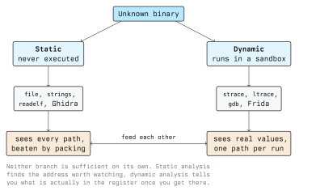

# Different Types of Reverse Engineering

"Reverse engineering" covers a family of techniques, not one procedure. Choosing the wrong one
wastes a day: reading the disassembly of a packed sample shows you the unpacker and nothing else,
and single-stepping a 200 MB firmware image in a debugger is not a plan. This lecture sorts the
techniques by two questions (*do you run the code?* and *what kind of artefact is it?*) and ends
with the defences that exist specifically to make your life harder.

## Static versus Dynamic Analysis

This is the first and most important split.

**Static analysis** examines the artefact without executing it. You read bytes, headers, strings,
instructions and decompiled pseudo-code.

**Dynamic analysis** runs the artefact, under a debugger, a tracer, an emulator or an
instrumentation framework, and observes what it actually does.



| | Static | Dynamic |
| --- | ------ | ------- |
| Executes the sample | No | Yes |
| Coverage | Every code path in the file | Only the paths this run took |
| Values | Constants only | Real runtime values, decrypted buffers |
| Risk | Low | The sample runs on your machine |
| Beaten by | Packing, encryption, obfuscation | Anti-debugging, sandbox detection, time bombs |
| Typical tools | `file`, `strings`, `readelf`, Ghidra | `gdb`, `strace`, `ltrace`, Frida |

They are complements. The standard rhythm is: find the interesting address statically, then break
on it dynamically to see what the registers hold. A packed sample inverts the order: run it under
a debugger until the unpacker has finished, dump the now-plaintext code from memory, then go back
to static analysis on the dump.

Both have a blind spot worth naming. Static analysis can tell you a branch exists but not whether
it is ever taken in practice. Dynamic analysis can tell you exactly what happened once, and tells
you nothing about the branch you did not trigger.

## By Artefact: What Are You Actually Holding?

### Native Binaries

Compiled machine code for a specific architecture and OS: ELF on Linux, PE on Windows, Mach-O on
macOS. This is the hard case and the default assumption for the rest of the module, because the
mapping from source to machine code is lossy and irreversible. Lecture 3 covers it in detail.

### Bytecode and Managed Code

Java, Android (DEX), .NET and Python compile to a bytecode that keeps far more structure than
machine code: class names, method names, field names and types often survive intact. Decompilers
for these targets frequently produce source that recompiles.

```bash
javap -c -p Example.class        # disassemble Java bytecode (JDK tool)
jadx-gui app.apk                 # decompile an Android APK to Java
apktool d app.apk                # unpack resources and Smali
```

For .NET assemblies, ILSpy serves the same role. Compiled Python (`.pyc`) can often be recovered,
but the available decompilers lag behind new interpreter releases, so success depends on the
version that produced the file.

Because so much survives, the defensive answer here is an obfuscator that renames identifiers and
rewrites control flow. It raises cost; it does not restore the secrecy that compiling to machine
code would have given.

### Scripts and Interpreted Code

JavaScript, PowerShell and shell scripts need no decompilation, because the source *is* the artefact. What
you reverse is the obfuscation: minified names, base64 and XOR layers, `eval` of a generated
string. The technique is unwrapping, usually by replacing the final `eval` with a print so the
decoded stage is shown rather than executed. Do that in a sandbox, not in your browser.

### Firmware and Embedded Systems

A firmware image is a container: bootloader, kernel, a filesystem and sometimes an encrypted blob.
The first step is carving it apart rather than disassembling it.

```bash
binwalk firmware.bin             # identify embedded files and filesystems
binwalk -e firmware.bin          # extract what it recognised
file squashfs-root/bin/busybox   # now you have ordinary binaries again
```

Firmware is often MIPS or ARM rather than x86, which changes the instruction set but not the
method. Getting the image in the first place can mean downloading a vendor update, dumping an SPI
flash chip, or attaching to a UART or JTAG header on the board, which is hardware work with its own
toolchain and its own legal constraints.

### Protocols and File Formats

Here the artefact is traffic or data rather than code. You capture many samples, diff them, and
look for length fields, magic bytes, sequence numbers and checksums that move in predictable ways.
Wireshark plus a hex editor plus patience; the matching binary, if you have it, tells you what the
fields mean.

### Hardware

Reading PCB traces, identifying chips from their markings, probing debug headers, and in the
extreme, decapping a chip to image the die. Expensive, slow, and the only option when there is no
software interface at all.

## By Knowledge: Black Box, Grey Box, White Box

An orthogonal axis, borrowed from testing:

- **Black box.** You have the artefact and nothing else. You infer behaviour from inputs and
  outputs.
- **Grey box.** You have partial information: documentation, an older version, debug symbols, a
  related open-source component.
- **White box.** You have source or symbols and are using reverse engineering to check that the
  binary matches them, which is common in supply-chain verification and in build reproducibility work.

Most real work is grey box, and the grey comes from your own research: a leaked header file, an
open-source library the vendor statically linked, a symbol-rich debug build shipped by accident.

## Anti-Reverse-Engineering, and What It Is Worth

Developers who do not want their binary read reach for four families of defence. You need to
recognise each one, because recognising it is most of the work of getting past it.

**Stripping.** Removing the symbol table. Function names disappear and Ghidra falls back to
`FUN_<address>`. Cheap, standard practice, and it only costs you names.

**Packing and encryption.** The real code is stored compressed or encrypted and unpacked into
memory at startup. Tell-tale signs: very few strings, a tiny `.text` with a large high-entropy
section, imports limited to memory-allocation functions. UPX is the common, honest case and
reverses with `upx -d`. Custom packers do not, and the standard answer is to let the program unpack
itself under a debugger and dump memory afterwards.

**Obfuscation.** Control-flow flattening, opaque predicates, junk instructions, string encryption,
virtualised instruction sets. It makes both the disassembly and the decompiler output far harder to
read without changing behaviour.

**Anti-debugging.** Code that detects an attached debugger and changes behaviour. On Linux the
classic is calling `ptrace(PTRACE_TRACEME, ...)` on itself: it fails if a debugger already has the
process, so a non-zero return means "I am being traced". Windows binaries read the
`BeingDebugged` flag through `IsDebuggerPresent`. Timing checks notice that single-stepping is
thousands of times slower than normal execution. The counter-move is to find the check and patch
or hook it, which is a reverse-engineering problem like any other.

The honest assessment: none of these provide security. They buy time, and against an analyst with
the sample in hand, time is all they buy. Kerckhoffs's principle still holds: if the secrecy of
your binary is what protects your users, your users are not protected. Keep secrets on a server you
control, authenticate clients properly, and treat obfuscation as a speed bump for casual copying
rather than a security control.

The legitimate defensive uses are real but narrow: slowing down commodity malware analysis of your
anti-tamper logic, protecting game clients from trivial cheats, and raising the cost of automated
mass-cracking. Each buys hours or days, not secrecy.

## Choosing an Approach

A practical decision order for an unknown Linux sample:

1. `file` and `strings` first. If you see human-readable strings and library names, static analysis
   will be productive.
2. Almost no strings, a high-entropy section, imports limited to `mmap`/`VirtualAlloc`-style
   functions? Assume packing. Plan for unpack-then-dump.
3. Symbols present and the language is managed (Java, .NET, Python)? Decompile first; you may get
   near-source.
4. The question is "what does it do to the system?" rather than "how is it implemented?" Go
   dynamic with `strace`/`ltrace` in a VM and skip the disassembly entirely.
5. The question is about one specific algorithm? Find it statically, then confirm with a debugger
   breakpoint on that one function.

## Key Takeaways

- Static analysis never runs the sample and sees all code paths; dynamic analysis sees real values
  on exactly one path. Serious work uses both.
- Bytecode targets (Java, .NET, Android, Python) retain names and structure and often decompile to
  near-source; native binaries do not.
- Firmware analysis starts with carving the image apart, not with a disassembler.
- Packing, obfuscation and anti-debugging are cost multipliers, not security controls. A secret in
  a distributed binary is a published secret.
- Pick the technique from the question you need answered, and re-pick it when the first ten minutes
  tell you the artefact is not what you assumed.

## Resources

- **jadx**: <https://github.com/skylot/jadx>, Android DEX and APK decompiler
- **ILSpy**: <https://github.com/icsharpcode/ILSpy>, .NET assembly browser and decompiler
- **binwalk**: <https://github.com/ReFirmLabs/binwalk>, firmware analysis and extraction
- **UPX**: <https://upx.github.io/>, the packer worth knowing because it is everywhere
- **Frida**: <https://frida.re/>, dynamic instrumentation for native and mobile targets
- **"Practical Malware Analysis"** by Sikorski and Honig, chapters on packing and anti-analysis
- **"Rootkits and Bootkits"** by Matrosov, Rodionov and Bratus, anti-analysis techniques in the
  wild
