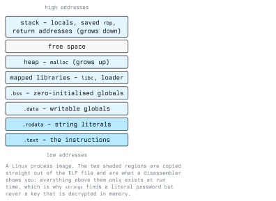

# Analyzing Software Binaries

A compiled binary is not a soup of bytes. It is a structured container with a documented format,
and most of what you need in the first hour of analysis comes from reading that structure rather
than from reading instructions. This lecture covers the layout of an executable, the command-line
tools that expose it, how the file becomes a running process, and how to drive Ghidra once you have
decided where to look.

## Executable File Formats

Three formats dominate:

| Format | Platform | Magic bytes |
| ------ | -------- | ----------- |
| ELF | Linux, BSD, most embedded systems | `7f 45 4c 46` (`\x7fELF`) |
| PE | Windows (`.exe`, `.dll`, `.sys`) | `4d 5a` (`MZ`), then `PE\0\0` |
| Mach-O | macOS, iOS | `cf fa ed fe` and relatives |

They differ in detail and agree in concept. Each has a header saying what architecture the code is
for and where execution starts, a table of sections or segments, a symbol table, and a list of the
external libraries and functions it needs.

Everything below uses ELF, because that is what the lab targets are. The ideas transfer.

## The Parts of an ELF File

The **ELF header** is the first 64 bytes on a 64-bit system and answers the triage questions: is
this 32- or 64-bit, which architecture, is it an executable or a shared object, and at which
address does execution begin.

```bash
readelf -h ./target
```

The **sections** carry the content. The ones that matter constantly:

| Section | Contents | Permissions |
| ------- | -------- | ----------- |
| `.text` | The machine instructions | read + execute |
| `.rodata` | String literals, constant tables, jump tables | read only |
| `.data` | Globals with a non-zero initial value | read + write |
| `.bss` | Globals initialised to zero; takes no space in the file | read + write |
| `.plt` / `.got` | The indirection used to call shared-library functions | varies |
| `.symtab` | Local symbol names; removed by `strip` | not loaded |
| `.dynsym` | Dynamic symbols; needed at run time, survives `strip` | loaded |

```bash
readelf -S ./target          # section headers, sizes, addresses
readelf -l ./target          # program headers: what the loader maps, and with which permissions
```

That last distinction matters. Sections are for the linker and for your tools; **segments**
(program headers) are what the kernel actually maps into memory. A section with no segment never
reaches the running process.

## From File to Process



The loader maps the file's segments at their load addresses, maps the shared libraries the binary
asked for, and sets up the stack. The heap grows later, on demand. Two consequences for analysis:

- Anything in `.rodata` is in the file, so `strings` finds it without running anything. Anything
  built at run time - a decrypted key, a constructed URL, a buffer read from the network - exists
  only in the process and can only be seen with a debugger.
- Modern binaries are usually position-independent (`ET_DYN` in `readelf -h`), so the addresses
  Ghidra shows (often starting at `0x100000`) are not the addresses you will see in a debugger.
  ASLR picks a load base per run. Work in offsets, and add the base when you need a real address.

## Command-Line Triage

```bash
file ./target
# ELF 64-bit LSB pie executable, x86-64, dynamically linked, not stripped

strings -n 6 ./target | sort -u | less      # literals in the file
strings -t x -n 6 ./target                  # with file offsets, useful for cross-referencing

nm -C ./target        # symbols, demangled; fails loudly if the binary is stripped
nm -D -C ./target     # dynamic symbols only; works on stripped binaries too

ldd ./target          # shared libraries required
objdump -d -M intel ./target | less          # full disassembly, Intel syntax
objdump -d -M intel --section=.text ./target # just the code
xxd ./target | head                          # raw bytes
```

`strings` deserves its reputation as the highest-value-per-second tool in reverse engineering.
Error messages, format strings, file paths, URLs, SQL fragments and version banners all land in
`.rodata`, and each one is an anchor you can cross-reference back to the code that uses it.

Its limits are equally important: it finds nothing in a packed binary, nothing that is constructed
at run time, and nothing that is encrypted until the program decrypts it. A sample with suspiciously
few strings is telling you something.

## Reading the Code: What x86-64 Conventions Buy You

You do not have to memorise the instruction set to make progress, but the calling convention is
non-negotiable, because it is how you read function arguments out of a disassembly.

On Linux and other System V x86-64 systems, integer and pointer arguments go in registers in this
order:

```text
rdi, rsi, rdx, rcx, r8, r9        then the stack for further arguments
rax                               holds the return value
```

Windows x64 uses `rcx, rdx, r8, r9` instead - a frequent source of confusion when switching
platforms.

So when you see this:

```asm
lea    rdi, [rip+0x2f1c]
mov    esi, 0x10
call   <memcmp@plt>
test   eax, eax
jne    <fail>
```

you can read it without knowing the rest of the function: the program is comparing 16 bytes against
a constant buffer somewhere in `.rodata`, and branching away on mismatch. That `lea` target is a
good place to put a breakpoint, and that `jne` is the check.

Useful patterns to recognise:

- `push rbp; mov rbp, rsp` - a classic function prologue, with `leave; ret` as the epilogue.
- `sub rsp, N` - allocating N bytes of local stack space; N hints at how large the locals are.
- `test eax, eax; je ...` - "if the result was zero". Very common after a comparison function.
- `xor eax, eax` - set `eax` to 0, cheaper than `mov eax, 0`.
- `call *something@plt` - a call into a shared library. The name tells you what the program is
  doing even when the surrounding code is unreadable.

## Working in Ghidra

The command line does triage; Ghidra does the actual analysis. The workflow:

1. **Create a project** (non-shared is fine) and import the binary. Ghidra detects the format and
   architecture - check that it guessed right.
2. **Run auto-analysis** when prompted. Defaults are reasonable. On a large binary this takes a
   while and only needs doing once.
3. **Open the CodeBrowser.** Three windows do the work: the *Symbol Tree* (functions, imports,
   exports), the *Listing* (disassembly) and the *Decompiler* (pseudo-C for the current function).
4. **Find a foothold.** Either start at `main`, or open the *Defined Strings* window, find an
   interesting string, and follow its cross-references to the code that uses it. Searching from a
   string is usually faster than reading from the entry point.
5. **Rename and retype as you learn.** Press `L` on a function or variable to rename it, and
   `Ctrl+L` to change a variable's type. This is not cosmetic: giving the decompiler a correct type
   often turns three lines of pointer arithmetic into one array access, and the pseudo-C gets
   dramatically more readable as you go.
6. **Follow the cross-references.** `Ctrl+Shift+F` on a symbol lists everywhere it is referenced.
   Who calls this function, and who writes to this global, are the two questions that build a map
   of the program.
7. **Use the function graph** when control flow gets complicated. Seeing the basic blocks and the
   branches between them makes a validation loop obvious in a way a linear listing does not.
8. **Comment relentlessly.** Ghidra saves your annotations in the project. Next week you will not
   remember why you called it `check_license`.

The decompiler is an aid, not an oracle. When its output looks impossible - a variable used before
assignment, a nonsensical cast - drop into the Listing and read the instructions. The disassembly
is ground truth; the pseudo-C is an interpretation.

## A Worked Starting Point

Build a target you own and look at it. Nothing here runs an untrusted binary.

```bash
cat > hello.c <<'EOF'
#include <stdio.h>
#include <string.h>

int main(int argc, char **argv) {
    if (argc > 1 && strcmp(argv[1], "open sesame") == 0) {
        puts("granted");
        return 0;
    }
    puts("denied");
    return 1;
}
EOF

gcc -O0 -g -o hello hello.c
file hello
strings -n 6 hello | grep -i sesame     # the comparison constant is simply in the file
objdump -d -M intel hello | grep -A 20 '<main>:'
```

Then rebuild it as a stripped, optimised binary and compare what survives:

```bash
gcc -O2 -s -o hello_stripped hello.c
nm hello_stripped          # "no symbols"
strings -n 6 hello_stripped | grep -i sesame     # still there
```

The lesson is in that last line. Stripping removes names, not data. The secret string is as visible
as it ever was.

## The Defensive Side

What this lecture implies for anyone shipping software:

- **Never ship a secret in a binary.** Keys, API tokens, hard-coded passwords and "hidden" admin
  endpoints are all one `strings` away. If a client needs to authenticate, give it a per-user
  credential and verify it on a server you control.
- **Enforce decisions server-side.** A licence check, a feature flag or a privilege check that runs
  entirely on the client is advisory. Only a check the attacker cannot reach is a control.
- **Strip release builds and ship debug symbols separately.** It costs an attacker time at no cost
  to your own debugging, as long as you keep the symbol files.
- **Keep the exploit mitigations on.** Compiling position-independent, with stack protectors,
  full RELRO and non-executable stacks does not stop analysis, but it raises the cost of turning a
  bug you found into working exploitation. Check them with a tool such as `checksec`.
- **Sign your binaries.** Signing does not prevent reading, but it makes a modified copy
  detectable, which is the realistic goal.

## Key Takeaways

- An executable is a documented container; read the header, sections and symbols before reading
  instructions.
- `file`, `strings`, `readelf`, `nm` and `objdump` answer most first-hour questions without
  executing anything.
- Sections live in the file, segments are what the loader maps; `.rodata` is visible statically,
  runtime data is not.
- The System V x86-64 argument registers (`rdi, rsi, rdx, rcx, r8, r9`, return in `rax`) let you
  read a call site without decoding the whole function.
- In Ghidra, renaming and retyping as you learn is the work, not a tidy-up afterwards. The
  decompiler output improves as you feed it information.
- Stripping removes names, not data. Treat everything in a shipped binary as public.

## Resources

- **ELF specification and `elf(5)`**: `man 5 elf` on any Linux system
- **"Practical Binary Analysis"** by Dennis Andriesse - ELF internals and disassembly in depth
- **"The Ghidra Book"** by Chris Eagle and Kara Nance
- **Ghidra documentation and course material**:
  <https://github.com/NationalSecurityAgency/ghidra/tree/master/GhidraDocs>
- **Compiler Explorer**: <https://godbolt.org/> - compare source, optimisation level and output
- **System V AMD64 ABI**: <https://gitlab.com/x86-psABIs/x86-64-ABI>
