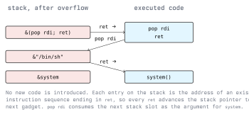

# Return Oriented Programming

Once the stack is non-executable, writing shellcode into a buffer and returning to it stops working:
the processor refuses to execute a page that is not marked executable. Return Oriented Programming
works around that. Instead of introducing new code, the exploit reuses code that is already mapped
and executable, and uses the stack as a program that drives it.

Lab targets only, with written authorization (Module 01).

## 3.1 The Idea

A *gadget* is a short sequence of instructions in the target or in a library that ends in `ret`.
Because `ret` takes its destination from the stack, an attacker who controls the stack controls the
order in which gadgets run. The stack becomes a list of addresses; each `ret` steps to the next
entry.



The simplest useful chain calls a libc function with an argument the attacker chose. On x86-64 the
first argument is in `rdi`, so a chain needs a gadget that loads `rdi` from the stack:

```text
  offset padding  ...............  fill the buffer and the saved rbp
  &(pop rdi; ret)                  <- ret lands here
  &"/bin/sh"                       <- popped into rdi
  &system                          <- ret lands here, with rdi set
```

This pattern, returning into an existing library function with controlled arguments, is called
`ret2libc`, and it predates general ROP. ROP generalises it: with enough gadgets, arbitrary
computation is possible without ever supplying a single byte of new code.

## 3.2 Finding Gadgets

```bash
ROPgadget --binary ./vuln
ROPgadget --binary ./vuln --only "pop|ret"
ropper --file ./vuln --search "pop rdi"
```

Gadget hunting also finds *unintended* instructions. x86 instructions have variable length and are
not aligned, so jumping into the middle of a longer instruction decodes to something entirely
different. That is why a stripped, small binary can still contain hundreds of usable gadgets, and
why counting "the functions in the binary" tells you nothing about its gadget surface.

In pwntools, the chain can be assembled from symbols instead of raw addresses:

```python
from pwn import *

elf  = context.binary = ELF("./vuln")
libc = ELF("/lib/x86_64-linux-gnu/libc.so.6")

rop = ROP(elf)
rop.call(elf.symbols["puts"], [next(elf.search(b"/bin/sh"))])
print(rop.dump())
```

`ROP.dump()` prints the chain with one annotated line per stack slot. Read it before sending it;
most failed chains are visible there.

## 3.3 The Address Problem

A chain needs real addresses, and ASLR plus PIE means they differ on every run.

- **Without PIE** (`-no-pie`), the program's own code sits at a fixed address, so gadgets inside the
  binary are known from the file. Only library addresses are randomised.
- **With PIE**, even the program's own gadgets move. The exploit needs a leak first.

ASLR randomises the *base* of each mapping, not the layout inside it. One leaked address from a
mapping therefore gives the whole mapping, because the offset of every symbol within a library is
fixed by that library's build:

```python
leak = u64(io.recv(6).ljust(8, b"\x00"))          # a libc pointer read out of the process
libc.address = leak - libc.symbols["puts"]         # recover the base
log.info("libc base: %#x", libc.address)
system = libc.symbols["system"]                    # now resolvable
```

Where the leak comes from is the actual work: an uninitialised pointer printed back, a format string
bug (Lecture 4), an out-of-bounds read, or a `puts` of a GOT entry arranged by a first, smaller ROP
chain. A two-stage exploit (chain one leaks, chain two uses the leak) is the normal shape.

The library build has to match the target exactly. An offset taken from your own machine's libc will
be wrong against a target running a different build.

## 3.4 PLT and GOT

Calls into a shared library go through two tables. The Procedure Linkage Table (`.plt`) holds a
small stub per imported function; the Global Offset Table (`.got`) holds the resolved address the
stub jumps to. With lazy binding, a GOT entry is filled in on the first call.

Two consequences:

- A GOT entry contains a library address, which makes it a convenient thing to leak:
  `puts(got["puts"])` prints libc's `puts` address.
- If the GOT is writable, an attacker with an arbitrary write can replace an entry and take control
  the next time that function is called. `-Wl,-z,relro,-z,now` (full RELRO) resolves everything at
  load time and maps the GOT read-only, which closes that path.

## 3.5 Chain Mechanics

Points that decide whether a chain runs or crashes:

- **Stack alignment.** The ABI requires 16-byte alignment of `rsp` at a `call`. Some libc functions
  use SSE instructions that fault on an unaligned stack. Prepending a bare `ret` gadget shifts the
  stack by eight bytes and fixes it.
- **Bad bytes.** If the input path is a string function, no part of the chain may contain `0x00`;
  if it is a line-based read, no `0x0a`. Choose gadgets accordingly.
- **Space.** A buffer may be too small for a full chain. A *stack pivot* (`leave; ret`, or
  `pop rsp`) moves `rsp` into a larger attacker-controlled area, such as a heap buffer, and the
  chain continues there.
- **`syscall` instead of a library.** If a `syscall` gadget exists, the chain can set `rax` to the
  syscall number and call the kernel directly, skipping libc entirely.
- **Ending cleanly.** A chain that ends in an interactive shell must not let the process exit;
  calling `system("/bin/sh")` keeps it alive, returning into nothing does not.

## 3.6 Variants You Will See Named

- **ret2libc**: return directly into a library function with controlled arguments. The minimal
  case of ROP.
- **ret2plt**: call a function through the target's own PLT stub, which needs no library address
  at all.
- **JOP / COP** (jump- and call-oriented programming): the same idea built from indirect `jmp` or
  `call` instead of `ret`, used when a mitigation specifically watches returns.
- **SROP** (sigreturn-oriented programming): forge a signal frame and use the `rt_sigreturn`
  syscall to load every register at once from the stack. One gadget, complete register control.
- **ret2dlresolve**: abuse the dynamic linker's symbol resolution to make it resolve a function by
  name, which avoids needing a libc leak.

## 3.7 What Stops It

ROP exists because NX removed code injection. The mitigations against ROP itself attack either the
addresses or the control flow.

- **ASLR and PIE.** Randomised bases mean the chain needs a leak first. This is the single most
  effective obstacle in practice, which is why building with `-fPIE -pie` matters. Note that a
  32-bit address space leaves little entropy to randomise; on 64-bit it is substantial.
- **Full RELRO.** `-Wl,-z,relro,-z,now` makes the GOT read-only, removing a standard write target
  and the lazy-binding path that `ret2dlresolve` abuses.
- **Control-Flow Integrity.** The compiler restricts each indirect call or jump to a set of legal
  targets computed at build time (`-fsanitize=cfi` in Clang with LTO, or `-fcf-protection` for the
  hardware scheme). A gadget that is not a legal target cannot be reached indirectly.
- **Protected return addresses.** Intel CET adds a shadow stack: a second, protected stack holds a
  copy of each return address and `ret` compares the two. ARM reaches the same goal with
  pointer authentication (PAC), which signs the return address with a key the attacker does not have, and
  the signature is checked before use. Either way, a chain that rewrites return addresses on the
  normal stack is caught at the first `ret`. ARM BTI additionally restricts where an indirect
  branch may land.
- **Fewer gadgets.** Compiling with LTO and dropping unused code shrinks the gadget surface. It
  raises the cost of writing a chain; it does not make one impossible.
- **The underlying bug.** None of the above fixes the overflow. A canary, a bounded copy, or a
  memory-safe language does.

### 3.7.1 Detection

ROP leaves traces a defender can look for: a process whose stack contains a dense run of pointers
into executable regions, repeated crashes in the same function (the offset-finding phase), or a
`SIGSEGV` with `rip` pointing into the middle of an instruction. On the host side, a shell spawned
as a child of a network-facing service is a far stronger signal than anything about the chain
itself, and that is what EDR and auditd rules key on. Module 13 covers the monitoring side.

## 3.8 Exercise

On your own lab VM, using a binary you built with `-fno-stack-protector -no-pie` but with NX left
on (the default):

1. Confirm with `checksec` that NX is enabled and PIE is not.
2. Verify that returning into a shellcode buffer on the stack fails, and read the exact fault.
3. Find a `pop rdi; ret` gadget and the address of a `/bin/sh` string, and build a `ret2libc` chain
   with ASLR disabled for the process (`setarch -R`).
4. Re-enable ASLR, and describe precisely what your chain now needs that it does not have.

## Key Takeaways

- NX stops injected code, so exploits reuse code that is already executable.
- A gadget is any instruction sequence ending in `ret`; on x86 unaligned decoding produces gadgets
  the compiler never emitted.
- The stack is the program: each entry is either a gadget address or data a gadget pops.
- ASLR turns exploitation into a two-stage problem (leak an address, then use it), and a leaked
  symbol gives the whole mapping base.
- Full RELRO, CFI, and hardware shadow stacks (CET, PAC/BTI) attack the chain itself; only fixing
  the memory-safety bug removes it.

## Resources

- Hovav Shacham, "The Geometry of Innocent Flesh on the Bone: Return-into-libc without Function
  Calls (on the x86)", ACM CCS 2007
- Solar Designer's original return-into-libc post, Bugtraq 1997
- ROPgadget: <https://github.com/JonathanSalwan/ROPgadget>; ropper: <https://github.com/sashs/Ropper>
- pwntools ROP API: <https://docs.pwntools.com/en/stable/rop/rop.html>
- Intel CET and Control-flow Enforcement, Intel SDM; ARM Pointer Authentication, Arm Architecture
  Reference Manual
- Clang Control Flow Integrity: <https://clang.llvm.org/docs/ControlFlowIntegrity.html>
