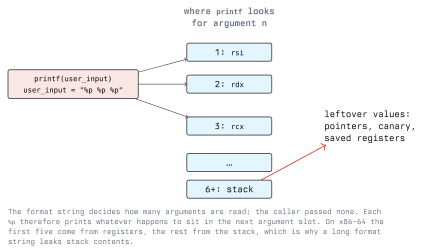

# Format String Vulnerabilities

A format string vulnerability is one of the cheapest bugs to write and one of the most powerful to
exploit. It needs no buffer, no overflow and no size mistake: it is enough to pass attacker input to
`printf` as the format argument. The result is a primitive that reads memory and, with `%n`, writes
to it.

Lab targets only, with written authorization (Module 01).

## 4.1 The Bug

```c
printf(user_input);          /* vulnerable */
printf("%s", user_input);    /* correct */
```

Both lines print the same thing for ordinary input. They differ in who decides what `printf` does.
`printf` is variadic: the format string tells it how many arguments to read and how to interpret
each one. There is no mechanism to check that against what the caller actually passed. If the format
string comes from the user, the user chooses how many arguments `printf` reads.

The same applies to the whole family: `fprintf`, `sprintf`, `snprintf`, `vprintf`, `syslog`,
`err`/`warn`, and the equivalents in other libraries.



On x86-64 the first variadic argument is taken from `rsi`, then `rdx`, `rcx`, `r8`, `r9`, and
everything after that from the stack. With no arguments passed, those locations still hold whatever
the previous code left there.

## 4.2 The Read Primitive

```text
  input            effect
  ------------     ---------------------------------------------------
  %p %p %p %p      print the next four argument slots as pointers
  %10$p            print argument slot 10 directly (positional)
  %s               treat the next slot as a char* and print the string
  %10$s            dereference slot 10 as a string
```

Positional specifiers (`%n$`) are what make this practical: instead of a long chain of `%p`, a
single short string reaches an arbitrary slot. First map out the slots:

```bash
./vuln
# input:
%1$p %2$p %3$p %4$p %5$p %6$p %7$p %8$p
```

Reading that output is the core skill. Values starting with `0x7f` on Linux are typically stack or
library pointers. A value that looks like your own input, decoded as ASCII, tells you which slot the
format string itself occupies, and that slot is the one that lets you choose an address, because
you control its contents.

```python
from pwn import *

for i in range(1, 20):
    io = process("./vuln")
    io.sendline(f"AAAA|%{i}$p".encode())
    log.info("%2d: %s", i, io.recvline().strip().decode())
    io.close()
```

What the read primitive gets you:

- **A stack leak**, which exposes the stack canary and the saved return address. That defeats the
  canary and tells you where the stack is.
- **A code or library leak**, which defeats ASLR and makes the ROP chain in Lecture 3 possible.
- **Arbitrary read.** Place a target address in your input, then dereference that slot with `%s`.

## 4.3 The Write Primitive

`%n` writes the number of characters printed so far to the `int*` in the corresponding argument
slot. It is the one conversion that writes to memory rather than to output.

```text
  %n     write an int   (4 bytes)
  %hn    write a short  (2 bytes)
  %hhn   write a byte   (1 byte)
```

The character count is controllable: `%500c` prints 500 characters, so a following `%n` writes 500.
To write a large 64-bit value, exploits split it into byte- or halfword-sized pieces with `%hhn` or
`%hn` and several writes rather than printing billions of characters.

The practical shape of an arbitrary write is:

1. Put the target address into the format string itself, so it lands on the stack in a slot you have
   identified.
2. Pad with `%Nc` until the printed character count equals the value you want to write.
3. Use `%k$hhn` to write that count to the address in slot `k`.
4. Repeat for the remaining bytes, in increasing order of value, adjusting the padding.

Typical targets: a GOT entry (if the GOT is writable, see RELRO in Lecture 3), a saved return
address on the stack, or a function pointer in a global structure.

pwntools automates the arithmetic:

```python
from pwn import *

elf = context.binary = ELF("./vuln")

def send(payload):
    io = process("./vuln")
    io.sendline(payload)
    io.recvall()

# offset = the slot the format string itself occupies, measured in 4.2
payload = fmtstr_payload(6, {elf.symbols["target_var"]: 0xdeadbeef})
send(payload)
```

`fmtstr_payload(offset, writes)` builds the padding and the `%n` sequence. The offset must be
measured first; a wrong offset writes to the wrong place.

## 4.4 Why This Bug Keeps Appearing

- Logging. `syslog(LOG_INFO, msg)` with a user-controlled `msg` is the classic instance.
- Error paths. A rarely taken branch formats something unusual and nobody reviewed it.
- Refactoring. A constant format string is replaced by a variable that later becomes
  user-influenced.
- Translation and templating. A format string loaded from a locale file or a configuration file
  that an attacker can influence is still a format string.

## 4.5 What Stops It

### 4.5.1 Never let input be the format string

The whole bug class disappears if the format string is always a literal:

```c
printf("%s", user_input);
fputs(user_input, stdout);          /* simpler still, when no formatting is needed */
syslog(LOG_INFO, "%s", msg);
```

### 4.5.2 Let the compiler find it

```bash
gcc -Wall -Wformat -Wformat-security -Werror=format-security -O2 -D_FORTIFY_SOURCE=2 -c app.c
```

`-Wformat-security` warns about a non-literal format string with no arguments, which is exactly the
vulnerable pattern; `-Werror=format-security` makes it fail the build. This check is cheap, has
almost no false positives, and should be on in every C project. Several distributions enable it in
their default build flags.

For your own variadic wrappers, tell the compiler the format is a format:

```c
void log_msg(const char *fmt, ...) __attribute__((format(printf, 1, 2)));
```

The argument check then applies to your function too.

### 4.5.3 Fortified libc

A fortified glibc build restricts `%n` when the format string is in writable memory, which removes
the write primitive in the most common configuration. It does not remove the read primitive, and it
is a mitigation, not a fix.

### 4.5.4 Mitigations that help indirectly

Full RELRO removes the GOT as a write target. ASLR means an address leaked in one run is useless in
the next. Neither prevents the leak itself, which is why a format string bug is treated as critical
even when no write is possible: leaking the canary and a library base is often the missing piece of
somebody else's exploit.

### 4.5.5 Detection

A format string bug is visible in logs: input containing runs of `%p`, `%s`, `%n` or `%N$` reaching
a logging interface, and output lines containing unexpected `0x7f...` values. A WAF or log pipeline
can alert on that pattern, and a crash in `vfprintf` with a user-derived format is a strong
indicator. Grepping a C codebase for `printf(` followed by a non-literal is a five-minute audit
worth doing on any legacy project.

## 4.6 Exercise

On your own lab VM, with a small program that calls `printf(buf)` on a line it read from stdin:

1. Map slots 1 to 20 with positional `%p` and identify which slot holds your own input.
2. Leak the stack canary and explain how you recognised it.
3. Use `%s` with an address you supply to read a string from `.rodata`.
4. Change a global `int` to a chosen value using `fmtstr_payload`, then write the same payload by
   hand and account for every byte of padding.
5. Rebuild with `-Werror=format-security` and show the build failing.

## Key Takeaways

- The bug is a user-controlled format string, not a buffer problem; `printf(user_input)` is the
  whole vulnerability.
- The format string decides how many arguments are read, so `%p` walks registers and then the
  stack, leaking canaries, stack and library addresses.
- Positional specifiers (`%7$p`) make reaching a specific slot trivial.
- `%n` turns the bug into an arbitrary write, built from several small writes with `%hhn`.
- Fix: a literal format string, always. Enforce it with `-Werror=format-security` and
  `__attribute__((format(printf, ...)))` on your own wrappers.
- Even a read-only format string bug is critical, because the leak defeats canaries and ASLR for
  another exploit.

## Resources

- `man 3 printf`: the conversion specifications, including `%n` and `%n$`
- GCC warning options, `-Wformat-security`:
  <https://gcc.gnu.org/onlinedocs/gcc/Warning-Options.html>
- GCC common function attributes, `format`:
  <https://gcc.gnu.org/onlinedocs/gcc/Common-Function-Attributes.html>
- pwntools `fmtstr` module: <https://docs.pwntools.com/en/stable/fmtstr.html>
- CWE-134 Use of Externally-Controlled Format String: <https://cwe.mitre.org/data/definitions/134.html>
- scut / team teso, "Exploiting Format String Vulnerabilities" (2001), the original write-up
