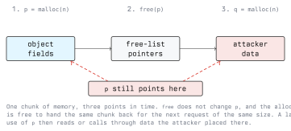

# Heap Exploitation

The stack has a fixed, compiler-known layout. The heap does not: the allocator hands out blocks at
runtime, mixes its own bookkeeping with the caller's data, and recycles memory aggressively. That
mixture is what makes heap bugs both common and productive. This lecture covers the structures
involved, the three bugs that matter, and what removes them.

Heap internals are allocator-specific. The descriptions below follow glibc's `malloc`, which is what
you meet on Linux, and the exact details differ between allocator versions and between allocators.
Treat the concepts as stable and verify the specifics on the target you are actually looking at.

Lab targets only, with written authorization (Module 01).

## 5.1 How the Allocator Thinks

`malloc` carves memory into *chunks*. A chunk is a header followed by the region the caller sees:

```text
  +----------------------------+  <- chunk start (what free() is given, minus the header)
  |  size of previous chunk    |   only meaningful when the previous chunk is free
  +----------------------------+
  |  size of this chunk | flags|   size is rounded; the low bits are flags,
  +----------------------------+   including "previous chunk in use"
  |                            |  <- the pointer malloc() returned
  |  user data                 |
  |                            |
  +----------------------------+
  |  size of previous chunk    |  <- header of the next chunk
  +----------------------------+
```

Two facts follow directly from this layout:

1. The allocator's metadata sits immediately *before* and *after* the caller's data. A write past
   the end of a heap buffer lands in the next chunk's header.
2. When a chunk is freed, its user area is no longer needed by the caller, so the allocator stores
   its own linked-list pointers there. Freed memory therefore contains pointers, not the old data.

Freed chunks go onto free lists ("bins") grouped by size so the next request of that size can be
served without touching the operating system. glibc additionally keeps a small per-thread cache
(the tcache) in front of those bins. The practical consequence for exploitation: **freeing and
immediately re-allocating the same size usually returns the same chunk.**

Inspect this directly instead of trusting a diagram. With a glibc heap plugin loaded in `gdb`:

```text
  (gdb) heap chunks
  (gdb) heap bins
  (gdb) vis_heap_chunks
```

## 5.2 Heap Overflow

The simplest heap bug is the same bug as Lecture 2 in a different region:

```c
char *name = malloc(32);
read(0, name, 128);        /* writes 96 bytes past the end of the allocation */
```

What follows `name` is not a return address, so there is nothing to hijack directly. Instead the
overflow reaches:

- **The next chunk's size field.** Forging a larger size makes a later `free` or `malloc` treat
  memory belonging to another object as part of this chunk, which produces overlapping allocations:
  two live pointers to the same bytes.
- **Another object's fields.** If the next chunk holds a structure with a function pointer, a
  length, or a privilege flag, the overflow sets it. This needs no allocator knowledge at all and
  is the most common real-world heap exploit.

Heap layout is not luck. An exploit arranges it deliberately, a technique called *heap grooming*
or feng shui, by making the program allocate and free objects in a chosen order so that the
overflowable buffer ends up adjacent to the interesting object.

## 5.3 Use-After-Free

```c
free(session);
/* ... later ... */
if (session->is_admin) { ... }        /* session is a dangling pointer */
```

`free` releases the memory. It does not change the pointer, and the compiler does not track
lifetimes. Whoever gets that chunk next decides what the dangling pointer sees.



The exploitation pattern is mechanical:

1. Make the program allocate the object and keep a reference.
2. Make it free the object without clearing the reference.
3. Make it allocate something of the same size that the attacker fills: a string, a request body,
   a name field. The allocator hands back the same chunk.
4. Make it use the stale reference. Reads now return attacker data; a call through a function
   pointer in that object transfers control.

A *type confusion* is the same shape with different mechanics: the reused chunk is interpreted as a
different type than it holds, so a field the attacker controls as data is read as a pointer.

Use-after-free is the dominant memory-safety bug class in large C++ codebases such as browsers and
kernels, because object lifetimes there are genuinely hard to reason about, while a bounded `memcpy`
is easy to get right.

## 5.4 Double Free and Free-List Corruption

```c
free(p);
free(p);        /* the same chunk is now on the free list twice */
```

A chunk that appears twice on a free list is handed out twice. Two independent parts of the program
then hold writable pointers to the same memory, and one of them is writing allocator pointers into
it. From there an attacker can corrupt the list itself:

- A free-list entry is just a pointer stored in freed user data. If the attacker can write to a
  freed chunk (via a use-after-free or an overflow), they can replace that pointer with an address
  of their choice.
- The next allocations walk the corrupted list and eventually return a pointer to that address.
  `malloc` returning an attacker-chosen address is an arbitrary write primitive, and it is why
  techniques with names like "tcache poisoning" or "fastbin dup" all reduce to the same idea.

Modern glibc pushes back on this: it keeps a key in freed tcache entries to detect an immediate
double free, and stores free-list pointers obfuscated against the location that holds them
("safe-linking") so that a naive overwrite produces an unusable pointer. These raise the bar; they
assume the attacker cannot leak the heap base, and they do not fix the bug.

## 5.5 Finding Heap Bugs

This is where tooling beats reading code.

```bash
gcc -fsanitize=address -g -O1 -o app_asan app.c      # ASan: UAF, double free, overflow
valgrind --leak-check=full ./app                     # no rebuild needed, much slower
```

AddressSanitizer catches a use-after-free at the moment of the stale access and prints three stack
traces: where the object was allocated, where it was freed, and where it was used. For C++, build
the test suite with ASan and run it in CI; for input-parsing code, add a fuzzer so the test inputs
are generated rather than written.

Run the sanitizers against your own code, in your own lab, never against somebody else's service.

## 5.6 What Stops It

### 5.6.1 Code patterns

- Free exactly once, in exactly one place. One owner per allocation.
- Set the pointer to `NULL` after `free`. A crash on a null dereference is a bug report; a
  use-after-free is a vulnerability. (Careful: this only helps for the pointer you nulled, not for
  copies of it elsewhere.)
- In C++, use `std::unique_ptr` and `std::shared_ptr` rather than raw `new`/`delete`, and
  `std::vector`/`std::string` rather than manual buffers. Lifetime then follows scope.
- Calculate sizes in `size_t` and check for overflow before allocating. `calloc(n, size)` performs
  that check for you and zeroes the result.
- Zero sensitive heap data before freeing it, so a later leak of that chunk exposes nothing.

### 5.6.2 Allocator and platform hardening

- Allocator integrity checks: size sanity on `free`, double-free detection, obfuscated free-list
  pointers. Enabled by default in current glibc.
- A hardened allocator (such as those used by browsers, or `scudo` on Android) adds randomised
  placement, guarded pages and quarantines, which makes grooming unreliable.
- Sampling detectors like GWP-ASan catch heap errors in production at a small performance cost.
- ARM Memory Tagging (MTE) tags every allocation and pointer and traps on a mismatch, which
  detects both overflow and use-after-free in hardware.
- `MALLOC_CHECK_` and `MALLOC_PERTURB_` are useful for debugging on glibc; they are not a security
  control for production.

### 5.6.3 Language choice

A heap overflow and a use-after-free are both impossible in safe Rust, Go, Java or C#. For new code
that parses untrusted input, this is the decision with the largest effect per hour spent.

### 5.6.4 Detection in operation

Allocator-detected corruption aborts the process with a message such as `double free or corruption`
or `malloc(): invalid size`. Those lines in a service log are a security event, not a reliability
nuisance: they mean memory corruption happened. Collect crashes centrally, keep core dumps for
services handling untrusted input, and alert on repeated aborts in the same function. The
offset-finding phase of exploit development looks exactly like that. Module 13 covers the response
side.

## 5.7 Exercise

On your own lab VM, with a small C program that allocates two 32-byte structures, where the second
contains a function pointer:

1. Print the addresses returned by `malloc` and work out the distance between the two chunks.
   Compare it with `sizeof` the structure, and explain the difference.
2. Overflow the first allocation into the second and change the function pointer. Observe the
   effect.
3. Free one structure, allocate a same-sized buffer you fill, and show that the two overlap.
4. Rebuild with `-fsanitize=address` and record exactly what ASan reports for each of the two bugs.

## Key Takeaways

- The allocator stores its metadata next to caller data and its free-list pointers inside freed
  chunks, so heap corruption yields both data and pointers.
- A heap overflow most often targets the *next object* rather than the allocator: a function
  pointer or a flag in the adjacent chunk.
- Use-after-free works because `free` does not change the pointer and the same chunk comes back on
  the next same-sized allocation.
- Double free puts one chunk on a free list twice; corrupting that list makes `malloc` return an
  attacker-chosen address, which is an arbitrary write.
- Heap layout is arranged deliberately by driving the program's own allocation pattern.
- Defences: single ownership, smart pointers, checked size arithmetic, ASan plus fuzzing in CI,
  hardened allocators, MTE where available, and a memory-safe language for new code.
- Allocator abort messages in production logs are security events.

## Resources

- `man 3 malloc`, `man 3 free`, `man 3 calloc`; glibc manual, "Memory Allocation"
- glibc source, `malloc/malloc.c`: the authoritative description of the chunk layout and bins
- AddressSanitizer: <https://github.com/google/sanitizers/wiki/AddressSanitizer>
- GWP-ASan: <https://llvm.org/docs/GwpAsan.html>
- ARM Memory Tagging Extension, Arm Architecture Reference Manual
- CWE-416 Use After Free, CWE-415 Double Free, CWE-122 Heap-based Buffer Overflow:
  <https://cwe.mitre.org/>
- how2heap, a maintained collection of heap techniques against specific glibc versions:
  <https://github.com/shellphish/how2heap>
