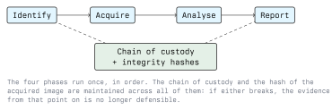

# Introduction to Digital Forensics

Digital forensics is the application of investigative method to data: recovering it, proving where it
came from, and explaining what it means, in a way that holds up when somebody else checks the work.
The last part is what separates forensics from ordinary troubleshooting. An administrator who finds
the cause of an outage is done when the service is back. A forensic examiner is done when another
examiner, given the same evidence, reaches the same conclusion.

This lecture covers what the discipline is for, the process it follows, the principles that make a
result defensible, and the legal frame it operates in here in Austria.

## 1.1 Where Forensics Fits

Forensics is one activity inside incident response, not a synonym for it. During an incident the
priority is usually to stop the damage; forensics answers the questions that come afterwards.

- **Incident response** asks: what is happening, how do we contain it, how do we recover?
- **Forensics** asks: what exactly happened, in what order, by whom, and what can we prove?

The two pull in opposite directions. Pulling the power cable contains an attack and destroys the
contents of RAM. Reimaging a laptop restores a user to work and erases the evidence. Deciding
between them is a judgement call made before the hands touch the keyboard, not after.

Typical reasons an organisation opens a forensic investigation:

- A suspected intrusion, to establish scope: which systems, which accounts, which data.
- Suspected insider activity, such as data taken on the way out of a job.
- A legal dispute or a criminal complaint, where the result will be used as evidence.
- A regulatory obligation. Under the GDPR a controller has to assess what personal data was
  affected by a breach before it can report meaningfully, and that assessment is forensic work.
- Post-incident improvement: finding the initial access path so the hole gets closed.

## 1.2 Branches of the Discipline

The method is the same; the artefacts differ.

| Branch | Primary evidence | Typical questions |
| ------ | ---------------- | ----------------- |
| Disk / host forensics | Disk images, file systems, OS artefacts | What was installed, opened, deleted? |
| Memory forensics | A RAM capture | What was running? What was decrypted in memory? |
| Network forensics | Packet captures, flow records, proxy and DNS logs | What was transferred, and to where? |
| Mobile forensics | Phone acquisitions, app databases | Messages, location history, app use |
| Cloud forensics | Provider audit logs, snapshots | Which API calls, by which identity? |
| Malware analysis | A suspicious binary | What does this sample do? |

Cloud and mobile both share a problem: you do not own the hardware, so acquisition depends on what
the provider or the device exposes. That constraint shapes the whole investigation.

## 1.3 The Forensic Process



The phase names vary between standards; ISO/IEC 27037 and NIST SP 800-86 both describe the same
shape. What matters is that the order is fixed and that nothing skips backwards.

### 1.3.1 Identification

Decide what is in scope and what counts as evidence. This phase produces the authorisation and the
list of systems, not data.

### 1.3.2 Acquisition and Preservation

Copy the evidence without changing it, and prove the copy is faithful. Covered in detail in the next
lecture.

### 1.3.3 Analysis

Work on the copy. Build a timeline, correlate artefacts, test hypotheses against the data.

### 1.3.4 Presentation

Write it up so that a reader who is not a forensic examiner can follow the reasoning and a reader
who is can reproduce it.

## 1.4 Core Principles

### 1.4.1 Work on a Copy, Never the Original

Every examination runs against an image. The original device is sealed and stored. If the analysis
corrupts something, you make a fresh copy from the original and start again.

### 1.4.2 Integrity Is Proven by Hash, Not Asserted

A cryptographic hash is taken of the source and of the image at acquisition time, recorded, and
re-verified before each later use. If the hash still matches, the data has not changed since
acquisition. Use SHA-256. MD5 still appears in older tooling and reports, but practical collisions
for MD5 have been public since 2004, so it is no longer a sound integrity argument on its own.

```bash
sha256sum /dev/sdb              # hash of the source device
sha256sum evidence.dd           # hash of the image, must match
```

### 1.4.3 Any Interaction Changes the System

There is no read-only way to interact with a running computer. Running a tool allocates memory,
touches the page cache, and writes log entries. The principle cannot be "change nothing", which is
impossible. It is to know and record what you changed. Note the tool, the version, the time, and
the account used.

### 1.4.4 Document As You Go

Notes written during the work are evidence of method. Notes reconstructed a week later are a story.
Record commands verbatim, with timestamps and the time zone. In a mixed-source timeline, convert
everything to UTC and say so.

### 1.4.5 Order of Volatility

Collect the data that disappears fastest first. RFC 3227 sets out the classic ordering:

```text
  most volatile
  |  CPU registers, cache
  |  RAM: running processes, network connections, open files
  |  Network state: ARP cache, routing table, sockets
  |  Running system: logged-on users, loaded kernel modules
  |  Disk: file systems, swap, hibernation file
  |  Remote and off-system logs
  |  Physical configuration, backups, archived media
  least volatile
```

This is why a live capture of RAM, if it is going to be taken at all, is taken before the machine is
shut down, and why "unplug it immediately" is sometimes exactly the wrong move.

### 1.4.6 Repeatability

Another examiner with your image, your notes, and comparable tools must reach your conclusion. This
rules out findings that rest on a tool's verdict alone. If a tool reports a file as deleted at a
given time, the report explains which artefact says so.

## 1.5 Anti-Forensics

Suspects and attackers interfere with evidence, and recognising the interference is part of the job.

- **Timestamp manipulation (timestomping):** file times set to arbitrary values. Detected by
  comparing redundant time sources: on NTFS, the `$STANDARD_INFORMATION` and `$FILE_NAME`
  attributes both carry timestamps, and tampering usually updates only one of them.
- **Secure deletion and wiping:** overwriting file content or whole devices. Full-device wipes are
  obvious; targeted wiping leaves a conspicuous hole in an otherwise continuous timeline.
- **Log clearing:** on Windows, clearing an event log is itself logged as an event. A log that
  starts abruptly, with nothing before a certain time, is a finding in its own right.
- **Encryption:** full-disk encryption makes a powered-off disk useless. This is the single
  strongest argument for capturing RAM while the machine is running, since the volume key is held
  in memory.
- **Living off the land:** using built-in tools rather than dropping files, which leaves no new
  binary to find. The evidence moves from the file system to process and command-line logs.

The defensive counterpart to all of this is **evidence that leaves the host**. Logs forwarded in
near real time to a central collector, with append-only storage, cannot be cleaned up by somebody
who later gains administrative access to the source machine. Local-only logging makes the
investigation depend entirely on the attacker's tidiness.

## 1.6 Legal and Ethical Frame

Forensic work touches other people's data by definition, so it needs a basis before it starts.

- **Authorisation in writing, before any acquisition.** Who asked, what systems, what time window,
  what you may and may not do. Without it, examining a system can itself fall under
  StGB §118a (unlawful access to a computer system), and a careless tool choice that destroys data
  can touch §126a (damage to data) or §126b (disruption of the functioning of a computer system).
- **Personal data.** An image of a work laptop contains private messages, health information and
  data about third parties who never consented. The GDPR applies: collect what the scope needs,
  keep it only as long as the investigation does, restrict who can access it.
- **Employee monitoring.** In Austria, measures that systematically monitor employees generally
  require involvement of the works council (Betriebsrat) where one exists. This is a question to
  settle with legal counsel before the examination, not during it.
- **Criminal matters.** If a crime is suspected, the seizure of evidence by the authorities follows
  the StPO and is not something a private examiner performs on their own initiative. The practical
  rule: preserve, do not seize, and get advice early.

Module 01 covers the legal detail. Treat this section as a reminder of which questions to ask, not
as legal advice.

## 1.7 Tooling

You will meet these throughout the module. Open-source tools are preferred in teaching because the
method is inspectable.

| Purpose | Tools |
| ------- | ----- |
| Imaging | `dd`, `dc3dd`, `ewfacquire` (libewf), Guymager, FTK Imager |
| File system analysis | The Sleuth Kit (`mmls`, `fsstat`, `fls`, `icat`), Autopsy |
| Memory analysis | Volatility 3, AVML, WinPmem, LiME |
| Timeline building | Plaso (`log2timeline.py`, `psort.py`), `mactime` |
| Carving | PhotoRec, Foremost, Scalpel, `bulk_extractor` |
| Network | Wireshark, `tshark`, `tcpdump`, Zeek |
| Metadata | `exiftool`, `strings`, `binwalk` |

A courtroom does not care which tool you used; it cares whether the result is reproducible and
whether you can explain what the tool did.

## 1.8 Exercise

Set this up in your own lab, on a machine you own.

1. Create a small file system image: a 64 MB file, formatted, with a few files written into it, then
   one of them deleted.
2. Hash the image with `sha256sum` and write the value down on paper.
3. Mount it read-only, list the files, unmount it, and hash again. Does the value match?
4. Mount it writable, list the files, unmount, hash again. Explain the result.
5. Write a short acquisition note for steps 1 to 4: what you ran, when, with which tool version.

Step 4 is the point of the exercise. Nothing you did was intended as a modification.

## Key Takeaways

- Forensics is distinguished from troubleshooting by the requirement that a result be reproducible
  by somebody else.
- Containment and evidence preservation conflict. Decide between them deliberately, in advance.
- Work on copies, prove integrity with SHA-256, and record every interaction. You cannot avoid
  changing a live system, only document the change.
- Collect in order of volatility: memory before disk, disk before archives.
- Full-disk encryption and log clearing both argue for the same control: capture volatile state
  while it exists, and ship logs off the host as they are written.
- Get written authorisation first. In Austria an unauthorised examination can itself be an offence
  under StGB §118a, and the data involved is almost always personal data under the GDPR.

## Sources

- ISO/IEC 27037, *Guidelines for identification, collection, acquisition and preservation of digital
  evidence*
- ISO/IEC 27041, 27042 and 27043, on assurance, analysis and incident investigation principles
- NIST SP 800-86, *Guide to Integrating Forensic Techniques into Incident Response*:
  <https://csrc.nist.gov/publications/detail/sp/800-86/final>
- RFC 3227, *Guidelines for Evidence Collection and Archiving*: <https://www.rfc-editor.org/rfc/rfc3227>
- Scientific Working Group on Digital Evidence (SWGDE) best practice documents:
  <https://www.swgde.org/documents>
- Carrier, *File System Forensic Analysis* (Addison-Wesley)
- The Sleuth Kit documentation: <https://sleuthkit.org/sleuthkit/docs.php>
