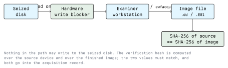

# Digital Evidence Acquisition

Acquisition is the step where evidence is copied out of the system that holds it. Everything later in
the investigation rests on it: an analysis of a bad image produces confident, wrong answers. This
lecture covers how to acquire disks, memory and network data, how to prove the copy is faithful, and
what to record while doing it.

All of it assumes written authorisation is already in place. See Module 01.

## 2.1 What a Forensic Copy Is

An ordinary file copy takes the files a file system is willing to show you. A forensic image takes
the whole block device, sector by sector, including:

- the partition table and the gaps between partitions,
- space marked as free, which still holds the content of deleted files,
- file slack, the unused tail of the last block of every file,
- swap and hibernation files,
- areas the operating system never mounts.

```text
   file copy           ->  allocated file content only
   partition image     ->  one file system, including its free space
   full device image   ->  every sector of the device
```

Default to a full device image. A partition image loses the partition table and anything outside the
partitions, which is exactly where somebody hiding data would put it.

## 2.2 The Acquisition Path



### 2.2.1 Write Blocking

A disk attached to a running operating system gets written to. Desktop systems mount volumes, index
them, create recycle-bin and thumbnail metadata, and journal file systems replay on mount. A
**hardware write blocker** sits between the disk and the examiner workstation and physically refuses
write commands. It is the standard tool for this job.

Software blocking is the fallback, not the preference:

```bash
blockdev --setro /dev/sdb        # mark the block device read-only
blockdev --getro /dev/sdb        # verify: 1 means read-only
```

This relies on the kernel honouring the flag, which a hardware blocker does not. If you must mount
a file system at all, mount it read-only from the image, never from the device:

```bash
mount -o ro,noload,loop,offset=$((2048 * 512)) evidence.dd /mnt/evidence
```

`noload` tells ext3/ext4 not to replay the journal, which would otherwise be a write.

### 2.2.2 Imaging Tools

`dd` is universal and does the job, but it is silent about progress and stops at the first read
error:

```bash
dd if=/dev/sdb of=/mnt/case/evidence.dd bs=4M conv=noerror,sync status=progress
```

`conv=noerror,sync` keeps going past a bad sector and pads the unreadable part with zeros, so the
offsets of everything after it stay correct. Without `sync` the image shifts and becomes useless.

Forensic variants hash while they read, so the source is read once:

```bash
dc3dd if=/dev/sdb of=evidence.dd hash=sha256 log=evidence.log
```

The Expert Witness Format (`.E01`) is the common container format. It compresses, stores case
metadata in the file, and keeps per-chunk CRCs so corruption is localised rather than fatal:

```bash
ewfacquire -t evidence -f encase6 -d sha256 /dev/sdb
ewfverify evidence.E01
```

Mount an E01 image for tools that only understand raw:

```bash
ewfmount evidence.E01 /mnt/ewf      # exposes /mnt/ewf/ewf1 as a raw device
```

Guymager is a graphical front end that produces raw or E01 images and does the hashing for you. It
is the practical choice in a lab exercise.

### 2.2.3 Verification

Two hashes, both recorded:

```bash
sha256sum /dev/sdb        > source.sha256
sha256sum evidence.dd     > image.sha256
diff <(cut -d' ' -f1 source.sha256) <(cut -d' ' -f1 image.sha256)
```

If they differ, the image is not usable. Common causes: the source was written to during
acquisition, a read error was padded, or the device size was misreported. Investigate before you
re-run, because a mismatch is information.

For E01, verification is built in: `ewfverify` recomputes the stored digest. Note that the hash of
an `.E01` *file* is not the hash of the acquired data; the digest inside it is.

A damaged or failing disk may not produce a stable hash at all, because reads of bad sectors are not
deterministic. Say so in the report rather than hiding it. Per-segment hashes let you show which
parts of the image are stable.

## 2.3 Live Acquisition

A running system is sometimes the only source: full-disk encryption is unlocked, a server cannot be
taken down, or the interesting state only exists in memory.

### 2.3.1 Memory

Memory holds process lists, network connections, injected code, command-line arguments, decrypted
content and encryption keys. None of it survives shutdown.

Capture with a tool that runs from your own trusted media and writes to external storage:

```bash
# Linux
avml /mnt/case/memory.lime

# Windows (from the examiner's own removable media)
winpmem_mini_x64.exe E:\case\memory.raw
```

Three facts about memory capture:

- The capture tool runs on the machine being captured, so it appears in its own capture. Record the
  tool and its version.
- RAM changes during the read, so the image is not a consistent snapshot. Analysis has to tolerate
  that.
- On a machine with full-disk encryption, this is where the volume key lives. Capturing memory
  before shutdown can be the difference between an investigation and a brick.

### 2.3.2 Volatile System State

Collected alongside memory, in order of volatility, from trusted binaries:

```bash
date -u                   # record the time and the offset first
ps auxww                  # processes with full command lines
ss -tupan                 # sockets with owning process
ip neigh                  # ARP cache
ip route
lsof -n -P                # open files and deleted-but-open files
lsmod                     # loaded kernel modules
w; last                   # sessions
```

Pipe each to a file on external storage and hash the files when done. Do not redirect output onto
the system under examination.

Everything above is read through the kernel of a possibly compromised machine, so a rootkit can lie
to all of it. That is why the memory image matters: it can be analysed independently of the
kernel's own reporting.

### 2.3.3 Disk Imaging on a Live System

Imaging a mounted file system produces an inconsistent image: files change while you read. It is
still worth doing when the alternative is nothing, and in virtualised environments a hypervisor
snapshot is usually a better source. State clearly in the report that the image was taken live.

## 2.4 Network Acquisition

```bash
tcpdump -i eth0 -s 0 -w /mnt/case/capture.pcap
tcpdump -i eth0 -s 0 -w /mnt/case/cap-%Y%m%d-%H%M.pcap -G 3600 -W 24
```

`-s 0` captures whole packets rather than a truncated header. The second form rotates hourly and
keeps the last 24 files, which is how you run a capture that has to survive for a while.

Full packet capture is expensive to store, so in practice an investigation leans on records that are
already being kept: firewall and proxy logs, NetFlow or IPFIX records, DNS query logs, and Zeek
connection logs. Most traffic is TLS-encrypted anyway, so the metadata (who talked to whom, when,
how much) is often the whole of the available evidence.

Hash the capture file when the capture ends, the same as any other acquisition.

## 2.5 Cloud and Mobile

You cannot attach a write blocker to a service you do not control.

- **Cloud:** evidence is the provider's audit log and whatever snapshot facility exists. Take a
  snapshot of the volume, export it, and hash the export. Audit logs are usually exported as JSON or
  CSV; hash the export and note the query and the time range used, because re-running the query
  later will not produce an identical file. The real control here is preparation: audit logging must
  be enabled, and retained somewhere the account being investigated cannot delete, before anything
  happens.
- **Mobile:** what you can get depends on the device, its OS version and its lock state. A logical
  acquisition through the device's own backup interface is the usual floor. Full physical
  acquisition generally needs commercial tooling and is not always possible. Record which method was
  used, because it determines what is absent.

## 2.6 Documentation and Chain of Custody

An image without a record is a file of unknown provenance. The record is part of the evidence.

An acquisition record contains at minimum:

- case identifier, examiner name, date and time with time zone;
- device make, model, serial number, capacity, and a photograph of the label;
- how the device was isolated: write blocker make and model, or the software method used;
- tool and version, and the exact command line;
- source hash, image hash, algorithm, and the result of the comparison;
- anything unexpected: read errors, size mismatches, a disk that was already powered on.

The **chain of custody** is the separate, continuous record of who held the evidence. Every transfer
gets a line: who handed over, who received, when, and the condition of the seal. A gap in the chain
is not a paperwork problem; it is a reason for a court to disregard the evidence.

```text
  Item 09-001  Seagate ST1000, S/N XXXXXXX, 1 TB
  2026-03-02 09:14Z  seized, sealed bag #4471        M. Example   (sig)
  2026-03-02 11:40Z  received into evidence store    A. Keeper    (sig)
  2026-03-03 08:05Z  released for imaging            A. Keeper -> B. Examiner
  2026-03-03 15:22Z  returned, seal intact, re-bag   B. Examiner -> A. Keeper
```

## 2.7 Exercise

Use a USB stick you own and do not mind overwriting.

1. Put a few files on it, delete one, and unmount it.
2. Attach it and set it read-only with `blockdev --setro`. Confirm with `--getro`.
3. Image it twice: once with `dd`, once with `ewfacquire`. Hash both results.
4. Run `ewfverify` on the E01 and compare the reported digest with your `dd` image's hash. Explain
   why the E01 file's own `sha256sum` differs from both.
5. Write the acquisition record for what you did, using the list in 2.6.
6. Now remove the read-only flag, mount the stick writable, unmount it, and re-image. Compare the
   hash with step 3 and account for the difference.

## Key Takeaways

- Image whole devices, not file systems, and never work on the original.
- Use a hardware write blocker. `blockdev --setro` is a fallback that depends on the kernel
  cooperating.
- `conv=noerror,sync` keeps offsets correct when `dd` hits a bad sector; without `sync` the image is
  worthless.
- Hash source and image with SHA-256 and record both. A mismatch is a finding, not a retry.
- Capture memory before shutting down, especially with full-disk encryption in play. A live capture
  is inconsistent by nature, and that belongs in the report.
- Tools on a compromised host can be lied to by the kernel; the memory image is what lets you check.
- Cloud and mobile acquisition is bounded by what the provider or device exposes, so the defensive
  work is enabling and protecting audit logs in advance.
- Chain of custody is continuous and signed. A gap can cost the evidence.

## Sources

- ISO/IEC 27037, *Guidelines for identification, collection, acquisition and preservation of digital
  evidence*
- NIST SP 800-86, *Guide to Integrating Forensic Techniques into Incident Response*
- NIST Computer Forensics Tool Testing (CFTT), write blocker and imaging tool test reports:
  <https://www.nist.gov/itl/ssd/software-quality-group/computer-forensics-tool-testing-program-cftt>
- RFC 3227, *Guidelines for Evidence Collection and Archiving*
- libewf and `ewfacquire` documentation: <https://github.com/libyal/libewf>
- Guymager: <https://guymager.sourceforge.io/>
- Volatility Foundation, on memory acquisition: <https://volatilityfoundation.org/>
- AVML: <https://github.com/microsoft/avml>
