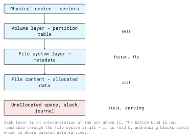

# Analysis of Digital Evidence

Analysis turns an image into an account of events. The raw material is bytes; the output is a
timeline with sources attached to every entry. This lecture covers the layers of a storage device,
the operating-system artefacts that record activity, memory and network analysis, and how to build a
timeline that survives scrutiny.

Everything here runs against a verified copy. Verify the hash before you start.

## 3.1 The Layers of a Storage Device



Each layer is an interpretation of the raw sectors. Tools exist per layer, and the useful habit is
knowing which layer a finding came from.

### 3.1.1 Volume Layer

```bash
mmls evidence.dd
```

`mmls` prints the partition table with each partition's start sector, length and type. Note the
unallocated entries: a gap between partitions is somewhere data can be parked where no file system
will ever show it.

The start sector is what every later command needs. The Sleuth Kit takes it as `-o`:

```bash
fsstat -o 2048 evidence.dd
```

`fsstat` reports the file system type, block size, inode or MFT layout, and the time of last mount.
Read it before anything else; a wrong offset produces plausible garbage rather than an error.

### 3.1.2 File System Layer

```bash
fls -o 2048 -r -p evidence.dd            # recursive listing with full paths
fls -o 2048 -r -d evidence.dd            # deleted entries only
istat -o 2048 evidence.dd 128            # metadata for one inode / MFT record
icat -o 2048 evidence.dd 128 > out.bin   # extract its content
```

A deleted entry in `fls` output is marked with `*`. The name and the metadata record survive
deletion for a while, and whether the content survives depends on whether the blocks were reused.

### 3.1.3 Unallocated Space and Carving

```bash
blkls -o 2048 evidence.dd > unallocated.bin
```

`blkls` extracts the unallocated blocks. Carving then looks for file signatures inside that stream,
ignoring the file system entirely:

```bash
photorec unallocated.bin
foremost -t jpg,pdf,doc -i unallocated.bin -o carved/
bulk_extractor -o bulk/ evidence.dd      # emails, URLs, card numbers, by pattern
```

Carving recovers content but not names, paths or timestamps, and it recovers fragments that look
like files but are not. Fragmented files generally do not carve correctly. A carved file is
evidence that bytes were present on the device; it is weaker evidence about who put them there or
when.

### 3.1.4 File Slack

A file system allocates whole blocks. A 100-byte file in a 4096-byte block leaves the rest of the
block holding whatever was there before. That residue is addressed by block, not by file, so it
needs `blkls` rather than a file copy.

## 3.2 Identifying Files

```bash
file suspicious.bin                     # type by magic bytes, not extension
sha256sum suspicious.bin                # for comparison against known sets
exiftool photo.jpg                      # EXIF: camera, software, sometimes GPS
strings -a -n 8 suspicious.bin | less   # printable strings
strings -a -e l suspicious.bin          # UTF-16LE, common in Windows binaries
binwalk firmware.bin                    # embedded archives and file systems
```

Extensions mean nothing. `file` reads the structure. Mismatches between extension and content are
worth noting in both directions: a `.jpg` that is a PE executable, and a `.txt` that is an archive.

**Hash sets** cut the workload. The NIST National Software Reference Library publishes hashes of
known software, which lets you eliminate the operating system and shipped applications and look only
at what is unusual. Autopsy and `hfind` can filter against such a set.

Do not confuse elimination with exoneration: a file matching a known-good hash can still have been
used maliciously, and a known-bad hash set only recognises exactly the samples it was built from.
Changing a single byte changes the hash. Fuzzy hashing (`ssdeep`) measures similarity instead, which
survives small modifications.

## 3.3 Timestamps

Four common timestamps, usually abbreviated MACB:

| Letter | NTFS | ext4 |
| ------ | ---- | ---- |
| M | content modified | `mtime` |
| A | accessed | `atime` |
| C | MFT record changed | `ctime` (inode changed) |
| B | born / created | `crtime` |

Points that matter in practice:

- **`ctime` is not creation time on Unix.** It is the inode change time. ext4 stores a real creation
  time in the inode; `stat` does not always display it, but `debugfs` will:

  ```bash
  debugfs -R 'stat <128>' /dev/sdb1
  ```

- **Access times are often disabled.** Many systems mount with `relatime` or `noatime` for
  performance, so an unchanged `atime` does not mean the file was not read.
- **Time zones.** NTFS stores UTC; ext4 stores UTC; the display is local. Normalise everything to
  UTC in the timeline and record the host's configured zone separately.
- **Clock skew.** A host's clock may be wrong. Compare against a source with reliable time, such as
  a server log or a network capture, and record the measured offset rather than correcting silently.
- **NTFS redundancy.** `$STANDARD_INFORMATION` and `$FILE_NAME` each hold a set of timestamps.
  Tools that timestomp commonly change only the first set, so a disagreement between the two is a
  strong indicator of manipulation. `istat` shows both.

## 3.4 Operating System Artefacts

These records exist because the OS wants performance or convenience, not because anybody wanted an
audit trail. That is what makes them useful: a user who deletes a file rarely deletes the artefacts
that record having opened it.

### 3.4.1 Windows

| Artefact | Location | Tells you |
| -------- | -------- | --------- |
| Event logs | `C:\Windows\System32\winevt\Logs\*.evtx` | Logons, service installs, process creation |
| Registry (system) | `C:\Windows\System32\config\`, holding `SYSTEM`, `SOFTWARE`, `SAM`, `SECURITY` | Configuration, accounts, services, USB history |
| Registry (user) | `NTUSER.DAT`, `UsrClass.dat` in the profile | Per-user activity, recent documents, typed paths |
| Prefetch | `C:\Windows\Prefetch\*.pf` | That a program ran, and roughly when |
| Amcache | `C:\Windows\appcompat\Programs\Amcache.hve` | Executables seen on the system |
| `$MFT`, `$LogFile`, `$UsnJrnl` | NTFS volume root | File creation, renaming and deletion history |
| Recycle Bin | `C:\$Recycle.Bin\<SID>\` | Original path and deletion time |
| LNK files and Jump Lists | User profile | Files opened, including from removable media |
| Browser data | Per-browser SQLite databases | History, downloads, searches |

Event IDs worth recognising: Security **4624** (successful logon, with a logon type that
distinguishes console from network from RDP), **4625** (failed logon), **4688** (process creation,
if enabled), **4720** (account created); System **7045** (a service was installed). Sysmon, if
deployed, adds process creation with command lines and hashes, network connections and file
creation. Sysmon is a deliberate control: it exists precisely to make this analysis possible, and
installing it is cheap.

```bash
# offline, from a mounted image
evtx_dump.py Security.evtx > security.xml
```

### 3.4.2 Linux

| Artefact | Location | Tells you |
| -------- | -------- | --------- |
| Authentication log | `/var/log/auth.log` (Debian), `/var/log/secure` (RHEL) | SSH logons, `sudo` use |
| Journal | `/var/log/journal/` | Service and kernel events |
| Shell history | `~/.bash_history`, `~/.zsh_history` | Commands, unordered and easily edited |
| Accounts | `/etc/passwd`, `/etc/shadow`, `/etc/group` | Added accounts, UID 0 duplicates |
| Persistence | systemd units, `/etc/cron*`, `~/.ssh/authorized_keys` | How something comes back after reboot |
| Package state | dpkg or rpm databases and logs | What was installed, and when |
| Audit log | `/var/log/audit/audit.log` | Syscall-level events, if auditd is configured |

```bash
journalctl --file ./system.journal --since "2026-03-01" --until "2026-03-03"
last -f ./wtmp
utmpdump ./btmp            # failed logon records
```

Shell history has no timestamps unless `HISTTIMEFORMAT` was set, is written at shell exit, and can
be truncated or redirected to `/dev/null`. Treat it as a lead, never as proof.

## 3.5 Memory Analysis

Volatility 3 takes the memory image and a plugin named for the platform:

```bash
vol -f memory.raw windows.info
vol -f memory.raw windows.pslist
vol -f memory.raw windows.pstree
vol -f memory.raw windows.cmdline
vol -f memory.raw windows.netscan
vol -f memory.raw windows.malfind
vol -f memory.raw windows.dlllist --pid 1234

vol -f memory.lime linux.pslist
vol -f memory.lime linux.bash
```

The `linux.*` plugins need a symbol table matching the exact kernel of the captured machine; without
one, Volatility cannot locate the kernel structures and the plugin fails outright.

What memory gives you that disk does not:

- Processes with no file on disk, and code injected into legitimate processes (`malfind` looks for
  executable private memory that no module claims).
- Full command lines, including arguments that were never written anywhere.
- Network connections as they existed at capture time, including ones already closed on the wire.
- Decrypted content and keys.

Compare `pslist` with `psscan`: `pslist` walks the kernel's process list, `psscan` scans for process
structures. A process that `psscan` finds and `pslist` does not has been unlinked from the list,
which is a rootkit technique. This comparison is the memory-forensics equivalent of checking two
timestamp sources against each other.

## 3.6 Network Analysis

```bash
tshark -r capture.pcap -q -z conv,tcp            # conversation summary
tshark -r capture.pcap -q -z io,phs              # protocol hierarchy
tshark -r capture.pcap -Y 'dns' -T fields -e dns.qry.name | sort | uniq -c | sort -rn
tshark -r capture.pcap -Y 'http.request' -T fields -e http.host -e http.request.uri
tshark -r capture.pcap --export-objects http,objects/
```

With TLS everywhere, content is usually unavailable and the analysis shifts to metadata: SNI values
in the TLS handshake, certificate details, DNS queries, connection timing and volume. Regular
connections at a fixed interval to one host, with small requests and small responses, is the shape
of command-and-control beaconing, and it is visible without decrypting anything.

Zeek turns a capture into structured logs (`conn.log`, `dns.log`, `ssl.log`, `files.log`) which are
far easier to work with at volume than packets.

## 3.7 Building the Timeline

The timeline is the deliverable of the analysis phase. Build it from everything at once, not per
source.

File system times with The Sleuth Kit:

```bash
fls -o 2048 -r -m / evidence.dd > body.txt
mactime -b body.txt -d -z UTC 2026-03-01..2026-03-05 > fs-timeline.csv
```

A super-timeline with Plaso, which parses file systems, registry hives, event logs, browser
databases and more into one store:

```bash
log2timeline.py --storage_file case.plaso evidence.dd
psort.py -o l2tcsv -w timeline.csv case.plaso \
  "date > '2026-03-01 00:00:00' AND date < '2026-03-05 00:00:00'"
```

Discipline for the timeline:

- Every row names its source artefact. "Program executed" is not a finding; "Prefetch entry for
  `tool.exe`, last run time 2026-03-02 14:11Z" is.
- Normalise to UTC and state the conversion applied.
- Corroborate: one artefact is a lead, two independent artefacts agreeing is a finding.
- Absence is evidence too, carefully. A gap in a continuous log, or a log that begins abruptly,
  points at deletion, but also at rotation, at a reboot, or at logging never having been enabled.
  Check which before you claim it.

## 3.8 Exercise

On a lab image you created yourself, or a published training image:

1. `mmls`, then `fsstat` on each partition. Record block size and file system type.
2. `fls -r -d` to find deleted entries. Pick one and recover it with `icat`.
3. `blkls` the unallocated space and carve it with PhotoRec. Compare the `icat` recovery with the carved output: which has a filename, which has a timestamp?
4. `istat` a file and compare the `$STANDARD_INFORMATION` and `$FILE_NAME` timestamps if the volume
   is NTFS.
5. Build a `mactime` timeline for the day you created the image and check whether it matches what
   you actually did. The discrepancies are the lesson.

## Key Takeaways

- Know which layer a finding came from: volume, file system, file content, or unallocated space.
- `fls`, `istat` and `icat` recover deleted files with their metadata; carving recovers content
  without names or times, plus false positives.
- File type comes from magic bytes, not the extension. Hash sets reduce the haystack but do not
  decide anything by themselves.
- On Unix, `ctime` is not creation time. Access times are frequently disabled. Normalise to UTC and
  measure clock skew rather than assuming.
- NTFS keeps two sets of timestamps, and a disagreement between them indicates timestomping.
- OS artefacts (Prefetch, registry, event logs, `$UsnJrnl`, `auth.log`) record activity that
  deleting a file does not remove. Sysmon and auditd exist to extend that record on purpose.
- In memory, compare `pslist` against `psscan`: a process in one and not the other has been hidden.
- With TLS, network analysis is metadata analysis. Beaconing is visible in timing and volume alone.
- The timeline is the product. Every row cites its source; two agreeing artefacts make a finding.

## Sources

- Carrier, *File System Forensic Analysis* (Addison-Wesley)
- The Sleuth Kit documentation: <https://sleuthkit.org/sleuthkit/docs.php>
- Autopsy: <https://www.autopsy.com/>
- Volatility 3 documentation: <https://volatility3.readthedocs.io/>
- Plaso / log2timeline: <https://plaso.readthedocs.io/>
- NIST National Software Reference Library: <https://www.nist.gov/itl/ssd/software-quality-group/national-software-reference-library-nsrl>
- Microsoft Sysmon documentation: <https://learn.microsoft.com/sysinternals/downloads/sysmon>
- Zeek documentation: <https://docs.zeek.org/>
- Wireshark and `tshark` documentation: <https://www.wireshark.org/docs/>
