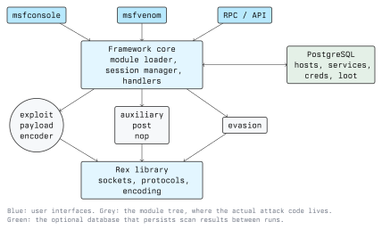

# Introduction to Metasploit

Metasploit is a framework for developing, testing, and running exploit code
against remote targets. It is the single most widely used exploitation tool in
penetration testing, and it is equally valuable on the defensive side: blue
teams use it to validate that a patch actually closes a hole, that an IDS
signature fires, and that incident response detects a live session. This
lecture explains what the framework is, how it is structured, and the
vocabulary you need before you touch a console.

## Why a Framework

Before Metasploit, an exploit was usually a standalone script written for one
vulnerability, with the shellcode, the network handling, and the target
details all hard-coded together. If you wanted a different payload, you rewrote
the exploit. If you wanted the same payload for a different exploit, you
rewrote the payload.

Metasploit separates these concerns. An exploit delivers control; a payload is
what runs once you have control; an encoder reshapes the payload; a handler
waits for it to call back. Each piece is a reusable module. You pick an
exploit, pick a payload that fits it, set a handful of options, and run. The
same payload works across hundreds of exploits, and the same exploit accepts
many payloads.

## Editions

- **Metasploit Framework** is the free, open-source core, maintained by Rapid7
  with a large community of contributors. It is what ships in Kali Linux and
  what this module uses. Everything in these lectures runs on the free edition.
- **Metasploit Pro** is a commercial product with a web GUI, automated
  campaigns, reporting, and team features. You do not need it to learn the
  material, and nothing here depends on it.

Treat the Framework edition as the real tool. The commercial features are
convenience layers on top of the same modules.

## Architecture



The framework is written mostly in Ruby. From top to bottom:

- **User interfaces.** `msfconsole` is the interactive command-line interface
  and the one you will use most. `msfvenom` is a separate command-line tool for
  generating standalone payloads. An RPC/API lets other tools drive the
  framework programmatically.
- **Framework core.** The module loader finds and loads modules, the session
  manager tracks your open sessions, and handlers catch incoming payload
  connections.
- **Modules.** The attack code itself, organised into types (see below).
- **Rex library.** Ruby Extension library: the low-level plumbing for sockets,
  protocol parsing, encoding, and text manipulation that modules build on.
- **Database.** An optional PostgreSQL database stores hosts, services,
  credentials, and loot so your results survive between sessions and can be
  queried later. Setting it up is covered in the next lecture.

## Module Types

Everything you run in Metasploit is a module. The main types:

- **exploit**: code that takes advantage of a specific vulnerability to run a
  payload on the target.
- **payload**: the code that runs on the target after the exploit succeeds (a
  shell, a Meterpreter session, a single command).
- **auxiliary**: modules that do not deliver a payload: scanners, fuzzers,
  sniffers, denial-of-service modules, login brute-forcers. A large part of
  reconnaissance work uses auxiliary modules.
- **post**: post-exploitation modules that run against a session you already
  have, to gather information, escalate, or pivot.
- **encoder**: transforms a payload, historically to avoid bad bytes or evade
  simple signatures. Modern antivirus is rarely fooled by encoding alone; do
  not treat it as an evasion guarantee.
- **nop**: generates no-operation instructions, used as padding when building
  exploits.

Modules are named by a path that tells you the type, platform, and target, for
example `exploit/windows/smb/ms17_010_eternalblue` or
`auxiliary/scanner/ssh/ssh_login`. You will learn to read these paths quickly.

## Exploits, Payloads, and Shellcode

An **exploit** is the technique that gets your code running. A **payload** is
that code. Payloads come in two flavours:

- **Singles** are self-contained: one block of code that does its whole job,
  such as "add a user" or "run this one command". They are simple and need no
  follow-up connection, but they are larger.
- **Staged** payloads split into a small **stager** and a larger **stage**. The
  stager is tiny enough to fit in a cramped exploit buffer; it opens a
  connection back to your handler, which then sends the full stage. Meterpreter
  is almost always delivered this way. The staged mechanism is covered in
  lecture 3.

The naming convention shows the difference. A `/` separates stager from stage
in a staged payload:

```text
windows/shell_reverse_tcp     single: whole reverse shell in one block
windows/shell/reverse_tcp     staged: small stager, then the shell stage
```

The underscore versus slash is easy to miss and changes the payload's
behaviour completely.

## Bind vs Reverse Connections

Payloads that open a network connection do it one of two ways:

- A **bind** payload opens a listening port *on the target* and waits for you
  to connect in. This fails whenever a firewall or NAT sits in front of the
  target and blocks inbound connections, which is almost always the case today.
- A **reverse** payload connects *from the target back to you*. Outbound
  connections are usually allowed, so reverse payloads work far more often.
  This is why `reverse_tcp` is the common default.

For the defender this is a useful asymmetry: blocking inbound traffic to a host
is easy, but a reverse payload rides outbound traffic that is normally
permitted. Egress filtering, which restricts the outbound connections a host
may make, is the control that closes this gap, and it is routinely neglected.

## A First Look at the Console

You start the framework with:

```bash
msfconsole
```

A few commands to recognise now; the next lectures use them in earnest:

```text
help                 list commands
search eternalblue   find modules by keyword
use <module>         select a module to work with
info                 show a selected module's description and options
show options         list the options a module needs
set RHOSTS 10.0.0.5  set an option (RHOSTS is the target address)
run                  launch the selected module
sessions             list open sessions
```

`RHOSTS` is the remote (target) host; `LHOST` is your local host, the address
a reverse payload connects back to. Getting `LHOST` wrong is the most common
beginner mistake: it must be an address the target can actually reach.

## Legal and Ethical Boundary

Running any Metasploit module against a system you do not own or have **written
authorization** to test is a criminal offence. In Austria this falls under
StGB §118a (unlawful access to a computer system) and related provisions;
Module 01 covers the legal detail. The rule for this module is simple:

- Only run these tools against your own lab, a deliberately vulnerable practice
  target (Metasploitable, a vulnerable VM you built, an authorized CTF), or a
  system covered by a signed engagement contract with a defined scope.
- "I was only learning" is not a defence. Build a lab.

Every exercise in this module assumes a lab you control or an explicitly
authorized target. Set one up before the next lecture.

## Key Takeaways

- Metasploit is a modular framework: exploits, payloads, encoders, and handlers
  are separate reusable pieces you combine.
- The free Framework edition has everything you need; Pro is optional.
- Modules come in types (exploit, payload, auxiliary, post, encoder, nop) and
  are named by a path that encodes type, platform, and target.
- Payloads are single or staged, and connect via bind or reverse; reverse
  connections work more often because outbound traffic is usually allowed.
- The defensive counterpart to reverse payloads is egress filtering.
- Only ever run these tools against systems you own or are authorized in
  writing to test.

## Resources

- Rapid7, *Metasploit Framework* documentation: <https://docs.metasploit.com>
- Metasploit Framework source and issues: <https://github.com/rapid7/metasploit-framework>
- *Metasploit: The Penetration Tester's Guide*, Kennedy, O'Gorman, Kearns,
  Aharoni (No Starch Press), the standard reference text.
- Module 01 (Ethics and Legal) for the Austrian/EU legal framework.
