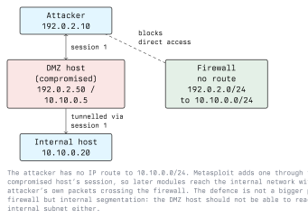

# Advanced Usage

Basic usage gets you a session. This lecture covers the techniques that make
Metasploit powerful on a real engagement: Meterpreter as a post-exploitation
platform, pivoting into networks you cannot reach directly, resource scripts for
automation, and a realistic view of what evasion can and cannot do. Each
technique is paired with the control that detects or stops it.

## Meterpreter

Meterpreter ("Meta-Interpreter") is Metasploit's flagship payload. Instead of a
plain command shell, it is a feature-rich agent that runs **in memory** inside a
host process and talks to the console over an encrypted channel. Because it does
not spawn a new process per command the way a raw shell does, and does not touch
disk, it is quieter than a cmd.exe or /bin/sh shell.

Once you have a Meterpreter session (`sessions -i 1`), useful commands:

```text
sysinfo              OS, architecture, hostname
getuid               which user you are running as
getpid               the process Meterpreter lives in
ps                   process list
pwd / cd / ls        filesystem navigation
download <file>      pull a file from the target
upload <file>        push a file to the target
shell                drop to a native command shell
background           return to the console, keep the session
```

### Migrating Processes

Meterpreter lives inside a host process. If that process is killed, or if it is
a short-lived one like the exploited service that is about to crash, the session
dies. **Migrating** moves Meterpreter into a different, more stable process:

```text
ps
migrate <pid>
```

Migration is also a durability and stealth move: hiding inside a long-running,
expected process (rather than an odd child of a crashed service) is harder to
spot. The defensive counterpart is process-lineage monitoring: an EDR that
notices one process's memory being written and executed by another flags exactly
this behaviour.

### Privilege Escalation Helpers

Meterpreter bundles some escalation helpers, most famously on Windows:

```text
getsystem            attempt known local escalation techniques
hashdump             dump local password hashes (needs SYSTEM)
```

`getsystem` tries several known techniques to go from a normal user to SYSTEM.
It does not always work, and on a patched, monitored host it is noisy. General
privilege escalation is Module 11's subject; here it is just one tool among
many. `hashdump` requires you to already be SYSTEM.

## Post-Exploitation Modules

Beyond the built-in commands, `post/` modules run against a session you have.
Background the session, then point a post module at it:

```text
background
use post/windows/gather/enum_logged_on_users
set SESSION 1
run
```

Examples of what post modules do:

- `post/multi/gather/*`: collect credentials, SSH keys, browser data
- `post/windows/gather/*`: enumerate users, software, network config
- `post/multi/manage/*`: manage the session, autoroute, migrate

Everything a post module collects lands in the database `loot` and `creds`
tables when relevant.

## Pivoting

A compromised host often sits on networks you cannot reach from your attacking
machine. **Pivoting** uses that host as a relay so your modules reach the
hidden network through the existing session.



### Autoroute

First, tell Metasploit to route traffic for the internal subnet through the
session. The `autoroute` post module reads the session's own routing table and
adds the routes:

```text
use post/multi/manage/autoroute
set SESSION 1
run
```

Now modules targeting `10.10.0.0/24` are sent through session 1. You can scan
the internal network with ordinary auxiliary modules as if you were local to
the DMZ host:

```text
use auxiliary/scanner/portscan/tcp
set RHOSTS 10.10.0.20
run
```

### Port Forwarding and SOCKS

To use tools *outside* Metasploit through the pivot, forward a single port or
stand up a SOCKS proxy.

A single local port forwarded to a host behind the pivot, from inside a
Meterpreter session:

```text
portfwd add -l 3389 -p 3389 -r 10.10.0.20
```

A SOCKS proxy that routes any proxy-aware tool through all the current routes:

```text
use auxiliary/server/socks_proxy
run -j
```

Point other tools at the SOCKS port (via `proxychains`, for example) and they
reach the internal network through the session.

### The Defence Is Segmentation

Pivoting works because the compromised host *can* reach the internal network. A
perimeter firewall does nothing here, because the traffic is already inside. The
control is **internal network segmentation**: the DMZ host should have no
business reaching the internal subnet, and a firewall rule between the two
segments stops the pivot. Monitoring east-west traffic between segments catches
it when prevention fails.

## Automation with Resource Scripts

A resource script replays console commands, turning a repeatable procedure into
one file. This documents your steps and makes them reproducible for a report:

```text
# recon.rc
workspace -a lab_internal
db_nmap -sV 10.10.10.0/24
hosts
services
```

```bash
msfconsole -r recon.rc
```

For advanced automation, resource scripts can embed Ruby in `<ruby>...</ruby>`
blocks, giving you loops and logic over the framework API. Keep scripts under
version control alongside your engagement notes.

## A Realistic View of Evasion

Beginners expect encoders to make payloads "undetectable". They do not.

- **Encoders** (for example the historically well-known `shikata_ga_nai`)
  change a payload's bytes, originally to remove bad characters an exploit
  cannot tolerate. Signature-based detection long ago learned the common
  encoders, so encoding alone does not hide a payload from current antivirus.
- **Template and format choices** in `msfvenom` change the wrapper but not the
  recognisable payload inside it.
- **Evasion modules** (`evasion/`) attempt more, but off-the-shelf Metasploit
  output is one of the most heavily signatured things in existence, precisely
  because it is so widely used.

The honest lesson for students: stock Metasploit payloads are easy for a
competent defender to catch. That is good news for the blue team. They are caught by memory
scanning, behaviour monitoring, egress filtering and process-lineage analysis,
which are the same controls you should be building and testing. Use Metasploit to verify those controls fire, not to chase an evasion
arms race in a classroom.

## Key Takeaways

- Meterpreter is an in-memory, encrypted post-exploitation agent; `migrate`
  moves it to a stable process and is detectable by process-lineage monitoring.
- `post/` modules run against an existing session for gathering, escalation, and
  management.
- Pivoting (`autoroute`, `portfwd`, SOCKS proxy) reaches networks only the
  compromised host can see; the defence is internal segmentation, not the
  perimeter firewall.
- Resource scripts make procedures repeatable and documented.
- Encoders and stock payloads are heavily signatured; use Metasploit to confirm
  your detections work rather than to pursue undetectability.

## Resources

- Rapid7, *Meterpreter* and *Pivoting* documentation: <https://docs.metasploit.com>
- Module 11 (Linux and Server Security) for privilege escalation in depth.
- Module 13 (Blue Teaming) for the detection side of these techniques.
