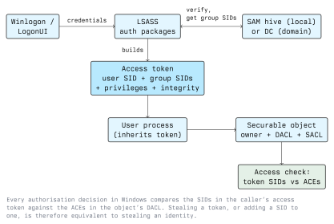

# Introduction to Windows Security

Windows dominates the corporate desktop and a large share of corporate servers. Almost every
enterprise intrusion you will read about involves a Windows host at some point in the chain. To
assess or defend such a network you need to understand the model Windows uses to decide who may do
what: the mechanism that sits underneath the hardening tips.

This lecture covers that mechanism: security principals, SIDs, access tokens, security descriptors,
privileges, integrity levels, and where credentials live while a user is logged on.

## The Security Model in One Picture

Windows is a *discretionary access control* system with a mandatory integrity layer bolted on top.
Every actor is a **security principal**, every protected thing is a **securable object**, and every
decision is made by comparing one against the other.



The important consequence: Windows never re-checks your password when you open a file. It checks
the token your process already carries. Any attack that obtains, forges, or modifies a token is as
good as knowing the password.

## Security Identifiers (SIDs)

Principals are named internally by a SID, not by a username. A SID looks like this:

```text
S-1-5-21-3623811015-3361044348-30300820-1013
│ │ │  │                                 └── RID (relative identifier)
│ │ │  └── domain or machine identifier
│ │ └── sub-authority 21 = "not a built-in, issued by a SAM or a domain"
│ └── authority 5 = NT Authority
└── revision
```

Renaming a user does not change the SID, so permissions survive renames. Some RIDs are fixed and
worth memorising, because they appear constantly in tool output:

| RID  | Principal                           |
| ---- | ----------------------------------- |
| 500  | Built-in Administrator              |
| 501  | Guest                               |
| 502  | krbtgt (domain only)                |
| 512  | Domain Admins                       |
| 513  | Domain Users                        |
| 519  | Enterprise Admins                   |

There are also well-known SIDs with no domain part, such as `S-1-5-18` (LocalSystem),
`S-1-5-32-544` (the local Administrators group) and `S-1-1-0` (Everyone).

```powershell
whoami /user
whoami /groups
whoami /priv
```

Those three commands are the fastest way to read your own token on a live host.

## Access Tokens

When LSASS authenticates a logon it builds an access token containing:

- the user SID,
- the SIDs of every group the user belongs to, each with flags (enabled, deny-only, …),
- a list of **privileges**, each enabled or disabled,
- an **integrity level**,
- the default owner and default DACL for objects the process creates.

Every process and thread carries a token. A thread may temporarily wear a different one
(*impersonation*), which is how a service handles a request "as" the client that made it. This is
normal, necessary behaviour, and it is exactly what privilege-escalation techniques abuse.

## Privileges

A privilege is a machine-wide right that is not expressed as an ACL. Several are equivalent to full
compromise of the host, which is why they belong on any assessment checklist:

| Privilege               | What it really means                                            |
| ----------------------- | --------------------------------------------------------------- |
| `SeDebugPrivilege`      | Open any process, including LSASS — read its memory              |
| `SeImpersonatePrivilege`| Impersonate a client that connects to you                        |
| `SeBackupPrivilege`     | Read any file regardless of its DACL                             |
| `SeRestorePrivilege`    | Write any file regardless of its DACL                            |
| `SeTakeOwnershipPrivilege` | Take ownership of any object, then rewrite its DACL           |
| `SeLoadDriverPrivilege` | Load kernel code                                                 |

Holding one of these is not "a step towards admin". For practical purposes it *is* admin. Service
accounts frequently hold `SeImpersonatePrivilege`, which is why so many IIS and MSSQL compromises
end at SYSTEM.

## Security Descriptors, DACLs and SACLs

Files, registry keys, services, processes, named pipes, printers and AD objects are all securable.
Each carries a security descriptor:

- **Owner SID**: the owner can always rewrite the DACL, no matter what the DACL says.
- **DACL**: an ordered list of access control entries (ACEs). Each ACE is allow or deny, names a
  SID, and carries an access mask.
- **SACL**: audit entries. These generate Security event log records; they grant nothing.

The access check walks the DACL in order and stops at the first ACE that resolves the requested
access. Deny ACEs are placed before allow ACEs in canonical order, which is why a misordered DACL
can silently grant access an administrator thought they had denied.

```powershell
# Effective permissions on a path
icacls C:\inetpub\wwwroot

# The same thing with the full descriptor, including owner
Get-Acl C:\inetpub\wwwroot | Format-List
```

Read `icacls` output carefully. `(F)` is full control, `(M)` modify, `(RX)` read and execute,
`(W)` write. A `(M)` or `(F)` for `Users`, `Authenticated Users` or `Everyone` on anything that gets
executed by a privileged account is a finding.

## Mandatory Integrity Control

On top of the DACL, every process and object has an integrity level: Untrusted, Low, Medium, High,
System. A lower-integrity process cannot write to a higher-integrity object even when the DACL would
allow it. Internet-facing sandboxes (browser renderers, Office protected view) run at Low; a normal
user process runs Medium; an elevated process runs High.

**User Account Control (UAC)** uses this. When an administrator logs on, LSASS issues two tokens: a
filtered token at Medium integrity with the admin group SID marked deny-only, and a full token at
High integrity. The consent prompt switches between them.

Microsoft does not treat UAC as a security boundary. Documented bypasses exist in every Windows
release, and new ones appear regularly. Treat "we require UAC consent" as a speed bump, not a
control, and configure UAC to prompt on the secure desktop at its highest setting anyway.

## Where Credentials Live

This is the part that matters most for both attack and defence.

- **SAM hive** (`HKLM\SAM`, file `C:\Windows\System32\config\SAM`): local account NT hashes, obscured
  with a key derived from the SYSTEM hive. Dumping it requires both hives.
- **LSASS process memory**: for each interactive session, the material needed for single sign-on:
  NT hashes, Kerberos tickets and keys, and, in older or badly configured setups, reversibly
  encrypted plaintext.
- **DPAPI**: per-user master keys protecting saved browser passwords, Credential Manager entries and
  certificates. A domain backup key on the DC can decrypt any user's DPAPI data in the domain.
- **Cached domain logons**: salted, iterated verifiers (often called MSCache / DCC2) that let a
  laptop log on without reaching a DC. They cannot be replayed, only cracked offline.
- **Credential Manager** (`cmdkey /list`): saved RDP and network credentials.

An NT hash is the MD4 of the UTF-16LE password with no salt and no iteration. Two users with the
same password have the same hash, and cracking is fast. More importantly, NTLM authentication uses
the hash directly, so a stolen hash authenticates without ever being cracked. This is the basis of
**pass-the-hash**.

### Defences that actually move the needle

- **LSA Protection** (`RunAsPPL`): LSASS runs as a protected process, so a user-mode debugger,
  including one with `SeDebugPrivilege`, cannot open it for read.
- **Credential Guard**: moves the secrets into a virtualisation-isolated process the normal OS
  cannot read at all. This is the real fix for pass-the-hash on a workstation.
- **Protected Users** group: members cannot use NTLM, DES or RC4, get no cached logon, and cannot be
  delegated.
- Do not log on to workstations with domain-administrative accounts. Credential theft requires a
  credential to be present; administrative tiering removes it from the machine entirely.

## Logon Types

The Security event log records *how* a logon happened, and that number tells you what credentials
were left behind.

| Type | Name              | Leaves reusable credentials in LSASS? |
| ---- | ----------------- | ------------------------------------- |
| 2    | Interactive       | Yes                                   |
| 3    | Network           | No                                    |
| 4    | Batch             | Yes                                   |
| 5    | Service           | Yes                                   |
| 7    | Unlock            | Yes                                   |
| 9    | NewCredentials    | Yes                                   |
| 10   | RemoteInteractive (RDP) | Yes                             |
| 11   | CachedInteractive | Yes                                   |

Type 3 is the safe one: the host verifies a challenge-response and keeps nothing. This is why
`PsExec` style access (type 3) is less damaging to the target than RDP (type 10), and why
administrators should prefer it.

## Events Worth Knowing

| Event ID | Log      | Meaning                                       |
| -------- | -------- | --------------------------------------------- |
| 4624     | Security | Successful logon (check the Logon Type field)  |
| 4625     | Security | Failed logon                                   |
| 4672     | Security | Special privileges assigned — i.e. an admin logon |
| 4688     | Security | Process created (enable command line auditing) |
| 4720     | Security | User account created                           |
| 7045     | System   | A service was installed                        |

```powershell
Get-WinEvent -FilterHashtable @{LogName='Security'; Id=4625} -MaxEvents 20 |
  Format-Table TimeCreated, Message -AutoSize
```

Event 4688 is close to useless without the "Include command line in process creation events" policy
enabled. Turning that on is one of the cheapest detection improvements available.

## Legal Note

Everything in this module is to be practised in your own lab or against a target you have written
authorization for. In Austria, unauthorized access to a computer system falls under StGB §118a, and
damaging data or a system under §126a and §126b; personal data encountered during an assessment is
covered by the GDPR. Module 01 covers the detail; read it before you touch a machine that is not
yours.

## Key Takeaways

- Authorization in Windows is a comparison between the SIDs in an access token and the ACEs in an
  object's DACL. Nothing re-checks the password.
- SIDs, not names, are the real identity. Learn the well-known RIDs.
- A handful of privileges (`SeDebug`, `SeImpersonate`, `SeBackup`, `SeRestore`,
  `SeTakeOwnership`, `SeLoadDriver`) are equivalent to SYSTEM.
- Integrity levels sit above the DACL; UAC is built on them but is not a security boundary.
- NT hashes are unsalted and directly usable for authentication, which is why credential material in
  LSASS is the central problem in Windows security.
- LSA Protection, Credential Guard, Protected Users and administrative tiering are the controls that
  address that problem.

## Resources

- Microsoft Learn, Windows access control: <https://learn.microsoft.com/windows/win32/secauthz/access-control>
- Microsoft Learn, well-known SIDs: <https://learn.microsoft.com/windows-server/identity/ad-ds/manage/understand-security-identifiers>
- Microsoft Learn, Credential Guard: <https://learn.microsoft.com/windows/security/identity-protection/credential-guard/>
- Microsoft Learn, advanced security audit policy: <https://learn.microsoft.com/windows/security/threat-protection/auditing/advanced-security-auditing>
- Sysinternals suite (`accesschk`, `Process Explorer`, `Sysmon`): <https://learn.microsoft.com/sysinternals/>
- *Windows Internals*, Russinovich, Solomon, Ionescu, Yosifovich, the reference for the object
  manager, the security reference monitor and the logon path.
