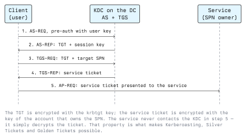

# Windows Penetration Testing

This lecture covers the tooling and techniques used to assess a Windows host or a small Windows
network: the Impacket suite, Kerberos as an attack surface, BloodHound for graphing privilege
relationships, local privilege escalation, and living-off-the-land binaries.

Everything here is to be run in your own lab or against a target covered by written authorization.
In Austria, unauthorized access is an offence under StGB §118a, and damaging data or systems under
§126a and §126b; Module 01 covers the detail. Build a lab: a Windows Server acting as a domain
controller, one or two member workstations, and a Linux attack host on an RFC 1918 segment.

## 3.1 Impacket

Impacket is a Python library implementing Microsoft's network protocols (SMB, MS-RPC, LDAP,
Kerberos, MS-SQL, DCOM) plus a collection of example scripts that have become standard assessment
tools. Its value is that it speaks these protocols from Linux, without a Windows machine and without
the restrictions a Windows client imposes.

### Shared argument style

Nearly every script takes the same target form and the same authentication options:

```text
domain/user:password@host

  -hashes LMHASH:NTHASH    authenticate with an NT hash instead of a password
  -k                       use Kerberos, from the ticket in KRB5CCNAME
  -no-pass                 do not prompt for a password (with -k or -hashes)
  -dc-ip 10.10.10.10       where to find the domain controller
```

`-hashes` is pass-the-hash: NTLM derives its response from the hash, so the password itself is never
needed. `-k` is pass-the-ticket, the Kerberos equivalent.

### The scripts that matter

| Script             | Purpose                                                           |
| ------------------ | ----------------------------------------------------------------- |
| `lookupsid.py`     | Enumerate domain users and groups by brute-forcing RIDs over RPC   |
| `samrdump.py`      | Enumerate accounts and the password policy over SAMR               |
| `secretsdump.py`   | Extract SAM, LSA secrets, cached logons; or domain hashes via DRSUAPI |
| `psexec.py`        | Service-based remote execution (creates and starts a service)      |
| `smbexec.py`       | Service-based execution writing output to a share                  |
| `wmiexec.py`       | Execution over WMI — leaves no service behind                      |
| `atexec.py`        | Execution via the Task Scheduler                                   |
| `GetUserSPNs.py`   | Request service tickets for accounts with an SPN (Kerberoasting)   |
| `GetNPUsers.py`    | Request AS-REPs for accounts without pre-authentication            |
| `getTGT.py` / `getST.py` | Obtain a TGT or a service ticket into a ccache file          |
| `ntlmrelayx.py`    | Relay NTLM authentication to another service                        |
| `mssqlclient.py`   | Authenticated MS-SQL client, including Windows authentication      |

A typical first authenticated step in a lab:

```bash
# What shares exist, and what can this account reach?
impacket-smbclient 'LAB.LOCAL/svc_backup:Password1@10.10.10.20'

# Who exists in the domain?
impacket-lookupsid 'LAB.LOCAL/svc_backup:Password1@10.10.10.10'
```

### What each execution method leaves behind

This matters as much as whether it works, because it is what a defender sees:

- `psexec.py`: writes a binary to `ADMIN$` and registers a service, so expect event 7045 in the
  System log, plus 5145 for the share access. Very loud, very reliable. `smbexec.py` is similar, creating a
  service per command.
- `wmiexec.py`: no service and no file on disk; appears as `wmiprvse.exe` spawning a child process.
  Visible in event 4688 and in Sysmon event 1 by parent-process relationship.
- `atexec.py`: a scheduled task is created and deleted; visible in the Task Scheduler log.

**Defence.** None of these works without valid credentials for a privileged account on the target.
The controls are therefore LAPS (so one local admin hash does not open every host), denying network
logon to local accounts, host firewall rules blocking workstation-to-workstation SMB, and alerting
on service installation (7045) from an account that does not normally install services.

## 3.2 Kerberos

Kerberos is the default authentication protocol in a domain. It is not a weak protocol; the attacks
against it exploit design properties that are necessary for it to work offline and at scale.



Two properties drive every attack below:

1. The service ticket is encrypted with the long-term key of the account that owns the SPN. Anyone
   who can ask for a ticket receives ciphertext encrypted with that account's key.
2. The service does not call the KDC to validate a ticket. It decrypts it and believes the contents.

### Kerberoasting

Any authenticated domain user may request a service ticket for any SPN. If the SPN belongs to a
normal user account (a service account), the ticket is encrypted with a key derived from that
account's password, and can be attacked offline.

```bash
impacket-GetUserSPNs -request -dc-ip 10.10.10.10 'LAB.LOCAL/student:Password1'
```

Computer accounts and group-managed service accounts have long random passwords and are not
realistically crackable. User service accounts with human-chosen passwords are.

**Defence.** Use group managed service accounts (gMSA) so the password is 240+ random bytes and
rotated automatically. Where a user account must own an SPN, give it a long random password. Disable
RC4 for Kerberos so tickets use AES, which is slower to crack. Detect by alerting on event 4769
where the ticket encryption type is RC4 (`0x17`), and plant a honeypot account with an SPN and no
real purpose, since nothing legitimate ever requests its ticket.

### AS-REP roasting

Kerberos pre-authentication requires the client to prove knowledge of its key before the KDC issues
anything. An account flagged "Do not require Kerberos preauthentication" skips that step, so the KDC
returns an AS-REP encrypted with the account's key to anyone who asks, without any credentials.

```bash
impacket-GetNPUsers -dc-ip 10.10.10.10 -request -format hashcat 'LAB.LOCAL/'
```

**Defence.** There is almost never a legitimate reason for this flag. Audit for it and clear it:

```powershell
Get-ADUser -Filter 'DoesNotRequirePreAuth -eq $true' -Properties DoesNotRequirePreAuth
```

### Ticket forgery

- A **silver ticket** is a service ticket forged with a stolen service account key. It grants access
  to that one service, and because the service never asks the KDC, it is not visible in DC logs.
- A **golden ticket** is a TGT forged with the `krbtgt` account key. It can be minted for any user,
  with any group membership, and is valid until the key changes.

**Defence.** A golden ticket is a post-compromise artefact: it requires the krbtgt key, which means
the domain was already fully compromised. Recovery from such a compromise requires resetting the
krbtgt password twice, allowing replication to complete between the resets. Detection focuses on
anomalies: a ticket with a lifetime longer than policy allows, a TGS request with no matching
preceding TGT request, a username in a ticket that does not exist in the directory.

### Pass-the-ticket and overpass-the-hash

Tickets are portable. A ticket extracted from one host works from another, because nothing binds it
to a machine. Similarly, an NT hash can be used to request a legitimate TGT, converting a hash into
Kerberos access.

```bash
export KRB5CCNAME=/tmp/svc_sql.ccache
impacket-getTGT -dc-ip 10.10.10.10 'LAB.LOCAL/svc_sql' -hashes :31d6cfe0d16ae931b73c59d7e0c089c0
impacket-wmiexec -k -no-pass 'LAB.LOCAL/svc_sql@sql01.lab.local'
```

**Defence.** Credential Guard keeps tickets out of reach of a user-mode process. The Protected Users
group prevents members' credentials being cached in a reusable form. Administrative tiering means a
ticket for a high-value account is never present on a low-value host in the first place.

## 3.3 BloodHound

BloodHound treats a Windows domain as a directed graph. Nodes are users, computers, groups, OUs,
GPOs and certificate templates. Edges are relationships that let one node control another:
`MemberOf`, `AdminTo`, `HasSession`, `CanRDP`, `GenericAll`, `GenericWrite`, `WriteDacl`,
`WriteOwner`, `ForceChangePassword`, `AddMember`, `DCSync`, `ReadLAPSPassword`.

The insight is that privilege in a domain is transitive, and humans cannot see transitive paths in a
directory of thousands of objects. An attacker only needs one chain of edges from a controlled
account to Domain Admins. A shortest-path query finds it in seconds.

Collection runs with SharpHound on Windows or `bloodhound-python` from Linux:

```bash
bloodhound-python -u student -p 'Password1' -d lab.local -ns 10.10.10.10 -c All
```

The output is JSON, imported into the BloodHound UI, which is backed by Neo4j and queried in Cypher.

**Use it as a defender.** BloodHound does more for the blue team than for the red team, because the
defender can run it on a schedule and act on the result.
Run collection, find every path into Tier 0, and remove edges until there are none. Typical findings
are a helpdesk group with `ForceChangePassword` over administrators, nested group membership nobody
intended, and `GenericAll` left over from a migration.

Collection itself is detectable: it generates a large volume of LDAP queries and SAMR/session
enumeration from a single host in a short window.

## 3.4 Local Privilege Escalation

Going from a normal user to SYSTEM on a single host. In practice this is nearly always a
misconfiguration, not an exploit.

### Service misconfigurations

A service runs as SYSTEM. If a non-admin can change what it runs, or replace the file it runs, that
is SYSTEM.

```powershell
# Services whose binary lives outside the protected system directories
Get-CimInstance Win32_Service |
  Where-Object { $_.PathName -notmatch 'C:\\Windows\\' } |
  Select-Object Name, StartName, PathName

# Can a normal user modify the service configuration, or the binary?
accesschk.exe -uwcqv "Users" *
accesschk.exe -quvw "C:\Program Files\Vendor\agent.exe"
```

Three variants:

- **Weak service permissions**: a user holds `SERVICE_CHANGE_CONFIG`, so the binary path can be
  repointed.
- **Weak binary or directory permissions**: the executable, or its folder, is writable by users.
- **Unquoted service path**: a path with spaces and no quotes, such as
  `C:\Program Files\My App\svc.exe`, makes the service manager try `C:\Program.exe` first. Writable
  parent directory plus unquoted path equals SYSTEM at next start.

### Other common findings

- **`AlwaysInstallElevated`**: set in both the HKLM and HKCU policy keys, any MSI a user runs is
  installed as SYSTEM. There is no safe use for it.
- **Scheduled tasks** running as a privileged account with a user-writable script or executable, and
  **DLL search order**, a privileged process loading a DLL by name from a user-writable directory.
- **Stored credentials**: `cmdkey /list`, Credential Manager entries, unattended install files
  (`unattend.xml`, `sysprep.xml`) left on disk, credentials in registry autologon values or in
  PowerShell history.
- **Impersonation privileges**: a service account holding `SeImpersonatePrivilege` can take on the
  identity of a client that connects to it. Several public techniques turn this into SYSTEM, so
  treat the privilege as equivalent to SYSTEM when writing a report.
- **Unpatched kernel and driver flaws**: the last resort, and the one that is fixed by patching.

Enumeration is best done with a tool, because the checklist is long: WinPEAS, PowerUp and Seatbelt
cover the same ground. Run them in your lab, then verify each finding manually, because these tools
produce false positives and a report item you have not confirmed is a liability.

**Defence.** Install software into `C:\Program Files`, where the default ACL is correct. Quote
service paths. Audit for user-writable entries in `%PATH%` and in service binary directories. Never
set `AlwaysInstallElevated`. Patch. Most of this is a one-off inventory exercise, after which it
only needs re-checking when software is deployed.

## 3.5 LOLBins

"Living off the land binaries" are signed Microsoft executables, already present on every Windows
system, that can be made to do something useful to an attacker: download a file, execute code,
bypass an application control path rule, or proxy an action through a trusted process name.

Examples of the capability classes, with legitimate purposes:

| Binary        | Legitimate use              | Why it is interesting              |
| ------------- | --------------------------- | ---------------------------------- |
| `certutil`    | Certificate management      | Downloads files; encodes and decodes base64 |
| `bitsadmin`   | Background transfers        | Downloads files, persists a job    |
| `regsvr32`    | Register COM objects        | Executes scriptlets                |
| `rundll32`    | Call a DLL export           | Executes code from a DLL           |
| `mshta`       | Run HTML applications       | Executes script                    |
| `msiexec`     | Install packages            | Executes installer code            |
| `wmic`        | WMI from the command line   | Local and remote execution         |

The table is a sample; the LOLBAS catalogue is far longer. What matters is the structural problem:
*"is this binary signed by Microsoft"* is not a usable security question, because the answer is yes
for all of them. Allow-listing by publisher does not constrain an attacker who only uses binaries
that publisher signed.

**Defence.**

- Application control policies blocking the known-abusable binaries by name where the organisation
  does not need them. Microsoft publishes recommended block rules for exactly this.
- Detection by behaviour and parentage rather than file identity: `certutil` contacting the
  internet, `regsvr32` spawned by a document, `wmic` starting a process on a remote host. Sysmon
  event 1 with the parent image, and event 3 for network connections, are the usual data source.
- Egress filtering. Several of these techniques need to reach an external host; a proxy that only
  permits known categories removes the download step.

## Lab Exercise

On your own lab domain, with no target outside it:

1. From the Linux host, enumerate users with `lookupsid.py` using a low-privileged account.
2. Create a service account with an SPN and a weak password. Kerberoast it, crack it offline, and
   confirm which event IDs appeared on the DC.
3. Recreate the same account as a gMSA and repeat. Explain in two sentences why the result differs.
4. Run `bloodhound-python`, import the data, find the shortest path to Domain Admins, then remove
   one edge and show the path is gone.
5. Create an unquoted service path with a writable parent folder. Identify it with `accesschk`,
   explain the exploitation path in writing, and then fix it.

## Key Takeaways

- Impacket lets you speak Windows protocols from Linux; the choice of execution method determines
  the artefacts a defender will see.
- Kerberos attacks exploit two design properties: service tickets are encrypted with the service
  account's key, and the service never consults the KDC.
- Kerberoasting is defeated by gMSA and AES; AS-REP roasting by clearing one account flag; golden
  tickets are a post-compromise problem, not a prevention problem.
- BloodHound makes transitive privilege visible. It belongs in the defender's toolkit on a schedule.
- Local privilege escalation is dominated by file and service ACL mistakes, not by exploits.
- LOLBins break the assumption that a trusted signature implies trusted behaviour; detection must be
  behavioural.

## Resources

- Impacket: <https://github.com/fortra/impacket>
- BloodHound Community Edition and the SharpHound collector: <https://github.com/SpecterOps/BloodHound>
- LOLBAS project: <https://lolbas-project.github.io/>
- MITRE ATT&CK, Windows matrix: <https://attack.mitre.org/matrices/enterprise/windows/>
- Microsoft Learn, Kerberos authentication: <https://learn.microsoft.com/windows-server/security/kerberos/kerberos-authentication-overview>
- Microsoft Learn, group managed service accounts: <https://learn.microsoft.com/windows-server/identity/ad-ds/manage/group-managed-service-accounts/group-managed-service-accounts-overview>
- Sysinternals `accesschk` and Sysmon: <https://learn.microsoft.com/sysinternals/>
