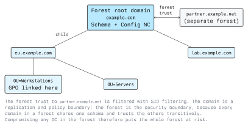

# Introduction to Active Directory

Active Directory Domain Services is the identity system almost every Windows network is built on.
It answers three questions for the whole organisation at once: who is this, what are they allowed to
do, and what settings apply to them. Understanding its structure is a prerequisite for the security
discussion in the next two lectures, because nearly every AD attack is an abuse of a legitimate
directory feature rather than a software flaw.

## What Active Directory Is

At bottom, AD is an LDAP directory plus a Kerberos KDC plus a replication engine, hosted on servers
called **domain controllers**. The directory stores objects (users, computers, groups, service
accounts, policies) in a hierarchical namespace. Every domain controller holds a writable copy of
the domain's data and replicates changes to the others, so there is no single master server.

The database file is `C:\Windows\NTDS\ntds.dit` on each DC. It contains every password hash in the
domain. That one sentence explains most of the rest of the module: a domain controller is the credential
store for the entire organisation.

## Structure



- **Forest**: the outermost container. All domains in a forest share one schema and one
  configuration partition, and trust each other transitively. The forest, not the domain, is the
  security boundary.
- **Domain**: a replication, policy and administrative boundary. Each domain has its own user
  accounts, its own password policy and its own Domain Admins group.
- **Tree**: domains sharing a contiguous DNS namespace, such as `example.com` and `eu.example.com`.
- **Organisational Unit (OU)**: a container used to delegate administration and to link Group
  Policy. OUs are not security groups; membership of an OU grants nothing by itself.
- **Site**: a representation of physical network topology, used to steer clients to a nearby DC and
  to schedule replication. Sites have no security meaning.

The distinction between domain and forest trips people up and matters enormously. Splitting a
company into two domains does *not* create isolation: a compromise of a DC in either domain can be
leveraged into control of the forest. If genuine isolation is required, you need separate forests.

## Naming

Every object has a distinguished name describing its full path:

```text
CN=Anna Berger,OU=Staff,OU=Vienna,DC=lab,DC=local
│               │               │
│               │               └── DC components mirror the DNS name lab.local
│               └── nested organisational units, read right to left
└── common name
```

Attributes you will see constantly:

| Attribute                     | Meaning                                        |
| ----------------------------- | ---------------------------------------------- |
| `sAMAccountName`              | Pre-Windows 2000 logon name, e.g. `aberger`     |
| `userPrincipalName`           | Logon name in email form, e.g. `aberger@lab.local` |
| `objectSid`                   | The SID, as covered in lecture 1                |
| `servicePrincipalName`        | Service identity the account may be reached as  |
| `memberOf` / `member`         | Group membership, in both directions            |
| `userAccountControl`          | A bit field of account flags                    |
| `pwdLastSet`, `lastLogonTimestamp` | Password and logon ageing                  |

`userAccountControl` is worth knowing because several security-relevant settings live in it as
single bits: account disabled, password never expires, pre-authentication not required, trusted for
delegation. Auditing a domain largely means auditing those bits.

## Partitions and the Global Catalog

A domain controller holds several naming contexts:

- **Domain NC**: the users, computers and groups of its own domain.
- **Configuration NC**: forest-wide topology: sites, services, certificate authorities. Replicated
  to every DC in the forest.
- **Schema NC**: the definition of every object class and attribute. One writable copy
  forest-wide.
- **Application partitions**: notably the AD-integrated DNS zones.

A **Global Catalog** server additionally holds a partial, read-only copy of every object in every
domain of the forest, which is how a user in one domain can be found from another. It listens on TCP
3268 (and 3269 for TLS) alongside the usual LDAP ports.

## Protocols and Ports

| Port         | Protocol               | Used for                               |
| ------------ | ---------------------- | -------------------------------------- |
| 53           | DNS                    | Locating domain controllers via SRV records |
| 88           | Kerberos               | Authentication                          |
| 135 + dynamic| RPC endpoint mapper    | Replication, remote management           |
| 389 / 636    | LDAP / LDAPS           | Directory queries                       |
| 445          | SMB                    | SYSVOL, file shares, named-pipe RPC      |
| 464          | kpasswd                | Kerberos password change                |
| 3268 / 3269  | Global Catalog         | Forest-wide searches                    |

A domain-joined client finds its DC by querying DNS for SRV records, not by configuration:

```bash
dig +short SRV _ldap._tcp.dc._msdcs.lab.local
```

That dependency is why DNS and AD are so tightly coupled, and why control of DNS in a domain is
close to control of authentication.

## FSMO Roles

Replication is multi-master, but a handful of operations need a single authority. These are the
Flexible Single Master Operations roles.

| Role                   | Scope  | Responsible for                              |
| ---------------------- | ------ | -------------------------------------------- |
| Schema Master          | Forest | Schema modifications                          |
| Domain Naming Master   | Forest | Adding and removing domains                   |
| RID Master             | Domain | Allocating blocks of RIDs to DCs              |
| PDC Emulator           | Domain | Authoritative time, password change urgency, lockout |
| Infrastructure Master  | Domain | Cross-domain object references                |

```powershell
Get-ADDomain  | Select-Object RIDMaster, PDCEmulator, InfrastructureMaster
Get-ADForest  | Select-Object SchemaMaster, DomainNamingMaster
```

The PDC Emulator is the one with day-to-day security relevance: it is the time authority for the
domain, and Kerberos refuses tickets outside a tolerance window (five minutes by default). Clock
skew is the most common reason a Kerberos tool fails in a lab.

## Groups

Three scopes, and the distinction governs where a group can be used:

- **Domain Local**: can contain principals from any trusted domain; usable for permissions only in
  its own domain.
- **Global**: contains principals from its own domain only; usable anywhere in the forest.
- **Universal**: contains principals from anywhere in the forest, usable anywhere; stored in the
  Global Catalog.

The recommended nesting is accounts into global groups, global groups into domain local groups, and
permissions onto the domain local group. In practice directories accumulate deep arbitrary nesting,
which is precisely what makes effective permissions unreadable without a graph tool.

The groups that matter most:

| Group                 | Why                                                      |
| --------------------- | --------------------------------------------------------- |
| Domain Admins         | Full control of the domain                                |
| Enterprise Admins     | Full control of every domain in the forest                |
| Schema Admins         | Can change the schema forest-wide                         |
| Administrators        | The built-in domain group that actually holds the rights  |
| Account / Backup / Server / Print Operators | Legacy groups with rights on DCs that are routinely underestimated |
| DnsAdmins             | Administers the DNS service running on domain controllers |

Treat every one of these as Tier 0. Backup Operators can read any file on a DC, including the
directory database; that is equivalent to Domain Admin even though the name does not suggest it.

## Group Policy

Group Policy Objects carry configuration and security settings. A GPO is stored in two halves: the
container in the directory, and the template files in `SYSVOL`, a share replicated to every DC.

```text
\\lab.local\SYSVOL\lab.local\Policies\{GUID}\
```

GPOs are linked to a site, a domain or an OU, and apply in that order (local, site, domain, OU),
with the last writer winning unless a link is enforced or inheritance is blocked. Security filtering
and WMI filters narrow which objects within the scope actually apply a GPO.

```powershell
Get-GPO -All | Select-Object DisplayName, ModificationTime
gpresult /r          # what applied to this machine and user
gpupdate /force
```

Two security consequences:

- Anyone who can edit a GPO can run code on every machine the GPO applies to. GPO edit rights are
  therefore administrative rights over that scope, and should be treated as such.
- SYSVOL is readable by every authenticated user in the domain, by design, because clients must read
  policy. Anything an administrator puts in a logon script is readable by everyone.

## Replication

Domain controllers replicate changes using the Directory Replication Service protocol over RPC. A DC
asks a peer for the changes it has not yet seen, and the peer returns the updated attributes,
including, when the requester is a DC, password hashes.

This is a necessary feature. It is also the mechanism behind one of the most important AD attacks,
covered in lecture 6: an account with replication rights can ask a DC for any account's password
hash without ever logging on to the DC. The rights involved are two extended rights on the domain
object, "Replicating Directory Changes" and "Replicating Directory Changes All".

```powershell
repadmin /showrepl
repadmin /replsummary
```

Auditing which non-DC principals hold those rights is one of the highest-value checks in a domain.

## Reading the Directory

AD is an LDAP server, so anything can query it, including from Linux:

```bash
ldapsearch -x -H ldap://10.10.10.10 -D 'student@lab.local' -W \
  -b 'DC=lab,DC=local' '(objectClass=user)' sAMAccountName userPrincipalName
```

From Windows, the RSAT PowerShell module is the usual route:

```powershell
Get-ADUser -Filter * -Properties PasswordNeverExpires, ServicePrincipalName |
  Where-Object { $_.ServicePrincipalName } |
  Select-Object SamAccountName, PasswordNeverExpires, ServicePrincipalName

Get-ADGroupMember -Identity 'Domain Admins' -Recursive
```

Note what the first query implies: an ordinary domain user can read most of the directory. AD is
designed to be readable by its members, because clients need to resolve names, find services and
locate policy. Enumeration of a domain by an authenticated user is therefore not an exploit. It is
the product working as designed, which is why the defensive focus is on what the directory *grants*
rather than on who can read it.

## Key Takeaways

- A domain controller holds every password hash in the domain; everything else follows from that.
- The forest, not the domain, is the security boundary. Separate domains do not isolate.
- Objects are identified by DN and SID; `userAccountControl` holds several security-relevant flags
  in single bits.
- DNS SRV records are how clients find DCs, which makes DNS control close to authentication control.
- GPO edit rights over a scope are administrative rights over that scope. SYSVOL is world-readable
  inside the domain.
- Replication rights allow retrieval of password hashes without logging on to a DC.
- Any authenticated user can read most of the directory. Defence is about restricting rights, not
  hiding structure.

## Resources

- Microsoft Learn, AD DS overview: <https://learn.microsoft.com/windows-server/identity/ad-ds/get-started/virtual-dc/active-directory-domain-services-overview>
- Microsoft Learn, FSMO roles: <https://learn.microsoft.com/troubleshoot/windows-server/active-directory/fsmo-roles>
- Microsoft Learn, Group Policy processing order: <https://learn.microsoft.com/previous-versions/windows/it-pro/windows-server-2003/cc785665(v=ws.10)>
- Microsoft Learn, AD DS replication concepts: <https://learn.microsoft.com/windows-server/identity/ad-ds/get-started/replication/active-directory-replication-concepts>
- RFC 4511, the LDAP protocol: <https://www.rfc-editor.org/rfc/rfc4511>
- RFC 4120, the Kerberos V5 protocol: <https://www.rfc-editor.org/rfc/rfc4120>
