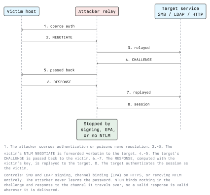

# Active Directory Penetration Testing

This lecture puts the previous five together: a methodology for assessing a domain, the attack
classes you will be looking for, and what each one tells the client to fix.

An AD assessment is not a hunt for exploits. The overwhelming majority of findings are legitimate
features configured in a way that grants more than intended. The deliverable is a chain: *this
account can reach that group through these three steps*. The remediation is to break the chain at
its cheapest link.

Scope and authorization come first. In Austria, unauthorized access is an offence under StGB §118a
and damaging data or systems under §126a and §126b; any personal data you encounter is covered by
the GDPR. Get the scope, the time window, the escalation contact and the explicit permission to
attempt privilege escalation in writing before you start. Module 01 covers this properly. The lab
for this lecture is your own domain on an RFC 1918 segment.

## 6.1 Methodology

| Phase | Question                                                           |
| ----- | ------------------------------------------------------------------ |
| 1     | What is reachable without credentials?                              |
| 2     | Can I obtain any valid credential at all?                           |
| 3     | With one ordinary user, what does the directory reveal?             |
| 4     | What paths exist from that user towards Tier 0?                     |
| 5     | What would detection have looked like at each step?                 |

Phase 5 is not optional padding. A report that lists findings but cannot say whether the client's
monitoring would have noticed is half a report.

## 6.2 Unauthenticated Reconnaissance

Start by establishing the domain name, the DCs and the policy that constrains you.

```bash
# Which hosts are domain controllers? SRV records answer this directly.
dig +short SRV _ldap._tcp.dc._msdcs.lab.local

nmap -p 53,88,135,139,389,445,464,636,3268 -sV 10.10.10.0/24

# Anonymous LDAP often still answers the root DSE, which names the domain and the DCs.
ldapsearch -x -H ldap://10.10.10.10 -s base -b '' defaultNamingContext dnsHostName
```

Where null or guest SMB sessions are allowed, `enum4linux-ng` and `rpcclient` will return the user
list, the group list and the password policy. The password policy matters before anything else: the
lockout threshold decides whether password spraying is safe to attempt at all.

**Defence.** Restrict anonymous enumeration (`RestrictAnonymous`, `RestrictAnonymousSAM`), disable
the guest account, and remove "Pre-Windows 2000 compatible access" from the Anonymous Logon SID.
None of this is a boundary, since any employee can still enumerate, but it removes the
pre-credential foothold.

## 6.3 Obtaining a First Credential

### Name resolution poisoning and NTLM relay

When a Windows client cannot resolve a name through DNS, it historically falls back to LLMNR, NBT-NS
and mDNS, broadcast protocols with no authentication. Any host on the segment can answer. The
client then authenticates to the responder, handing over an NTLM exchange.

Captured NetNTLMv2 material can be attacked offline, but the more direct route is relaying it: the
attacker forwards the exchange to a third service and ends up authenticated as the victim.



Related to this are **authentication coercion** techniques, which abuse legitimate RPC interfaces
that make a server authenticate to an attacker-supplied path. The print spooler and the encrypting
file system remote protocol are the well-known ones. Coercion turns relay from an opportunistic
attack that waits for a mistyped share name into one the attacker triggers on demand, and the
machine that can be coerced is often a domain controller.

**Defence.** This is the single highest-value hardening cluster in most domains:

- Disable LLMNR and NBT-NS by Group Policy. Fix the DNS entries that made them necessary.
- Require SMB signing everywhere, and LDAP signing plus channel binding on domain controllers.
- Enable Extended Protection for Authentication on HTTP endpoints that accept Windows auth,
  especially AD Certificate Services web enrollment.
- Disable the print spooler service on domain controllers and on any server that does not print.
- Begin the NTLM retirement project described in lecture 5.

### Password spraying

One password, many accounts, slowly: the inverse of brute force, and the shape that survives
lockout policy. It works because any sufficiently large user population contains someone using the
season and the year.

```bash
kerbrute userenum -d lab.local --dc 10.10.10.10 users.txt
kerbrute passwordspray -d lab.local --dc 10.10.10.10 users.txt 'Autumn2024!'
```

Kerberos pre-authentication failures also distinguish a valid username from an invalid one, which is
how `userenum` works: the KDC returns a different error for an account that does not exist.

**Defence.** Enforce a banned-password list so seasonal and company-name passwords are rejected at
the point of being set, which is far more effective than complexity rules. Require MFA on every
externally reachable authentication endpoint. Alert on a high rate of 4771/4768 failures spread
across many accounts from one source, which is the signature spraying leaves and which a per-account
lockout threshold will never trigger.

### Shares and SYSVOL

An ordinary credential makes every readable share worth a look. SYSVOL in particular is readable by
every domain user by design, and historically contained Group Policy Preferences files with
passwords encrypted using a key Microsoft published. The patch removed the ability to create new
ones, but existing files in SYSVOL remain readable until someone deletes them.

```bash
# Enumerate shares an account can reach across a subnet
nxc smb 10.10.10.0/24 -u student -p 'Password1' --shares
```

**Defence.** Audit SYSVOL for credentials. Review share permissions for `Everyone` and
`Authenticated Users`. Never put a password in a logon script.

## 6.4 Authenticated Enumeration

With one ordinary account, collect everything and analyse offline. The directory is readable, so
this is fast and quiet relative to anything else you will do.

```bash
bloodhound-python -u student -p 'Password1' -d lab.local -ns 10.10.10.10 -c All
```

Then work through the checklist from lecture 5: SPNs, pre-authentication flags, delegation settings,
machine account quota, replication rights, stale `adminCount=1` objects, password policy, and who
can read LAPS passwords.

Two things to examine that BloodHound surfaces well and manual review usually misses:

- **ACL edges.** `GenericAll`, `GenericWrite`, `WriteDacl`, `WriteOwner`, `ForceChangePassword` and
  `AddMember` over a privileged object are all equivalent to controlling it, directly or in two
  steps. These accumulate from delegations nobody remembers making.
- **Session data.** Where a Domain Admin is currently logged on determines which workstation
  compromise is worth the effort. This is tiering, measured.

## 6.5 Escalation Paths

### Kerberos

Covered in lecture 3: Kerberoasting against user accounts with SPNs, AS-REP roasting against
accounts without pre-authentication, and ticket reuse. In a domain assessment these are the first
things to try after enumeration because they need nothing but an ordinary account.

### Delegation abuse

- **Unconstrained delegation** on a non-DC host: compromising it yields the TGT of every user who
  authenticates to it. Combined with coercion, an attacker can choose which user that is.
- **Constrained delegation**: control of the front-end account allows impersonating arbitrary users
  towards the configured SPNs.
- **Resource-based constrained delegation**: an attacker who can write
  `msDS-AllowedToActOnBehalfOfOtherIdentity` on a computer object, and who can create or control a
  computer account, can impersonate any user to that machine. This is why the machine account quota
  and the `GenericWrite` edges on computer objects matter together rather than separately.

### Active Directory Certificate Services

If the domain runs a certificate authority, it is Tier 0. A certificate that authenticates to AD is
equivalent to a password, and it survives a password reset. The catalogued misconfigurations, known
as the ESC series, mostly reduce to two mistakes:

- A certificate template that lets a low-privileged enroller specify the subject the certificate will
  identify, so they can request a certificate naming an administrator.
- The web enrollment endpoint accepting NTLM authentication without channel binding, making it a
  relay target.

`certipy` is the standard tool for auditing templates. The remediation is to review every template
for who can enroll, whether the requester supplies the subject, and whether manager approval is
required, and to put EPA on the web endpoints.

### Replication rights and DCSync

An account holding the two directory replication extended rights can ask a DC for any account's
password hash, including `krbtgt`, over the normal replication interface. No logon to the DC is
required.

```bash
impacket-secretsdump -just-dc-user krbtgt 'LAB.LOCAL/admin@10.10.10.10'
```

This is the usual final step of a domain compromise, and it is a configuration review item, not a
vulnerability: enumerate every principal holding those rights and remove the ones that are not
domain controllers.

**Detection.** Event 4662 on the directory object with the replication extended right GUIDs, where
the requesting account is not a domain controller. This is one of the highest-fidelity alerts
available in AD, because legitimate non-DC replication essentially does not happen.

### Unpatched DC protocol flaws

A small number of serious vulnerabilities in DC-side protocol handling have allowed domain takeover
from an unauthenticated or low-privileged position. Zerologon (CVE-2020-1472) in the Netlogon
secure channel is the best-known example. Checking patch level on domain controllers is therefore
part of every assessment. These are also the only findings in this lecture that are fixed purely by
patching rather than by configuration.

## 6.6 Trusts

In a multi-domain forest, a compromise of any domain is a compromise of the forest, because the
trust relationships are transitive and SID filtering is not applied within a forest. Across a forest
trust, SID filtering is applied by default and is what prevents an attacker in one forest asserting
membership of a privileged group in the other. Disabling SID filtering on a forest trust, which is
occasionally done to work around a migration problem, removes that protection.

```powershell
Get-ADTrust -Filter * | Select-Object Name, Direction, TrustType, ForestTransitive, SIDFilteringQuarantined
```

**Defence.** Review every trust for necessity and direction. Keep SID filtering enabled. Where two
business units genuinely require isolation, they require separate forests, not separate domains.

## 6.7 Reporting

An AD finding is only useful if it names the chain and the cheapest break in it. Write each one as:

1. The path, step by step, with the specific objects involved.
2. The impact in terms the client cares about: what data or systems this reaches.
3. The single change that breaks the chain, and the cost of making it.
4. Whether the client's existing monitoring would have detected the step, with the event IDs.

Prioritise by what removes the most paths, not by what sounds most severe. Deploying LAPS,
requiring SMB signing, disabling LLMNR and removing unconstrained delegation will usually eliminate
more attack paths than anything else you can recommend.

## Lab Exercise

Against your own lab domain only:

1. Enumerate the domain unauthenticated. Record exactly what you obtained with no credentials.
2. Obtain a low-privileged credential by whatever means your lab allows, then run BloodHound.
3. Identify three distinct paths towards Domain Admins. For each, write the chain, the break, and
   the detection.
4. Apply the fixes (SMB signing, LLMNR off, remove unconstrained delegation, machine account quota
   to zero) and re-run collection. Show which paths disappeared.
5. Enable the audit subcategories from lecture 5 and repeat one attack. Produce the events it
   generated and write the detection rule.

Step 4 and step 5 are the point of the exercise. Finding the path is the easy half.

## Key Takeaways

- Almost every AD finding is a feature configured too generously, not a software bug. The two
  categories are fixed very differently.
- Relay and coercion are the dominant route from no credentials to a credential; signing, channel
  binding and disabling legacy name resolution are the answer.
- Password spraying beats brute force because it survives lockout policy. Banned-password lists beat
  complexity rules.
- Delegation settings, ADCS templates and directory ACLs are where the escalation paths hide.
- Replication rights held by anything other than a domain controller are a domain compromise waiting
  to happen, and are among the easiest things to both audit and detect.
- The forest is the security boundary. Keep SID filtering on forest trusts.
- A finding without a detection story and a named cheapest fix is an incomplete finding.

## Resources

- Impacket: <https://github.com/fortra/impacket>
- BloodHound Community Edition: <https://github.com/SpecterOps/BloodHound>
- NetExec: <https://github.com/Pennyw0rth/NetExec>
- Kerbrute: <https://github.com/ropnop/kerbrute>
- Certipy, for AD CS review: <https://github.com/ly4k/Certipy>
- Microsoft Learn, best practices for securing AD: <https://learn.microsoft.com/windows-server/identity/ad-ds/plan/security-best-practices/best-practices-for-securing-active-directory>
- Microsoft Learn, events to monitor in AD: <https://learn.microsoft.com/windows-server/identity/ad-ds/plan/appendix-l--events-to-monitor>
- Microsoft Learn, Netlogon secure channel changes (CVE-2020-1472): <https://msrc.microsoft.com/update-guide/vulnerability/CVE-2020-1472>
- MITRE ATT&CK, credential access and lateral movement: <https://attack.mitre.org/tactics/TA0006/>
