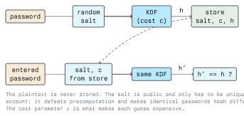
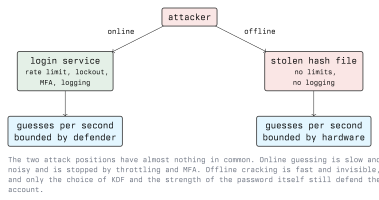

# Password Cracking Basics

Password cracking means recovering a plaintext password from something derived
from it, usually a hash. It is not a single technique but a search: the
attacker guesses a candidate, applies the same transformation the system
applied, and compares the result. Everything else in this module is a way of
making that search cheaper.

This lecture covers how passwords are stored, where the material an attacker
works from comes from, what separates online from offline attacks, and how to
reason about the size of a search space.

## 1.1 Why Passwords Are Not Stored

A system that needs to check a password does not need to know it. It only
needs to recognise it. So the stored value is a one-way function of the
password, and the check is a comparison of two outputs.

Three properties are expected from that function:

- **Preimage resistance:** given the output, finding an input that produces
  it should be infeasible.
- **Determinism:** the same password and the same parameters must always give
  the same output, or verification cannot work.
- **Cost:** each evaluation should be deliberately slow. This is the property
  a general-purpose hash such as SHA-256 does *not* have.



## 1.2 Hash, Salt, Cost

### 1.2.1 Plain Hashes

A bare cryptographic hash, `h = SHA256(password)`, is a poor password store:

- It is fast by design. A hash function is optimised for throughput, which is
  exactly what an attacker wants.
- It is unsalted, so identical passwords produce identical hashes. The hash
  file leaks which accounts share a password, and one cracked hash unlocks
  every account that reused it.
- Because it is unsalted, results can be precomputed once and reused against
  every leak, forever.

### 1.2.2 Salt

A salt is a random value stored alongside the hash and mixed into the input:
`h = H(salt || password)`. It is not a secret. Its job is narrower than it is
often described:

- It makes precomputation useless, because a table would have to be built per
  salt.
- It decouples equal passwords, so the hash file no longer reveals reuse.

A salt does **not** slow down an attack on a single known hash. If the
attacker has the salt (and they do, it sits next to the hash), guessing that
one account costs exactly what it cost before.

### 1.2.3 Cost and Key Derivation Functions

What does slow an attacker down is a deliberately expensive function with a
tunable work factor. These are password hashing functions, or
password-based key derivation functions (KDFs):

| Function | Tunable cost | Notes |
| -------- | ------------ | ----- |
| PBKDF2 | iteration count | Widely available, CPU-only, cheapest to attack on GPUs of the four. |
| bcrypt | cost factor (log2 of rounds) | Memory access pattern is unfriendly to GPUs. Truncates input at 72 bytes. |
| scrypt | CPU and memory cost | Memory-hard, so attack hardware needs RAM, not just cores. |
| Argon2id | time, memory, parallelism | Memory-hard, the current general recommendation (specified in RFC 9106). |

The point of memory-hardness is economic. A GPU or an ASIC gets its advantage
from running thousands of tiny arithmetic units in parallel. If each guess
also demands a sizeable block of memory, those units starve, and the
attacker's hardware advantage shrinks.

Cost is a parameter, not a constant. It is chosen so that one verification
takes an amount of time the login path can absorb, and it is raised as
hardware improves. The parameters are stored with the hash, which is how a
system can verify old hashes after the policy changes.

## 1.3 Where Hashes Come From

An attacker does not start from a hash. They start from an access that yields
one. Knowing the formats matters because the format determines how expensive
the attack will be.

### 1.3.1 Unix Local Accounts

Password hashes live in `/etc/shadow`, readable only by root. The second
field encodes everything needed to verify:

```text
alice:$6$rounds=656000$Xq1x...$Ck9f...:19800:0:99999:7:::
       |  |                |
       |  |                hash
       |  salt (and parameters)
       scheme id
```

Common scheme identifiers in that field:

```text
$1$       MD5-crypt      obsolete, very fast, do not use
$5$       sha256crypt
$6$       sha512crypt    long the default on many distributions
$2b$      bcrypt
$y$       yescrypt       memory-hard, default on recent Debian/Ubuntu
$argon2id$  Argon2id
```

The practical consequence: reading `/etc/shadow` already requires root, so
this is a post-exploitation step, typically aimed at reusing a password
elsewhere rather than at the machine already compromised.

### 1.3.2 Windows Local Accounts

Local account hashes are kept in the SAM registry hive, domain hashes in
`NTDS.dit` on a domain controller. The stored value is the NT hash: MD4 over
the UTF-16LE encoding of the password.

Two things follow, and both matter:

- It is **unsalted**. Identical passwords give identical NT hashes across all
  machines and all domains.
- It is a **single, fast hash iteration**. There is no cost parameter at all.

So an NT hash is both precomputable and extremely fast to attack. Worse, in
many authentication flows the NT hash is itself sufficient to authenticate
without ever recovering the password, which is the basis of pass-the-hash.
The defence is therefore not "crack-resistant passwords" alone but
restricting where privileged credentials are exposed.

### 1.3.3 Application Databases

A leaked `users` table is the most common real-world source. What the column
contains is entirely up to the developer, and that is the lesson: the same
breach is a nuisance or a catastrophe depending on one implementation choice
made years earlier.

### 1.3.4 Captured Protocol Material

Some authentication exchanges let a passive or semi-active observer collect a
value derived from the password: a Kerberos ticket encrypted with a service
account's key, a NetNTLM challenge-response, a WPA2 four-way handshake. None
of these reveal the password, but all of them can be attacked offline.

## 1.4 Online Versus Offline

This distinction decides which defences apply.



**Online** attacks submit guesses to a running service: a login form, SSH,
an API. The attacker's rate is whatever the defender permits. Every attempt
is a log line. Defences are rate limiting, exponential backoff, account
lockout with care taken not to create a denial-of-service, anomaly detection,
and above all a second factor.

**Offline** attacks run against captured material on the attacker's own
hardware. There is no rate limit, no log, no lockout, and no way for the
defender to notice. Only two things still help: how expensive each guess is
(the KDF and its cost) and how unlikely the password is to be guessed.

A breach notification is therefore also a cracking deadline. From the moment
a hash file leaves the organisation, the only remaining protection is the
work factor.

## 1.5 Keyspace and Entropy

A brute-force attack enumerates a keyspace. Its size is the number of symbols
raised to the length:

```text
  lowercase only      26^8  = 208,827,064,576
  lower+upper+digits  62^8  = 218,340,105,584,896
  all printable ASCII 95^8  = 6,634,204,312,890,625
```

Expressed in bits, a password of length L drawn uniformly from an alphabet of
N symbols carries `L * log2(N)` bits of entropy. For printable ASCII,
`log2(95)` is about 6.55 bits per character.

Two warnings about that formula, both important:

1. It only holds for **uniformly random** choices. A human-chosen
   `Sommer2024!` is formally 11 characters over a large alphabet, but it is
   near the front of any reasonable guessing order, so its real strength is
   a tiny fraction of the arithmetic. Entropy measures the generator, never
   the string.
2. Each additional character multiplies the keyspace, while each additional
   character class only widens the base. Length is the cheaper lever, which
   is why modern guidance prioritises a long minimum over composition rules.

Real attacks exploit exactly this gap. They do not enumerate the keyspace;
they enumerate human behaviour, in roughly descending order of likelihood.

## 1.6 Legal Boundary

Cracking a hash you were not authorised to possess, and using a recovered
password, are offences in Austria under the StGB, in particular §118a
(unlawful access to a computer system) and §126c (misuse of computer
programs); related provisions cover data damage (§126a) and interference with
system function (§126b). Recovered credentials are personal data under the
GDPR. Work only on your own lab systems or under a written, scoped
authorisation. Module 01 covers the legal framework in detail.

## Key Takeaways

- Systems store a one-way derivation of a password, never the password.
- A salt kills precomputation and hides reuse. It does not slow anything down.
- A cost parameter is what slows an attacker down. Use Argon2id, scrypt, or
  bcrypt, not a bare hash.
- Online and offline attacks have disjoint defences. Rate limiting and MFA do
  nothing once the hash file is stolen.
- NT hashes are unsalted and uniterated, which makes them unusually weak and
  also directly reusable without cracking.
- Entropy describes how a password was generated, not how it looks.

## Sources

- [https://datatracker.ietf.org/doc/html/rfc9106](https://datatracker.ietf.org/doc/html/rfc9106) (Argon2)
- [https://datatracker.ietf.org/doc/html/rfc7914](https://datatracker.ietf.org/doc/html/rfc7914) (scrypt)
- [https://pages.nist.gov/800-63-3/sp800-63b.html](https://pages.nist.gov/800-63-3/sp800-63b.html)
- [https://cheatsheetseries.owasp.org/cheatsheets/Password_Storage_Cheat_Sheet.html](https://cheatsheetseries.owasp.org/cheatsheets/Password_Storage_Cheat_Sheet.html)
- [https://www.ris.bka.gv.at/](https://www.ris.bka.gv.at/) (StGB, Austrian legal information system)
