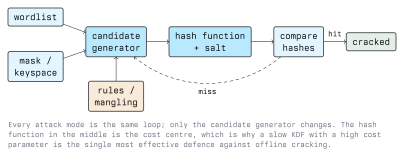

# Password Cracking Tools

The tools in this lecture do not do anything conceptually new. They implement
the loop from the previous lecture efficiently: generate a candidate, hash it
with the right algorithm and salt, compare, repeat. What distinguishes them is
which hash formats they know, how fast they run, and how flexibly they can be
told what to guess.

Everything here is run against your own lab systems or an authorised target.
See Module 01 for the legal framework.

## 2.1 The Toolchain

A realistic workflow has four stages, and only the third is "cracking":

```text
  1. acquire      a hash file, a captured handshake, an encrypted archive
  2. extract      convert it into a line a cracker understands
  3. identify     determine the algorithm and the matching mode
  4. attack       run the cracker; iterate on the candidate generator
```

Skipping stage 3 is the most common beginner mistake. Running the wrong mode
produces zero results and tells you nothing about the password.

## 2.2 Identifying a Hash

Identification is heuristic. A 32-character hex string could be MD5, an NT
hash, or a truncated something-else; length and character set narrow the
options but rarely settle them.

```bash
# Heuristic guesses, with the matching hashcat modes
hashid -m '5f4dcc3b5aa765d61d8327deb882cf99'

# Older interactive alternative
hash-identifier
```

Stronger evidence than length:

- **A prefix.** `$6$`, `$2b$`, `$argon2id$`, `$y$` are self-describing. Modular
  crypt format exists precisely so that the stored value names its own
  algorithm and parameters.
- **Context.** A hash from `/etc/shadow` on a Debian system, a hash from a
  SAM dump, and a hash from a web application's `users` table have very
  different likely answers. Where you got it is usually better information
  than what it looks like.
- **The source code.** On an authorised assessment you can often just read
  how the application hashes passwords.

## 2.3 John the Ripper

John the Ripper (use the community build, *jumbo*) is the most format-rich
cracker. Its strength is breadth: hundreds of formats, and a large family of
companion scripts that turn files into crackable lines.

### 2.3.1 Preparing Input

```bash
# Merge /etc/passwd and /etc/shadow into John's expected format
unshadow /etc/passwd /etc/shadow > hashes.txt

# The *2john helpers extract a crackable representation from a file
zip2john archive.zip      > zip.hash
ssh2john id_rsa           > key.hash
keepass2john database.kdbx > kdbx.hash
```

Those helpers do not break anything. They parse a container and emit the
key-verification material, which is then attacked exactly like a password
hash.

### 2.3.2 Running It

```bash
# Dictionary attack with a wordlist
john --wordlist=/usr/share/wordlists/rockyou.txt hashes.txt

# Same, with John's mangling rules applied to each word
john --wordlist=rockyou.txt --rules=Jumbo hashes.txt

# Pin the format when autodetection is ambiguous
john --format=sha512crypt --wordlist=rockyou.txt hashes.txt

# List everything already cracked for this file
john --show hashes.txt

# Incremental mode: John's own statistical candidate generator
john --incremental hashes.txt
```

Useful operational flags: `--fork=N` to use N CPU processes, `--session=NAME`
to name a run so it can be resumed with `--restore=NAME`, and `--status` to
query progress. Results accumulate in a "pot file" (`john.pot`), which is why
`--show` works after the run has finished.

## 2.4 Hashcat

Hashcat is GPU-first. For fast, unsalted hashes the difference against a CPU
cracker is orders of magnitude; for a memory-hard KDF the gap narrows sharply,
which is the whole argument for memory-hardness.

### 2.4.1 Modes

Hashcat needs the hash type as a number (`-m`) and the attack mode (`-a`).

```text
  -m 0      MD5
  -m 100    SHA1
  -m 1400   SHA2-256
  -m 1000   NTLM
  -m 1800   sha512crypt  ($6$)
  -m 3200   bcrypt       ($2*$)
  -m 22000  WPA-PBKDF2-PMKID+EAPOL
```

```text
  -a 0      straight      wordlist, optionally with rules
  -a 1      combination   every word of list A joined to every word of list B
  -a 3      brute-force   mask over a defined keyspace
  -a 6      hybrid        wordlist + mask appended
  -a 7      hybrid        mask + wordlist prepended
```

The authoritative list is long and changes between releases. Get it from the
installed binary rather than from notes:

```bash
hashcat --help | less
hashcat --example-hashes | less   # one sample hash per supported mode
```

### 2.4.2 Running It

```bash
# Dictionary attack against NT hashes
hashcat -m 1000 -a 0 hashes.txt rockyou.txt

# Dictionary plus rules
hashcat -m 1000 -a 0 hashes.txt rockyou.txt -r rules/best64.rule

# Mask attack: exactly eight lowercase letters
hashcat -m 1000 -a 3 hashes.txt '?l?l?l?l?l?l?l?l'

# Same mask family, incrementally from length 6 to 8
hashcat -m 1000 -a 3 -i --increment-min 6 --increment-max 8 \
        hashes.txt '?l?l?l?l?l?l?l?l'

# Write results to a file, and print what is already cracked
hashcat -m 1000 -a 0 -o cracked.txt hashes.txt rockyou.txt
hashcat -m 1000 --show hashes.txt
```

A run can be named with `--session=NAME` and resumed with
`--session=NAME --restore`. Candidates can be inspected without hashing
anything, which is the best way to learn what a rule set actually does:

```bash
hashcat -a 0 --stdout rockyou.txt -r rules/best64.rule | head -20
```



## 2.5 Online Guessing Tools

These submit guesses to a live service, so they are loud, slow, and trivially
detectable. On an authorised test they are used sparingly and with the client
informed, because account lockout can cause a real outage.

```bash
# One username, many passwords, against a lab SSH service
hydra -l testuser -P passwords.txt ssh://192.168.56.20

# Many usernames, one password: password spraying (see lecture 3)
hydra -L users.txt -p 'Winter2024!' ssh://192.168.56.20

# Stop at the first valid pair, and limit parallel tasks
hydra -l testuser -P passwords.txt -f -t 4 ssh://192.168.56.20
```

`medusa` and `ncrack` fill the same role with different protocol coverage.
For Windows environments, `netexec` (the successor to CrackMapExec) is the
usual tool for validating credentials across many hosts.

Defensive counterpart: these tools are easy to detect, and that is the point
to exploit. Alert on many failures for one account (guessing), on one failure
across many accounts in a short window (spraying), and on successful logins
from new locations after a burst of failures.

## 2.6 Wordlists

The candidate list matters more than the tool. The classic starting point is
`rockyou.txt`, a plaintext list from a 2009 breach, which ships with Kali at
`/usr/share/wordlists/rockyou.txt` (compressed on some versions). The
`SecLists` project collects far more, organised by language, source, and
context.

Building a targeted list beats a bigger generic one. For an authorised
engagement, terms drawn from the organisation's own vocabulary (product
names, local place names, the current year, the sports club in the town)
crack more hashes than another ten million generic entries.

```bash
# Deduplicate and sort a merged list; order matters for speed, duplicates waste work
sort -u list_a.txt list_b.txt > merged.txt

# Keep only candidates of a plausible length
awk 'length($0) >= 8 && length($0) <= 16' merged.txt > filtered.txt
```

`hashcat-utils` provides small helpers for this kind of list surgery, and
`cewl` can build a wordlist by crawling a website you are authorised to test.

## 2.7 Choosing a Tool

| Situation | Reasonable choice |
| --------- | ----------------- |
| Exotic or container format (archive, keystore, disk image) | John the Ripper jumbo |
| Large volume of fast hashes, GPU available | Hashcat |
| Need to extract a hash from a file first | A `*2john` helper, then either cracker |
| Credential check against a live service | hydra / netexec, carefully and in scope |
| Verifying your own password policy | Either, against your own hash dump, with written approval |

## 2.8 Measurement, Not Magic

A benchmark is the only honest way to answer "how long will this take". It is
also hardware- and version-specific, which is why no figures are quoted here.

```bash
# Benchmark the installed build on the installed hardware
hashcat -b

# Benchmark a single mode
hashcat -b -m 3200
```

Compare the rate for `-m 0` (MD5) with `-m 3200` (bcrypt) on the same machine.
The ratio between them is the entire practical argument of this module: the
defender's choice of hash function, not the attacker's hardware, dominates
the outcome.

## Key Takeaways

- Identify the hash before attacking it. Context beats string length.
- John the Ripper wins on format breadth; hashcat wins on raw speed.
- The `*2john` helpers extract crackable material from containers; the attack
  afterwards is an ordinary password attack.
- `--stdout` and `--show` make a cracker's behaviour inspectable; use them
  while learning.
- Online guessing tools are noisy by construction, which is what makes
  detection practical.
- A targeted wordlist outperforms a larger generic one.
- Benchmark on your own hardware rather than trusting quoted numbers.

## Sources

- [https://hashcat.net/wiki/](https://hashcat.net/wiki/)
- [https://www.openwall.com/john/doc/](https://www.openwall.com/john/doc/)
- [https://github.com/danielmiessler/SecLists](https://github.com/danielmiessler/SecLists)
- [https://github.com/hashcat/hashcat-utils](https://github.com/hashcat/hashcat-utils)
- [https://github.com/vanhauser-thc/thc-hydra](https://github.com/vanhauser-thc/thc-hydra)
