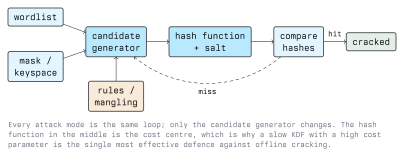

# Password Cracking Techniques

A keyspace of printable eight-character passwords has roughly 6.6 * 10^15
members. No attacker enumerates it when they do not have to. Every technique
in this lecture is a way of visiting likely candidates first, so that the
expected number of guesses before a hit is far smaller than the size of the
space.

Run all of this against your own lab or an authorised target only. Module 01
covers the legal framework.

## 3.1 The Only Loop There Is



The hash function in the middle is fixed by the target. The compare step is
cheap. So a technique is judged on one question: for a given number of
guesses, how much of the realistic password population does it cover?

## 3.2 Dictionary Attack

Try entries from a list. This is the baseline, and against a real population
of human-chosen passwords it is also the single most productive technique,
because password choice is heavily concentrated on a small number of values.

```bash
hashcat -m 1800 -a 0 shadow.hash rockyou.txt
john --wordlist=rockyou.txt shadow.hash
```

The list is the whole attack. A list ordered by observed frequency finds more
in the first million guesses than an alphabetically sorted list of ten
million.

**What stops it:** a blocklist check at the moment the password is chosen. If
the password was never allowed to be `Passwort123`, no list contains it.

## 3.3 Rule-Based Mangling

Humans satisfy composition rules predictably. Asked for a capital, a digit,
and a symbol, they produce `Sommer2024!`, not a random string. Mangling rules
encode those habits as transformations applied to each dictionary word.

Hashcat's rule syntax is a small stack language, one function per character:

```text
  :        do nothing (pass the word through unchanged)
  c        capitalise the first letter, lowercase the rest
  u        uppercase everything
  r        reverse
  d        duplicate the word
  $1       append the character "1"
  ^a       prepend the character "a"
  sa@      substitute every "a" with "@"
  $2 $0 $2 $4   append "2024", one character per function
```

Functions combine on one line, and a rule file is a list of such lines:

```text
c $2 $0 $2 $4 $!
sa@ se3 si1 $1
```

Applied to `sommer`, those two lines produce `Sommer2024!` and `s@mm3r1`.

```bash
# Apply a shipped rule set
hashcat -m 1800 -a 0 shadow.hash rockyou.txt -r rules/best64.rule

# Inspect what the rules generate, without hashing anything
hashcat -a 0 --stdout wordlist.txt -r rules/best64.rule | head -30
```

John has an equivalent mechanism configured in `john.conf` and selected with
`--rules=NAME`.

Rules multiply the work: a 14-million-word list with a 64-rule set is
roughly 900 million candidates. That is still a rounding error against the
full eight-character keyspace, and it covers a far more likely region of it.

**What stops it:** nothing about the policy, because mangling is a *response*
to composition policies. What stops it is removing the predictability, with a
generated passphrase or a password manager, plus a slow KDF so that 900
million candidates is no longer a cheap run.

## 3.4 Brute Force and Mask Attacks

A pure brute force tries every string over an alphabet. A mask attack is the
same thing with structure imposed per position, which is what makes it
useful: real passwords are not uniform, and known structure removes enormous
amounts of the space.

Hashcat's placeholders:

```text
  ?l   a-z              ?d   0-9
  ?u   A-Z              ?s   printable symbols
  ?a   ?l + ?u + ?d + ?s
  ?h   0-9 a-f          ?H   0-9 A-F
  ?b   0x00 - 0xff
```

```bash
# Exactly eight lowercase letters
hashcat -m 1800 -a 3 shadow.hash '?l?l?l?l?l?l?l?l'

# Capital, five lowercase, four digits: a very common human shape
hashcat -m 1800 -a 3 shadow.hash '?u?l?l?l?l?l?d?d?d?d'

# A custom charset in slot 1, used three times
hashcat -m 1800 -a 3 -1 '?l?u?d' shadow.hash '?1?1?1?d?d?d?d'
```

Masks scale badly and predictably. Each added `?a` multiplies the space by
about 95, each added `?l` by 26. Adding two characters to a lowercase mask
makes the run 676 times longer. This is why length is the defender's best
lever and why mask attacks are reserved for short passwords, for machine-
generated values with a known format, or for completing a partially known
password.

**What stops it:** length. Past roughly 12 random characters an unstructured
mask attack is not a practical threat regardless of hardware, and the
attacker falls back to techniques that exploit human choice instead.

## 3.5 Combinator and Hybrid Attacks

Passphrases built from two or three real words are vulnerable to a cheaper
search than their character length suggests.

```bash
# Every word of A joined to every word of B
hashcat -m 1800 -a 1 shadow.hash words_a.txt words_b.txt

# Wordlist with a four-digit mask appended
hashcat -m 1800 -a 6 shadow.hash rockyou.txt '?d?d?d?d'

# Mask prepended to each wordlist entry
hashcat -m 1800 -a 7 shadow.hash '?d?d?d?d' rockyou.txt
```

`-a 6` and `-a 7` cover an extremely common real shape: a word plus a year,
or a word plus a sequence of digits.

**What stops it:** enough words. A two-word combination from a 10,000-word
list is 10^8 candidates, which is nothing. Six words from a 7,776-word list
is about 2.2 * 10^23, which is not. Diceware-style passphrases work, but only
with enough words and only when the words are chosen randomly rather than
written as a sentence.

## 3.6 Statistical and Markov-Guided Generation

Rather than enumerating a space in order, a generator can be trained on real
password data and emit candidates in descending order of estimated
likelihood. Hashcat uses Markov chains internally for its mask attacks, and
John's `--incremental` mode does something comparable with character
frequency statistics.

This is the sharpest tool against human-chosen passwords, because it attacks
the distribution directly rather than the alphabet. It is also the reason
"my password looks random" is a weak claim: these generators are trained on
millions of passwords whose owners thought the same.

## 3.7 Rainbow Tables

A time-memory trade-off. Instead of hashing candidates at attack time, the
attacker precomputes chains of alternating hash and reduction steps, stores
only the endpoints, and recovers a password by walking a chain at lookup
time. The technique was refined by Philippe Oechslin and popularised by
tools such as RainbowCrack and `ophcrack`.

It is largely historical, for exactly one reason: **a salt defeats it
completely.** A table is built for one hash function with no salt. With an
n-bit salt the attacker needs 2^n tables, which is immediately infeasible.

Where rainbow tables still work is where salts are absent by design, which in
practice means legacy Windows hashes, LM hashes in particular, which
uppercase the password, split it into two 7-character halves, and encrypt
each separately. That design was weak enough that complete tables are
practical. LM is disabled by default on modern Windows.

**What stops it:** a per-user salt. This is a solved problem, and its lesson
is that unsalted storage puts the hashes in a different threat class
altogether.

## 3.8 Attacks That Skip Cracking Entirely

Often the goal is a session, not a plaintext. Three families of attack get
there without recovering any password.

### 3.8.1 Credential Stuffing

Take username/password pairs from a previous breach and replay them against
an unrelated service. It works because of reuse, not weakness: a long random
password that was used in two places is as vulnerable as a short one. Success
rates per pair are low, which is irrelevant when the attacker has hundreds of
millions of pairs.

**Defences:** MFA, checking authentication attempts against known-breached
credential sets, detecting the traffic pattern (many accounts, one attempt
each, distributed sources), and device or risk-based step-up.

### 3.8.2 Password Spraying

Invert the loop. Instead of many passwords against one account, try one or
two very likely passwords against every account in the organisation. Because
each account sees only one or two failures, lockout thresholds are never
reached.

```bash
# One likely password, many accounts, in an authorised lab
hydra -L users.txt -p 'Winter2024!' ssh://192.168.56.20
```

**Defences:** lockout thresholds do not catch this, so detection must be
organisation-wide: alert on a rise in failures across many distinct accounts
within a short window, and on the same source attempting many accounts. A
breach blocklist removes the handful of passwords spraying actually relies on.

### 3.8.3 Credential Reuse of Hashes and Tickets

In some protocols the derived value is itself sufficient to authenticate. An
NT hash can be used directly in NTLM authentication (pass-the-hash), and
Kerberos tickets can be reused while valid. Cracking is unnecessary.

**Defences:** these are architectural. Restrict where privileged credentials
are exposed, use administrative tiering so a workstation compromise does not
yield domain credentials, prefer Kerberos over NTLM and disable NTLM where
possible, and give service accounts long generated passwords so that tickets
encrypted with their keys cannot be attacked offline.

## 3.9 Choosing a Technique

In practice an engagement runs them in increasing cost order and stops when
the result is good enough to make the point:

```text
  1. frequency-ordered dictionary        cheapest, highest yield
  2. dictionary + mangling rules         covers composition-rule behaviour
  3. targeted wordlist for this client   organisation vocabulary
  4. hybrid: word + digits/year          very common real shape
  5. masks for known structures          short or format-constrained values
  6. unconstrained brute force           last resort, usually infeasible
```

That ordering is itself a finding. If step 1 cracks a large share of an
organisation's hashes, the problem is the policy, not the hardware.

## Key Takeaways

- Attackers search likely candidates first; keyspace size is an upper bound,
  not a cost estimate.
- Dictionary plus rules is the highest-yield technique against human-chosen
  passwords, because it models human behaviour.
- Mask attacks are only viable against short or structurally known passwords;
  length defeats them outright.
- Rainbow tables are defeated completely by per-user salts.
- Stuffing, spraying, and hash reuse bypass cracking altogether, so password
  strength alone does not defend against them.
- Different techniques have different defences: blocklists stop dictionaries,
  length stops masks, salts stop tables, MFA stops reuse.

## Sources

- [https://hashcat.net/wiki/doku.php?id=rule_based_attack](https://hashcat.net/wiki/doku.php?id=rule_based_attack)
- [https://hashcat.net/wiki/doku.php?id=mask_attack](https://hashcat.net/wiki/doku.php?id=mask_attack)
- [https://www.openwall.com/john/doc/RULES.shtml](https://www.openwall.com/john/doc/RULES.shtml)
- [https://owasp.org/www-community/attacks/Credential_stuffing](https://owasp.org/www-community/attacks/Credential_stuffing)
- [https://attack.mitre.org/techniques/T1110/](https://attack.mitre.org/techniques/T1110/) (Brute Force, MITRE ATT&CK)
