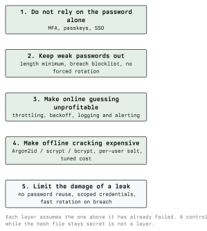

# Password Policies and Best Practices

The previous lectures showed what attackers actually do. This one turns that
into policy. The guiding principle is simple and it is worth stating before
anything else: a policy is good if it shifts the password population away
from what the techniques in lecture 3 are good at finding, and bad if it
merely feels strict.

Many traditional rules fail that test. They make passwords harder for people
and easier for `best64.rule`.

## 4.1 A Layered Model



Read the layers as a sequence of failures. If the first layer holds, nothing
below it is tested. If the hash file is stolen, only layer four is still
doing anything. Any control that stops working the moment the database leaks
is a convenience, not a layer.

## 4.2 What Modern Guidance Says

Guidance converged over the last decade, and current recommendations
(NIST SP 800-63B, the BSI IT-Grundschutz guidance, the OWASP
Authentication Cheat Sheet) agree on the main points:

**Do:**

- Set a **minimum length** and keep it meaningful. Eight characters is a
  floor, not a target; twelve or more is a better minimum for accounts that
  matter.
- Allow a **long maximum**, at least 64 characters, and accept the full
  Unicode range including spaces. A short maximum tells users their password
  manager's output is unwelcome.
- Check new passwords against a **blocklist** of known-breached and
  obviously weak values, and reject matches at the moment of choosing.
- Allow and encourage **password managers**. Do not block paste in password
  fields.
- Store with a **memory-hard KDF** and a per-user salt (lecture 1).

**Do not:**

- Impose **composition rules** (one upper, one digit, one symbol). They
  produce predictable results and are the reason mangling rules work.
- Force **periodic rotation** without cause. Users respond with
  `Sommer2024!` becoming `Sommer2025!`, which an attacker's rule set already
  covers. Rotate on evidence of compromise instead.
- Use **password hints** or knowledge-based "security questions". The answers
  are often public, and they create a weaker parallel path into the account.
- Truncate silently, or restrict the character set. Both reduce the keyspace
  without telling anyone.

The shift from composition to length and blocklists is not a relaxation. It
removes the rules attackers model well and keeps the ones they cannot work
around.

## 4.3 Blocklists

A blocklist is the only control that removes the top of the password
distribution, which is where a dictionary attack earns almost all of its
hits.

What belongs in it:

- The most common passwords from public breach data.
- Passwords containing the organisation's name, product names, or the local
  town.
- The service name itself, and sequential or repeated characters.
- Values previously used on this account.

Checking a user's password against a breach corpus without sending the
password anywhere is a solved problem: a *k*-anonymity lookup sends only a
short prefix of the hash and filters the returned candidate list locally. The
service never learns which password was checked. Services such as Have I
Been Pwned expose exactly this interface, and it can be run self-hosted from
a downloaded corpus if sending even a prefix is unacceptable.

## 4.4 Rate Limiting and Lockout

This is the layer that defends online guessing, and it is a balance.

- **Throttling with exponential backoff** is usually better than hard
  lockout. Delays grow with consecutive failures, so guessing becomes
  uneconomical while a legitimate user who mistypes twice is barely affected.
- **Hard lockout** after N failures hands an attacker a denial-of-service: a
  list of usernames is enough to lock out an entire organisation.
- Rate limit per account **and** per source, because spraying defeats the
  first and a distributed attack defeats the second.
- Return an **identical response** for an unknown user and a wrong password.
  A different message, or a measurably different response time, is user
  enumeration.

Detection matters as much as prevention, and the signatures differ:

```text
  many failures, one account        classic online guessing
  one failure, many accounts        password spraying
  one attempt per pair, many IPs    credential stuffing
  success after a burst of failures  a guessed or stuffed credential
```

A SIEM rule for the second and third patterns is more valuable than a lower
lockout threshold, because those are the attacks lockout does not see.
Module 13 covers the detection side.

## 4.5 Beyond the Password

### 4.5.1 Multi-Factor Authentication

MFA is the highest-value layer because it breaks the attacker's economics
entirely: a correct password is no longer sufficient. The factors are not
equal:

| Factor | Resists guessing | Resists phishing | Note |
| ------ | ---------------- | ---------------- | ---- |
| SMS code | yes | no | Also exposed to SIM swapping and SS7 issues. |
| TOTP app | yes | no | Code can be relayed by a proxy in real time. |
| Push approval | yes | partly | Vulnerable to approval fatigue; number matching helps. |
| FIDO2 / WebAuthn | yes | yes | Challenge is bound to the origin, so a proxy site fails. |

The phishing-resistance column is the one that separates them. SMS and TOTP
stop guessing but not a real-time relay; a hardware-backed FIDO2 credential
is cryptographically bound to the site it was registered for, so a look-alike
domain cannot use it.

### 4.5.2 Passkeys

A passkey is a FIDO2 credential used as the primary factor instead of a
password. The private key never leaves the authenticator, nothing reusable is
transmitted, and there is no shared secret on the server to steal. That
removes offline cracking, credential stuffing, and password phishing in one
step. The practical difficulties are recovery and device loss, not
cryptography.

### 4.5.3 Single Sign-On

Centralising authentication reduces the number of password stores to defend
and the number of places a credential can be reused. It also concentrates
risk: the identity provider becomes worth attacking on its own terms, and it
is where the strongest controls belong.

## 4.6 Guidance for Users

Short, honest, and consistent with everything above:

- Use a **password manager**. It is the only practical way to have a
  different strong password everywhere.
- Let it **generate** passwords. A generated 16-character random string is
  immune to every technique in lecture 3 except reuse and theft.
- For the few passwords you must memorise (the manager's master password,
  the disk encryption passphrase) use a **randomly generated passphrase of
  several words**. Random selection is the requirement; a sentence you wrote
  yourself is not random.
- **Never reuse** a password across services. Reuse is what converts someone
  else's breach into your problem.
- Enable **MFA** everywhere it is offered, preferring a hardware key or a
  passkey.
- Change a password when there is **evidence** of compromise, not on a
  schedule.

## 4.7 Auditing Your Own Policy

Password auditing is the legitimate application of this entire module: crack
your own organisation's hashes to find out whether the policy works. It is
also the point where the legal and organisational requirements are strictest,
because a hash dump is a concentration of personal data.

Before anything technical:

1. **Written authorisation** naming the systems, the time window, and the
   people involved. Verbal approval is not sufficient (see Module 01).
2. A **data protection assessment**. Password hashes are personal data under
   the GDPR. Define where the dump is stored, who can access it, and when it
   is destroyed.
3. **Report statistics, not passwords.** The deliverable is "41 of 300
   accounts cracked within one hour, 12 of them matched a top-1000 list", not
   a list of plaintexts. Individual passwords are needed only to notify the
   affected account holders, and are deleted after that.
4. A **destruction step** with a date, carried out and documented.

In Austria, unauthorised access to a computer system falls under StGB §118a,
and possessing or distributing tooling for that purpose under §126c; related
provisions cover data damage (§126a) and interference with system function
(§126b). The authorisation is what distinguishes an audit from an offence.

A useful audit metric is not "how many did we crack" but **how fast**. Hashes
cracked in the first ten minutes represent accounts an opportunistic attacker
would also have. That number, tracked over time, tells you whether the policy
change worked.

## Key Takeaways

- Judge a policy by whether it defeats real techniques, not by how strict it
  feels.
- Length, a breach blocklist, and a memory-hard KDF are the controls that
  work; composition rules and forced rotation are the ones that backfire.
- Prefer throttling with backoff over hard lockout, which is itself a
  denial-of-service primitive.
- Spraying and stuffing need organisation-wide detection, because per-account
  lockout never sees them.
- MFA breaks the attacker's economics; FIDO2 and passkeys additionally resist
  phishing, which SMS and TOTP do not.
- A password audit needs written authorisation, a GDPR assessment, statistics
  rather than plaintexts, and a documented destruction step.

## Sources

- [https://pages.nist.gov/800-63-3/sp800-63b.html](https://pages.nist.gov/800-63-3/sp800-63b.html)
- [https://cheatsheetseries.owasp.org/cheatsheets/Authentication_Cheat_Sheet.html](https://cheatsheetseries.owasp.org/cheatsheets/Authentication_Cheat_Sheet.html)
- [https://cheatsheetseries.owasp.org/cheatsheets/Password_Storage_Cheat_Sheet.html](https://cheatsheetseries.owasp.org/cheatsheets/Password_Storage_Cheat_Sheet.html)
- [https://haveibeenpwned.com/Passwords](https://haveibeenpwned.com/Passwords)
- [https://fidoalliance.org/passkeys/](https://fidoalliance.org/passkeys/)
- [https://www.bsi.bund.de/](https://www.bsi.bund.de/) (IT-Grundschutz)
- [https://www.ris.bka.gv.at/](https://www.ris.bka.gv.at/) (StGB)
