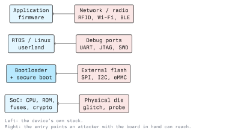

# Introduction to Hardware Hacking

Hardware hacking means analysing a physical device in order to understand or change how it
works. In a security context it is the discipline of attacking a system while holding it in
your hands: reading the chips, listening to the buses between them, talking to the debug
interfaces the manufacturer forgot to disable, and recovering the firmware that runs on top.

It matters because the usual network assumptions break down. A web server sits in a data
centre; a door controller, a smart meter or an insulin pump sits in a corridor, on a wall or
on a person. Once an attacker can touch a device, "the attacker cannot read our flash" stops
being a safe assumption, and the design has to hold up anyway.

## Why Devices Are Attacked Physically

- **Firmware is the shortest path to the whole product line.** One flash dump often yields
  credentials, API keys or signing material shared by every unit shipped.
- **Embedded systems are long-lived.** A controller installed in 2012 may still run its
  original firmware, with no update channel.
- **Cost pressure removes defences.** Secure boot, encrypted flash and tamper detection cost
  parts, board area and engineering time. Many products ship without them.
- **The physical device is the oracle.** An attacker can power-cycle it a million times,
  single-step its boot, and watch every bus. No remote target is that cooperative.

## The Attack Surface of an Embedded Device



Reading it from the bottom up:

- **Physical die access.** Decapsulation, microprobing, fault injection. Expensive, needs lab
  equipment, and the realistic threat only for high-value targets.
- **External memory.** Firmware usually lives in a separate SPI NOR flash, an I2C EEPROM or an
  eMMC package. If it is not encrypted, desoldering or clipping onto it reads everything.
- **Debug interfaces.** UART consoles, JTAG and SWD are left enabled far more often than you
  would expect, because the factory needs them for testing and nobody closed the door.
- **Radio and network.** RFID, NFC, BLE, Wi-Fi, 433 MHz remotes. Covered in this module for
  RFID/NFC, and in Module 19 for Wi-Fi.

## Buses You Will Meet

| Bus  | Wires                          | Typical use                        | What it gives an attacker        |
| ---- | ------------------------------ | ---------------------------------- | -------------------------------- |
| UART | TX, RX, GND (often + VCC)      | Serial console, logs, bootloader   | A shell, boot messages, prompts  |
| SPI  | CLK, MOSI, MISO, CS, GND       | External flash, displays, radios   | The whole firmware image         |
| I2C  | SDA, SCL, GND                  | EEPROM, sensors, RTC, PMIC         | Config, calibration, small keys  |
| JTAG | TCK, TMS, TDI, TDO, (TRST)     | Factory test, debug, boundary scan | Halt the CPU, read/write RAM     |
| SWD  | SWDIO, SWCLK, GND              | ARM Cortex-M debug (2-wire JTAG)   | The same, over two pins          |

UART is asynchronous and needs no clock line, so both sides must agree on a baud rate.
115200 and 9600 are the usual first guesses. SPI and I2C are synchronous and clocked by the
master, which makes them easy to decode with a logic analyser.

### Finding the Pads

Most boards have a row of test points near the main SoC. A workable routine:

1. Photograph the board, both sides, well lit. You will refer back to the photos constantly.
2. Read the markings on every IC and pull the datasheets. The SoC datasheet gives you the
   pinout, the flash datasheet gives you the command set.
3. With the board **powered off**, use a multimeter in continuity mode to find ground: any pad
   that beeps against a known ground pad or shield is GND.
4. Power the board and measure the remaining pads against ground. A pad sitting at a steady
   3.3 V is likely VCC; a UART TX pin idles high and dips while the board boots and prints.
5. Connect a logic analyser or a USB-serial adapter and look at the traffic before you ever
   try to write anything.

## The Toolbox

Nothing here is exotic, and a usable bench costs less than a laptop.

- **Multimeter**: continuity, voltage levels, finding ground. The first tool you reach for.
- **USB-to-serial adapter** (FT232, CP2102, CH340): talks to a UART console at 3.3 V. Check
  the logic level before connecting; 5 V into a 3.3 V pin destroys parts.
- **Logic analyser**: an 8-channel fx2lafw-based unit plus `sigrok`/PulseView decodes UART,
  SPI and I2C in software.
- **SPI flash programmer**: a CH341A module, a Bus Pirate or an FT2232-based board, driven by
  `flashrom`.
- **SOIC-8 test clip**: reads a flash chip in place, no desoldering, when the board allows it.
- **Soldering iron and hot air**: for when it does not.
- **JTAG/SWD probe**: an ST-Link, J-Link or FT2232 adapter, driven by OpenOCD.
- **Oscilloscope**: for analogue questions a logic analyser cannot answer: ringing, slow
  edges, brown-outs, power traces.
- **Proxmark3 / NFC reader**: for the RFID work in the next lecture.
- **JTAGulator** or an equivalent pin-finding tool: brute-forces which header pin is which.

### First Contact Over UART

```bash
# Who showed up when the adapter was plugged in?
ls /dev/tty*            # Linux: /dev/ttyUSB0, /dev/ttyACM0
# Open a console. Ctrl-A then Ctrl-\ quits picocom.
picocom -b 115200 /dev/ttyUSB0
# Or with screen; Ctrl-A then K quits.
screen /dev/ttyUSB0 115200
```

If the output is garbage, the baud rate is wrong. Step through 9600, 19200, 38400, 57600 and
115200, or capture the line with a logic analyser and let the decoder work it out:

```bash
sigrok-cli --driver fx2lafw --config samplerate=4m --samples 4000000 \
  --channels D0 --protocol-decoders uart:rx=D0:baudrate=115200
```

## What Hardware Hacking Does Not Mean

Physical access is not a licence. Dismantling a device you do not own, or one that belongs to
your school or employer, needs permission from whoever owns it, in writing, before you start.
In Austria, unauthorised access to a computer system is a criminal offence under **StGB
§118a**, damaging data under **§126a**, and interfering with a system's operation under
**§126b**; transmitting on RFID, ISM or Wi-Fi frequencies is additionally regulated by
telecommunications law, and any personal data you encounter falls under the GDPR. Module 01
covers the legal detail; read it before you touch a device that is not yours.

Two practical consequences for lab work:

- Buy your own targets. Used routers, IP cameras, door readers and dev boards are cheap, and a
  device you own is a device you may legally destroy.
- Keep an engagement scope in writing for any assessment work, and keep the device inventory
  with it. "I was only curious" is not a defence.

## A Realistic Workflow

```text
  recon            access              extract            analyse          exploit
  ----------       -------------       -----------        -----------      ----------
  photos,      ->  UART / JTAG /   ->  flash dump,    ->  binwalk,     ->  write to
  datasheets       SPI clip            memory read        Ghidra           flash, glitch,
                                                                          forge input
```

Lectures 4 and 5 walk the extract/analyse and exploit stages in detail. Lectures 2 and 3 take
two specific technologies, RFID/NFC and biometrics, because almost every physical access
control system in a school, office or lab is built from one or both.

## Defensive View

Every item in the toolbox has a countermeasure, and a designer who expects the toolbox builds
differently:

| Attack path                 | What stops it                                             |
| --------------------------- | --------------------------------------------------------- |
| Reading external flash      | Encrypted flash, keys in on-die OTP, signed images         |
| UART console                | Console disabled in production builds, no root shell       |
| JTAG/SWD                    | Debug port locked by fuse after provisioning               |
| Firmware rollback           | Monotonic version counter checked by the bootloader        |
| Cloned or modified firmware | Secure boot with a root of trust in mask ROM               |
| Opening the enclosure       | Tamper switch that zeroises keys, potting, mesh            |

None of these is free, and each has a cost in field repair and manufacturing complexity. The
question of whether a device can be hacked at all is not the useful one: with enough time and
a microscope, anything can. The engineering question is "does breaking one unit break the
fleet". A good design keeps the attack local.

## Exercises

Run all of these against hardware you own.

1. Take a retired router or IP camera. Photograph both sides of the board, identify every IC
   from its markings, and write a one-page inventory with datasheet links.
2. Find ground, VCC, TX and RX on the test header with a multimeter, then capture the boot
   output over UART and save the log.
3. Decode the same UART line with a logic analyser and confirm the baud rate the decoder
   reports matches the one you guessed.
4. Write the threat model: for your device, which of the six defences in the table above are
   present, and what does their absence let an attacker do?

## Key Takeaways

- Hardware hacking starts with observation (photographs, datasheets, a multimeter) rather than
  with exploitation.
- The usual entry points are external memory and debug interfaces, in that order, because they
  are cheap to reach and often entirely unprotected.
- UART, SPI, I2C, JTAG and SWD cover nearly every bus you will meet on a consumer board.
- A product is well designed when compromising one unit does not compromise the rest of the
  fleet: keys per device, signed firmware, locked debug ports.
- Physical access to a device you do not own is an authorization question before it is a
  technical one. Get it in writing.

## Resources

- Joe Grand, *Hardware Hacking Basics* talks and the JTAGulator documentation:
  <https://www.grandideastudio.com/>
- Jasper van Woudenberg and Colin O'Flynn, *The Hardware Hacking Handbook*, No Starch Press
- sigrok/PulseView protocol decoder documentation: <https://sigrok.org/wiki/Protocol_decoders>
- flashrom supported programmers: <https://www.flashrom.org/>
- OpenOCD user guide: <https://openocd.org/doc/html/index.html>
- OWASP Firmware Security Testing Methodology:
  <https://github.com/scriptingxss/owasp-fstm>
