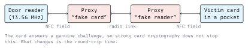

# RFID and NFC

RFID (Radio Frequency Identification) is a family of technologies in which a reader powers a
passive tag over a radio field and the tag answers. NFC (Near Field Communication) is a
subset built on the 13.56 MHz RFID standards, extended so that two active devices (a phone
and a terminal, for instance) can also talk to each other.

For a security course these matter because they are the physical access layer of most
buildings. The badge that opens the lab, the fob on your keyring, the card in the canteen
terminal and the tag in your passport are all RFID, and the security of each ranges from
"none at all" to "genuinely sound".

## Frequency Bands and What Lives There

| Band             | Standards                   | Range        | Typical use                     |
| ---------------- | --------------------------- | ------------ | ------------------------------- |
| 125/134 kHz (LF) | EM4100, HID Prox, T5577     | a few cm     | Old badges, animal chips        |
| 13.56 MHz (HF)   | ISO/IEC 14443 A/B, 15693    | up to ~10 cm | Access control, payment, NFC    |
| 860–960 MHz (UHF)| ISO/IEC 18000-6, EPC Gen2   | metres       | Logistics, inventory, tolling   |

LF and HF tags are **inductively coupled**: the reader's coil and the tag's coil form a
transformer, which both powers the tag and carries the data. UHF tags use backscatter, which
is why they work at a distance. Range matters for the attacker's choice of tool, not for the
protocol's security.

### Low Frequency: No Security by Design

An EM4100-class tag contains a read-only identifier and nothing else. It has no
authentication, no challenge-response and no way to refuse a read. Any reader in range gets
the ID, and any writable tag (a T5577, for example) can be programmed to emit the same ID.
A "cloned" LF badge is not a clever attack; it is the technology working exactly as specified.

With a Proxmark3 (Iceman firmware):

```text
pm3 --> hw version          # confirm the client and firmware match
pm3 --> lf search           # identify the tag type and read the ID
pm3 --> lf em 410x reader   # read an EM4100 ID specifically
```

Writing that ID to a blank T5577 is a single further command. Treat LF credentials as public
identifiers, never as secrets: the correct fix is to replace the system, not to configure it
better.

### High Frequency: The Interesting Layer

ISO/IEC 14443 describes four parts: the RF interface (part 1), the initialisation and
anticollision that assigns a UID (part 3), and a transmission protocol for APDU-style
exchanges (part 4). Cards that implement part 4 can run real cryptographic protocols.

Common HF card families, in rough order of age:

- **MIFARE Classic**: NXP's proprietary Crypto1 cipher with 48-bit keys and sector-based
  access. Published academic attacks from 2008 onward broke both the cipher and its key
  diversification, and practical key-recovery tools have existed ever since. Still widespread.
- **MIFARE Ultralight / NTAG**: cheap memory tags with little or no cryptography. Fine for
  URLs and tickets, wrong for access control.
- **MIFARE DESFire EV1/EV2/EV3**: a real smartcard-style file system with 3DES and AES
  mutual authentication. Secure when the integrator uses diversified keys per card.
- **JavaCard / ISO 7816 applets over 14443-4**: full smartcards; what passports and payment
  cards use.

Enumerating an HF card is read-only and non-destructive:

```text
pm3 --> hf search           # what is on the antenna?
pm3 --> hf 14a info         # UID, SAK, ATQA, guessed card type
pm3 --> hf mfu info         # Ultralight / NTAG details
```

With libnfc and a cheap PN532 reader:

```bash
nfc-list                    # list readers and any tag in the field
nfc-mfclassic r a dump.mfd  # read a Classic card using known key A
```

## Attacks, and What Each One Really Requires

### Skimming and Cloning

Read a credential in passing, then write it to a blank. Against LF this needs only proximity.
Against MIFARE Classic it needs the sector keys, which tools recover by exploiting weaknesses
in Crypto1. The Proxmark3's `hf mf chk` tries a dictionary of keys, and `hf mf autopwn`
chains key recovery with dumping. Against DESFire with properly diversified keys, cloning
fails: the card will not reveal the key, and the reader will not accept a card that cannot
authenticate.

Note what the UID is and is not. It is an anticollision address, not a secret. Phones
randomise it per session, and "magic" cards let you set it arbitrarily. Any system that grants
access on UID alone is trivially bypassed, whatever card family it uses.

### Relay Attacks



Two devices form a bridge: one presents itself to the real reader as the card, the other
presents itself to the card in the victim's pocket as a reader, and every message is forwarded
between them. The card performs a genuine authentication, so the cryptography is untouched and
the reader sees a valid transaction.

The only reliable defence is physical, not cryptographic:

- **Distance bounding** protocols, which measure the round-trip time of single-bit challenges
  and reject responses that arrive too late. ISO/IEC 14443 has no such mechanism; some newer
  systems and UWB-based car keys do.
- **Taking the card out of the field**: shielding sleeves, and not carrying the credential
  where a reader can reach it.
- **A second factor** that cannot be relayed: a PIN at the reader, or a mobile credential that
  requires the phone to be unlocked.

### Eavesdropping and Replay

An HF exchange can be captured with an antenna near the reader. Whether this is useful depends
on the protocol: a static transmission replays, a fresh-nonce challenge-response does not.
This is the basic reason to prefer part-4 cards with mutual authentication over memory cards.

### Denial of Service

A strong field on the carrier frequency prevents any card from being read. It is effective,
easy and almost always illegal: jamming is a telecommunications offence quite apart from
anything in the StGB. Do not demonstrate it outside a shielded setup.

### Downgrade and Integrator Error

The most common real-world failure is not a broken cipher. It is a well-chosen card used
badly: default keys left in place, the same key on every card in the estate, the access
decision made on the UID, or a reader configured to accept both DESFire and Classic so an
attacker simply presents the weaker one. Check the configuration before you blame the silicon.

## Defensive Checklist

- Use cards with mutual authentication (DESFire EV2/EV3 or a smartcard applet). Treat LF and
  MIFARE Classic as deprecated.
- **Diversify keys per card** from a master key held in a secure module. One shared key means
  one compromised card compromises the building.
- Never authorise on the UID. Authorise on a successful cryptographic authentication.
- Keep the access decision on a backend that logs, so unusual patterns (the same credential
  at two doors a minute apart) are visible.
- Add a second factor at high-value doors: PIN pad, or a mobile credential bound to device
  unlock.
- Disable legacy card support once migration is finished, and audit that it stayed disabled.
- Treat the reader itself as untrusted hardware. Readers on the unsecured side of a door are
  reachable; the controller and the door relay belong on the secure side, and the link between
  them should be authenticated rather than an open Wiegand line.

## Privacy and Law

A card UID is an identifier tied to a person, so logs of card reads are personal data under
the GDPR: they need a lawful basis, a retention period and access control. Reading other
people's credentials without authorisation is not a grey area. For lab work, buy your own
blank tags and readers, use your own cards, and keep the written permission of whoever owns
any system you test. Module 01 has the legal framework.

## Exercises

Use your own cards and tags only.

1. Identify three tags you own with `lf search` and `hf search`. For each, record the type,
   the UID, and whether it supports ISO 14443-4.
2. Clone one of your own LF tags onto a blank T5577. Then explain in writing why the same
   procedure fails against a correctly configured DESFire card.
3. Draw the message sequence of a relay attack against a challenge-response card, and mark the
   one quantity the attacker cannot forge.
4. Review a real access control deployment on paper: your school's, with permission, or a
   vendor datasheet. Which items from the defensive checklist are met?

## Key Takeaways

- Frequency tells you the physics; the card family tells you the security. 125 kHz tags have
  none, MIFARE Classic's is broken, DESFire and smartcard applets are sound when integrated
  correctly.
- A UID is an address, not a credential. Systems that trust it are bypassed by a blank card.
- Cloning is defeated by cryptography. Relaying is not: it needs distance bounding, shielding
  or a second factor.
- The most frequent real weakness is integrator configuration: default keys, shared keys, and
  legacy compatibility left enabled.
- Card read logs are personal data. Handle them under the GDPR like any other identifier.

## Resources

- Proxmark3 Iceman client documentation: <https://github.com/RfidResearchGroup/proxmark3>
- libnfc project: <https://github.com/nfc-tools/libnfc>
- ISO/IEC 14443 and 15693 overviews: <https://www.iso.org/>
- NXP MIFARE product documentation: <https://www.nxp.com/products/rfid-nfc>
- Flavio Garcia et al., *Dismantling MIFARE Classic*, ESORICS 2008
- Gerhard Hancke and Markus Kuhn, *An RFID Distance Bounding Protocol*, SecureComm 2005
