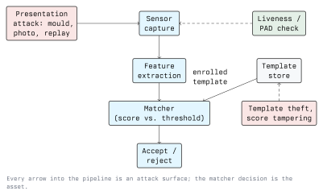

# Biometrics

A biometric system identifies or verifies a person from a physical or behavioural
characteristic: a fingerprint, a face, an iris, a vein pattern, a voice, a typing rhythm.
Hardware hacking meets biometrics in two places: the sensor, which can be fed something that
is not a live human, and the device around it, which stores templates and makes the accept
decision in firmware you can often read.

The defining property of a biometric is that it is **not a secret and cannot be revoked**. You
leave fingerprints on every glass you touch and your face is photographed daily. A password
that leaks can be changed; a fingerprint that leaks is gone for life. Everything else in this
lecture follows from that.

## Identification versus Verification

- **Verification (1:1)**: "is this person who they claim to be?" The system compares the
  presented sample against one stored template, usually after a card or a username has
  identified the claim.
- **Identification (1:N)**: "who is this person?" The sample is compared against the whole
  database. Error rates scale badly with N: with a million templates, even a tiny per-comparison
  false-match rate produces false hits on nearly every search.

Most access control is verification. Most surveillance applications are identification, which
is both harder and far more legally constrained.

## The Pipeline, and Where It Breaks

1. **Capture**: the sensor produces an image or a signal. Attack: present an artefact.
2. **Feature extraction**: the raw sample is reduced to a template: minutiae points, an
   embedding vector, an iris code. Attack: inject a crafted sample that extracts to a chosen
   template.
3. **Storage**: the enrolled template sits in flash, a secure element, or a server. Attack:
   read it, or replace it with your own.
4. **Matching**: a similarity score is computed and compared with a threshold. Attack: tamper
   with the score, the threshold, or the branch that uses them.
5. **Decision**: accept or reject, usually a single bit travelling to a door relay. Attack:
   drive that bit directly and ignore the whole pipeline.

Point 5 deserves the most attention. A fingerprint reader screwed to the outside wall, wired to a
door strike with an unauthenticated line, can be bypassed by cutting the line and shorting the
relay. No biometric is stronger than the wiring it controls.

## Error Rates: The Vocabulary You Need

| Term | Meaning                                                                 |
| ---- | ----------------------------------------------------------------------- |
| FAR  | False Accept Rate: an impostor is accepted                              |
| FRR  | False Reject Rate: a legitimate user is rejected                        |
| EER  | Equal Error Rate: the operating point where FAR equals FRR              |
| FTE  | Failure to Enrol: the subject cannot be enrolled at all                 |
| FTA  | Failure to Acquire: a usable sample cannot be captured this attempt     |

FAR and FRR trade off against each other along a single threshold. Lower the threshold and
users stop complaining while impostors get in; raise it and the opposite happens. There is no
setting that improves both, so the operating point is a business decision: a phone unlock
tolerates a higher FAR than a vault door.

Two cautions when reading vendor figures. First, published rates come from specific datasets
under specific conditions and rarely survive contact with a dusty workshop and wet hands.
Second, FAR describes *zero-effort impostors*: someone else's finger presented innocently. It
says nothing about an attacker who builds a spoof on purpose; that is measured separately, as
presentation attack detection performance.

## Presentation Attacks

A presentation attack feeds the sensor an artefact designed to be accepted. ISO/IEC 30107 is
the standard that defines the terminology and the testing methodology, and the countermeasure
is called **presentation attack detection (PAD)**, informally "liveness detection".

The pattern across modalities is consistent: the easier a trait is to capture remotely, the
easier it is to spoof.

- **Fingerprint**: a latent print is lifted or a photograph of a finger is used to build a
  mould, which is cast in a flexible material. Optical and capacitive sensors have both been
  defeated this way in public demonstrations for many years. PAD options: sweat pore detection,
  perspiration over time, sub-dermal imaging (ultrasonic), blood flow.
- **Face**: a printed photo defeats the weakest systems, a screen replay defeats the next
  tier, and a 3D mask or a depth-aware spoof is needed against structured-light or
  time-of-flight sensors. PAD options: depth sensing, infrared illumination, texture analysis,
  challenge-response (blink, turn), multi-frame consistency.
- **Iris**: a high-resolution photograph, sometimes with a contact lens over it to restore the
  curvature. PAD options: pupil response to changing illumination, multi-spectral imaging.
- **Voice**: recording and replay, and increasingly synthesis from samples of the target's
  speech. PAD options: challenge phrases, replay-artefact detection, channel analysis.
- **Behavioural traits** (gait, typing): generally weak as a primary factor; useful as
  continuous, low-confidence signals alongside something stronger.

An important consequence: any biometric system worth deploying must assume spoof attempts.
"The sensor accepted it, therefore the person was present" is not a sound inference without
tested PAD.

## Template Security

Templates are the long-term asset. A compromised template database is permanent, because the
subjects cannot change their traits.

- **Store the template, never the sample.** A template is a reduced representation; raw images
  are worse to lose. But do not treat a template as unrecoverable. Research has repeatedly
  reconstructed usable images from minutiae and from embeddings. Templates are sensitive data,
  not hashes.
- **A biometric cannot be hashed like a password.** Matching is fuzzy: two reads of the same
  finger never produce identical bytes, so ordinary hashing does not work. The relevant
  techniques are **biometric template protection**: fuzzy commitment and fuzzy vault schemes,
  and cancellable biometrics, where a per-application transform is applied so that a leak from
  one system does not help against another.
- **Keep matching on-device where possible.** The pattern used by modern phones (template in
  a secure element, matching inside it, only an accept/reject bit leaving) limits the blast
  radius to one device. A central template server concentrates the risk.
- **Bind the decision.** The accept bit must be authenticated and fresh, or an attacker who
  can reach the bus replays it.

## Hardware Attacks on a Biometric Device

Treat the reader as any other embedded target from Lecture 1:

- Dump the firmware from the external flash, and look for the template store and the threshold
  constant. Both are frequently in plain flash.
- Find the UART console; many readers ship one, and some print enrolment events.
- Watch the line to the controller. An unauthenticated Wiegand or relay output can be sniffed,
  replayed, or simply driven.
- Check what happens on fault: some devices fail open when the sensor is disconnected or when
  power is glitched during the match. Fail-open is a design decision, and it is often the wrong
  one.

## Defensive Design

- Use biometrics as **one factor**, not the only one. Biometric plus PIN, or biometric plus
  card, covers the spoof case and the coercion case.
- Insist on tested PAD, with the test methodology named (ISO/IEC 30107-3), not a marketing
  claim about "liveness".
- Pick the operating point deliberately and document it, including what happens on FTE.
- Keep templates in a secure element, match on-device, and apply template protection if a
  central store is unavoidable.
- Authenticate the link from reader to controller, and put the controller on the secure side of
  the door.
- Provide a non-biometric fallback that is not weaker than the primary path. An override code on a
  sticker under the reader defeats everything above it.

## Legal and Ethical Constraints

Biometric data processed for the purpose of uniquely identifying a person is a **special
category of personal data** under GDPR Article 9: processing is prohibited unless a specific
exception applies, consent must be genuinely free (which is hard to establish between an
employer and an employee, or a school and a pupil), and a Data Protection Impact Assessment is
normally required. Austrian data protection law adds its own requirements on top.

The practical rule for a school project: do not build a biometric database of your classmates.
Enrol yourself, with your own consent, delete the data afterwards, and keep the dataset out of
any shared repository. Module 01 covers the framework.

## Exercises

Use only your own biometric data, on your own hardware.

1. Take a fingerprint sensor or a face unlock you own. Measure FRR informally: 50 genuine
   attempts, count the rejects. Then change a condition (wet finger, poor light) and repeat.
   Explain what moved and why.
2. For the same device, write down which PAD mechanisms the vendor documents, and which
   modality-specific spoof classes from this lecture they address.
3. Trace the decision path of a biometric door reader from a datasheet: where is the template,
   where is the match performed, and what travels on the wire to the controller?
4. Write a one-page DPIA sketch for deploying fingerprint access control in a school workshop.
   State the lawful basis you would rely on and the alternative you would offer.

## Key Takeaways

- A biometric is an identifier, not a secret, and it cannot be revoked. Design as if the trait
  is public, because it is.
- FAR and FRR trade off along one threshold; there is no setting that improves both, and vendor
  figures describe zero-effort impostors, not deliberate spoofs.
- Presentation attacks are the standard threat, PAD is the standard countermeasure, and
  ISO/IEC 30107 is how it is tested.
- Templates cannot be hashed like passwords. Keep them in a secure element, match on-device,
  and use template protection when a central store is unavoidable.
- The weakest part of most biometric installations is not the sensor but the wire from the
  reader to the door and the fallback code on the keypad.
- Biometric data is GDPR Article 9 special category data. Consent in a school or workplace is
  rarely free, and a DPIA is normally required.

## Resources

- ISO/IEC 30107 (presentation attack detection) overview: <https://www.iso.org/>
- NIST biometrics research and FRVT/FpVTE evaluations: <https://www.nist.gov/programs-projects/biometrics>
- Anil Jain, Arun Ross and Karthik Nandakumar, *Introduction to Biometrics*, Springer
- European Data Protection Board guidance on biometric data: <https://www.edpb.europa.eu/>
- Chaos Computer Club publications on fingerprint and iris spoofing: <https://www.ccc.de/>
