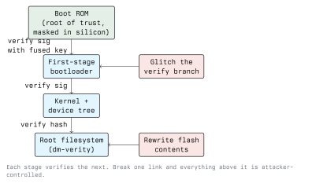

# Exploiting Embedded Systems

Lecture 4 ended with an understanding of the device. This lecture is about turning that
understanding into control: running your own code, bypassing the checks that should stop you,
and, the part that matters for defence, knowing exactly which design decision would have
blocked each step.

Everything described here belongs in a lab, against hardware you own or are authorised in
writing to test. Nothing in this lecture is written as a procedure against a deployed system.

## The Usual Starting Points

Before anything clever, check the boring paths. In real assessments they succeed most of the
time.

- **Default and hardcoded credentials.** A root hash from the extracted `/etc/shadow`, or a
  service account found in a CGI script, used over the device's own telnet or SSH.
- **Debug services left running.** `telnetd`, a vendor diagnostic daemon on a high port, an
  unauthenticated HTTP endpoint that runs shell commands "for support".
- **The bootloader console.** If U-Boot accepts input, the boot arguments are attacker-
  controlled, and a Linux kernel will happily take a different init process:

  ```text
  => printenv bootargs
  => setenv bootargs 'console=ttyS0,115200 root=/dev/mtdblock2 init=/bin/sh'
  => boot
  ```

  That is a root shell with no credentials involved. The defence is a bootloader with the
  console disabled in production, or one that requires a per-device password, and a kernel
  command line that is part of the signed image rather than editable environment.

- **Unauthenticated or unsigned updates.** If the device fetches an image over plain HTTP, or
  accepts an image whose signature it never checks, the update channel is the exploit.
- **Shared secrets.** One TLS key, one API token, one symmetric key for the whole product
  line. Extracting it from one unit compromises every unit, which is the single most damaging
  design error in embedded security.

## Memory Corruption on Embedded Targets

The classes are the same ones from Module 06 and Module 04: stack overflow, heap corruption,
format string, and integer overflow leading to an undersized allocation. The environment is
friendlier to the attacker:

- Often no ASLR, no stack canaries, no NX, because the toolchain defaults were never changed
  or the MMU-less target cannot support them.
- Everything frequently runs as root in a single address space.
- No crash reporting, no monitoring, no automatic restart with a different layout.
- Old library versions, because the vendor pinned a kernel and a C library years ago.

The practical consequence for a defender is that a bug class long since mitigated on a desktop
is still directly exploitable here. Compiler hardening flags, a non-root service user, a
watchdog, and a current C library are cheap and remove most of the advantage.

## Secure Boot and What Breaking It Means



Secure boot is a chain of signature checks anchored in something the attacker cannot rewrite:
code in mask ROM, using a public key hash burned into one-time-programmable fuses. Each stage
verifies the next before handing over control. The property it provides is narrow but
valuable: **the device will only run software the vendor signed.**

It fails in recognisable ways:

- **No root of trust.** The first-stage bootloader itself lives in writable external flash, so
  the "chain" starts with something the attacker can replace.
- **Verification not enforced.** Signature checking compiled in but disabled by a flag, a
  development key still trusted in production, or a debug mode that skips the check.
- **Incomplete coverage.** The kernel is verified but the root filesystem is not, so a writable
  partition with a startup script is as good as a modified kernel. `dm-verity` or a signed,
  read-only rootfs closes this.
- **Rollback.** The attacker writes an older, legitimately signed image with a known
  vulnerability. The fix is an anti-rollback counter in fuses, checked by the bootloader.
- **Keys recovered.** If the signing key is on a developer laptop rather than in an HSM, the
  whole scheme collapses the first time that laptop is compromised.

## Fault Injection

Fault injection deliberately pushes a chip outside its specified operating conditions so that
one instruction misbehaves. A comparison returns the wrong result, a branch is skipped, or a loop
counter is corrupted. A single skipped branch is enough when that branch is "if the signature
is invalid, stop".

Mechanisms, conceptually:

- **Voltage glitching**: a brief dip in the supply rail at a precise moment.
- **Clock glitching**: an extra or shortened clock edge, so a stage does not have time to
  settle.
- **Electromagnetic injection**: a localised EM pulse from a small coil over the die.
- **Optical injection**: a laser on a decapsulated die; precise, and expensive.
- **Temperature and other environmental stress**: crude, but occasionally sufficient.

The attack is about timing: the glitch must land on the right instruction, so the
work is in finding the trigger and then sweeping glitch width and offset over many thousands of
attempts. ChipWhisperer is the standard open platform for learning this, and it is a classroom
exercise precisely because the target is a board designed to be glitched.

Countermeasures are layered, and all of them are design-time:

- Redundant checks: verify twice, compare the results, and branch on both.
- Avoid single-bit decisions; use values whose complement must also be correct.
- Voltage, clock and temperature sensors that halt the part when inputs leave spec.
- Random delays so the attacker cannot predict when the check happens.
- Secure elements, which are built and certified specifically to resist this.

## Side-Channel Analysis

A chip leaks information about what it computes through its power consumption, its
electromagnetic emissions and the time it takes. Where fault injection changes behaviour, side
channels only observe it, and that is enough to recover keys.

- **Simple power analysis** reads a single trace to see the shape of an algorithm: the rounds of
  a block cipher, the square-and-multiply pattern of an exponentiation.
- **Differential and correlation power analysis** collect many traces with varying inputs and
  use statistics to recover the key one byte at a time, even when the trace looks like noise.
- **Timing attacks** exploit comparisons that return early. A byte-by-byte `memcmp` of a MAC or
  a password leaks its answer through how long it takes.

Countermeasures: constant-time implementations and constant-time comparison for anything
secret, masking and blinding so intermediate values are randomised, hardware crypto
accelerators with built-in countermeasures, and limiting how many operations an attacker can
request with a chosen input.

## Hardware Implants and Supply Chain

Physical access also allows adding hardware: a logic analyser left permanently on a bus, an
interposer between the SoC and the flash that serves different contents, a modified module with
an extra radio. The countermeasures are organisational as much as technical: tamper-evident
seals, tamper switches that zeroise keys, device attestation so a modified unit cannot rejoin
the fleet, and provenance controls on the manufacturing line.

## Putting the Defences Together

A design that holds up against most of this lecture looks like:

1. **Root of trust in ROM**, with the public key hash in OTP fuses.
2. **Full chain of trust**: bootloader, kernel, device tree and a verified read-only rootfs.
3. **Encrypted flash**, key in on-die OTP, so a dump yields nothing.
4. **Debug interfaces fused off** after provisioning; no production console.
5. **Per-device keys**, provisioned at manufacture, so one compromise stays local.
6. **Signed updates with an anti-rollback counter**, over an authenticated transport.
7. **Hardened userland**: non-root services, compiler hardening, current libraries, watchdog.
8. **Secure element** for key storage and crypto operations on anything high-value.
9. **Tamper response**: detect enclosure opening, zeroise keys, log it centrally.
10. **Monitoring**: a fleet backend that notices a device whose firmware version or behaviour
    does not match its peers.

Not every product needs all ten. A €15 sensor and a payment terminal sit at different points on
that list, and deciding where is a threat-modelling exercise, not a checklist exercise.

## Exercises

Lab targets only, owned by you or explicitly authorised.

1. On a development board, interrupt the boot and obtain a shell through the bootloader
   environment. Then reconfigure the bootloader so your own attack no longer works, and verify
   that it fails.
2. Audit an extracted firmware image from Lecture 4 against the ten-point list. For each item,
   record present, absent, or not applicable, with the evidence.
3. Build the simplest of the timing attacks: write a small program that compares a secret with
   `memcmp`, measure the timing difference per correct byte, then replace it with a constant-time
   comparison and show the difference disappears.
4. Using ChipWhisperer or a simulator, glitch a password check on a training target and record
   how many attempts were needed. Then describe which two countermeasures from this lecture
   would have raised that number most, and why.

## Key Takeaways

- Check the boring paths first: default credentials, debug services, an open bootloader console,
  unsigned updates. They work more often than memory corruption.
- Embedded memory-corruption bugs are easier to exploit than desktop ones because the standard
  mitigations are usually absent, and switching them on is cheap.
- Secure boot gives one property: only vendor-signed code runs. It fails through writable first
  stages, unverified rootfs, rollback, and leaked signing keys more often than through
  cryptography.
- Fault injection breaks a single decision at a precise moment; the defences are redundant
  checks, environmental sensors, random delays and a secure element.
- Side channels recover keys by observing power, EM or time. Constant-time code and masking are
  the answer, not secrecy about the implementation.
- Design so that compromising one unit does not compromise the fleet: per-device keys, signed
  updates with anti-rollback, and a backend that notices when a device stops looking like its
  peers.
- Authorization in writing before any of this. In Austria, unauthorised access and interference
  with a computer system are offences under StGB §118a, §126a and §126b; see Module 01.

## Resources

- Colin O'Flynn and Jasper van Woudenberg, *The Hardware Hacking Handbook*, No Starch Press
- ChipWhisperer documentation and tutorials: <https://chipwhisperer.readthedocs.io/>
- Paul Kocher, Joshua Jaffe and Benjamin Jun, *Differential Power Analysis*, CRYPTO 1999
- U-Boot documentation, including verified boot: <https://docs.u-boot.org/>
- OWASP IoT Security Verification Standard: <https://github.com/OWASP/IoT-Security-Verification-Standard-ISVS>
- ENISA guidance on baseline security for IoT: <https://www.enisa.europa.eu/>
