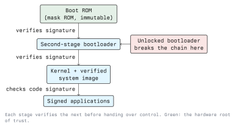

# Mobile Device Architecture

A phone is not one computer. It is several processors sharing a package, each with its own
firmware, its own privileges and its own attack surface. Understanding that split explains why
some attacks are possible, why some defences work, and where a security boundary actually sits.

## The Hardware Picture

Almost everything in a modern phone lives on one **System on Chip (SoC)**: application CPU cores,
GPU, memory controller, and a set of dedicated blocks. The ones that matter for security:

- **Application processor.** Runs the operating system and all apps. This is what people mean by
  "the CPU".
- **Baseband processor.** Runs the cellular modem on its own real-time firmware, independent of
  the main OS. It speaks to the carrier network. It is a separate computer with its own code base,
  and on modern designs it is deliberately isolated from application memory so that a modem bug
  cannot directly read your data.
- **Trusted Execution Environment (TEE).** A hardware-enforced isolated execution mode on the
  application processor - ARM TrustZone on most phones. Code in the TEE runs while the normal OS
  is suspended and can hold secrets the OS cannot read. Fingerprint matching, key operations and
  DRM typically live here.
- **Secure element or dedicated security processor.** A separate small processor with its own
  memory, used for the highest-value secrets. Apple's Secure Enclave and the discrete security
  chips in recent Android flagships are examples.
- **Sensors and radios.** Wi-Fi, Bluetooth, NFC, GPS. Each has firmware. Each is an input.

The practical consequence: "the device was compromised" is not a single statement. Root on the
application processor does not give you the TEE, and a key marked non-exportable in the secure
element stays there even on a rooted phone. Conversely, a bug in modem or Wi-Fi firmware can be
reachable over the air without the user touching anything.

## The Chain of Trust

Mobile platforms do not trust storage. They trust one small piece of immutable hardware and
build outwards from it, each stage verifying the signature of the next before executing it.



- The **Boot ROM** is burned into the chip at manufacture. It cannot be modified, which is what
  makes it a *root of trust*. It holds, or can verify against, the vendor's public key.
- Each later stage is loaded from flash, has its signature checked, and is executed only if the
  check passes. A tampered bootloader or kernel fails verification and the device refuses to boot
  or boots into a restricted state.
- Android calls the system-partition part of this **Verified Boot**, and exposes the result as a
  *boot state*: green (verified, vendor keys), yellow (verified, but against a user-supplied key),
  orange (verification disabled, bootloader unlocked). Apps and remote services can ask the
  platform for an attestation of that state.

On Android, bootloader unlocking is the gate for everything else. It is a deliberate,
user-visible action, and it **wipes user data** - precisely so that unlocking cannot be used to
read the data of a phone you found. iOS offers no unlock path at all, which is why modifying an
iOS device requires an exploit; Lecture 4 covers jailbreaking as the equivalent.

### What this does and does not stop

It stops persistent tampering: an attacker who modifies the system image cannot make the device
boot it. It does not stop an attacker exploiting a bug in software that *is* correctly signed,
and it does not protect anything after the chain hands over to a vulnerable kernel.

## Storage Encryption

Device encryption protects data at rest, which is the lost-phone case.

- The encryption key is derived from a **hardware-bound key** that never leaves the secure
  hardware, combined with the user's passcode. Having the flash chip is therefore not enough:
  you need the chip *and* the passcode, and the secure hardware rate-limits passcode attempts so
  that brute force is slow regardless of how fast your computer is.
- **File-based encryption** encrypts individual files with different keys, which allows a useful
  distinction: some data is readable only after the user has unlocked the device at least once
  since boot, while a small amount - enough to receive a call or run an alarm - is readable
  earlier. iOS expresses the same idea as *Data Protection classes*, chosen per file by the app.
- A locked, powered-off phone with a strong passcode is a genuinely hard target. The same phone
  unlocked, or with a four-digit PIN and a weak rate limiter, is not.

**Defensive point:** an app that stores a secret in a file does not choose whether the disk is
encrypted, but it does choose the protection class. Storing an authentication token in a class
that is readable before first unlock removes most of the benefit.

## The Application Sandbox

This is the central security mechanism of both platforms, and it is worth stating plainly:

> Each app gets its own identity, its own private storage, and no ability to read another app's
> data or to call the kernel on another app's behalf. Everything it can do beyond its own sandbox
> is mediated by the platform.

The mechanisms differ - Android uses one Linux UID per app plus SELinux, iOS uses a per-app
sandbox profile plus a per-app container - but the property is the same. The next two lectures
take each in turn.

Three consequences follow from the sandbox and are easy to miss:

1. **Inter-app communication must be explicit**, which means it is an interface, which means it
   needs the same input validation as any network interface. Android intents and iOS URL schemes
   are attack surface.
2. **Shared resources are outside the sandbox.** External storage, the clipboard, system logs, and
   screenshots taken by the OS are visible or reachable beyond the app. Secrets put there leave
   the sandbox.
3. **The sandbox protects apps from each other, not the user from the app.** An app with the
   location permission has your location. That is what the permission model is for.

## Permissions

Beyond the sandbox, sensitive capabilities - camera, microphone, location, contacts, SMS - are
gated by permissions. The user should be asked in context rather than presented with a list
nobody reads: Android moved the decision from install time to use time with runtime permissions
in Android 6.0 (API level 23), and iOS has prompted at point of use for far longer.

Two ideas matter here:

- **Least privilege is a design decision, not a dialog.** If an app requests contacts access only
  because one optional feature uses it, the permission is still held by the whole app.
- **A denied permission must be a working state.** Code that crashes or silently misbehaves when
  a permission is refused trains users to grant everything.

## The Update Model

Updates are the single most effective mobile security control and the hardest to rely on.

- **App updates** flow through the store and reach most users quickly.
- **OS updates** on iOS come from one vendor to all supported devices. On Android, the vendor
  builds an image, sometimes a carrier approves it, and support ends after a fixed window that
  varies enormously between a flagship and a budget handset.
- Google addresses part of the gap by shipping monthly **Android security bulletins** and by
  moving components into updatable modules and Play Services, so that some fixes arrive without a
  full OS update. It reduces the problem; it does not remove it.

**For a defender, the design consequence is concrete:** set a minimum supported OS version, state
it, and do not assume the fleet is patched. For an assessment, the OS version of the test device
is part of the finding.

## Putting It Together

A rough map of where a security boundary sits:

```text
  +-------------------------------------------------------+
  |  App A sandbox   |  App B sandbox   |  App C sandbox   |   <- isolated by the OS
  +-------------------------------------------------------+
  |  Operating system: permissions, IPC, crypto services  |   <- root lives here
  +-------------------------------------------------------+
  |  TEE / secure element: keys, biometrics, attestation  |   <- survives root
  +-------------------------------------------------------+
  |  Boot ROM: immutable root of trust                    |   <- survives everything
  +-------------------------------------------------------+
     Baseband, Wi-Fi, NFC firmware: separate, reachable
     over the air, outside the OS trust boundary
```

Read it as a question: for a given finding, which line did the attacker cross? A data leak into
external storage crosses the top line only. A privilege escalation to root crosses the second.
Extracting a hardware-backed key crosses the third, and almost nothing crosses the fourth.

## Key Takeaways

- A phone is several processors; the baseband and radio firmware are separate computers outside
  the OS trust boundary.
- The chain of trust starts in immutable Boot ROM and verifies each stage before running it.
  Unlocking the bootloader breaks the chain and wipes the device.
- Disk encryption keys are bound to secure hardware and to the passcode, so the flash chip alone
  is useless. Protection classes decide what is readable before first unlock.
- The app sandbox is the central control. Everything that crosses it - IPC, shared storage, the
  clipboard, logs - is an interface that needs validation.
- Hardware-backed keys survive root. That is why attestation and Keystore/Keychain matter more
  than any check an app runs on itself.

## Resources

- Android Platform Security Model: <https://source.android.com/docs/security/features>
- Android Verified Boot: <https://source.android.com/docs/security/features/verifiedboot>
- Apple Platform Security guide (secure boot, Secure Enclave, Data Protection):
  <https://support.apple.com/guide/security/welcome/web>
- ARM TrustZone documentation: <https://developer.arm.com/documentation/>
- Android security bulletins: <https://source.android.com/docs/security/bulletin>
