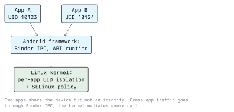

# Android Security

Android is a Linux system with an application framework on top and a hard rule about identity:
every app is a different user. Most of Android's security model follows from that rule, and most
Android app vulnerabilities are cases where an app voluntarily opened a hole in it.

## The Sandbox: One UID Per App

When an app is installed, the system assigns it a Linux user ID. Its private directory is owned
by that UID and readable by nobody else. Two apps on the same device are two unprivileged Linux
users who cannot read each other's files.



On top of the UID separation sits **SELinux**, in enforcing mode since Android 5.0. SELinux is
mandatory access control: even a process running as root is confined to what its policy domain
permits. This is why a root exploit in one component does not automatically mean access to
everything, because the policy still applies.

You can see the UIDs on your own emulator:

```bash
adb shell pm list packages
adb shell dumpsys package com.example.app | grep -i userId
adb shell ps -A | head
```

## The Permission Model

Permissions are declared in the manifest and, for the sensitive ones, granted by the user.

- **Install-time permissions** (Android calls them *normal* permissions) are granted automatically
  because the risk is low, for example `INTERNET`.
- **Runtime permissions** (*dangerous* permissions) require a prompt at the point of use: camera,
  microphone, location, contacts, SMS, call log. Runtime prompting arrived in Android 6.0
  (API level 23).
- **Signature permissions** are granted only to apps signed with the same key as the app that
  declared them. This is how a suite of apps from one vendor can share data without exposing it
  to anyone else, and it is the correct tool for that job.
- **Special access** settings (accessibility services, notification access, overlay drawing,
  "all files access") sit outside the normal prompt flow and must be enabled in Settings. They
  are enormously powerful, which is why malware families spend so much effort talking users into
  granting them.

Inspect what an app asks for and what it got:

```bash
adb shell dumpsys package com.example.app | grep -A 40 "requested permissions"
```

**Defensive point:** request the minimum, request it at the point of use so the prompt has
context, and handle refusal as a normal path. A permission you hold is a permission you are
responsible for.

## App Components and the Exported Surface

An Android app is not a single process with one entry point. It is a set of components, each of
which the system can start:

- **Activity**: a screen.
- **Service**: background work.
- **Broadcast receiver**: handler for system or app-wide events.
- **Content provider**: a structured data interface, usually SQL-shaped, addressed by URI.

Each component can be **exported**, meaning other apps may start or query it. Exported components
are the main Android-specific attack surface, and the classic bug is an exported component that
was never meant to be reachable: an internal debug activity, a service that performs a privileged
action on request, a content provider that hands back rows without checking who is asking.

The export rule to remember:

- A component with an `<intent-filter>` is exported by default unless you say otherwise.
- For apps targeting Android 12 (API level 31) or higher, a component with an intent filter
  **must** declare `android:exported` explicitly or the app will not install, a deliberate push
  to make the decision conscious.

```xml
<!-- Internal only: nothing outside the app can start it -->
<activity android:name=".AdminActivity" android:exported="false" />

<!-- Reachable, but only by apps holding our own permission -->
<service android:name=".SyncService"
         android:exported="true"
         android:permission="com.example.app.permission.SYNC" />
```

### Testing the exported surface in your lab

Against your own emulator and a practice app, the components are enumerable and then reachable
from the shell:

```bash
# What does the app declare?
adb shell dumpsys package com.example.vulnerable | less

# Start an activity directly, bypassing the app's own navigation
adb shell am start -n com.example.vulnerable/.AdminActivity

# Send a broadcast the app listens for
adb shell am broadcast -a com.example.vulnerable.ACTION_RESET

# Query an exported content provider
adb shell content query --uri content://com.example.vulnerable.provider/users
```

If `am start` opens an admin screen that the login flow was supposed to protect, the login flow
was never a security control, only navigation.

**What stops it:** `android:exported="false"` for anything internal; a signature-level
`android:permission` for anything that should be reachable only by your own apps; and an
authorisation check *inside* the component, because a component that is legitimately exported
still has to decide whether this caller may do this thing.

## Intents and Deep Links

Intents are how components are addressed. Two kinds, with different risks:

- **Explicit intents** name the target component. Safe to send.
- **Implicit intents** describe an action and let the system pick a handler. Sending sensitive
  data in an implicit intent means any app that registered a matching filter may receive it.

Deep links map a URL to a screen. If the URL carries parameters that the app acts on without
validation, any web page the user visits can drive the app. The platform's answer is **App
Links**, a deep link verified against a `assetlinks.json` file hosted on the domain, so that
only the real domain owner's links open your app. Unverified custom schemes such as
`myapp://` can be claimed by any installed app.

**Defensive point:** treat every incoming intent as untrusted network input. Validate the
parameters, check the caller where it matters, and never ship a deep link that performs a state
change without a confirmation.

## WebView

A `WebView` embeds a browser inside the app. It is a frequent source of findings because it
collapses web vulnerabilities into the app's sandbox:

- `addJavascriptInterface` exposes Java/Kotlin methods to page JavaScript. If the page loaded is
  not fully trusted, this is a bridge from web content into app code.
- `setAllowFileAccess` and the related file-access settings can let loaded content read local
  files.
- Loading a URL over HTTP, or ignoring TLS errors in `onReceivedSslError`, hands content control
  to anyone on the network path.

**What stops it:** load only HTTPS content you control, disable JavaScript if you do not need it,
do not expose a JavaScript interface to remote content, and never override an SSL error handler to
proceed. "Proceed on certificate error" in production is a finding on its own.

## Storage

Where an app puts data decides who can read it.

| Location | Visibility |
| --- | --- |
| App-private internal storage | The app's UID only |
| `SharedPreferences` (default) | App-private, but plain XML - readable with root or a backup |
| External/shared storage | Other apps, subject to scoped storage rules |
| System log (`logcat`) | Reachable during debugging and by some tooling |
| Clipboard | Any app that reads it |

Two practical controls: use `EncryptedSharedPreferences` or the Android Keystore for anything
secret, and set `android:allowBackup="false"` for apps whose data should not be copied off the
device by the backup mechanism. Never log credentials or tokens: a stray debug log line is one
of the most common real findings in a mobile assessment.

The Keystore is the important one. A key generated inside the Keystore with hardware backing is
usable by the app but not extractable from the device, so even a full filesystem dump does not
yield the key. That is a property no amount of application code can emulate.

## Network Security

Android blocks cleartext HTTP by default on recent versions. The configuration lives in a
network security config file:

```xml
<!-- res/xml/network_security_config.xml -->
<network-security-config>
  <base-config cleartextTrafficPermitted="false" />
  <domain-config>
    <domain includeSubdomains="true">api.example.com</domain>
    <pin-set>
      <pin digest="SHA-256">base64-encoded-public-key-hash</pin>
    </pin-set>
  </domain-config>
</network-security-config>
```

**Certificate pinning** restricts which certificates the app accepts for a domain, which defeats
an interception proxy relying on an installed CA. It is a real control against network attackers,
and worth knowing its limit: on a device the attacker controls, pinning can be removed by hooking
the app. Pin to raise the cost, not to create a guarantee.

Note also that since Android 7.0, user-installed CA certificates are not trusted by apps by
default, which is why intercepting your own test app's traffic normally requires a debuggable
build or a rooted device.

## Platform Defences Worth Knowing

- **APK signing.** Every APK is signed, and updates must be signed with the same key. This is
  what ties an app's identity to its developer.
- **Google Play Protect.** On-device and store-side scanning for known malicious apps.
- **Play Integrity API.** Lets a backend ask the platform for a signed verdict about the device
  and app state, meaning a genuine app binary, a recognised device and an unmodified system. Because the signature
  is checked server-side, this is far stronger than a root check written in app code. It is still
  not proof: treat the verdict as risk signal input, not as an authentication decision.
- **Scoped storage.** Restricts broad access to shared storage, so an app can no longer wander the
  whole SD card.

## Rooting

Rooting means obtaining a privileged shell on your own device, usually by unlocking the
bootloader and flashing a modified boot image. For this module, it is a lab tool: root gives you
the filesystem access and process instrumentation you need for dynamic analysis.

Its security consequences are worth stating:

- The sandbox is intact between apps, but a root-capable process can read any app's data.
- Verified Boot reports a modified state, which attestation can detect.
- A rooted phone is a reasonable test device and a poor daily driver for anything that matters.

Root detection in an app, looking for the `su` binary or checking for known management packages,
is easy to write and easy to bypass, because it runs in the process the attacker is already
hooking. Use it as telemetry. Use platform attestation, checked on the server, for decisions.

## Key Takeaways

- One Linux UID per app plus SELinux is the whole foundation. Most app-level Android findings are
  self-inflicted holes in it.
- Exported components are the signature Android attack surface. `exported="false"` by default,
  signature permissions for internal IPC, and an authorisation check inside every component that
  is genuinely exported.
- Treat intents, deep links and WebView content as untrusted input, because they are.
- Secrets belong in the Keystore, not in `SharedPreferences`, not in logs, not on shared storage.
- Pinning and root detection raise cost. Server-side checks, including Play Integrity verified on
  the backend, make decisions.

## Resources

- Android security documentation: <https://source.android.com/docs/security>
- App security best practices: <https://developer.android.com/privacy-and-security/security-tips>
- Network security configuration: <https://developer.android.com/privacy-and-security/security-config>
- Android Keystore system: <https://developer.android.com/privacy-and-security/keystore>
- Play Integrity API: <https://developer.android.com/google/play/integrity>
- OWASP MASTG, Android testing chapters: <https://mas.owasp.org/MASTG/>
