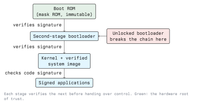

# iOS Security

iOS aims at the same properties as Android (verified boot, per-app isolation, hardware-backed
keys, permission-gated capabilities) and reaches them differently. The platform is closed, the
hardware and software come from one vendor, and code signing is enforced at install time and
then continuously at runtime. The result is a smaller attack surface and a much narrower set of
options for anyone testing it.

## Code Signing Is the Centre

On Android, the signature identifies the developer and ties updates to the same key. On iOS the
kernel additionally refuses to execute pages that are not backed by a valid signature. Three
practical effects follow:

- An app cannot download and run new native code. Dynamic code loading in the Android sense is
  not available.
- Memory cannot normally be both writable and executable, which removes a large family of
  exploitation techniques.
- Installing an app requires a signature from Apple, from an enterprise certificate, or from a
  development profile tied to specific device identifiers.

This is also why analysing an iOS app dynamically usually needs a jailbroken device: without one,
you cannot inject a library into another app's process.

### Entitlements

An iOS app's privileges are listed in its **entitlements**, a signed property list inside the
binary. Entitlements say which keychain groups, app groups, capabilities and background modes the
app may use. Because they are part of the signature, they cannot be edited without invalidating
it. Reading an app's entitlements is one of the first things you do in a static assessment: they
tell you what the app is allowed to reach.

## Secure Boot and the Secure Enclave

The boot chain is the same shape as the one in Lecture 2: immutable Boot ROM verifies the next
stage, which verifies the kernel, which enforces code signing on everything above it.



The **Secure Enclave** is a separate coprocessor with its own memory, present since the A7
generation (iPhone 5s). It holds a device-unique key fused at manufacture, performs the key
derivation that unlocks file protection classes, and does the biometric matching for Touch ID and
Face ID. Biometric data itself never leaves it and is never sent anywhere. The Enclave answers
"yes" or "no" and does not hand back a fingerprint.

This is the architectural reason the passcode matters so much: file keys are wrapped with a key
derived from the passcode inside the Enclave, and the Enclave enforces escalating delays between
attempts. A six-digit passcode is strong not because six digits is a lot of entropy but because
the hardware will not let you try quickly.

## The Sandbox and App Containers

Every app runs in a sandbox described by a profile, and its data lives in a **container**
directory separate from the bundle:

```text
  Bundle container  (read-only, signed)
    MyApp.app/
      MyApp                  <- the Mach-O executable
      Info.plist             <- bundle metadata
      embedded.mobileprovision
      Assets, nib files, resources

  Data container    (read-write, per app, per install)
    Documents/             <- user data, included in backups
    Library/Preferences/   <- NSUserDefaults plist files
    Library/Caches/        <- may be purged, often forgotten
    tmp/
```

Two findings fall straight out of this layout. Anything in `Documents` or `Preferences` is in the
device backup, so a secret written to `NSUserDefaults` leaves the phone whenever the user backs
up. And `Library/Caches` quietly accumulates copies of API responses, including the sensitive ones.

Apps signed by the same team can share a container through an **app group**, which is declared as
an entitlement. Shared storage is correspondingly less isolated: an app group is a deliberate
hole in the sandbox and should carry only what has to be shared.

## Keychain and Data Protection

iOS gives apps two distinct places to put data, and choosing wrongly is the most common storage
finding.

**The Keychain** is the place for credentials, tokens and keys. It is encrypted, backed by the
Secure Enclave, and each item carries an accessibility attribute:

| Attribute | Readable |
| --- | --- |
| `kSecAttrAccessibleWhenUnlocked` | Only while the device is unlocked |
| `kSecAttrAccessibleAfterFirstUnlock` | After the first unlock since boot |
| `kSecAttrAccessibleWhenUnlockedThisDeviceOnly` | While unlocked, and never restored to another device |
| `kSecAttrAccessibleWhenPasscodeSetThisDeviceOnly` | Only if a passcode is set; not backed up |

**Data Protection** applies the same idea to files, through a protection class set per file. The
default class for app files requires that the device has been unlocked at least once since boot.

**Defensive point:** pick the most restrictive class the feature tolerates. A session token that
only matters while the user is looking at the screen belongs in `WhenUnlocked`, not in
`AfterFirstUnlock`, and a device-bound credential should use a `ThisDeviceOnly` variant so that
restoring a backup onto a different phone does not carry it along.

## Permissions and Privacy

iOS prompts at point of use for camera, microphone, location, contacts, photos, calendar,
Bluetooth, local network and more. Each prompt requires a purpose string in `Info.plist`, from the
`NSCameraUsageDescription` family of keys, and an app that requests a capability without the
string will not get it. That design forces the developer to state a reason the user reads.

Two platform privacy features worth knowing by name:

- **App Tracking Transparency**: cross-app tracking identifiers require explicit user consent.
- **Privacy report and indicators**: the system shows when microphone or camera is in use and
  summarises which apps accessed what.

For an assessment, the purpose strings in `Info.plist` are a free summary of what an app wants.

## Network Security: App Transport Security

**App Transport Security (ATS)**, introduced with iOS 9, requires HTTPS with a modern
configuration by default. Plaintext HTTP is blocked unless the app declares an exception in
`Info.plist`.

```xml
<!-- A finding: this disables ATS for everything -->
<key>NSAppTransportSecurity</key>
<dict>
  <key>NSAllowsArbitraryLoads</key>
  <true/>
</dict>
```

Finding `NSAllowsArbitraryLoads` set to true in a production app is a reportable issue: it means
every request the app makes may travel in cleartext. A narrow, documented per-domain exception for
one legacy host is defensible; a blanket switch is not.

Pinning on iOS is implemented in the app's URL session delegate, and carries the same caveat as
on Android: it stops a network attacker, and it does not stop someone instrumenting the app on a
jailbroken device they own.

## Jailbreaking

Jailbreaking removes the code-signing enforcement on a device, which is what makes dynamic
analysis possible: injecting a library, attaching a debugger, reading another app's container.

What it means for the platform:

- The sandbox and code signing stop constraining processes, so an app's data is reachable.
- Secure Enclave protections remain. A key generated in the Enclave is still not extractable, and
  biometric matching still happens inside it.
- The boot chain state is no longer what the vendor intended, which attestation can detect.

Apps commonly try to detect jailbreak: looking for files that should not exist, checking whether
the sandbox can be escaped by writing outside the container, testing whether a known package
manager scheme can be opened. These are all defeated the same way as Android root detection,
because the check runs in the process the attacker already controls. Apple's **App Attest** and
DeviceCheck exist for the same reason Play Integrity does: a signed assertion the *server*
verifies is worth something, a local boolean is not.

## Static Analysis Without a Device

An `.ipa` file is a ZIP archive, so a good amount of work needs nothing but a laptop:

```bash
unzip -o app.ipa -d extracted
ls extracted/Payload/MyApp.app

# Bundle metadata, including permission purpose strings and ATS exceptions
plutil -p extracted/Payload/MyApp.app/Info.plist

# Which shared libraries and frameworks does the binary link against?
otool -L extracted/Payload/MyApp.app/MyApp

# Hardcoded URLs, endpoints and suspicious constants
strings extracted/Payload/MyApp.app/MyApp | grep -i -E 'https?://|api|token'
```

`otool` and `plutil` ship with the Xcode command line tools on macOS. On Linux, use a
cross-platform Mach-O parser instead; the structure is the same.

Note that App Store binaries are delivered encrypted (FairPlay), so `strings` on a store download
yields little. Decrypting one requires a jailbroken device, which is the point at which "static
analysis anywhere" ends. Practice apps such as DVIA are distributed unencrypted for exactly this
reason.

## Android and iOS Side by Side

| Concern | Android | iOS |
| --- | --- | --- |
| App identity | Linux UID + signing key | Code signature + entitlements |
| Isolation | UID separation + SELinux | Sandbox profile + container |
| Secret storage | Keystore (TEE-backed) | Keychain (Secure Enclave-backed) |
| Cleartext HTTP | Blocked by network security config | Blocked by ATS |
| IPC surface | Intents, exported components, providers | URL schemes, universal links, app groups |
| Attestation | Play Integrity API | App Attest / DeviceCheck |
| Owner privilege escape | Rooting | Jailbreaking |

The symmetry is the useful part: once you can name a control on one platform, ask what plays its
role on the other.

## Key Takeaways

- Runtime code-signing enforcement is the defining iOS control. It removes dynamic native code
  loading and is why dynamic analysis needs a jailbroken device.
- The Secure Enclave holds the device key, derives file protection keys, and does biometric
  matching. Biometric data never leaves it.
- Credentials go in the Keychain with the tightest accessibility attribute the feature allows;
  `NSUserDefaults` and `Documents` are backed up and are not a secret store.
- `NSAllowsArbitraryLoads` disabling ATS app-wide is a finding. Per-domain exceptions need a
  documented reason.
- Jailbreak detection in the app is telemetry. App Attest verified on the server is a control.

## Resources

- Apple Platform Security guide: <https://support.apple.com/guide/security/welcome/web>
- Keychain services and accessibility attributes: <https://developer.apple.com/documentation/security/keychain-services>
- App Transport Security: <https://developer.apple.com/documentation/security/preventing-insecure-network-connections>
- App Attest and DeviceCheck: <https://developer.apple.com/documentation/devicecheck>
- OWASP MASTG, iOS testing chapters: <https://mas.owasp.org/MASTG/>
