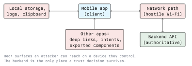

# Mobile App Security

The previous two lectures described what the platforms give you. This one is about assessing a
single app: what to test, in what order, and how to decide whether something you found is a
finding. The structure follows the OWASP MASVS categories, because that is the vocabulary the
industry uses in reports.

## The Central Assumption



Everything in this lecture follows from one assumption: **the app runs on hardware the attacker
controls.** Storage can be read, traffic can be intercepted, the binary can be decompiled, the
process can be hooked. None of that is a vulnerability in itself - it is the environment.

What makes a finding is a *consequence*: a secret in storage that unlocks something, a trust
decision made locally that the server then believes, an interface exposed to other apps that does
more than it should.

## MASVS Categories as a Test Plan

### Storage

The question is: what does the app write down, and who can read it?

Pull the app's private directory on your own emulator and look:

```bash
# Android: run-as works for a debuggable build; a root shell reaches any app
adb shell run-as com.example.vulnerable ls -la /data/data/com.example.vulnerable
adb shell run-as com.example.vulnerable cat shared_prefs/settings.xml

# Anything written to shared storage is readable without privileges at all
adb shell ls -la /sdcard/Android/data/com.example.vulnerable
```

What you are looking for: session tokens, passwords, API keys, personal data, and SQLite
databases with unencrypted contents. Also check the places nobody intends to use as storage -
system logs, the clipboard, keyboard caches, and screenshots the OS takes when the app is
backgrounded.

```bash
adb logcat | grep -i -E 'token|password|authorization'
```

**Controls:** `EncryptedSharedPreferences` or the Keystore on Android, Keychain with a tight
accessibility attribute on iOS, `android:allowBackup="false"` and the `ThisDeviceOnly` Keychain
variants to keep secrets out of backups, no secrets in logs, and marking sensitive screens so the
OS does not snapshot them (`FLAG_SECURE` on Android).

### Cryptography

The recurring mistakes are predictable and all of them are findable in decompiled code:

- A hardcoded key in the binary. A key shipped to every user is not a key.
- ECB mode, or CBC with a fixed or all-zero IV. Both leak structure.
- A home-made cipher, or XOR with a constant presented as encryption.
- A password hashed with a single pass of a fast hash instead of a password hashing function.
- Keys derived from something predictable: a device identifier, a timestamp, an installation
  counter.

**Controls:** use the platform crypto APIs with authenticated encryption (AES-GCM), generate keys
in the Keystore or Keychain so they are hardware-bound and non-extractable, and get randomness
from the platform CSPRNG rather than a general-purpose random number generator.

### Authentication and Session Management

The important sentence: **authentication happens on the server.** A mobile app collects
credentials and displays the result. Any check the app performs on itself is a user interface
behaviour, not a security control.

Things to test:

- Does a session token expire, and can it be revoked server-side?
- Can the client bypass the login screen, for example by starting a post-login activity directly?
  (Lecture 3 showed `am start`; this is the finding it produces.)
- Is biometric unlock gating access to a secret, or just hiding a screen? The correct pattern ties
  the biometric result to the release of a Keystore or Keychain item, so that failing the
  biometric means the key is genuinely unavailable, instead of flipping a boolean the app can be
  convinced to ignore.
- Does the backend enforce authorisation per object, or does it trust an identifier the client
  sends?

That last one matters most. In a mobile assessment the findings that count are usually in the
backend API. The app is the easiest way to discover that API, and the API is where the data lives.

### Network Communication

Set up an intercepting proxy against your own lab app and watch the traffic. On Android the proxy
CA has to be trusted by the app, which since Android 7.0 means a debuggable build, a
`network_security_config` that trusts user CAs in the debug variant, or a rooted device with the
certificate placed in the system store.

What to check:

- Any cleartext HTTP at all.
- Whether the app accepts a certificate it should not: an interception proxy with its own CA that
  works against the production build means validation is broken or pinning is absent.
- Whether TLS errors are swallowed. An empty `onReceivedSslError` or a trust manager that accepts
  everything is a serious finding, and both are visible in decompiled code without any traffic
  capture.
- What is in the requests: credentials in URLs, tokens in query strings that end up in logs,
  excessive data in responses.

**Controls:** HTTPS everywhere enforced by platform configuration (network security config, ATS),
correct certificate validation, and pinning where the threat model justifies the operational cost
of key rotation.

### Platform Interaction

This is the mobile-specific category and it is where the platform-level material from lectures 3
and 4 turns into test cases:

- Exported activities, services, receivers and content providers that should not be exported.
- Deep links and custom URL schemes that act on parameters without validation, or that are not
  domain-verified.
- WebView configuration: JavaScript interfaces exposed to remote content, file access enabled,
  TLS errors overridden.
- Permissions requested beyond what the features need.
- Pasteboard and share-sheet use for sensitive content.

**Controls:** as in those lectures - `exported="false"` by default, authorisation checks inside
components, verified App Links and universal links, locked-down WebViews, least privilege.

### Code Quality and Resilience

Memory-safety bugs matter where the app has native code: a C or C++ library reached through the
Android NDK, a third-party SDK shipped as a native binary. Managed code in Kotlin, Java or Swift
removes most of that class, so native components deserve more attention per line than the rest of
the app.

Resilience is the MASVS category covering obfuscation, root/jailbreak detection, anti-debugging
and integrity checks. Be clear about what it is for: these measures raise the cost of analysis.
They do not protect data and they do not make a local trust decision trustworthy. A report that
lists "no root detection" as a high-severity finding while the API accepts an unauthenticated
request has its priorities inverted.

Also in scope: the dependencies. A mobile app ships a pile of third-party SDKs - analytics,
crash reporting, advertising - and each one inherits the app's permissions and can see the app's
data. Which SDKs are present, and what they send where, is part of the assessment, and under the
GDPR it is part of the compliance picture too.

## Tooling

### Static analysis

**MobSF** (Mobile Security Framework) is the usual starting point: it takes an APK or IPA,
unpacks it, decompiles, and produces a report covering the manifest, permissions, exported
components, hardcoded strings, insecure API use and network configuration.

```bash
# Run the server locally, then upload the sample through the web interface
docker run -it --rm -p 8000:8000 opensecurity/mobile-security-framework-mobsf
```

Treat the output as a lead list, not a report. Automated scanners are good at finding
`exported="true"` and a string that looks like a key, and bad at knowing whether either matters.
Every item needs a human to decide whether it is exploitable.

### Dynamic analysis

**Frida** injects a JavaScript engine into a running process so you can inspect and change
behaviour at runtime. **Objection** is a toolkit built on Frida with ready-made commands for the
common mobile tasks.

```bash
# What is running, and on which device?
frida-ps -Ua

# Interactive exploration of your own lab app
objection -g com.example.vulnerable explore
```

From an `objection` session you can list the app's storage, dump the Keychain on iOS, enumerate
classes and methods, and inspect objects live. The next lecture covers the mechanics.

The reason dynamic analysis matters is not that it finds different bugs than reading the code. It
is that it answers "does this code path actually run, with these values?" in seconds, where
reading decompiled output takes an hour.

## A Workable Assessment Order

1. **Get the app.** APK or IPA, and the version you are authorised to test.
2. **Static pass.** Manifest or `Info.plist`, permissions, exported surface, network
   configuration, declared SDKs. Run MobSF while you read.
3. **Decompile and read.** Crypto use, hardcoded secrets, TLS handling, local checks that look
   like security decisions.
4. **Storage pass.** Install, use the app normally, then look at everything it wrote.
5. **Network pass.** Proxy the traffic, map the API, test the API's authorisation separately from
   the app.
6. **Platform pass.** Poke the exported components and deep links from the shell.
7. **Dynamic pass.** Hook the specific functions the static pass made you curious about.
8. **Write it up.** Impact first, reproduction steps, the control that fixes it.

Step 5 deserves its own emphasis. The backend is usually where the severe findings are, and the
app is a map to it.

## Reporting

A mobile finding is worth writing down when you can state the consequence. "The token is stored
in `SharedPreferences`" is an observation; "an attacker with physical access to an unlocked phone,
or a backup of it, recovers a session token that does not expire and reuses it from any device"
is a finding. Severity comes from the attacker you need to assume: a remote attacker is worse
than one needing the unlocked device in hand.

Keep the legal frame in mind while you collect evidence. App data is personal data. Screenshots
and database dumps taken during a test fall under the GDPR, belong in the engagement's storage,
and get deleted when the engagement ends. Module 01 has the detail.

## Key Takeaways

- Assume the device is hostile. The finding is never "the binary can be decompiled", it is what
  decompiling it lets you do.
- MASVS gives the categories: storage, crypto, auth, network, platform interaction, code quality,
  resilience. Work through them rather than improvising.
- Authentication and authorisation are server-side properties. A local check is UI behaviour.
- The backend API is usually where the serious findings are. The app is how you find the API.
- Automated tools produce leads. A finding needs a human to establish impact.
- Obfuscation and root detection raise cost, not safety. Rank them accordingly in a report.

## Resources

- OWASP MASVS: <https://mas.owasp.org/MASVS/>
- OWASP MASTG test cases: <https://mas.owasp.org/MASTG/>
- Mobile Security Framework (MobSF): <https://github.com/MobSF/Mobile-Security-Framework-MobSF>
- Frida: <https://frida.re/docs/home/>
- Objection: <https://github.com/sensepost/objection>
