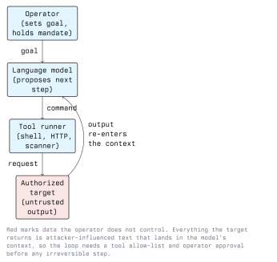

# Introduction to AI in Offensive Security

Machine learning has been part of security tooling for a long time: spam filters, anomaly
detection, malware classifiers. What changed recently is that large language models made
*text and code* cheap to produce and cheap to analyse. Offensive security is largely a job
of reading, writing and correlating text, so the effect is direct.

This lecture sets the vocabulary for the module, separates what AI actually changes from
what it only appears to change, and establishes the legal and lab ground rules used in the
remaining five lectures.

## 1.1 Vocabulary

- **Machine learning (ML):** a program whose behaviour is derived from data rather than
  written out as rules. A spam classifier trained on labelled mail is ML.
- **Large language model (LLM):** a model trained to predict the next token of text. Given
  a prompt, it produces a continuation. It has no state between calls other than the text
  you pass it.
- **Context window:** the text the model can see for one call: your instructions, the
  conversation so far, and anything a tool pasted into it. Everything in there is treated
  the same way by the model, which is the root of most of the security problems in this
  module.
- **Agent:** an LLM wired into a loop that can call tools (shell, HTTP, a scanner), feed
  the output back into the context and decide the next call.
- **Prompt injection:** text that reaches the context from an untrusted source and is acted
  on as if it were an instruction from the operator.
- **Hallucination:** a confident, fluent, wrong output. The model has no mechanism that
  distinguishes a remembered fact from a plausible-sounding invention.

## 1.2 Three Relationships Between AI and Security

Keep these apart; they are often mixed up in press coverage.

1. **AI as an attacker's tool** - the subject of lectures 2 to 5. The model helps a human
   attacker write, translate, read or decide faster.
2. **AI as a target** - the model and its surrounding application are themselves attack
   surface: prompt injection, data exfiltration through tool calls, model and data theft,
   training-data poisoning. The OWASP Top 10 for LLM Applications and MITRE ATLAS catalogue
   this area.
3. **AI as a defender's tool** - triage, correlation, detection engineering, log
   summarisation. Lecture 6 and Module 13 cover the blue side.

## 1.3 The Assisted Attack Loop

Almost every offensive use of an LLM in this module is the same loop with different tools
plugged into it.



Two properties of this loop matter for everything that follows:

- **The operator keeps the mandate.** The model does not have authorization; the human
  running it does. Signing a scope document and then letting an agent wander outside it is
  the same offence as doing it by hand.
- **Target output is untrusted input.** Whatever a web page, a banner or a file returns is
  appended to the model's context. If an attacker controls that text, they get a say in
  what your agent does next. Lecture 5 works through this.

## 1.4 What AI Actually Changes

Be precise here, because the honest answer is narrower than the marketing and broader than
the dismissal.

### 1.4.1 Cost of Language Collapses

Writing a convincing, grammatically perfect pretext in German, Slovenian or Hungarian used
to require a person who spoke it. It no longer does. The classic awareness-training advice
"look for bad grammar" is dead, and training material that still teaches it is actively
harmful. Lecture 3 covers the consequences.

### 1.4.2 Breadth Without Expertise

A model compresses a large amount of documentation. Someone who has never seen a Kerberos
ticket can get a usable explanation and a plausible first command in seconds. This lowers
the floor of attacker skill; it does not raise the ceiling. The hard parts - a novel bug
class, a reliable exploit, quiet lateral movement - still need expertise, and the model
will produce confident nonsense for all three.

### 1.4.3 Triage and Correlation Scale

Reading 40,000 lines of scanner output, 100,000 leaked credentials or a company's entire
public LinkedIn footprint is boring, mechanical work. Machine assistance here is real and
already routine, for attackers and defenders alike. Lecture 4 covers the scanning side.

### 1.4.4 Some Repetitive Work Disappears

Report drafting, converting a packet capture into a table, rewriting a one-off script from
Bash to PowerShell. Unglamorous, and the largest practical time saving in a real
engagement.

## 1.5 What AI Does Not Change

- **The vulnerabilities.** SQL injection, missing patches, flat networks and reused
  passwords are what gets exploited, with or without a model.
- **The controls.** Patching, least privilege, segmentation, MFA, logging and backups work
  exactly as well against an AI-assisted attacker.
- **Verification.** Every model claim needs to be checked against the target. A model that
  reports a vulnerability has reported a guess until you reproduce it.
- **The law.** Authorization is still a human, written thing.

## 1.6 Failure Modes You Will Meet Immediately

| Failure | What it looks like | What to do about it |
| ------- | ------------------ | ------------------- |
| Hallucinated fact | A CVE number, flag or API that does not exist | Check against the vendor advisory or `--help` |
| Confident wrong command | Correct syntax, wrong semantics, destructive | Read before running; never pipe model output to a shell |
| Stale knowledge | Options removed years ago, old default ports | Prefer the man page over the model |
| Scope drift in an agent | A host outside the engagement gets scanned | Enforce scope outside the model, not in the prompt |
| Data leakage | Client data pasted into a third-party service | Clear it in the contract, or run a local model |

The last row is the one that ends careers. Prompts sent to a hosted model are a transfer of
data to a processor. If the prompt contains client systems, employee names or captured
credentials, that transfer needs a legal basis and usually a data processing agreement. For
a lot of engagements the clean answer is a locally hosted model.

## 1.7 Running a Model Locally

For this module you can work entirely offline. `ollama` is the simplest route; `llama.cpp`
is the lower-level one.

```bash
# Pull and run an open-weights model locally; nothing leaves the machine.
ollama pull llama3.1
ollama run llama3.1

# One-shot from a script or a pipe.
echo "Explain what nmap -sV does, in two sentences." | ollama run llama3.1
```

A local model on a laptop is weaker than a hosted frontier model. That is a useful teaching
property: you will see hallucinations clearly instead of having to look for them.

## 1.8 Legal and Ethical Boundaries

Module 01 is the reference; the short version for this module:

- **Authorization in writing, before anything runs.** Scope, time window, contact, and an
  explicit statement about whether AI tooling may process the client's data. Unauthorized
  access to a computer system is an offence under StGB §118a, and data damage and
  interference under §126a and §126b. "An agent did it on its own" is not a defence.
- **Personal data.** OSINT for pretexting means processing personal data under the GDPR.
  Having a model do the collecting changes nothing about the legal basis you need.
- **Tooling.** StGB §126c makes producing or distributing tools aimed at committing those
  offences punishable. Build detection content and lab exercises, not deployable weapons.
- **Deepfakes of real people.** A synthesized voice or face of an identifiable person is
  their personal data and, depending on use, also a fraud offence. Never produce one of a
  classmate, a teacher or an employee, even as a demonstration, without their written
  consent.

## 1.9 Lab Setup for This Module

Everything in this module is done inside a lab you own:

- An isolated VM network on RFC 1918 addresses (for example `192.168.56.0/24`), with no
  route to the school network or the internet except an explicitly allowed proxy.
- Deliberately vulnerable targets: OWASP Juice Shop, DVWA, Metasploitable, or a container
  you build yourself.
- A local model via `ollama`, so no lab data goes to a third party.
- A notes file per exercise recording what you ran, what the model claimed and what you
  verified. The last column is the point of the exercise.

## Key Takeaways

- An LLM is a text predictor in a loop; the dangerous part is that everything in its context
  looks equally authoritative to it, including attacker-controlled text.
- AI mainly changes cost and scale: fluent language, broad shallow knowledge, and fast
  triage. It does not invent new vulnerability classes and it does not weaken existing
  controls.
- Hallucination is not an edge case, it is the normal failure mode. Nothing a model claims
  counts as a finding until you reproduce it against the target.
- The operator holds the authorization, not the tool. Scope must be enforced outside the
  model.
- Sending client or personal data to a hosted model is a data transfer with legal
  consequences. A local model avoids the question entirely.

## Resources

- OWASP Top 10 for Large Language Model Applications - <https://owasp.org/www-project-top-10-for-large-language-model-applications/>
- MITRE ATLAS, adversarial threat landscape for AI systems - <https://atlas.mitre.org/>
- NIST AI Risk Management Framework - <https://www.nist.gov/itl/ai-risk-management-framework>
- Ollama, for running open-weights models locally - <https://ollama.com/>
- Module 01 - Ethics and Legal, for the Austrian and EU legal detail
