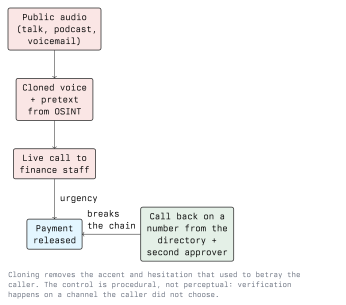

# AI in Social Engineering

This is where AI has changed attacks the most, because social engineering is made of
exactly the things language models produce well: text, voice, faces and patience.

Module 02 covered social engineering and OSINT in their classic form. This lecture looks at
what synthesis changes, and - more importantly - why the controls that survive are
procedural rather than perceptual.

## 3.1 The Economics Change, Not the Attack

A spear-phishing mail has always beaten a bulk phishing mail. It just cost a person an hour
of research and writing per target, so attackers sent one bulk mail to 10,000 people
instead. Generation removes that trade-off: the research is scraped and summarised, the
mail is drafted per target, and the attacker gets spear-phishing quality at bulk phishing
volume.

Nothing about the attack is new. The filter that used to protect most organisations - "it
is too expensive to target us individually" - is gone.

## 3.2 Text: What Fluency Removes

The classic indicator list taught in awareness training was mostly a list of *production
defects*:

| Old indicator | Status today |
| ------------- | ------------ |
| Broken grammar, odd phrasing | Gone; output is fluent in any language |
| Generic greeting | Gone; the name, team and project are scraped |
| Wrong tone for the sender | Largely gone if public writing exists to imitate |
| Obviously wrong branding | Gone; a page clone is trivial |
| Mismatched sender domain | **Still valid** |
| Unexpected request for credentials or payment | **Still valid** |
| Urgency plus secrecy | **Still valid** |
| Channel the sender never uses | **Still valid** |

The bottom half of that table is the part worth teaching. It describes the *request* and
the *channel*, which the attacker needs in order to profit, rather than the *prose*, which
they can now make perfect for free.

For a German-speaking region this matters more than in English-speaking ones. Austrian
organisations were partially protected by phishing written in stilted or obviously
machine-translated German. That protection is gone, including for regional phrasing.

## 3.3 Reconnaissance Feeding the Pretext

The pipeline is ordinary OSINT (Module 02) with a summarisation step bolted on:

```text
public sources            -> structured profile      -> pretext
-------------------------    --------------------      ------------------------
company site, press        name, role, manager,       "Re: the Tuesday migration
LinkedIn, GitHub, talks,   current project, tone,     window - can you confirm
conference programmes,     holiday mentions,          the service account before
breach dumps               who approves payments      I hand it to the vendor?"
```

Legally, this is processing personal data. Collecting it with a model rather than by hand
does not change the GDPR position, and an engagement that includes it needs that spelled
out in the authorization. See Module 01.

- **Defence:** reduce the public surface that feeds step one. Review what the company site,
  job ads and conference bios disclose about internal tooling, reporting lines and payment
  approval. Job adverts that list the exact EDR and VPN products in use are a gift.

## 3.4 Voice: Cloning and Vishing

Speech synthesis from a short sample is commercially available. Anyone who has given a
talk, left a voicemail greeting or appeared in a podcast has published training data.



What a cloned voice defeats is *recognition*: "that is definitely her, I have known her for
nine years". What it does not defeat is a process that never depended on recognition in the
first place.

- **Call back on a number from the internal directory**, never a number offered during the
  call. The attacker controls their channel, not yours.
- **Dual authorization for payments and for changes to bank details**, with the second
  approver contacted independently.
- **An agreed verification question** for high-value requests, not a secret worth stealing
  but something not scrapeable, such as a detail from a shared meeting.
- **No exceptions for seniority.** The entire pretext is a senior person demanding an
  exception. A policy that bends for the CEO is a policy that bends for a cloned CEO.

Private equivalent: families should agree a code word for "I am in trouble, send money"
calls, which are the consumer version of the same fraud.

## 3.5 Video: Deepfakes in Meetings

Real-time face and voice synthesis in a video call has been used in business email
compromise fraud. Reported cases include a finance employee joining a video meeting with
what appeared to be several colleagues, all synthetic, and releasing a very large transfer.

Live detection advice ("ask them to turn their head", "watch the ears") is a moving target
and should not be taught as a control. It may work today against a weak pipeline and will
fail against a better one.

- **Defence:** identical to the voice case. The verification happens outside the call, on a
  channel the caller did not choose, and the authority to move money never rests on one
  person's judgement in one meeting. Treat a video call as no stronger evidence of identity
  than a phone call.

## 3.6 Personas and Long-Game Social Engineering

Generated profile photos and consistent, fluent chat make fake personas cheap to run at
scale. The recurring patterns:

- **Fake recruiters** approaching engineers, ending in a "coding assignment" that executes
  attacker code, or a "screening call" that harvests internal detail.
- **Fake candidates** applying to real openings, with a synthetic interview presence, to
  obtain a laptop, VPN access and a payroll record.
- **Long-running relationship fraud**, where the cost of maintaining hundreds of parallel
  conversations used to be the limiting factor.

- **Defence:** verification through the organisation rather than through the person. For
  recruiting, that means identity checks on hire, hardware shipped to a verified address,
  and no production access before onboarding completes. For engineers, it means never
  running a stranger's code outside a disposable VM.

## 3.7 Authorized Testing in a Lab

If a phishing simulation is part of an engagement, the rules are strict and worth stating:

- Written authorization naming the organisation, the time window and the target population.
  Simulations against individuals without the employer's mandate are not tests.
- No synthesized voice or likeness of a real person without that person's written consent.
  Impersonating a named executive by voice crosses from testing into fraud offences, and
  the recording itself is their personal data.
- Collect metrics, not credentials. A simulation that stores real passwords has created a
  new breach.
- Report in aggregate. The output is "38 percent clicked, and here is the process gap",
  not a list of names for disciplinary action; naming individuals destroys the reporting
  culture you need.

For practice without any of this exposure, build the targets yourself: a lab mailbox, a
fictional company at `example.com`, and classmates who have agreed to play the roles.

## 3.8 Lab Exercise

1. Pick a fictional company and write its public footprint: an "about" page, three staff
   bios, one job advert. Two pages is enough.
2. Using only that material, draft - on paper, not sent anywhere - the pretext you would
   expect an attacker to build, and name the single piece of published information that
   made it work.
3. For each of the five controls in sections 3.4 and 3.6, state whether it would have
   stopped your pretext, and at which step.
4. Rewrite the job advert to remove the attacker's leverage without making it useless for
   recruiting. This is the realistic deliverable: you cannot delete the public footprint,
   you can only make it less specific.

## Key Takeaways

- AI does not add a new social engineering technique. It removes the cost of personalising
  one, so targeted-quality attacks now arrive at untargeted volume.
- Awareness training built on spotting bad grammar and generic greetings is obsolete and
  should be rewritten around the request, the channel and the urgency.
- Voice and video cloning defeat human recognition. Controls that depend on recognising a
  person therefore fail; controls that depend on an independent channel do not.
- Call-back on a directory number, dual authorization, and no exceptions for seniority stop
  the entire family of impersonation fraud, synthetic or not.
- Reducing what the organisation publishes about roles, tooling and approval chains cuts
  the attack off at the reconnaissance step.
- Synthesizing a real person's voice or face without written consent is not a classroom
  exercise; it is personal data and, in use, a fraud offence.

## Resources

- ENISA Threat Landscape, for current social engineering trends - <https://www.enisa.europa.eu/topics/cyber-threats/threats-and-trends>
- C2PA, content provenance and authenticity specifications - <https://c2pa.org/>
- Austrian Watchlist Internet, local fraud reporting and examples - <https://www.watchlist-internet.at/>
- Module 02 - Reconnaissance, for OSINT technique; Module 01 - Ethics and Legal, for consent and GDPR
