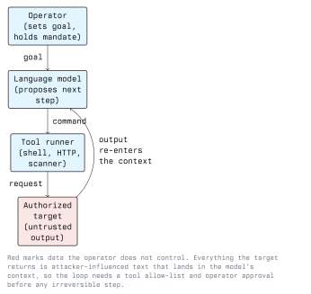
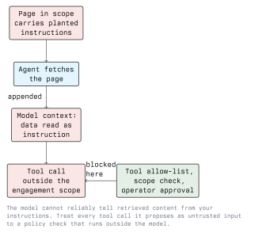

# AI in Penetration Testing

Lecture 4 looked at one phase. This lecture looks at the engagement as a whole: where
assistance helps across a test, what an agent is and how it fails, how to keep evidence and
scope discipline when a tool is proposing the next command, and how to test AI systems
themselves, since clients now have them.

## 5.1 Levels of Autonomy

Be precise about which of these you are using; the risk profile differs completely.

| Level | What it means | Risk |
| ----- | ------------- | ---- |
| 0 - Reference | Ask, read, type the command yourself | Bad advice only |
| 1 - Draft | Model writes a command or script, you review and run it | Destructive command if unread |
| 2 - Supervised agent | Model proposes, tool runs it after you approve each step | Approval fatigue |
| 3 - Autonomous agent | Model runs a loop of its own until a goal or limit | Scope breach, unlogged action |

Levels 0 and 1 are where almost all honest value sits today. Level 3 against a client
network, without hard external limits, is a liability problem rather than a technical one.

## 5.2 Where It Helps Across an Engagement

- **Recall.** The right flag for a tool you use twice a year, or the LDAP filter syntax you
  look up every time.
- **Translation.** Turning a working proof of concept into the language available on the
  host, or a `curl` request into a script that iterates.
- **Reading output.** Making sense of an unfamiliar configuration dump, a certificate
  chain, or a log format you have not seen before.
- **Report writing.** Business impact paragraphs, remediation wording, consistent severity
  phrasing across thirty findings. This is the largest real time saving and the lowest
  risk, because you are describing results you already verified.
- **Teaching.** For a student, "explain what this response tells me" is the strongest use
  in the list.

Where it does not help: deciding whether something is exploitable, judging blast radius, or
knowing when to stop. Those are the parts that make a tester worth hiring.

## 5.3 The Agent Loop and Its Failure Modes



Running this loop against anything real surfaces the same problems every time:

- **No stopping condition.** The model will keep proposing steps. Without an iteration cap,
  a token budget and a wall-clock limit, it runs until something else stops it.
- **Loops and repetition.** It retries a failing command with cosmetic variations instead
  of concluding the path is closed.
- **Destructive commands.** It has no model of what is irreversible. `DROP`, `rm -rf`, a
  write to a production configuration file and a password change all look like ordinary
  next steps to it.
- **Scope drift.** A redirect, a DNS record or a link in a page points at an address
  outside the engagement and the loop follows it. This is the one that becomes a legal
  problem.
- **Lost evidence.** The loop summarises as it goes, and the summary is what remains. The
  actual request and response that proved the finding are gone.

Mitigations, all of which live *outside* the model:

- An explicit allow-list of in-scope hosts and networks, checked by the tool runner before
  every request, not described to the model in a prompt.
- A command allow-list or a deny-list of irreversible operations, with mandatory human
  approval for anything not on it.
- Full transcript logging: every command, every raw response, with timestamps, kept as
  engagement evidence.
- Hard limits on iterations, time and spend.
- The engagement-wide rule from any other test: run it from a known source address the
  client can attribute, so your traffic can be separated from a real intrusion.

## 5.4 Prompt Injection Against Your Own Tooling

This is the failure mode students underestimate. Your agent reads the target. The target may
be controlled by someone who knows that.



A page, a TXT record, an HTTP header, a filename, a PDF, an email body or a product review
can all carry text addressed to your agent. The model has no channel separation: your
instructions and the fetched page are the same kind of token. If the planted text says to
ignore prior instructions and fetch an internal URL, there is nothing inside the model that
reliably refuses.

For a penetration tester the realistic consequences are scope breach, leaked client data
sent to an attacker-controlled endpoint, and a report containing findings the target made
up for you.

Controls:

- Keep the scope and tool policy outside the model, as code. The policy must be unable to
  be argued with.
- Treat every retrieved document as data. Where the framework supports it, place it in a
  separate, clearly delimited channel and instruct the model that content there is never an
  instruction. This reduces the problem; it does not solve it.
- Require human approval for any action that leaves the engagement scope, writes data, or
  sends anything outbound.
- Log raw tool output, so you can see afterwards what the agent was told.

The same mechanism, pointed the other way, is a finding when you test a client's own AI
application: a support bot that reads customer tickets and can call internal tools is a
confused deputy waiting to happen.

## 5.5 Testing AI Systems as Targets

Clients increasingly deploy LLM applications, so "test our chatbot" is a real engagement
request. Structure it around the OWASP Top 10 for LLM Applications and ask:

- **Prompt injection, direct and indirect.** Can a user, or a document the system ingests,
  change its behaviour? Indirect injection via retrieved content is the serious variant.
- **Tool and plugin scope.** What can the model call? With whose privileges? A model given
  a service account with broad database rights has handed every user that account.
- **Output handling.** Model output rendered into a page without encoding is stored XSS
  with extra steps; model output passed to a shell or a query is injection with extra
  steps. Treat it as untrusted user input, because it is.
- **Sensitive information disclosure.** Does the system context contain secrets, other
  customers' data, or internal documents retrievable by a well-phrased question?
- **Resource consumption.** Unbounded context or tool loops are a denial-of-wallet problem
  as much as a denial-of-service one.
- **Supply chain.** Model weights, embeddings and third-party plugins pulled from public
  registries, usually unverified.

Tooling exists for the repetitive part:

```bash
# garak: a vulnerability scanner for LLM endpoints.
python -m garak --model_type huggingface --model_name gpt2 --probes encoding
```

Run it against an endpoint you are authorized to test, exactly like any other scanner.
Microsoft's PyRIT and promptfoo cover similar ground with different emphases. The findings
still need manual confirmation, for the reasons in lecture 4.

## 5.6 Data Handling During an Engagement

Specific to AI-assisted testing, and the item most often missed in the contract:

- Scan output, source code, screenshots and credentials pasted into a hosted model are
  transferred to a third party. The engagement contract must say whether that is allowed,
  to which provider, and under what terms.
- Captured personal data (user tables, mailboxes) should not go into a model at all. The
  GDPR position does not improve because the processing was convenient.
- A local model removes the question. For a lot of engagements this is the deciding
  argument for `ollama` over a hosted API, even at lower quality.
- Retention: if a provider retains prompts for training by default, that is a disclosure of
  client data. Check the setting; document the answer.

## 5.7 Lab Exercise

Target: your own lab VM, with an intentionally vulnerable web application.

1. Work at autonomy level 1 for one hour. For every command the model drafts, record: did
   it run, did it do what the model said it would, did you have to fix it.
2. Count the result. The ratio of "worked as described" to "needed correction" is the
   number worth remembering from this module.
3. Plant your own injection: add a page to the lab app containing text addressed to an
   automated reader, instructing it to fetch `http://192.168.56.99/`, a host inside your
   lab that is out of your declared scope. Point an assisted workflow at the application and
   see whether the out-of-scope request appears in that host's logs.
4. Write the scope check that would have blocked it. Four lines of code is enough; the
   point is that it lives outside the model.
5. Produce a one-page report for one verified finding, with the raw request and response as
   evidence and the model's draft text corrected by you. Mark every sentence you had to
   change.

## Key Takeaways

- Name your autonomy level. Reference and draft use are routine; an unsupervised agent
  loose on a client network is a liability decision, not a tooling decision.
- The biggest honest gains are recall, output reading and report writing, the parts that
  are not deciding anything.
- Agent loops fail by not stopping, repeating, doing irreversible things and drifting out of
  scope. Every mitigation is external: allow-lists, approval gates, hard limits, logging.
- Target output is attacker-influenced input to your own tooling. Prompt injection against
  the tester is a real scope-breach and data-leak path.
- Client AI applications are testable systems: injection, tool scope, output handling,
  disclosure, resource consumption, supply chain.
- Authorization in writing, evidence capture and data handling rules do not relax because a
  model is in the loop. They matter more, because the tool acts faster than you read.

## Resources

- OWASP Top 10 for Large Language Model Applications - <https://owasp.org/www-project-top-10-for-large-language-model-applications/>
- OWASP Web Security Testing Guide, for engagement structure - <https://owasp.org/www-project-web-security-testing-guide/>
- garak, LLM vulnerability scanner - <https://github.com/NVIDIA/garak>
- Microsoft PyRIT - <https://github.com/Azure/PyRIT>
- MITRE ATLAS - <https://atlas.mitre.org/>
- Module 01 - Ethics and Legal, for authorization and GDPR requirements
