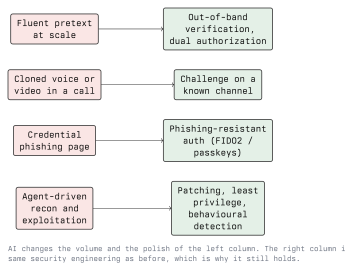

# Defending Against AI-Enhanced Attacks

The previous five lectures built the attacker's side. This one turns it around and asks the
only question that matters for a defender: given that attackers now have fluent language,
cheap personalisation and fast triage, what do we change, and what do we deliberately leave
alone?

The short answer: change the human-facing controls, keep the technical ones, and add a new
category for the AI systems your own organisation is deploying.

## 6.1 What Actually Shifts in the Threat Model

- **Personalisation is free.** Assume every employee can receive a well-researched,
  correctly written, contextually plausible message in their own language.
- **Identity signals from voice and video are unreliable.** Recognising a person is no
  longer evidence of who they are.
- **Attacker triage is faster.** Time from initial access to "we found what is valuable"
  shortens, which shortens your detection and response budget.
- **The entry bar is lower.** More attackers, operating at a lower skill level, hitting
  known vulnerabilities and known social engineering patterns.
- **You now run AI systems too.** Anything with a model, a document store and tool access
  is a new, poorly understood attack surface in your own estate.

What does not shift: the exploited weaknesses. Unpatched services, flat networks, excessive
privilege, reused credentials and absent logging are still how incidents happen.

## 6.2 The Mapping From Attack to Control

Each row is worth stating explicitly, because the right column is where budget should go.

### 6.2.1 Identity: Make Credentials Unphishable

If the credential cannot be replayed by whoever received it, a perfect phishing page stops
mattering.

- **FIDO2 / passkeys** bind the authentication to the origin, so a cloned login page at a
  look-alike domain cannot use what it captures. This is the single highest-value control
  against AI-polished phishing.
- **Push-notification MFA is not equivalent.** It is vulnerable to fatigue and relay. If it
  must remain, enable number matching.
- **Conditional access** on device compliance and location narrows what a stolen session is
  worth.
- **Short session lifetimes and token binding** limit the value of a stolen cookie, which
  is what modern phishing kits actually take.

### 6.2.2 Process: Verification That Does Not Depend on Perception

- Payments and changes to bank details require a second approver, contacted on a channel
  the requester did not supply.
- Call-back to a number from the internal directory, always.
- A documented, blame-free procedure for "I think this call was fake", so people stop the
  transaction instead of worrying about embarrassing a senior colleague.
- Help-desk identity verification that does not rely on voice or on facts an attacker can
  scrape. Account resets and MFA re-enrolment are the classic target; require a verified
  channel or an in-person step.

### 6.2.3 Detection: Behaviour, Not Content

Content-based filtering degrades as generated text improves. The signals that hold up are
structural and behavioural:

- New or look-alike domains, first contact from an unknown sender, mismatch between display
  name and address, mail that fails SPF, DKIM or DMARC alignment. Publish a DMARC policy at
  `p=reject` for your own domains so your brand is harder to use.
- Impossible-travel and anomalous-session signals on identity platforms.
- Mass file reads, unusual directory enumeration, and access to shares an account never
  touches, which is the on-host triage behaviour from lecture 2.
- Outbound connections from servers and service accounts to inference endpoints that have
  no business reason to be contacted.

### 6.2.4 The Unchanged Core

Patch management, asset inventory, least privilege, network segmentation, application
allow-listing, offline and tested backups, logging with real retention, and a rehearsed
incident response plan. None of this is affected by how well the attacker writes.

## 6.3 Awareness Training That Is Not Obsolete

Most training material in circulation still teaches detection by writing quality. Rewrite
it:

| Remove | Replace with |
| ------ | ------------ |
| "Look for spelling mistakes" | "Look at what is being asked for" |
| "Generic greetings are suspicious" | "Unexpected payment, credential or access requests are suspicious, however well written" |
| "You will recognise your colleagues" | "Verify out-of-band for anything irreversible" |
| "Report phishing" (only) | "Report, and we will thank you, including for false alarms" |
| Annual slide deck | Short, frequent, role-specific drills, especially for finance and the help desk |

Measure the reporting rate alongside the click rate. An organisation where people report
quickly detects the campaign that nobody clicked on yet.

## 6.4 Do Not Rely on "AI Detectors"

Tools that claim to tell whether text, an image, audio or video was generated are not
reliable enough to act on. They produce false positives on non-native writing and on
formal styles, they degrade as generators improve, and their failure mode - accusing an
innocent person - is expensive.

The constructive direction is **provenance rather than detection**: cryptographically
signed capture metadata (the C2PA specifications), signed internal communications, and
verification through an independent channel. Proving where something came from is tractable;
proving what produced it is not.

The EU AI Act introduces transparency obligations for certain AI systems and for synthetic
content, phased in over several years. Treat it as a compliance driver for provenance and
labelling work, and check the current applicable dates before quoting them.

## 6.5 Securing Your Own AI Systems

This is the genuinely new work. If your organisation deploys a chatbot, a document
assistant or an agent with tool access, the following is a minimum:

- **Scope the tools.** The model gets the narrowest possible set of actions, each with its
  own least-privileged credential. Never a shared admin service account.
- **Keep the authorization outside the model.** Permission checks run in code, on the
  caller's identity, before the tool executes. "The prompt tells it not to" is not a
  control.
- **Human approval for irreversible actions.** Sending mail externally, moving money,
  deleting data, changing configuration.
- **Treat model output as untrusted.** Encode it before rendering, never pass it unchecked
  to a shell, a query or a file path.
- **Segregate retrieved content.** Documents and web pages are data, delimited and labelled
  as such. It reduces indirect injection; it does not eliminate it, so the control above
  still has to hold.
- **Rate limits and budgets**, against both abuse and runaway loops.
- **Log everything**: prompt, retrieved context, tool calls, outputs. Without this, an
  incident involving the system cannot be investigated at all.
- **Govern the supply chain.** Pin and verify model weights and plugins the way you would
  any other dependency.
- **Test it.** Red-team the application before deployment and after changes, using the
  OWASP LLM Top 10 as the checklist and tools such as garak or PyRIT for the repetitive
  parts (lecture 5).

## 6.6 Incident Response for Synthetic-Media Fraud

Add a short playbook; the first hour decides whether the money is recoverable.

1. **Stop the transaction.** Contact the bank immediately; recall is sometimes possible
   within a short window. This outranks investigation.
2. **Preserve evidence.** Call records, meeting recordings and metadata, mail headers,
   chat logs. Do not delete the meeting.
3. **Verify through the real person**, on a known channel, that they did not make the
   request.
4. **Report.** In Austria, to the police; keep the GDPR breach clock in mind if personal
   data was disclosed, and check whether a notification to the supervisory authority is
   required.
5. **Communicate without blame.** The employee followed a process that failed them. If the
   organisation punishes them, the next person conceals it.
6. **Fix the process, not the person.** Which approval step was missing, and is it now
   mandatory?

## 6.7 Lab Exercise

Work in pairs, on paper and in a lab, with no real organisation involved.

1. Take the fictional company from lecture 3. Write the three AI-enhanced attacks you
   consider most likely against it.
2. For each, name the single control that stops it and the step at which it intervenes. If
   you cannot name the step, the control is a slogan.
3. Rewrite one page of a real-looking awareness training slide that currently teaches
   "spot the bad grammar", using the table in 6.3.
4. Take a small lab LLM application (a local model with one tool, for example a file
   reader) and write its tool policy: what it may call, with which rights, and what needs
   human approval. Then try to talk it out of the policy and confirm that the policy, being
   outside the model, holds.
5. Write the synthetic-media incident playbook for the company on one page, with names and
   phone numbers filled in from the fictional directory.

## Key Takeaways

- AI changes the human-facing layer of the attack, so that is where the response belongs:
  phishing-resistant authentication, out-of-band verification, dual approval and
  non-perceptual identity checks.
- The technical core - patching, least privilege, segmentation, allow-listing, logging,
  backups - is unaffected and remains the foundation.
- Detection should key on behaviour and structure, not on the quality of the text. Content
  filtering loses this race by construction.
- Detectors that claim to identify AI-generated media are not dependable; invest in
  provenance and independent verification instead.
- Awareness training built on writing quality must be rewritten around requests, channels
  and urgency, and measured by reporting rate.
- Your own AI deployments are new attack surface: scope the tools, enforce authorization
  outside the model, require approval for irreversible actions, treat output as untrusted,
  and log everything.
- Have a playbook for synthetic-media fraud, and run it blame-free, because speed in the
  first hour is what recovers the money.

## Resources

- OWASP Top 10 for Large Language Model Applications - <https://owasp.org/www-project-top-10-for-large-language-model-applications/>
- MITRE ATLAS, including its catalogue of mitigations - <https://atlas.mitre.org/>
- NIST AI Risk Management Framework - <https://www.nist.gov/itl/ai-risk-management-framework>
- EU Artificial Intelligence Act, Regulation (EU) 2024/1689, official text on EUR-Lex - <https://eur-lex.europa.eu/eli/reg/2024/1689/oj>
- FIDO Alliance, passkeys and phishing-resistant authentication - <https://fidoalliance.org/passkeys/>
- C2PA content provenance - <https://c2pa.org/>
- Module 13 - Blue Teaming, for detection engineering and incident response in depth
