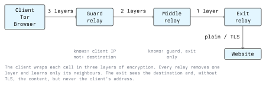

# How Tor Works

When you open a website normally, your ISP knows which site you are visiting and the site sees your IP address. TLS hides the *content* of the connection, but not the fact that you are talking to each other. Tor hides that relationship: no single point on the path knows both who you are and where you are going.

This lecture explains how Tor does that: onion routing, circuits, the directory system, and the tricks it uses to get past censorship. It ends with the most important part, what Tor does *not* protect against.

## The Core Idea: Onion Routing

A proxy or VPN moves trust instead of removing it. The VPN provider sees both your IP address and every site you visit, so you have to trust it completely. Onion routing splits that knowledge across several independent servers so that none of them sees the whole picture.

Tor sends your traffic through three relays, chosen from several thousand run by volunteers around the world:



1. **Guard (entry) relay:** sees your IP address, but only encrypted data heading for the next relay.
2. **Middle relay:** sees only the guard and the exit. It knows neither you nor your destination.
3. **Exit relay:** sends your request to the actual website. It sees the destination, but not who sent the request.

Before sending, your client encrypts the data three times: first with the exit's key, then the middle's, then the guard's. Each relay peels off exactly one layer, like the layers of an onion, and forwards the rest. Only the exit sees the original request. On the way back each relay adds a layer, and your client removes all three.

## Building a Circuit

The path through three relays is called a **circuit**. The client builds it one hop at a time ("telescoping"):

1. The client connects to the guard over TLS and runs a key exchange with it (the *ntor* handshake, based on Curve25519). Both sides now share a key nobody else knows.
2. Through that encrypted connection the client asks the guard to extend the circuit to the middle relay and runs a second key exchange with the middle. The guard only forwards the handshake and cannot compute the key.
3. The same step through guard and middle reaches the exit.

At the end the client shares a separate symmetric key with each of the three relays. Data is sent in **fixed-size cells** (514 bytes), so an observer cannot tell a keystroke from part of a video by its size. Relays encrypt the cell layers with AES in counter mode.

Building a circuit takes several round trips around the world, so Tor builds circuits in advance and reuses them. A new circuit is used for new connections roughly every ten minutes. Tor Browser also isolates sites from each other: each site in the address bar gets its own circuit, so the exit for your webmail is not the exit for your news site.

Applications reach Tor through a SOCKS port that the Tor client opens on your own machine. To the application it looks like an ordinary proxy; behind that port, the client fetches the consensus, picks the guard and builds the circuit:

```bash
# The tor daemon listens on 9050, Tor Browser on 9150
curl --socks5-hostname 127.0.0.1:9050 https://check.torproject.org/api/ip
# {"IsTor":true,"IP":"185.220.101.x"}
```

The `--socks5-hostname` flag matters. It sends the *hostname* through Tor, so the exit resolves DNS. With plain `--socks5`, curl looks the name up through your normal DNS resolver first and tells your ISP where you are going: a classic **DNS leak**.

## The Directory System

How does a client know which relays exist and what their keys are? It cannot simply ask a relay, because a malicious relay could answer with a list containing only its friends.

Tor solves this with a small, fixed group of **directory authorities** (currently nine servers run by trusted people and organizations in different countries). Their addresses and keys are compiled into the Tor software. Every hour they:

1. Collect self-descriptions from all relays (address, keys, bandwidth, exit policy).
2. Measure the relays' real bandwidth.
3. Vote, and sign a shared **consensus**, a list of all usable relays.

A client only accepts a consensus signed by a majority of the authorities, so a few compromised authorities cannot feed it a fake network. In the consensus each relay carries **flags**:

| Flag | Meaning |
| --- | --- |
| `Guard` | Stable and fast enough to be an entry relay |
| `Exit` | Allows traffic out to the normal internet |
| `Stable`, `Fast` | Long uptime, good bandwidth |
| `HSDir` | Stores onion service descriptors (Lecture 3) |
| `BadExit` | Caught manipulating traffic; clients will not use it as an exit |

Clients choose relays weighted by bandwidth and never put two relays from the same /16 network or the same operator ("family") into one circuit.

### Why Guards Stay Fixed

A Tor client picks one guard and keeps it for months, even though changing it would seem more anonymous. The reasoning: if an attacker runs some relays and your client picked a new random entry for every circuit, the attacker would eventually be your entry *and* your exit on some circuit, and could link you to your destination. With a fixed guard you are either unlucky once (your guard is malicious) or safe for months. You don't get unlucky again with each new circuit.

### Exit Policies

Every exit relay publishes an **exit policy**: which ports and addresses it will connect to. Many exits block port 25 (SMTP) to prevent spam. The "reduced exit policy" only allows common ports such as 80, 443 and 22. The list of exit relays is public, which is why many websites block Tor or show it extra CAPTCHAs.

## Bridges and Pluggable Transports

The relay list is public, so a censor can simply block every relay's IP address. Countries such as China, Iran and Russia do exactly that. Tor's answer has two parts.

**Bridges** are relays that are not listed in the public consensus. Users get bridge addresses through the Tor Browser settings, from <https://bridges.torproject.org/>, by e-mail or through messenger bots, a few at a time, so a censor cannot easily collect them all.

That is not enough, because deep packet inspection can recognize Tor traffic by its shape even without the IP address. **Pluggable transports** disguise the connection to the bridge:

| Transport | How it hides Tor |
| --- | --- |
| **obfs4** | Makes traffic look like random bytes with no recognizable protocol |
| **Snowflake** | Tunnels through WebRTC, the protocol behind video calls, via short-lived volunteer proxies running in ordinary browsers |
| **meek** | Sends traffic to a large cloud/CDN, so blocking it would mean blocking that whole cloud |
| **WebTunnel** | Looks like an ordinary HTTPS connection to an ordinary website |

This is a constant arms race. When a censor learns to detect a transport, the Tor Project and researchers develop the next one.

## Tor Browser

Tor alone only anonymizes the network connection. A normal browser would still give you away through cookies, fingerprinting and plugins. **Tor Browser** is a modified Firefox ESR designed so that all its users look the same:

- Same user-agent, same fonts, same reported time zone (UTC) for everyone
- **Letterboxing:** the window size is rounded to standard values so your screen size cannot fingerprint you
- No persistent history, cookies or cache; everything is wiped when the browser closes
- First-party isolation: each site gets its own cookies and its own circuit
- **Security levels:** *Standard*, *Safer* (JavaScript off on non-HTTPS sites, some fonts and media disabled) and *Safest* (JavaScript off everywhere)

The goal is not to be *invisible* but to be *indistinguishable*. That is also why you should not install add-ons or resize the window: anything that makes your browser unusual makes you easier to pick out.

## Threat Model: What Tor Does Not Protect Against

Tor's design document is clear about its limits. Knowing them is the most important takeaway of this lecture.

- **An attacker who sees both ends.** Someone who can watch the traffic entering the network at your guard *and* leaving at the exit or the website can match the timing and volume of packets and link you to your destination, even though they cannot read anything. Tor does not try to stop a global passive adversary, because doing so would make it too slow to use.
- **The exit relay reading unencrypted traffic.** The exit sees whatever you send. Over plain HTTP that includes passwords. Always use HTTPS; Tor Browser enforces it by default.
- **You identifying yourself.** If you log into your Instagram account over Tor, Instagram knows it is you. Tor hides your IP address, not your identity.
- **Malware and exploits.** A browser exploit can make your computer connect to the attacker directly, past Tor. Lecture 4 shows that this has happened in real investigations.
- **Other applications.** Only traffic sent through Tor is protected. A PDF opened in an external viewer or a program that ignores proxy settings connects directly.
- **The fact that you use Tor.** Without bridges, your ISP can see that you connect to the Tor network, just not what you do there.

## Conclusion

Tor builds a circuit of three volunteer relays, wraps your data in three layers of encryption, and makes sure no single relay knows both ends. A signed consensus prevents fake relay lists, fixed guards limit long-term exposure to malicious relays, and bridges with pluggable transports keep the network reachable under censorship. Tor protects *who talks to whom*. It does not protect against someone watching both ends, against reading unencrypted traffic at the exit, or against users and software giving themselves away. The next lecture uses the same building blocks to hide the server as well.

## Resources

- **Tor specifications**: <https://spec.torproject.org/> - The authoritative protocol description
- **Tor design paper**: *Tor: The Second-Generation Onion Router* (USENIX Security 2004)
- **Tor Metrics**: <https://metrics.torproject.org/> - Relay counts, bandwidth, bridge usage per country
- **Relay Search**: <https://metrics.torproject.org/rs.html> - Look up any relay, its flags and exit policy
- **Tor Browser design document**: <https://2019.www.torproject.org/projects/torbrowser/design/>
- **Snowflake**: <https://snowflake.torproject.org/> - Run a proxy in your own browser to help censored users
