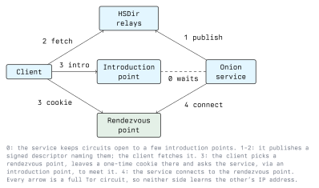

# Onion Services

In a normal Tor connection the client is anonymous, but the website is not: the exit relay connects to a public IP address. **Onion services** (formerly "hidden services") flip this around. The server is anonymous as well. It has no public IP address, can sit behind a home router or firewall, and still accepts connections from anywhere in the Tor network. Neither side learns where the other is.

This is the technology that "the darknet" usually refers to. This lecture explains how onion addresses work, how a client and a hidden server find each other, and what actually runs on onion services.

## Onion Addresses

A v3 onion address looks like this (an example, not a real service):

```text
pg6mmjiyjmcrsslvykfwnntlaru7p5svn6y2ymmju6nubxndf4pscryd.onion
```

The 56 characters are not a random name assigned by a registry. They *are* the service's public key:

```text
address = base32( public_key | checksum | version ) + ".onion"

public_key   32 bytes   ed25519 key of the service
checksum      2 bytes   SHA3-256(".onion checksum" | public_key | version)[:2]
version       1 byte    0x03
```

This has important consequences:

- **No registry, no DNS.** Anyone can create an onion address offline by generating a key pair. Nobody can seize or revoke the name, and nobody needs to approve it.
- **Self-authenticating.** When you connect to an address, Tor checks that the server proves possession of the matching private key. You cannot be redirected to a fake server under the same address, so a certificate authority is not needed to prove identity.
- **Unreadable for humans.** Nobody can memorize or check 56 random characters. That makes phishing easy, as shown below.
- **The private key is the identity.** Whoever has the file `hs_ed25519_secret_key` *is* the service. If police seize a server and the key, they can run the service themselves. That is exactly what happened with the Hansa market (Lecture 4).

The older v2 addresses had only 16 characters, based on short RSA-1024 keys. They were switched off in 2021.

## How Client and Service Meet

The problem: the client must reach a server whose IP address it does not know, and the server must not learn the client's address either. The solution is to meet in the middle, at a relay chosen by the client, with both sides arriving through their own Tor circuits.



**0. Introduction points.** The service picks a few random relays (usually three) as *introduction points* and keeps Tor circuits open to them. The introduction points do not know which service they are serving, nor where it is.

**1. Publishing the descriptor.** The service writes a *descriptor*: a signed document listing its introduction points and keys. It uploads it to a handful of relays with the `HSDir` flag. Which relays those are is computed from the address and the current date, so they change every day.

**2. Fetching the descriptor.** A client that knows the onion address can compute the same HSDirs and download the descriptor.

**3. Introduction and rendezvous.** The client picks a random relay as *rendezvous point* and leaves a one-time secret (a "cookie") there. It then sends a message to one of the introduction points, encrypted for the service, saying in effect "meet me at relay R with cookie C".

**4. Connection.** The service builds its own circuit to the rendezvous point and presents the cookie. The rendezvous point joins the two circuits.

The result is a connection across **six relays**: three chosen by the client, three by the service. The rendezvous point only passes along encrypted data and knows neither side. This is also why onion services are slower than normal Tor browsing.

### Protecting the Address List

In the v2 design, HSDir relays could read the descriptors they stored and collect onion addresses, and researchers did exactly that to map the darknet. v3 fixes this. Each day the service derives a *blinded* key from its real key. Descriptors are stored and signed under the blinded key and encrypted with a key that only someone who already knows the onion address can compute. An HSDir stores the descriptor without learning which service it belongs to. As a result, there is **no complete list of onion services**. You can only find one if somebody tells you its address.

### Client Authorization

A service can additionally require **client authorization**: the descriptor is encrypted for a list of authorized client keys (x25519). Someone who has the address but not a key cannot even fetch the introduction points. This suits private services such as an admin interface or a remote SSH login, which should not be reachable at all for anyone else.

## Running an Onion Service

Hosting an onion service takes two lines in Tor's configuration file `torrc`:

```text
HiddenServiceDir /var/lib/tor/my_service/
HiddenServicePort 80 127.0.0.1:8080
```

This tells Tor: "publish an onion service and forward its port 80 to the web server on local port 8080". After restarting Tor, the directory contains:

```text
/var/lib/tor/my_service/
  hostname                  the .onion address
  hs_ed25519_public_key
  hs_ed25519_secret_key     the identity; must never leak
```

The web server should only listen on `127.0.0.1`. The most common way to unmask an onion service is a web server that is also reachable via its real public IP address. Search engines like Shodan index it there, and comparing page content, TLS certificates, favicon hashes or SSH host keys links the onion address to the IP address. Other classic leaks are status pages such as Apache's `/server-status`, error pages that print the real hostname, and outgoing connections (for example image fetches or update checks) that the server makes outside Tor.

Assignment 1 walks through hosting a harmless onion service in your own lab.

## Vanity Addresses and Phishing

Since an address is a hash of a key, you can generate millions of keys until one happens to start with a chosen prefix. Tools such as `mkp224o` do exactly that. Each additional character multiplies the work by 32: a 6-character prefix takes seconds, 8 characters take hours to days on a normal computer. Facebook's onion address famously begins with `facebook`.

Criminals use the same trick. They generate an address with the same first characters as a well-known service, put up a proxy that copies the real site live, and replace cryptocurrency addresses or capture passwords. Because users only glance at the start of the address, these clones work well. Defences:

- Get onion addresses from the organization's own normal website, not from link lists or forums
- Use bookmarks instead of searching again
- Look for the **Onion-Location** feature: a website can send an HTTP header that makes Tor Browser show a ".onion available" button, leading to the verified address

## What Runs on Onion Services

**Legitimate services** (all can be verified from the organization's normal website):

- The Tor Project's own websites
- **SecureDrop** instances of newspapers, for anonymous document submission
- News sites: BBC, Deutsche Welle, The New York Times, ProPublica
- DuckDuckGo search, Proton Mail, Facebook
- **OnionShare**, which starts a temporary onion service on your own computer to share a file or host a chat
- Messengers such as Ricochet Refresh and Briar, which use onion services so there is no central server

**Criminal services** that you will meet in threat-intelligence work:

- **Marketplaces.** They sell drugs, stolen data and fraud services, with escrow, vendor ratings and dispute handling. They look like ordinary online shops. Payment is mostly in cryptocurrency, increasingly in Monero rather than Bitcoin because Monero is harder to trace.
- **Ransomware leak sites.** Ransomware groups list victim companies with a countdown and publish stolen data if the ransom is not paid. Defenders watch these sites to learn about breaches, sometimes before the victim does.
- **Forums** for selling access to hacked networks, exploits and stolen databases.
- **Scams.** A large share of darknet sites are simply fraud: fake markets, fake "hitman" services, clones of real markets that steal deposits.

## Attacks on Onion Services

Onion services are attacked like any server, plus some Tor-specific problems:

- **Denial of service.** Introducing a client costs the service real work (building a circuit), while sending introduction requests is cheap. In 2022-2023 large floods made many onion services unreachable for months. Since Tor 0.4.8, services can demand a small **proof-of-work** puzzle from clients when under attack, so flooding becomes expensive.
- **Guard discovery.** An attacker who can make the service build many circuits may eventually get one of their relays next to the service's guard and learn which guard it uses. That is the first step towards finding its IP address. *Vanguards* (extra fixed relays on the service side) make this much harder; they are built into Tor since 0.4.7 in a lighter form.
- **Ordinary web vulnerabilities.** SQL injection, file uploads and misconfigured servers are as common on onion services as anywhere else. Several takedowns started with a web vulnerability that revealed the server's real IP address.

## Conclusion

An onion address is a public key, so it needs no registry and cannot be spoofed, but it is also impossible for humans to verify. Client and service find each other through a published, encrypted descriptor and meet at a rendezvous point across six relays, so neither learns the other's location. Since v3, nobody can list all onion services. The same mechanism carries SecureDrop submissions, censorship-resistant news and private admin access, as well as markets and ransomware leak sites. Most real-world unmasking does not break this protocol. It exploits the server and the people running it, which is the subject of the next lecture.

## Resources

- **Onion services documentation**: <https://community.torproject.org/onion-services/> - Setup guides and best practices
- **Rendezvous specification**: <https://spec.torproject.org/rend-spec/> - The v3 protocol in detail
- **Onion-Location**: <https://community.torproject.org/onion-services/advanced/onion-location/>
- **OnionShare**: <https://onionshare.org/>
- **mkp224o**: <https://github.com/cathugger/mkp224o> - Vanity address generator
- **Vanguards**: <https://github.com/mikeperry-tor/vanguards> - Guard discovery protection for onion services
