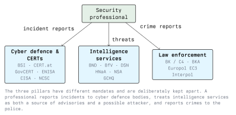

# The Agency Landscape

Security is often described as a contest between attackers and defenders inside a company. In practice the state is involved on every side. National authorities set rules and receive incident reports, government CERTs publish warnings and help with incident response, intelligence services both defend networks and attack them, and the police investigate cybercrime. A security professional who does not know which agency does what will report an incident to the wrong place, miss a legal deadline, or misjudge who is behind an attack.

This lecture gives an overview of that landscape. The following lectures cover each part in detail.

## Three Pillars

State involvement in cybersecurity falls into three areas with different mandates, different legal bases and different relationships to the public:

| Pillar | Mandate | Typical tasks | Examples |
| --- | --- | --- | --- |
| **Cyber defence and CERTs** | Protect networks and help others protect theirs | Warnings and advisories, incident response support, regulation and reporting obligations | BSI, CERT.at, GovCERT Austria, ENISA |
| **Intelligence services** | Collect information for the government, protect the state | Signals intelligence, counter-intelligence, attribution, in some cases offensive operations | BND, BfV, DSN, Heeresnachrichtenamt, NSA, GCHQ |
| **Law enforcement** | Investigate crimes and bring offenders to court | Criminal investigations, seizures, arrests, international cooperation | Bundeskriminalamt (AT and DE), Europol, Interpol |

### Why the pillars are kept separate

The separation is deliberate, and in Germany it is a constitutional principle known as the *Trennungsgebot*: intelligence services and police must be organisationally separate, and intelligence services have no police powers. They may not arrest anyone or search a house. The reason is historical. The Gestapo combined secret intelligence with police power, and the post-war constitution was written to prevent that from happening again.

Austria has no equivalent constitutional rule. Its domestic intelligence service sits inside the police (see Lecture 3). The tension between collecting intelligence and enforcing the law exists there too, and it shapes how Austria reorganised its intelligence service in 2021.

For a security professional the separation has practical consequences:

- A report to a **CERT** is generally about getting help and warning others. Most CERTs are not law-enforcement bodies and handle reports confidentially.
- A report to the **police** starts a criminal investigation. Evidence becomes part of a case file, and the victim may be asked to testify.
- **Intelligence services** rarely appear directly. They show up in advisories, in attribution reports, and as the actors behind some of the most capable attacks.

## Three Levels

Each pillar exists at several levels, and an incident often involves more than one:

- **National:** the authorities of one state, such as the BSI in Germany or CERT.at in Austria. Most reporting obligations and criminal investigations start here.
- **European:** EU agencies and networks that coordinate the national bodies, such as ENISA, CERT-EU, Europol and Eurojust. EU law, above all the NIS2 Directive, sets the rules that national laws implement.
- **International:** cooperation beyond the EU, through Interpol, the Council of Europe's Budapest Convention on Cybercrime, intelligence alliances such as the Five Eyes, and bilateral agreements.

A ransomware attack on an Austrian hospital shows how the levels connect. The hospital reports the incident to the competent national authority under the NIS rules and asks CERT.at for help. It files a criminal complaint with the police, whose cybercrime unit coordinates with Europol because the ransomware group operates from several countries. Months later, an international operation coordinated by Europol and Eurojust takes the group's servers offline. Intelligence services may have contributed attribution that never becomes public.

## Where Professionals Meet the State

| Situation | Agency | Why |
| --- | --- | --- |
| Your company suffers a significant incident | National NIS authority or CSIRT | Legal reporting obligation under NIS2 (Lecture 2) |
| You need help containing an attack | National or sector CERT | Technical support, indicators of compromise |
| You find a vulnerability in a product | Vendor first, national CERT as coordinator | Coordinated vulnerability disclosure |
| Your company is extorted or defrauded | Police cybercrime unit | Criminal complaint, investigation |
| You attribute an attack to a state actor | Intelligence advisories, CERT | Context, indicators, coordinated warnings |
| You are asked by an authority for customer data | Legal department, then the requesting agency | Lawful requests must have a legal basis (Lectures 3 and 4) |

The last row matters more than students expect. Companies that run IT services regularly receive requests from authorities, and an engineer may be the first person to see one. A request is not automatically lawful. It must have a legal basis, come from an authority entitled to make it, and usually go through the company's legal department.

## The State as a Threat

States protect networks, and they also attack them. Intelligence services develop and buy exploits, run espionage campaigns and in some cases carry out destructive attacks. Some of the most capable threat actors are units of state intelligence services or the military (Lecture 3). Some states also tolerate or use criminal groups operating from their territory.

For a defender this means that the threat model of a company depends on what it does. A small online shop worries about criminals. A defence contractor, an energy provider or a government ministry must also assume that a well-resourced state actor is interested in it.

## Conclusion

The state is involved in cybersecurity through three pillars: cyber defence bodies and CERTs, intelligence services, and law enforcement. They are deliberately kept apart, most strictly in Germany, and each works at national, European and international level. A security professional reports incidents to the first, investigates crimes with the third, and has to treat the second as both a source of information and a potential adversary. The next lectures look at each pillar in turn.

## Resources

- **CERT.at**: <https://cert.at/> - Austria's national CERT
- **BSI**: <https://www.bsi.bund.de/> - Germany's Federal Office for Information Security
- **ENISA**: <https://www.enisa.europa.eu/> - The EU Agency for Cybersecurity
- **Europol EC3**: <https://www.europol.europa.eu/about-europol/european-cybercrime-centre-ec3>
