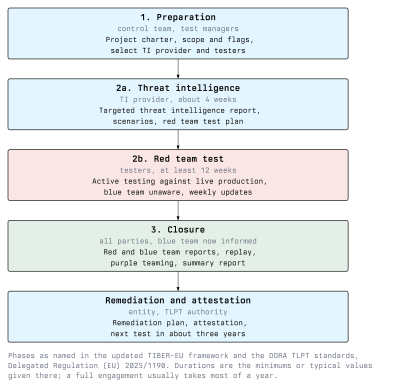

# Frameworks and Regulation

For most organisations a red team engagement is voluntary. For large parts of the European financial sector it is not. Banks, insurers and payment systems are so interconnected that a successful attack on one of them can affect many others, and supervisors want evidence that these institutions can withstand a capable attacker. Since 2018 the European Central Bank has offered a common framework for such tests, TIBER-EU. Since January 2025, DORA has made threat-led penetration testing mandatory for selected financial entities, using a method that is closely based on TIBER-EU.

This lecture describes both, the Austrian implementation TIBER-AT, and the British scheme CBEST that inspired them. Even outside the financial sector, these frameworks are the best public description of how a well-governed red team engagement works, and many companies borrow their structure for voluntary tests.

## TIBER-EU

**TIBER-EU** stands for *Threat Intelligence-Based Ethical Red Teaming*. The European Central Bank published the framework in May 2018 and has since updated it to align with the DORA standards on threat-led penetration testing. It is a framework, not a law: each country decides whether to adopt it, and it is then implemented by a national authority, usually the central bank, in a national implementation guide. According to the ECB, 21 European countries have adopted it, including Austria and Germany.

TIBER-EU defines:

- **who takes part:** the tested entity with its control team and blue team, an external threat intelligence provider, the red team testers, and a **TIBER Cyber Team** (TCT) at the authority, whose **test managers** accompany each test;
- **how a test runs:** in fixed phases, each with defined documents;
- **what the authority receives:** summaries and an **attestation** that the test was carried out according to the framework.

The attestation matters for organisations that operate in several countries. Because all participating authorities follow the same framework, a test in one country can be recognised in others, so a banking group does not have to repeat the same test for every supervisor.

Two principles shape every TIBER test. First, it runs against **live production systems**, not test environments, because only production shows how the organisation really defends itself. Second, it is **threat-led**: the scenarios come from threat intelligence about this specific organisation, prepared by an independent provider, not from the testers' preferences.

The ECB publishes guidance documents for each part of a test, among them control team guidance, purple teaming guidance, and templates for the scope specification, the targeted threat intelligence report, the red team test plan and the reports. They are free and worth reading even for a voluntary engagement.

## TIBER-AT

In Austria, the Oesterreichische Nationalbank (OeNB) and the Financial Market Authority (FMA) published the joint **TIBER-AT Implementation Guide** in November 2023. The TIBER Cyber Team is located at the OeNB and coordinates and accompanies tests in cooperation with the FMA. After a test, the FMA issues the attestation. The guide was revised in 2025 to reflect the DORA standards.

TIBER-AT gave Austrian financial institutions a way to prepare for mandatory TLPT under DORA by applying the same method voluntarily first. Germany has an equivalent implementation, TIBER-DE, run by the Deutsche Bundesbank.

## DORA Threat-Led Penetration Testing

The **Digital Operational Resilience Act** (Regulation (EU) 2022/2554) has applied since 17 January 2025 (see Module 26, Lecture 4). Its chapter on digital operational resilience testing has two levels:

- **Articles 24 and 25:** every financial entity in scope must run a testing programme appropriate to its size and risk, for example vulnerability assessments, network security assessments, scenario-based tests and penetration tests.
- **Articles 26 and 27:** financial entities identified by the competent authority must also carry out **advanced testing by means of threat-led penetration testing (TLPT)**.

The main rules for TLPT in Article 26:

| Rule | Content |
| --- | --- |
| Who | Financial entities identified by the competent authority, based on their importance for the financial sector and their risk profile |
| How often | At least every three years; the authority can change the frequency based on risk |
| What | Several or all critical or important functions, on live production systems |
| Third parties | ICT providers that support those functions are included; where needed, several financial entities can test a shared provider together (pooled testing) |
| Testers | Internal testers are allowed under conditions, but external testers must be used every three tests; significant credit institutions must use external testers only |
| Result | Summary of findings, remediation plans, and an attestation by the authority |

Article 27 sets requirements for testers. Among other things, they must have a strong reputation and the necessary technical and organisational skills, be certified by an accreditation body or follow formal codes of conduct or ethical frameworks, provide independent assurance about how they manage the risks of testing, and hold professional indemnity insurance.

### The TLPT standards

The details are set out in regulatory technical standards on TLPT, adopted as **Commission Delegated Regulation (EU) 2025/1190** and published in the Official Journal in June 2025. They follow the TIBER-EU structure closely. The standards use the term **control team** for what is often called the white team, and they define the **blue team** explicitly as staff who defend the entity's systems and are not aware of the test.

The standards also make some points binding that were previously good practice. A selection:

- Each test has a **control team lead** who is responsible for all test-related activities, and the control team is kept as small as possible.
- The threat intelligence provider is **external** to the financial entity.
- The financial entity must have **risk management for the test** itself: what could go wrong during the test, and how it is prevented (Lecture 3).
- The active red team test should take **at least 12 weeks**.
- **Replay and purple teaming** in the closure phase are mandatory.

## The Phases

TIBER-EU and the DORA standards describe the same sequence of phases. The figure shows it with the parties involved and typical durations.

### Preparation

The financial entity informs the authority, sets up the control team and agrees the formalities with the test managers. The key documents are:

- **Project charter / initiation documents:** who is involved, timeline, communication, confidentiality.
- **Scope specification:** which critical or important functions are tested, which systems support them, and which **flags** the red team should reach. The management body signs off the scope.
- **Selection of providers:** the threat intelligence provider and the red team testers are chosen and contracted. The frameworks expect the entity to check their qualifications, references and insurance (Article 27).

### Testing: threat intelligence

The threat intelligence provider analyses which threat actors are relevant for this entity, what they want and how they typically operate, and what an attacker could find out about the entity from public sources. The result is the **targeted threat intelligence report**, which proposes realistic attack scenarios. According to the DORA standards this phase typically takes about four weeks. The red team then turns the scenarios into a **red team test plan**, which the control team and the authority approve (Lecture 4).

### Testing: red team test

The red team carries out the plan against live production systems. The blue team does not know about the test. The red team reports progress to the control team at least weekly, and the control team decides about leg-ups, pauses and escalations. The active test takes at least 12 weeks under the DORA standards, because real attackers take their time and a rushed test is noisier and less realistic.

### Closure

When the active test ends, the blue team is informed. Under the DORA standards:

- the testers deliver the **red team test report** to the control team within four weeks;
- the blue team writes a **blue team test report** describing what it detected and how it responded, at the latest ten weeks after the end of the active test;
- red and blue team **replay** the attack together and run a **purple teaming** exercise on topics they choose jointly, also within ten weeks;
- all parties exchange feedback on the process;
- the entity submits a **summary report** of the findings to the authority.

### Remediation and attestation

The entity writes a **remediation plan** for the weaknesses found, the authority issues the **attestation**, and the clock for the next test starts. Lecture 5 covers reporting and remediation.

A full engagement, from the first meeting to the attestation, usually takes well over half a year. Most of that time is preparation, analysis and closure, not attacking.

## CBEST and Other Schemes

The Bank of England introduced **CBEST** for the UK financial sector in 2014. It was one of the first schemes for intelligence-led red teaming on behalf of a regulator, and TIBER-EU draws heavily on it: the separation between threat intelligence provider and red team, the testing of live systems and the involvement of the regulator all appear in CBEST first. CBEST uses accredited providers and is run together with the UK financial regulators.

Similar schemes exist elsewhere, for example in Hong Kong and Singapore. They differ in detail but share the same structure: an independent threat intelligence phase, a covert red team test on production systems, a small group in the tested organisation that steers the test, and a closure phase with remediation.

## Outside the Financial Sector

No EU law requires TLPT outside the financial sector. NIS2 requires essential and important entities to assess the effectiveness of their security measures (Article 21), but leaves the method open. Companies in energy, health or manufacturing that want a red team engagement can still use TIBER-EU as a template: it is public, well documented, and an auditor or supervisor will recognise its structure. The assignment in this module uses it exactly this way.

## Conclusion

TIBER-EU, published by the ECB in 2018, is the common European framework for threat intelligence-based red teaming in the financial sector. Austria implements it as TIBER-AT through the OeNB and the FMA. Since January 2025 DORA requires selected financial entities to carry out threat-led penetration testing at least every three years, with detailed rules in Delegated Regulation (EU) 2025/1190. All of these follow the same pattern: preparation with a small control team and an approved scope, independent threat intelligence, a covert test on live systems lasting several months, and a closure phase with reports, replay, purple teaming and remediation. The next lecture looks at the documents that keep such a test legal and safe.

## Resources

- **TIBER-EU framework and guidance**: <https://www.ecb.europa.eu/paym/cyber-resilience/tiber-eu/html/index.en.html>
- **TIBER-AT (FMA announcement)**: <https://www.fma.gv.at/en/oenb-and-fma-increasing-security-measures-against-cyber-attacks-in-the-financial-sector/>
- **DORA**: Regulation (EU) 2022/2554, Articles 24-27, available on EUR-Lex
- **TLPT standards**: Commission Delegated Regulation (EU) 2025/1190, available on EUR-Lex
- **CBEST**: Bank of England, <https://www.bankofengland.co.uk/>
