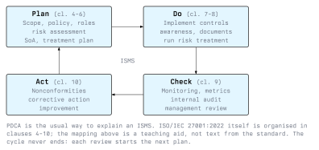

# Information Security Management Systems

Security measures that are introduced once and then left alone decay. Staff change, systems are replaced, new threats appear, and a firewall rule set that was correct three years ago is now full of exceptions nobody remembers. An **information security management system** (ISMS) is the answer to this problem. It is not a piece of software but a set of policies, processes, responsibilities and records that make an organisation manage security continuously: plan it, implement it, check it and improve it.

The most widely used standard for an ISMS is **ISO/IEC 27001**. This lecture explains its structure, the control catalogue in Annex A and ISO/IEC 27002, the Statement of Applicability, and how certification works.

## The ISO/IEC 27000 Family

ISO/IEC 27001 is one standard in a family. The ones a security professional meets most often:

| Standard | Content | Certifiable? |
| --- | --- | --- |
| ISO/IEC 27000 | Overview and vocabulary | No |
| ISO/IEC 27001 | Requirements for an ISMS | **Yes** |
| ISO/IEC 27002 | Guidance on implementing the controls of Annex A | No |
| ISO/IEC 27005 | Guidance on information security risk management (Lecture 3) | No |
| ISO/IEC 27017 / 27018 | Cloud security and protection of personal data in public clouds | No (used as an extension) |
| ISO/IEC 27701 | Extension for privacy information management | Yes (with or alongside 27001) |

Only ISO/IEC 27001 contains requirements ("the organization shall ...") that an auditor can check. ISO/IEC 27002 explains how the controls can be implemented ("should"), and an organisation is free to implement them differently.

The current edition is **ISO/IEC 27001:2022**, published in October 2022. Certificates based on the older 2013 edition had a transition period that ended in October 2025, so valid certificates today refer to the 2022 edition. An amendment in 2024 added a reference to climate change to the clauses on the context of the organisation; it does not change the controls.

## Structure: Clauses 4-10

Since 2013, ISO/IEC 27001 follows the same high-level structure as other ISO management system standards, such as ISO 9001 (quality) and ISO 14001 (environment). This makes it easier to run several management systems together. The requirements are in clauses 4 to 10:

| Clause | Title | What the organisation must do |
| --- | --- | --- |
| 4 | Context of the organization | Understand internal and external issues and interested parties, define the scope of the ISMS |
| 5 | Leadership | Top management commitment, information security policy, roles and responsibilities |
| 6 | Planning | Risk assessment and risk treatment process, Statement of Applicability, security objectives |
| 7 | Support | Resources, competence, awareness, communication, documented information |
| 8 | Operation | Run the risk assessments and implement the risk treatment plan |
| 9 | Performance evaluation | Monitoring and measurement, internal audit (9.2), management review (9.3) |
| 10 | Improvement | Handle nonconformities, take corrective action, improve continually |

The **scope** (clause 4.3) deserves attention. An organisation can certify only part of itself, for example one data centre or one product line. A certificate is only meaningful if you know its scope: "ISO 27001 certified" says little if the scope covers the marketing department but not the cloud platform you plan to buy.

## The PDCA Cycle

The usual way to explain how an ISMS works is the **Plan-Do-Check-Act** (PDCA) cycle, which comes from quality management. The 2022 standard no longer names PDCA explicitly, but its clauses map onto it:

- **Plan:** define scope and policy, assign roles, assess risks, decide on controls (clauses 4-6).
- **Do:** implement the controls, train staff, run the processes (clauses 7-8).
- **Check:** measure whether the controls work, run internal audits, review results with management (clause 9).
- **Act:** fix what is not working and improve (clause 10).

Then the cycle starts again. A management review that finds new risks feeds the next round of planning. This is the difference between an ISMS and a one-time security project.

## Annex A and ISO/IEC 27002

Annex A of ISO/IEC 27001:2022 lists **93 controls**, grouped into **four themes**:

| Theme | Annex A section | Number of controls | Examples |
| --- | --- | --- | --- |
| Organizational | A.5 | 37 | Information security policies, asset inventory, access control, supplier relationships, incident management, threat intelligence |
| People | A.6 | 8 | Screening, terms of employment, awareness and training, remote working, reporting security events |
| Physical | A.7 | 14 | Physical perimeters, entry controls, clear desk and clear screen, equipment maintenance, secure disposal |
| Technological | A.8 | 34 | Endpoint devices, privileged access, malware protection, vulnerability management, backup, logging, network security, secure coding |

The 2013 edition had 114 controls in 14 domains. The 2022 revision merged many of them, and added 11 new controls, among them threat intelligence (A.5.7), information security for the use of cloud services (A.5.23), ICT readiness for business continuity (A.5.30), configuration management (A.8.9), data leakage prevention (A.8.12), monitoring activities (A.8.16), web filtering (A.8.23) and secure coding (A.8.28).

Annex A lists each control in one or two sentences. **ISO/IEC 27002:2022** has the same 93 controls with a purpose, implementation guidance and further information for each. It also tags every control with **attributes**, for example the control type (preventive, detective, corrective), the security property it protects (confidentiality, integrity, availability) and the cybersecurity concept (identify, protect, detect, respond, recover, matching the NIST CSF functions of Lecture 4). The attributes let an organisation filter the catalogue in different ways.

Annex A is a reference list, not a mandatory checklist. The organisation decides which controls it needs based on its risk assessment, and it may add controls that are not in Annex A.

## The Statement of Applicability

The **Statement of Applicability** (SoA) is required by clause 6.1.3 d). It is the key document of an ISMS and usually the first thing an auditor or a customer asks for. For every one of the 93 Annex A controls it states:

- whether the control is applicable,
- why it was included or excluded,
- whether it is implemented.

An excerpt for a small software company might look like this:

| Control | Applicable | Justification | Status |
| --- | --- | --- | --- |
| A.5.23 Cloud services | Yes | Source code and email are hosted in the cloud | Implemented |
| A.7.4 Physical security monitoring | Yes | Office contains the build server | Planned Q3 |
| A.8.28 Secure coding | Yes | We develop software for customers | Implemented |
| A.8.11 Data masking | No | No production personal data used outside production; risk assessment R-14 | - |

A justification such as "not relevant" is not enough. The exclusion must follow from the risk assessment or from the scope.

## Documented Information

The standard requires certain documented information, including the scope, the information security policy, the risk assessment and risk treatment process and their results, the SoA, the security objectives, evidence of competence, monitoring results, the internal audit programme and results, management review results, and records of nonconformities and corrective actions. Beyond that, the organisation decides how much documentation it needs. A common mistake is to produce hundreds of pages nobody reads; auditors look for evidence that the processes are actually lived.

## Certification

An organisation can have its ISMS certified by an independent **certification body**. In Austria certification bodies are accredited by **Akkreditierung Austria**, which is part of the Federal Ministry of Economy, Energy and Tourism (BMWET); in Germany by the **DAkkS** (Deutsche Akkreditierungsstelle). A certificate from a body without accreditation carries much less weight.

The certification cycle runs over three years:

| Step | What happens |
| --- | --- |
| Stage 1 audit | Review of documentation and readiness: scope, policy, risk assessment, SoA. Often partly remote. |
| Stage 2 audit | On-site check that the ISMS is implemented and effective: interviews, samples, technical evidence |
| Certificate | Issued if there are no open major nonconformities, valid for three years |
| Surveillance audits | Usually once a year in years two and three, checking parts of the ISMS |
| Recertification | Full audit before the three years expire |

Auditors classify findings as **major nonconformities** (a requirement is not met at all, or a systematic failure; blocks certification until fixed), **minor nonconformities** (an isolated lapse) and **observations** or opportunities for improvement.

In Germany, the BSI also offers **ISO 27001 certification on the basis of IT-Grundschutz**, which combines the ISO requirements with the BSI methodology (Lecture 4). It is common in the public sector and among KRITIS operators.

### What a certificate does and does not mean

A certificate shows that an organisation has a working management system for its stated scope: it assesses risks, decides on controls and improves. It does not show that the organisation is secure or that it has chosen strong controls. Certified companies are breached too. When you assess a supplier, read the scope and ask for the SoA, rather than relying on the logo.

## Conclusion

An ISMS makes security a continuous process instead of a one-time project. ISO/IEC 27001:2022 defines the requirements in clauses 4-10 and lists 93 reference controls in four themes in Annex A, with implementation guidance in ISO/IEC 27002. The Statement of Applicability connects the risk assessment to the chosen controls, and an accredited certification body checks the whole system in a three-year cycle. The heart of the ISMS is the risk assessment, which is the topic of the next lecture.

## Resources

- **ISO/IEC 27001:2022**: Information security, cybersecurity and privacy protection - Information security management systems - Requirements (available from ISO and national standards bodies such as Austrian Standards and DIN)
- **ISO/IEC 27002:2022**: Information security controls
- **ISO 27001 overview**: <https://www.iso.org/standard/27001>
- **Akkreditierung Austria**: the national accreditation body, part of the Federal Ministry of Economy, Energy and Tourism (BMWET); it publishes the list of accredited certification bodies
- **BSI ISO 27001 certification on the basis of IT-Grundschutz**: <https://www.bsi.bund.de/>
